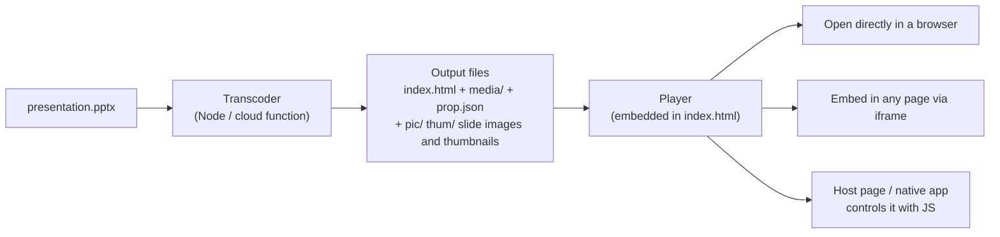

English | [中文](README.md)

# unppt

**Turn PowerPoint files (.pptx) into web pages that play in the browser and look the same as in Microsoft PowerPoint.**

You have a .pptx lesson or presentation and want to play it on a website, in an app or in an online classroom, without asking users to install Office and without flattening it into static images (which loses animations, transitions and video). That is what unppt does: one command turns a .pptx into **one self-contained HTML file** (double-click to play) containing vector SVG pages and a zero-dependency player. Animations, slide transitions, audio/video and hyperlinks are kept. The HTML can be embedded in any web page with an `<iframe>`, and the host page or a native app can control it with JS (next slide, play animations, and so on).

[](https://www.npmjs.com/package/@unppt/unppt)
[](LICENSE)



> Terms: **SVG** is a vector image format that browsers display natively and that stays sharp when zoomed; an **iframe** is the HTML tag that embeds one web page inside another; the **transcoder** is the program that turns a .pptx into web files, and the **player** is the JS that plays those files in the browser.

## Features

- **Matches PowerPoint**: during development, images exported by a local copy of PowerPoint are the "answer key"; every page is compared and scored automatically (see "Status and accuracy" below).
- **One file to play**: the default output is a single self-contained HTML file (named after the input when `-o` is not given) holding the player, pages, fonts and small images; it works from a local double-click, any static server or a CDN.
- **Animations and transitions**: entrance, exit, emphasis and motion-path animations, triggers, automatic advance timings, slide transitions, audio and video.
- **Embeddable and controllable**: cross-origin iframe embedding; control it via `postMessage` (the standard browser way for different pages to message each other), the same-page `window.unppt` object, or a native app's WebView, and receive events such as slide changes and end of show.
- **Live-class sync**: presenter and watch modes; the watch side follows the teacher with the `sync` command (see [examples/live-class.html](examples/live-class.html)).
- **The transcoder is a pure function**: bytes in, files out; it does not touch the disk or the network and needs no external programs or native add-ons (slide images and thumbnails use the bundled resvg WASM), so it runs in cloud functions as is.
- **Big files, little memory**: the input is read by position, so 1 GB-class files convert with little memory.
- **Zero-dependency player**: about 58 KB (about 21 KB gzipped); supports Chrome, Firefox and mobile WebViews.
- **Several output forms**: a single HTML file (default), on-demand loading (one data file per slide), or one HTML per slide.

## Side-by-side comparison

In each image below **Microsoft PowerPoint is on the left and unppt on the right** (the content is a neutral test case made with PowerPoint).

| Charts | SmartArt |
|---|---|
|  |  |
| **Text effects** | **3D shapes** |
|  |  |

More: [table styles](docs/images/compare-table-styles.png), [chart data labels](docs/images/compare-charts-point-labels.png), [all shapes](docs/images/compare-shapes-all.png).

The player (click, arrow keys, space bar or swipe left/right to move on):


## Status and accuracy

Current version: **0.2.1**.

Accuracy is measured with **SSIM** (structural similarity, a number from 0 to 1 where 1 means the two images are identical): each page drawn by unppt is compared with the image PowerPoint exports, and **a page passes when SSIM ≥ 0.95**.

| Test set | Size | Conversion failures | Pass rate (SSIM ≥ 0.95) | Mean SSIM |
|---|---|---|---|---|
| Synthetic test cases (`testcases/`) | 228 decks / 504 pages | — | 92.3% | 0.984 |
| Random batch of real-world decks | 100 decks / 3527 pages | 0 | 78.8% (about 95% of pages at SSIM ≥ 0.90) | 0.967 |

Most failing pages differ only in details (text a few pixels off, one chart label in a different place) and look the same at a glance.

**Known gaps**:

- time scaling on chart date axes (min / max, month / year intervals);
- vertical WordArt text (`wordArtVert`);
- variable fonts;
- EMF+ records inside EMF images;
- some SmartArt that needs re-layout;
- 3D bevel under 180-degree rotation;
- the truncation threshold for category labels rotated 45 degrees.

If a deck does not look right, please open an issue (make sure the file can be shared publicly, or rebuild a deck with neutral content that reproduces the problem).

## 5-minute quick start

You need [Node.js](https://nodejs.org/) **20.12 or later** (run `node -v` to check).

**Step 1: convert a file with npx, no install needed**

```bash
npx @unppt/unppt presentation.pptx --system-fonts
```

**Or install globally and use the `unppt` command**

```bash
npm install -g @unppt/unppt
unppt presentation.pptx -o out/index.html --system-fonts
```

**Or download and install from GitHub** (while npm reviews a new version, or behind a corporate mirror; see [Getting started](docs/en/getting-started.md))

```powershell
Invoke-WebRequest https://github.com/spitmaster/unppt/releases/latest/download/unppt.tgz -OutFile unppt.tgz
npm install -g .\unppt.tgz
```

macOS / Linux (in Terminal):

```bash
curl -L -o unppt.tgz https://github.com/spitmaster/unppt/releases/latest/download/unppt.tgz
npm install -g ./unppt.tgz
```

If you get a permission error (`EACCES` / `permission denied`), prefix the second line with `sudo` (`sudo npm install -g ./unppt.tgz`) and enter your login password. Run `unppt -v` afterwards to check the version.

`--system-fonts` lays text out with the fonts installed on your machine, so line breaks match PowerPoint (fonts are explained in [docs/en/usage.md](docs/en/usage.md)).

**Step 2: open the output**

Open the generated `.html` file in a browser (without `-o` it has the same name as the input and sits in the same folder) and it plays.

**Command-line options** (run `unppt` with no arguments for the built-in help, or see the [usage guide](docs/en/usage.md)):

| Option | Meaning |
|---|---|
| `-o, --out <file>` | Output file, defaults to a `.html` with the input's name; for the `paged` / `pages` forms it is an output folder |
| `--output <form>` | Output form: `single` (default, one self-contained HTML), `paged` (on-demand loading), `pages` (paged plus one HTML per slide), `data` (same as `--data`) |
| `--fonts <dir>` | Font folder (repeatable); text is laid out with real glyph widths |
| `--system-fonts` | Use the system font folders; Office's private fonts and cloud fonts (Aptos, Gill Sans MT, ...) are used too and embedded in the output when used (browsers cannot use these fonts since they are not installed in the system) |
| `--embed-fonts` | Embed subsets of the fonts used (viewers need no installed fonts and see exactly what was laid out; mind licensing for commercial fonts) |
| `--data` | Output only the deck data `deck.json` (for development and debugging) |
| `--no-images` | Do not output slide images `pic/` and thumbnails `thum/` (`prop.json` is still written) |
| `--jobs <n\|auto>` | How many threads draw slide images in parallel, default `auto`; `1` draws on the main thread |
| `--inline-limit <bytes>` | Images smaller than this are inlined into the HTML, default 2097152 (2 MB); video and audio always go to `media/` |
| `--stats` | Print time taken and peak memory at the end |
| `-q, --quiet` | Do not show progress |

## Using it from code (cloud functions etc.)

```bash
npm install @unppt/unppt
```

```js
import { convert } from '@unppt/unppt';

const result = await convert(pptxBytes, {        // pptxBytes: Uint8Array
  // you write the output: index.html, prop.json, media/xxx.mp4, pic/1.jpg ...
  write: async (path, data) => { /* data is a string, a Uint8Array or a stream (AsyncIterable) */ },
  fonts: [fontBytes1, fontBytes2],   // optional: font file contents (ttf / otf / ttc)
  embedFonts: true,                  // optional: embed font subsets (off by default)
});
console.log(result.slides, result.report.missingFonts, result.report.warnings);
```

**Big files**: do not read the whole file into memory; pass an object that "reads by position" and the transcoder reads only the parts it needs:

```js
import { open, stat } from 'node:fs/promises';

const size = (await stat('big.pptx')).size;
const fh = await open('big.pptx');
const source = {
  size,
  read: async (offset, length) => {
    const buf = new Uint8Array(length);
    const { bytesRead } = await fh.read(buf, 0, length, offset);
    return buf.subarray(0, bytesRead);
  },
};
await convert(source, { write });
await fh.close();
```

Measured: a 300-slide file with 800 MB of video, under a 128 MB memory limit, converts in about 1 second with about 120 MB peak memory.

All options (`output`, `images`, `rasterWasm`, `rasterPool`, `onProgress`, ...) are in the [usage guide](docs/en/usage.md).

## Embedding and external control (JS bridge)

```html
<iframe id="ppt" src="https://cdn.example.com/deck/index.html?ui=0"></iframe>
<script type="module">
  import { UnpptFrame } from './host.js';      // repository build output packages/player/dist/host.js
  const deck = new UnpptFrame(document.getElementById('ppt'));
  await deck.ready;
  await deck.next();          // next step (plays pending animations first, then moves to the next slide)
  await deck.goto(3, 0);      // go to slide 4, step 0 (slide numbers start at 0)
  deck.on('change', (s) => console.log(s.slide, s.step, s.slideCount, s.stepCount));
</script>
```

You can also post messages directly without `host.js`:

```js
iframe.contentWindow.postMessage({ unppt: 1, id: 1, cmd: 'goto', args: { slide: 3, step: 0 } }, '*');
// player reply: { unppt: 1, re: 1, ok: true, result: { slide, step, slideCount, stepCount } }
// player event: { unppt: 1, event: 'ready' | 'change' | 'end' | 'link', data: { ... } }
```

Commands are `next`, `prev`, `goto`, `sync` and `getState`; on the same page use `window.unppt.next()` and friends, and native apps call `window.unppt.handle('{"cmd":"next"}')`. Common URL parameters: `slide`, `step` (initial position), `ui=0` (hide built-in buttons), `timings=0/1`, `origin=` (restrict message origins), `mode=watch` (watch mode), `links=0` (let the host handle external links).

The full reference (Android / iOS / React Native, hidden-slide rules, every URL parameter, sequence diagrams) is in [Embedding and control](docs/en/embedding.md); runnable examples are [examples/iframe-host.html](examples/iframe-host.html) and [examples/live-class.html](examples/live-class.html).

## Documentation map

**User docs** (read top to bottom):

| Document | Contents |
|---|---|
| [Getting started](docs/en/getting-started.md) | From zero: install Node, convert your first file, play it |
| [Usage guide](docs/en/usage.md) | Every CLI and `convert()` option, fonts, output forms, big files |
| [Embedding and control](docs/en/embedding.md) | iframe, postMessage, `window.unppt`, native apps, URL parameters |
| [Output format](docs/en/output-format.md) | What each output file is; the structure of `deck.json` / `prop.json` |
| [Architecture overview](docs/en/architecture.md) | The parts of the program and how they fit together (lots of diagrams) |
| [How transcoding works](docs/en/transcoding.md) | From the entry point: how a .pptx becomes SVG step by step |
| [How the player works](docs/en/player.md) | How the player shows pages, runs animations, handles navigation and external commands |
| [Accuracy and evaluation](docs/en/fidelity.md) | What "same as PowerPoint" means and how pages are compared and scored |
| [FAQ](docs/en/faq.md) | Wrong fonts, large files, cross-origin embedding and more |

**Developer docs** (in Chinese):

| Document | Contents |
|---|---|
| [SPEC.md](SPEC.md) | Source of truth for requirements: confirmed decisions, PowerPoint rules found by measurement |
| [docs/architecture.md](docs/architecture.md) | Developer architecture: module layers, extension points (how to add capabilities) |
| [CONTRIBUTING.md](CONTRIBUTING.md) | Collaboration conventions |
| [docs/release.md](docs/release.md) | How to publish to npm |

## Development

```bash
git clone https://github.com/spitmaster/unppt.git
cd unppt
npm install
npm run build
npm test
node packages/transcoder/dist/cli.js presentation.pptx -o out/index.html --system-fonts
```

| Command | Purpose |
|---|---|
| `npm run build` | Build the transcoder and the player |
| `npm test` | Unit tests |
| `python tools/make-case/make.py` | Generate test cases (neutral content) into `testcases/` with PowerPoint |
| `python tools/powerpoint/export.py run [--set testcases]` | Export reference images (the answer key) with PowerPoint |
| `python tools/compare/run.py --set testcases\|daily\|all` | Convert, screenshot, compare with PowerPoint, write a report |
| `python tools/check-player.py [chromium\|firefox]` | Player end-to-end tests (cross-origin iframe, native bridge, ...) |
| `python tools/powerpoint/transitions.py capture name,... / capture-anim name,... / compare` | Transition and animation comparison: frame-by-frame PowerPoint slideshow captures vs. the player at the same moments |

The development tools need Windows + PowerPoint + Python (`pip install pywin32 numpy pillow playwright fonttools`); using the transcoder and player does not.

**Sample safety**: real-world samples live in `samples/` (not in the repository), and everything generated from them lives only in `.cache/` (not in the repository). See section 4 of [SPEC.md](SPEC.md).

## License

[Apache-2.0](LICENSE). Third-party library licenses are listed in [packages/transcoder/THIRD-PARTY-NOTICES.md](packages/transcoder/THIRD-PARTY-NOTICES.md).
