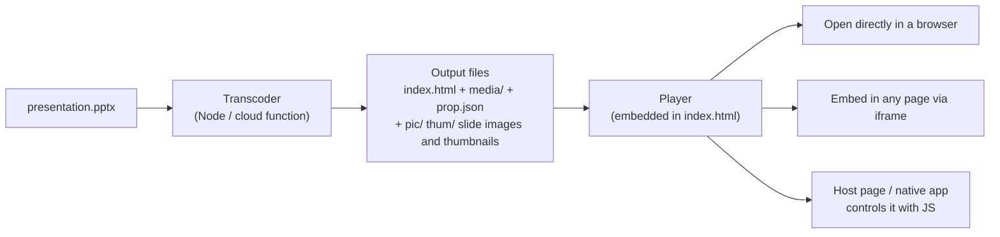
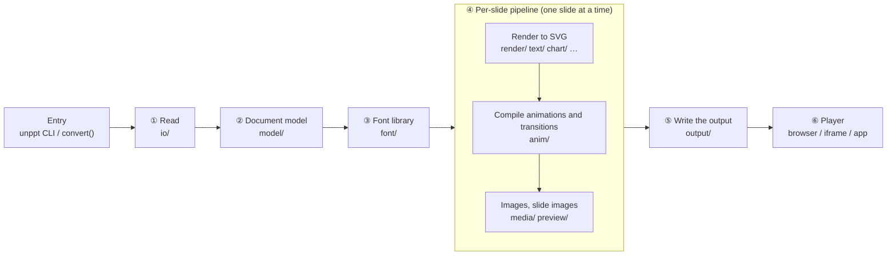

**English** | [简体中文](README.zh.md)

# unppt

Convert PowerPoint decks (.pptx) into web pages with one command: open in a browser to play, with animations, transitions, audio and video kept and the look matching PowerPoint; embed them in any web page or app and control them from code.

[](https://www.npmjs.com/package/@unppt/unppt)
[](LICENSE)

## Install

Requires [Node.js](https://nodejs.org/) 20.12 or later.

```bash
npm install -g @unppt/unppt
```

## Usage

```bash
unppt deck.pptx
```

Open the generated `deck/index.html` in a browser to play it.

More usage, options, embedding in web pages, calling it from code → [docs/en/usage.md](docs/en/usage.md)

## Features

From .pptx to playback:



> Terms: **SVG** is a vector image format that browsers display natively and that stays sharp when zoomed; an **iframe** is the HTML tag that embeds one web page inside another; the **transcoder** is the program that turns a .pptx into web files, and the **player** is the JS that plays those files in the browser.

- **Matches PowerPoint**: during development, images exported by a local copy of PowerPoint are the "answer key"; every page is compared and scored automatically (see "Status and accuracy" below).
- **Fast to open, made for online viewing**: the CLI writes the on-demand form by default (without `-o` it goes into a new folder named after the .pptx, e.g. `deck/index.html`): the entry HTML is only tens of KB and each slide's data and images load when that slide is shown, with the next one preloaded; works from a local double-click, any static server or a CDN. `--output single` gives one self-contained HTML file for sending as an attachment.
- **Animations and transitions**: entrance, exit, emphasis and motion-path animations, triggers, automatic advance timings, slide transitions, audio and video.
- **Embeddable and controllable**: cross-origin iframe embedding; control it via `postMessage` (the standard browser way for different pages to message each other), the same-page `window.unppt` object, or a native app's WebView, and receive events such as slide changes and end of show.
- **Live-class sync**: presenter and watch modes; the watch side follows the teacher with the `sync` command (see [examples/live-class.html](examples/live-class.html)).
- **The transcoder is a pure function**: bytes in, files out; it does not touch the disk or the network and needs no external programs or native add-ons (slide images and thumbnails use the bundled resvg WASM), so it runs in cloud functions as is.
- **Big files, little memory**: the input is read by position, so 1 GB-class files convert with little memory.
- **Zero-dependency player**: about 58 KB (about 21 KB gzipped); supports Chrome, Firefox and mobile WebViews.
- **Several output forms**: on-demand loading (the CLI default, one data file per slide), a single HTML file (the `convert()` default), or on-demand loading plus one HTML per slide.

## Side-by-side comparison

In each image below **Microsoft PowerPoint is on the left and unppt on the right** (the content is a neutral test case made with PowerPoint).

| Charts | SmartArt |
|---|---|
|  |  |
| **Text effects** | **3D shapes** |
|  |  |

More: [table styles](docs/images/compare-table-styles.png), [chart data labels](docs/images/compare-charts-point-labels.png), [all shapes](docs/images/compare-shapes-all.png).

The player (click, arrow keys, space bar or swipe left/right to move on):


## How it works

**In one sentence: everything that can be computed at conversion time is computed at conversion time; the player only displays and plays.** PowerPoint's inheritance, text layout, chart and animation rules are all worked out in the transcoder from measured behaviour: each slide becomes a vector SVG (with every character already positioned) and animations become "what happens on each click" data. The transcoder and the player talk only through the [output format](docs/en/output-format.md), so they can be deployed and upgraded independently.



| Step | Why it exists | What it does | Details |
|---|---|---|---|
| Entry `cli.ts` / `convert()` | The CLI, servers and cloud functions share one pure function | Input is bytes or a "read at offset" object; all output goes to a `write` callback; the transcoder itself never touches the disk or the network | [Transcoding 3–4](docs/en/transcoding.md#3-one-conversion-end-to-end-overview) |
| ① Read `io/` | A .pptx is a ZIP full of XML, possibly gigabytes in size | Reads only the ZIP directory and inflates a part when it is needed; audio and video stream straight from the ZIP, never held in memory | [5](docs/en/transcoding.md#5-step-2-reading-the-zip-and-xml-lazily) |
| ② Document model `model/` | A shape's colour, font or position may come from the theme, master, layout or slide | Builds the theme → master → layout → slide inheritance chain and merges placeholders, colours and text styles the way PowerPoint does | [6](docs/en/transcoding.md#6-step-3-the-presentation-model) |
| ③ Font library `font/` | Line breaks depend on character widths, and viewers do not have these fonts | Embedded fonts > explicit fonts > default font pack; layout uses the original font's metrics, display uses an open-source font | [11](docs/en/transcoding.md#11-fonts-lookup-substitution-embedding-and-subsetting) |
| ④ Render `render/` etc. | Browsers know nothing about PowerPoint shapes, effects or charts and cannot reproduce its line breaks | Draws preset shapes, fills and lines, shadows and glow, 3D, tables, charts and SmartArt as SVG; breaks text by PowerPoint's measured rules and fixes every character's position | [7–9](docs/en/transcoding.md#7-step-4-rendering-each-slide-to-svg) |
| ④ Animations `anim/` | PowerPoint animations are a deep timing tree the player should not have to understand | Compiles them into "what happens on each click", carrying PowerPoint's original keyframes and formulas along | [10](docs/en/transcoding.md#10-animations-and-transitions) |
| ④ Media and slide images `media/` `preview/` | Browsers cannot show EMF / WMF / TIFF; listings and sharing need previews | Converts and de-duplicates images; draws each slide as a full image and a thumbnail with resvg (WASM) | [12–13](docs/en/transcoding.md#12-images-audio-and-video) |
| ⑤ Write `output/` | Some want one file to attach, others want on-demand loading from a CDN | Subsets fonts to the characters used (HarfBuzz WASM) and writes the HTML, per-slide data and `prop.json` for the chosen output form | [14](docs/en/transcoding.md#14-writing-the-output-four-output-forms) |
| ⑥ Player `packages/player` | The output must embed in any web page or app | Zero dependencies: shows the SVG, pages, plays animations and transitions, responds to the host's commands | [How the player works](docs/en/player.md) |

Key design decisions (the full picture is in [Architecture](docs/en/architecture.md)):

- **Lay out text ourselves instead of leaving it to the browser**: browsers break lines and measure text differently from PowerPoint and from each other. Every line-breaking rule (CJK line-start / line-end rules, hanging punctuation, dashes, tab stops, ...) is measured in PowerPoint first and then implemented, and recorded in [SPEC section 7](SPEC.md#7-实测得到的-powerpoint-规则用-make-case-用例校准) (Chinese).
- **Separate fonts for layout and display**: non-embedded Microsoft YaHei, Calibri and so on are laid out with the original font's metrics (numbers such as advance widths, no glyph shapes), so lines break exactly like PowerPoint; glyphs come from the matching open-source font, so viewers need no fonts installed and no commercial font is redistributed (see "Fonts" below).
- **Pure function, streaming**: bytes in, files out, no external programs or native add-ons, so it runs in cloud functions; slides are processed one at a time and the input is read at offsets, so a 1 GB file converts in little memory.
- **New feature = new file + one registry line**: chart types, image formats, shape effects, transitions and animation effects are all extension points; see the [developer architecture notes](docs/architecture.md) (Chinese).
- **"Looks like PowerPoint" is measured, not eyeballed**: images exported by a local copy of PowerPoint are scored page by page, and line wrapping has its own line-by-line test; each class of problem is first reproduced with a neutral synthetic deck and measured, and every change is A/B compared; customer decks are only used on the local machine and their content never leaves it. See [Fidelity and evaluation](docs/en/fidelity.md).

## Status and accuracy

Current version: **0.3.2**. Full breakdown in the [test report](docs/en/test-report.md).

How we measure "looks the same": every slide unppt produces is compared with the image PowerPoint itself exports for that slide, giving a **similarity score** (0 to 1, **1 = looks identical**). **A slide passes at 0.95 or more**; the remaining differences are usually details like text a pixel or two off. The score is SSIM, a standard image-comparison method; see [Fidelity](docs/en/fidelity.md#ssim) for exactly how it is computed.

| Decks tested | Size | Failures | Slides passing (≥ 0.95) | Average similarity |
|---|---|---|---|---|
| Feature test decks (`testcases/`) | 255 decks / 543 pages | 0 | 93.0% | 0.984 |
| Real-world decks | 5212 decks / 168662 slides | 0 | 78.5% (95.6% above 0.90) | 0.965 |

Most failing pages differ only in details (text a few pixels off, one chart label in a different place) and look the same at a glance. **Line wrapping** is also compared line by line: across 991 real decks, 99.8% of about 40,000 multi-line text boxes and 99.9% of 6,051 multi-line table cells break exactly like PowerPoint. All 5,212 real decks (about 169,000 slides) convert with no failures.

**Known gaps**:

- time scaling on chart date axes (min / max, month / year intervals);
- vertical WordArt text (`wordArtVert`);
- EMF+ records inside EMF images;
- some SmartArt that needs re-layout;
- 3D bevel under 180-degree rotation;
- the truncation threshold for category labels rotated 45 degrees.

If a deck does not look right, please open an issue (make sure the file can be shared publicly, or rebuild a deck with neutral content that reproduces the problem).

## Fonts

- **Playback never uses fonts on the viewer's computer**: every character used is packed into the output as a font subset, so Windows, Mac, Android and iPhone viewers see exactly the same thing (e.g. thousands of students in a live class); only characters that no font has are left to the browser, and `unppt check` lists them.
- **Fonts in the output come from only two sources** (unless you explicitly specify fonts with `--fonts` / `--system-fonts`): fonts the author embedded in the PPT (used as-is), and open-source fonts from the default font pack `@unppt/fonts` (SIL OFL 1.1: Noto Sans SC, Noto Serif SC, LXGW WenKai, Zhuque Fangsong, Carlito, Caladea, Liberation and others). The pack is only needed on the machine that converts; viewers never download it.
- **Non-embedded fonts**: laid out with the original font's metrics and displayed with the matching open-source font (Microsoft YaHei → Noto Sans SC, Calibri → Carlito, ...), so lines break like PowerPoint and glyph shapes differ slightly; fonts the pack does not know are substituted the way PowerPoint does (so are Source Han Sans / Serif when not embedded, matching PowerPoint on computers that do not have them).
- **Symbol fonts**: your characters are never changed. Wingdings 1–3 that are not embedded display as symbols through code-compatible open fonts in the pack; other symbol fonts (Webdings, Symbol, ...) show as letters or boxes when not embedded, and `unppt check` tells the author to "Embed fonts in the file".

Details: [Getting started, section 7](docs/en/getting-started.md#7-fonts-why-they-matter-and-how-they-are-handled-now).

## Using it from code (cloud functions etc.)

```bash
npm install @unppt/unppt
```

```js
import { convert } from '@unppt/unppt';
import { loadFontPack } from '@unppt/unppt/node';   // Node only: reads the installed default font pack

const fontPack = await loadFontPack();               // no system fonts needed on servers or cloud functions
const result = await convert(pptxBytes, {        // pptxBytes: Uint8Array
  // you write the output: index.html, prop.json, media/xxx.mp4, pic/1.jpg ...
  write: async (path, data) => { /* data is a string, a Uint8Array or a stream (AsyncIterable) */ },
  fontPack,                          // default font pack: same result as converting on a desktop
  fonts: [fontBytes1],               // optional: your own font files (ttf / otf / ttc); win over the pack for the same name
});
console.log(result.slides, result.fontCheck, result.report.warnings);
```

To check fonts only, without writing files: `checkFonts(pptxBytes, { fontPack })`; it returns the same data as `unppt check --json`.

**Big files**: do not read the whole file into memory; pass an object that "reads by position" and the transcoder reads only the parts it needs:

```js
import { open, stat } from 'node:fs/promises';

const size = (await stat('big.pptx')).size;
const fh = await open('big.pptx');
const source = {
  size,
  read: async (offset, length) => {
    const buf = new Uint8Array(length);
    const { bytesRead } = await fh.read(buf, 0, length, offset);
    return buf.subarray(0, bytesRead);
  },
};
await convert(source, { write, fontPack });
await fh.close();
```

Measured: a 300-slide file with 800 MB of video, under a 128 MB memory limit, converts in about 1 second with about 120 MB peak memory.

All options (`output`, `images`, `rasterWasm`, `rasterPool`, `onProgress`, ...) are in the [usage guide](docs/en/usage.md).

## Embedding and external control (JS bridge)

```html
<iframe id="ppt" src="https://cdn.example.com/deck/index.html?ui=0"></iframe>
<script type="module">
  import { UnpptFrame } from './host.js';      // repository build output packages/player/dist/host.js
  const deck = new UnpptFrame(document.getElementById('ppt'));
  await deck.ready;
  await deck.next();          // next step (plays pending animations first, then moves to the next slide)
  await deck.goto(3, 0);      // go to slide 4, step 0 (slide numbers start at 0)
  deck.on('change', (s) => console.log(s.slide, s.step, s.slideCount, s.stepCount));
</script>
```

You can also post messages directly without `host.js`:

```js
iframe.contentWindow.postMessage({ unppt: 1, id: 1, cmd: 'goto', args: { slide: 3, step: 0 } }, '*');
// player reply: { unppt: 1, re: 1, ok: true, result: { slide, step, slideCount, stepCount } }
// player event: { unppt: 1, event: 'ready' | 'change' | 'end' | 'link', data: { ... } }
```

Commands are `next`, `prev`, `goto`, `sync` and `getState`; on the same page use `window.unppt.next()` and friends, and native apps call `window.unppt.handle('{"cmd":"next"}')`. Common URL parameters: `slide`, `step` (initial position), `ui=0` (hide built-in buttons), `timings=0/1`, `origin=` (restrict message origins), `mode=watch` (watch mode), `links=0` (let the host handle external links).

The full reference (Android / iOS / React Native, hidden-slide rules, every URL parameter, sequence diagrams) is in [Embedding and control](docs/en/embedding.md); runnable examples are [examples/iframe-host.html](examples/iframe-host.html) and [examples/live-class.html](examples/live-class.html).

## Documentation map

**User docs** (read top to bottom):

| Document | Contents |
|---|---|
| [Getting started](docs/en/getting-started.md) | From zero: install Node, convert your first file, play it |
| [Usage guide](docs/en/usage.md) | Every CLI and `convert()` option, fonts, output forms, big files |
| [Embedding and control](docs/en/embedding.md) | iframe, postMessage, `window.unppt`, native apps, URL parameters |
| [Output format](docs/en/output-format.md) | What each output file is; the structure of `deck.json` / `prop.json` |
| [Architecture overview](docs/en/architecture.md) | The parts of the program and how they fit together (lots of diagrams) |
| [How transcoding works](docs/en/transcoding.md) | From the entry point: how a .pptx becomes SVG step by step |
| [How the player works](docs/en/player.md) | How the player shows pages, runs animations, handles navigation and external commands |
| [Accuracy and evaluation](docs/en/fidelity.md) | What "same as PowerPoint" means and how pages are compared and scored |
| [FAQ](docs/en/faq.md) | Wrong fonts, large files, cross-origin embedding and more |

**Developer docs** (in Chinese):

| Document | Contents |
|---|---|
| [SPEC.md](SPEC.md) | Source of truth for requirements: confirmed decisions, PowerPoint rules found by measurement |
| [docs/architecture.md](docs/architecture.md) | Developer architecture: module layers, extension points (how to add capabilities) |
| [CONTRIBUTING.md](CONTRIBUTING.md) | Collaboration conventions |
| [docs/release.md](docs/release.md) | How to publish to npm |

## Development

```bash
git clone https://github.com/spitmaster/unppt.git
cd unppt
npm install
node scripts/fetch-fonts.mjs      # once: download the default font pack's font files (not in git) and verify SHA-256
npm run build
npm test
node packages/transcoder/dist/cli.js presentation.pptx -o out/index.html
```

| Command | Purpose |
|---|---|
| `npm run build` | Build the transcoder and the player |
| `npm test` | Unit tests |
| `python tools/make-case/make.py` | Generate test cases (neutral content) into `testcases/` with PowerPoint |
| `python tools/powerpoint/export.py run [--set testcases]` | Export reference images (the answer key) with PowerPoint |
| `python tools/compare/run.py --set testcases\|daily\|all` | Convert, screenshot, compare with PowerPoint, write a report |
| `python tools/check-player.py [chromium\|firefox]` | Player end-to-end tests (cross-origin iframe, native bridge, ...) |
| `python tools/powerpoint/transitions.py capture name,... / capture-anim name,... / compare` | Transition and animation comparison: frame-by-frame PowerPoint slideshow captures vs. the player at the same moments |

The development tools need Windows + PowerPoint + Python (`pip install pywin32 numpy pillow playwright fonttools`); using the transcoder and player does not.

**Sample safety**: real-world samples live in `samples/` (not in the repository), and everything generated from them lives only in `.cache/` (not in the repository). See section 4 of [SPEC.md](SPEC.md).

## License

[Apache-2.0](LICENSE). Third-party library licenses are listed in [packages/transcoder/THIRD-PARTY-NOTICES.md](packages/transcoder/THIRD-PARTY-NOTICES.md).
