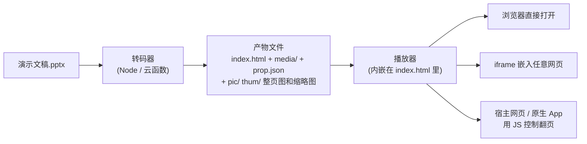
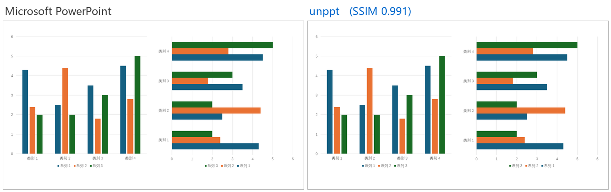
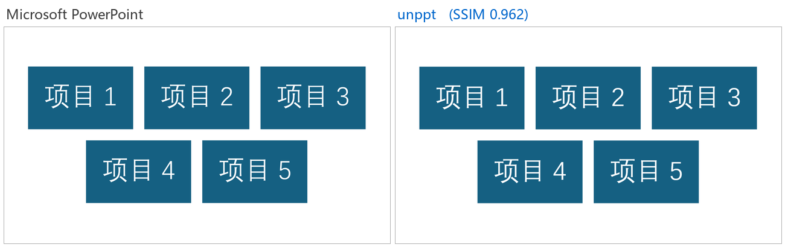
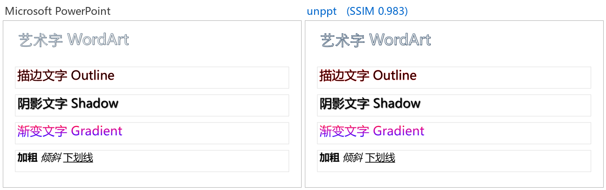
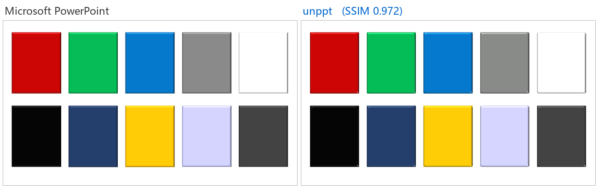
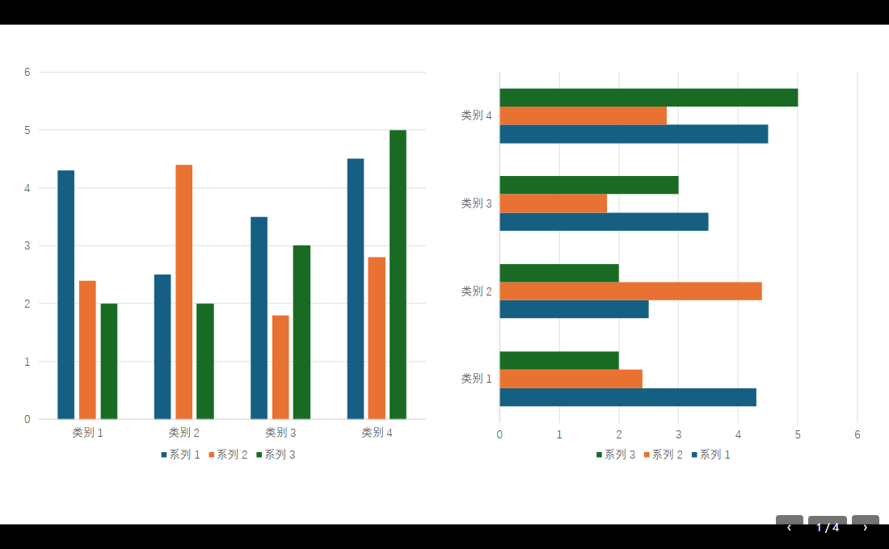

[English](README.en.md) | 中文

# unppt

**把 PowerPoint 文件（.pptx）转成网页，在浏览器里播放，效果和 Microsoft PowerPoint 一致。**

你有一份 .pptx 课件或演示文稿，想放到网站、App 或在线课堂里播放，又不想让用户装 Office、也不想把它转成一张张静态图片（那样动画、切换、视频都没了）。unppt 做的就是这件事：用一条命令把 .pptx 转成**一个自包含的 HTML 文件**（双击就能播放），里面是矢量的 SVG 页面和一个零依赖的播放器；动画、页面切换、音视频、超链接都保留。这个 HTML 可以用 `<iframe>` 嵌进任何网页，宿主页面或原生 App 还能用 JS 控制它翻页、播放动画。

[](https://www.npmjs.com/package/@unppt/unppt)
[](LICENSE)



> 名词：**SVG** 是浏览器能直接显示的矢量图格式，放大不糊；**iframe** 是网页里嵌入另一个网页的标签；**转码器**指把 .pptx 变成网页文件的那段程序，**播放器**指在浏览器里把这些文件放出来的那段 JS。

## 特点

- **效果对齐 PowerPoint**：开发时用本机 PowerPoint 导出的图片作"标准答案"，逐页自动比对打分（见下面的「现状和准确度」）。
- **一个文件就能播**：默认产物是一个自包含的 HTML 文件（不写 `-o` 时和输入同名，例如 `演示文稿.html`），播放器、页面、字体、小图片都在里面；本地双击、放到任意静态服务器、CDN 都能用。
- **动画和切换**：进入、退出、强调、路径动画，触发器，自动换片计时，页面切换效果，音视频。
- **可嵌入、可控制**：iframe 跨域嵌入；用 `postMessage`（浏览器里不同网页之间发消息的标准方法）、同页 `window.unppt`、原生 App 的 WebView 三种方式控制翻页，并接收翻页、播放结束等事件。
- **直播课同步**：演绎端 / 观看端两种模式，观看端用 `sync` 指令跟上老师的进度（见 [examples/live-class.html](examples/live-class.html)）。
- **转码器是纯函数**：字节进、文件出，不读写磁盘、不联网，不依赖外部程序和原生插件（整页图、缩略图用打包在内的 resvg WASM），可以直接放进云函数。
- **大文件小内存**：按位置读取输入文件，1GB 级的文件也能在小内存下转码。
- **播放器零依赖**：约 58KB（gzip 后约 21KB），支持 Chrome、Firefox、移动端 WebView。
- **多种产物形式**：单文件 HTML（默认）、按需加载（每页单独一个数据文件）、每页一个 HTML。

## 效果对比

下面每张图**左边是 Microsoft PowerPoint，右边是 unppt**（内容是用 PowerPoint 合成的中性测试用例）。

| 图表 | SmartArt |
|---|---|
|  |  |
| **文字效果** | **三维形状** |
|  |  |

更多对比图：[表格样式](docs/images/compare-table-styles.png)、[图表数据标签](docs/images/compare-charts-point-labels.png)、[全部形状](docs/images/compare-shapes-all.png)。

播放器界面（点击、方向键、空格、触屏左右滑动都能翻页）：



## 现状和准确度

当前版本 **0.2.0**。

准确度用 **SSIM**（结构相似度，0 到 1 之间的一个数，1 表示两张图一模一样）衡量：把 unppt 画出来的页面和 PowerPoint 导出的图片逐页比较，**SSIM ≥ 0.95 算这一页通过**。

| 测试集 | 规模 | 转码失败 | 通过率（SSIM ≥ 0.95） | 平均 SSIM |
|---|---|---|---|---|
| 合成测试用例（`testcases/`） | 228 份 / 504 页 | — | 92.3% | 0.984 |
| 随机抽取的真实课件 | 100 份 / 3527 页 | 0 | 78.8%（约 95% 的页 SSIM ≥ 0.90） | 0.967 |

没通过的页面大多只是细节不同（文字差几个像素、某个图表标签位置不一样），整体上看不出区别。

**已知还没做好的地方**：

- 图表日期坐标轴的时间刻度（最小值 / 最大值、按月 / 按年的间隔）；
- 艺术字竖排（`wordArtVert`）；
- 可变字体（variable fonts）；
- EMF 图片里的 EMF+ 记录；
- 部分需要重新排版的 SmartArt；
- 旋转 180 度时的三维棱台效果；
- 分类标签倾斜 45 度时的截断阈值。

遇到效果不对的 PPT，欢迎提 Issue（请先确认文件可以公开，或者用中性内容重新做一份能复现问题的 PPT）。

## 5 分钟上手

需要 [Node.js](https://nodejs.org/) **20.12 或更高版本**（在命令行运行 `node -v` 查看）。

**第 1 步：不安装，直接用 npx 转一个文件**

```bash
npx @unppt/unppt 演示文稿.pptx --system-fonts
```

**或者全局安装后用 `unppt` 命令**

```bash
npm install -g @unppt/unppt
unppt 演示文稿.pptx -o out/index.html --system-fonts
```

`--system-fonts` 表示用本机装的字体排版，这样换行位置才和 PowerPoint 一致（字体的说明见 [docs/zh/usage.md](docs/zh/usage.md)）。

**第 2 步：打开产物**

用浏览器打开生成的 `.html` 文件（不写 `-o` 时和输入文件同名，放在同一个目录）就能播放。

**命令行选项**（完整说明运行 `unppt` 不带参数查看，或见 [使用指南](docs/zh/usage.md)）：

| 选项 | 说明 |
|---|---|
| `-o, --out <文件>` | 输出文件，默认和输入同名的 `.html`；`paged` / `pages` 形式下是输出目录 |
| `--output <形式>` | 产物形式：`single`（默认，一个自包含的 HTML）、`paged`（按需加载）、`pages`（paged 再加每页一个 HTML）、`data`（同 `--data`） |
| `--fonts <目录>` | 字体目录（可以写多次），转码时按真实字宽排版 |
| `--system-fonts` | 使用本机系统字体目录；Office 自带的私有字体、云字体（Aptos、Gill Sans MT 等）也会用上，并且用到时嵌入产物（浏览器用不了这些没装进系统的字体） |
| `--embed-fonts` | 把用到的字做成字体子集嵌入（观看端不需要安装字体，显示与转码时一致；商业字体请注意分发授权） |
| `--data` | 只输出演示数据 `deck.json`（开发调试用） |
| `--no-images` | 不输出整页图 `pic/` 和缩略图 `thum/`（`prop.json` 照常输出） |
| `--jobs <n\|auto>` | 出图用几个线程同时画，默认 `auto`；`1` 是在主线程画 |
| `--inline-limit <字节>` | 小于这个大小的图片内联进 HTML，默认 2097152（2MB）；视频音频总是单独输出到 `media/` |
| `--stats` | 结束时显示用时和峰值内存 |
| `-q, --quiet` | 不显示进度 |

## 在代码里使用（云函数等）

```bash
npm install @unppt/unppt
```

```js
import { convert } from '@unppt/unppt';

const result = await convert(pptxBytes, {        // pptxBytes：Uint8Array
  // 输出交给你写：index.html、prop.json、media/xxx.mp4、pic/1.jpg ……
  write: async (path, data) => { /* data 可能是字符串、Uint8Array 或数据流（AsyncIterable） */ },
  fonts: [fontBytes1, fontBytes2],   // 可选：字体文件内容（ttf / otf / ttc）
  embedFonts: true,                  // 可选：嵌入字体子集（默认关闭）
});
console.log(result.slides, result.report.missingFonts, result.report.warnings);
```

**大文件**：不要把整个文件读进内存，传一个"按位置读取"的对象即可，转码器只读需要的部分：

```js
import { open, stat } from 'node:fs/promises';

const size = (await stat('big.pptx')).size;
const fh = await open('big.pptx');
const source = {
  size,
  read: async (offset, length) => {
    const buf = new Uint8Array(length);
    const { bytesRead } = await fh.read(buf, 0, length, offset);
    return buf.subarray(0, bytesRead);
  },
};
await convert(source, { write });
await fh.close();
```

实测：300 页 + 800MB 视频的文件，限制 128MB 内存，1 秒左右转完，峰值内存约 120MB。

全部选项（`output`、`images`、`rasterWasm`、`rasterPool`、`onProgress` 等）见 [使用指南](docs/zh/usage.md)。

## 嵌入网页与外部控制（JS bridge）

```html
<iframe id="ppt" src="https://cdn.example.com/deck/index.html?ui=0"></iframe>
<script type="module">
  import { UnpptFrame } from './host.js';      // 仓库构建产物 packages/player/dist/host.js
  const deck = new UnpptFrame(document.getElementById('ppt'));
  await deck.ready;
  await deck.next();          // 下一步（有动画先播动画，播完再翻页）
  await deck.goto(3, 0);      // 跳到第 4 页第 0 步（页码从 0 开始）
  deck.on('change', (s) => console.log(s.slide, s.step, s.slideCount, s.stepCount));
</script>
```

不用 `host.js` 也可以直接发消息：

```js
iframe.contentWindow.postMessage({ unppt: 1, id: 1, cmd: 'goto', args: { slide: 3, step: 0 } }, '*');
// 播放器回复：{ unppt: 1, re: 1, ok: true, result: { slide, step, slideCount, stepCount } }
// 播放器事件：{ unppt: 1, event: 'ready' | 'change' | 'end' | 'link', data: { ... } }
```

指令有 `next`、`prev`、`goto`、`sync`、`getState`；同页 JS 用 `window.unppt.next()` 等，原生 App 用 `window.unppt.handle('{"cmd":"next"}')`。常用 URL 参数：`slide`、`step`（打开时定位）、`ui=0`（隐藏自带按钮）、`timings=0/1`、`origin=`（限制消息来源）、`mode=watch`（观看模式）、`links=0`（外部链接交给宿主处理）。

完整说明（Android / iOS / React Native、隐藏页规则、所有 URL 参数、时序图）见 [嵌入与控制](docs/zh/embedding.md)，可运行示例见 [examples/iframe-host.html](examples/iframe-host.html) 和 [examples/live-class.html](examples/live-class.html)。

## 文档地图

**使用者文档**（从上往下读即可）：

| 文档 | 内容 |
|---|---|
| [入门](docs/zh/getting-started.md) | 从零开始：装 Node、转第一个文件、打开播放 |
| [使用指南](docs/zh/usage.md) | 命令行和 `convert()` 的全部选项、字体、产物形式、大文件 |
| [嵌入与控制](docs/zh/embedding.md) | iframe、postMessage、`window.unppt`、原生 App、URL 参数 |
| [产物格式](docs/zh/output-format.md) | 转出来的每个文件是什么、`deck.json` / `prop.json` 的结构 |
| [架构总览](docs/zh/architecture.md) | 整个程序由哪几块组成、它们怎么配合（大量图解） |
| [转码原理](docs/zh/transcoding.md) | 从程序入口开始，一个 .pptx 是怎么一步步变成 SVG 的 |
| [播放器原理](docs/zh/player.md) | 播放器怎么显示页面、播动画、处理翻页和外部指令 |
| [准确度与评测](docs/zh/fidelity.md) | "和 PowerPoint 一样"的标准是什么、怎么自动比对打分 |
| [常见问题](docs/zh/faq.md) | 字体不对、文件太大、嵌入跨域等问题 |

**开发者文档**：

| 文档 | 内容 |
|---|---|
| [SPEC.md](SPEC.md) | 需求真相源：已确认的决策、实测得到的 PowerPoint 规则 |
| [docs/architecture.md](docs/architecture.md) | 开发用架构说明：模块分层、扩展点（怎么加新能力） |
| [CONTRIBUTING.md](CONTRIBUTING.md) | 协作约定 |
| [docs/release.md](docs/release.md) | 怎么发布到 npm |

## 开发

```bash
git clone https://github.com/spitmaster/unppt.git
cd unppt
npm install
npm run build
npm test
node packages/transcoder/dist/cli.js 演示文稿.pptx -o out/index.html --system-fonts
```

| 命令 | 作用 |
|---|---|
| `npm run build` | 构建转码器和播放器 |
| `npm test` | 单元测试 |
| `python tools/make-case/make.py` | 用 PowerPoint 生成测试用例（中性内容）到 `testcases/` |
| `python tools/powerpoint/export.py run [--set testcases]` | 用 PowerPoint 导出参考图（标准答案） |
| `python tools/compare/run.py --set testcases\|daily\|all` | 转码、截图、和 PowerPoint 比对、出报告 |
| `python tools/check-player.py [chromium\|firefox]` | 播放器端到端测试（跨域 iframe、原生桥接等） |
| `python tools/powerpoint/transitions.py capture 名字,... / capture-anim 名字,... / compare` | 页面切换、动画对照：PowerPoint 放映逐帧截图，和播放器同一时刻的画面比较 |

开发工具需要 Windows + PowerPoint + Python（`pip install pywin32 numpy pillow playwright fonttools`）；只用转码器和播放器不需要这些。

**样本安全**：真实样本放在 `samples/`（不进仓库），由样本生成的一切只放在 `.cache/`（不进仓库）。规则见 [SPEC.md](SPEC.md) 第 4 节。

## 许可证

[Apache-2.0](LICENSE)。第三方类库的许可证见 [packages/transcoder/THIRD-PARTY-NOTICES.md](packages/transcoder/THIRD-PARTY-NOTICES.md)。
