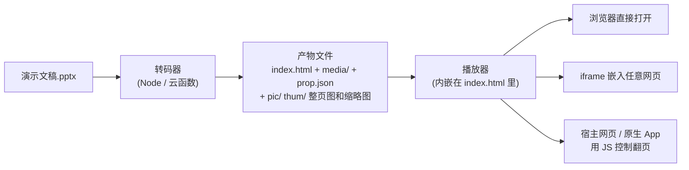
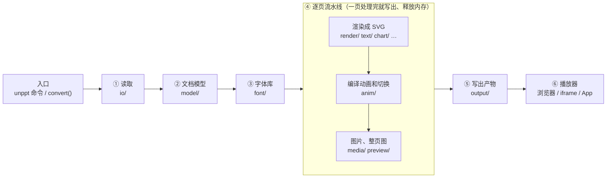

[English](README.en.md) | 中文

# unppt

把 PowerPoint 课件（.pptx）一条命令转成网页：浏览器打开就能播放，动画、页面切换、音视频都保留，效果和 PowerPoint 一致；也能嵌进任何网页或 App，用代码控制翻页。

[](https://www.npmjs.com/package/@unppt/unppt)
[](LICENSE)

## 安装

需要 [Node.js](https://nodejs.org/) 20.12 或更高版本（命令行运行 `node -v` 查看）。

```bash
npm install -g @unppt/unppt
```

装好后运行 `unppt -v` 查看版本号。会自动带上默认字体包（下载约 67MB），不用另外装字体。

- **公司内网镜像装不上**（报 `EALLOWREMOTE`、`ETARGET`、找不到版本）：指定 npm 官方源 `npm install -g @unppt/unppt --registry https://registry.npmjs.org/`
- **不能连 npm**：从 [Releases](https://github.com/spitmaster/unppt/releases/latest) 下载 `unppt-fonts.tgz` 和 `unppt.tgz`，运行 `npm install -g ./unppt-fonts.tgz ./unppt.tgz`（完整步骤见 [快速上手第 3 节](docs/zh/getting-started.md#3-安装)）

## 使用

```bash
unppt 课件.pptx
```

转好的文件放在课件旁边新建的同名文件夹里（`课件.pptx` → `课件/index.html`），用浏览器打开 `index.html` 就能播放（点击、方向键、空格、触屏滑动都能翻页）。

常用写法：

```bash
unppt 课件.pptx -o out              # 输出到 out 文件夹
unppt 课件.pptx --output single     # 输出一个自包含的 HTML 文件，方便当附件发送
unppt check 课件.pptx               # 只检查字体有没有问题，不输出文件
npx @unppt/unppt 课件.pptx          # 不安装，临时用一次
```

全部选项运行 `unppt` 不带参数查看，或见 [使用指南第 2 节](docs/zh/usage.md#2-命令行参考)；在代码里调用见后面的「在代码里使用」。

## 特点

从 .pptx 到播放：



> 名词：**SVG** 是浏览器能直接显示的矢量图格式，放大不糊；**iframe** 是网页里嵌入另一个网页的标签；**转码器**指把 .pptx 变成网页文件的那段程序，**播放器**指在浏览器里把这些文件放出来的那段 JS。

- **效果对齐 PowerPoint**：开发时用本机 PowerPoint 导出的图片作"标准答案"，逐页自动比对打分（见下面的「现状和准确度」）。
- **打开快、适合在线看**：命令行默认输出按需加载的形式（不写 `-o` 时放进 pptx 旁边新建的同名文件夹，例如 `演示文稿/index.html`）：入口 HTML 只有几十 KB，每页的数据和图片看到那一页才加载、并预加载下一页；本地双击、静态服务器、CDN 都能用。也可以用 `--output single` 输出一个自包含的 HTML 文件，方便当附件发送。
- **动画和切换**：进入、退出、强调、路径动画，触发器，自动换片计时，页面切换效果，音视频。
- **可嵌入、可控制**：iframe 跨域嵌入；用 `postMessage`（浏览器里不同网页之间发消息的标准方法）、同页 `window.unppt`、原生 App 的 WebView 三种方式控制翻页，并接收翻页、播放结束等事件。
- **直播课同步**：演绎端 / 观看端两种模式，观看端用 `sync` 指令跟上老师的进度（见 [examples/live-class.html](examples/live-class.html)）。
- **转码器是纯函数**：字节进、文件出，不读写磁盘、不联网，不依赖外部程序和原生插件（整页图、缩略图用打包在内的 resvg WASM），可以直接放进云函数。
- **大文件小内存**：按位置读取输入文件，1GB 级的文件也能在小内存下转码。
- **播放器零依赖**：约 58KB（gzip 后约 21KB），支持 Chrome、Firefox、移动端 WebView。
- **多种产物形式**：按需加载（命令行的默认，每页单独一个数据文件）、单文件 HTML（`convert()` 的默认）、每页再加一个 HTML。

## 效果对比

下面每张图**左边是 Microsoft PowerPoint，右边是 unppt**（内容是用 PowerPoint 合成的中性测试用例）。

| 图表 | SmartArt |
|---|---|
|  |  |
| **文字效果** | **三维形状** |
|  |  |

更多对比图：[表格样式](docs/images/compare-table-styles.png)、[图表数据标签](docs/images/compare-charts-point-labels.png)、[全部形状](docs/images/compare-shapes-all.png)。

播放器界面（点击、方向键、空格、触屏左右滑动都能翻页）：


## 实现思路

**一句话：能在转码时算好的，都在转码时算好；播放器只管显示和播放。** PowerPoint 的继承、排版、图表、动画规则都在转码器里按实测结果算完：每页变成一段矢量 SVG（每个字的位置都已排定），动画变成"每次点击做哪些动作"的数据。转码器和播放器只通过[产物格式](docs/zh/output-format.md)联系，可以各自部署、各自升级。



| 步骤 | 为什么需要它 | 它做什么 | 详细 |
|---|---|---|---|
| 入口 `cli.ts` / `convert()` | 命令行、服务器、云函数共用同一个纯函数 | 输入是字节或"按位置读取"的对象，输出全部交给 `write` 回调；转码器自己不碰磁盘、不联网 | [转码原理 3–4](docs/zh/transcoding.md#3-一次转码的全过程总览) |
| ① 读取 `io/` | .pptx 是装满 XML 的 ZIP 包，文件可能上 GB | 只读 ZIP 目录，用到哪个部件才解压哪个；音视频从 ZIP 流式写出，不进内存 | [5](docs/zh/transcoding.md#5-第-2-步按需读取-zip-和-xml) |
| ② 文档模型 `model/` | 一个形状的颜色、字体、位置可能写在主题、母版、版式、幻灯片任何一层 | 建主题 → 母版 → 版式 → 幻灯片的继承链，按 PowerPoint 的规则合并占位符、颜色、文字样式 | [6](docs/zh/transcoding.md#6-第-3-步演示文稿模型-presentation) |
| ③ 字体库 `font/` | 换行位置由字宽决定，观看者电脑上又没有这些字体 | 嵌入字体 > 指定字体 > 默认字体包；排版用原字体的度量，显示用开源字体 | [11](docs/zh/transcoding.md#11-字体查找替代嵌入和子集化) |
| ④ 渲染 `render/` 等 | 浏览器不认识 PowerPoint 的形状、效果、图表，也排不出一样的换行 | 预设形状、填充线条、阴影发光、三维、表格、图表、SmartArt 画成 SVG；文字按 PowerPoint 实测规则断行，每个字的坐标写死 | [7–9](docs/zh/transcoding.md#7-第-4-步逐页渲染成-svg) |
| ④ 动画 `anim/` | PowerPoint 的动画是一棵很深的时间树，不该让播放器去理解 | 编译成"每次点击做哪些动作"，PowerPoint 原始的关键帧和公式原样带上 | [10](docs/zh/transcoding.md#10-动画和页面切换) |
| ④ 媒体和出图 `media/` `preview/` | EMF / WMF / TIFF 浏览器不认；列表页、分享要预览图 | 图片转换、去重；用 resvg（WASM）把每页画成整页图和缩略图 | [12–13](docs/zh/transcoding.md#12-图片音视频) |
| ⑤ 写出 `output/` | 有人要一个文件当附件，有人要放 CDN 按需加载 | 只把用到的字做成字体子集（HarfBuzz WASM），按产物形式写出 HTML、每页数据、`prop.json` | [14](docs/zh/transcoding.md#14-写出产物四种产物形式) |
| ⑥ 播放器 `packages/player` | 产物要能嵌进任何网页和 App | 零依赖：显示 SVG、翻页、播动画和切换，响应宿主的指令 | [播放器原理](docs/zh/player.md) |

几个关键的设计决定（全貌见 [架构入门](docs/zh/architecture.md)）：

- **排版自己做，不交给浏览器**：浏览器的换行、字宽和 PowerPoint 不一样，不同浏览器之间也不一样。断行规则（标点禁则、悬挂、破折号、制表位……）都是先用 PowerPoint 实测、再实现，记在 [SPEC 第 7 节](SPEC.md#7-实测得到的-powerpoint-规则用-make-case-用例校准)。
- **排版和显示分开用字体**：没嵌入的微软雅黑、Calibri 等，按原字体的度量（只有字宽等数字，没有字形）排版，换行和 PowerPoint 一样；字形用对应的开源字体，观看的人不用装字体，也不分发商业字体（见下面的「字体」）。
- **纯函数、流式处理**：字节进、文件出，不依赖外部程序和原生插件，所以能放进云函数；一页一页处理、按位置读输入，1GB 的文件小内存也能转。
- **加功能 = 加一个文件 + 注册表一行**：图表类型、图片格式、形状效果、页面切换、动画效果都是扩展点，见 [开发用架构说明](docs/architecture.md)。
- **"和 PowerPoint 一样"靠测量**：本机 PowerPoint 导出参考图逐页打分，自动换行另有逐行对照的专项测试；修一类问题先合成中性用例实测，改完做 A/B 对照；客户课件只在本机使用，内容不外传。见 [还原度与评测](docs/zh/fidelity.md)。

## 现状和准确度

当前版本 **0.3.1**。完整的分项统计见 [测试报告](docs/zh/test-report.md)，调研记录见 [docs/zh/research](docs/zh/research/README.md)。

准确度用 **SSIM**（结构相似度，0 到 1 之间的一个数，1 表示两张图一模一样）衡量：把 unppt 画出来的页面和 PowerPoint 导出的图片逐页比较，**SSIM ≥ 0.95 算这一页通过**。

| 测试集 | 规模 | 转码失败 | 通过率（SSIM ≥ 0.95） | 平均 SSIM |
|---|---|---|---|---|
| 合成测试用例（`testcases/`，浏览器里播放器的截图） | 255 份 / 543 页 | 0 | 93.0% | 0.984 |
| 本机全部真实课件（整页图） | 5212 份 / 168662 页 | 0 | 70.4%（93.5% 的页 SSIM ≥ 0.90） | 0.956 |

没通过的页面大多只是细节不同（文字差几个像素、某个图表标签位置不一样），整体上看不出区别。**自动换行**另外逐行对照：991 份真实课件里约 4 万个多行文本框 99.8%、6051 个多行表格单元格 99.9% 的换行和 PowerPoint 完全一致。本机全部 5212 份真实课件（约 16.9 万页）都能转码，失败 0。

**已知还没做好的地方**：

- 图表日期坐标轴的时间刻度（最小值 / 最大值、按月 / 按年的间隔）；
- 艺术字竖排（`wordArtVert`）；
- 可变字体（variable fonts）；
- EMF 图片里的 EMF+ 记录；
- 部分需要重新排版的 SmartArt；
- 旋转 180 度时的三维棱台效果；
- 分类标签倾斜 45 度时的截断阈值。

遇到效果不对的 PPT，欢迎提 Issue（请先确认文件可以公开，或者用中性内容重新做一份能复现问题的 PPT）。

## 字体

- **播放时绝不用观看者电脑上的字体**：用到的每个字都做成字体子集打包进产物，Windows、Mac、安卓、iPhone 上看到的完全一样（例如直播课里几千个学生）；只有所有字体都没有的字才交给浏览器，`unppt check` 会列出来。
- **产物里的字体只有两个来源**（除非你用 `--fonts` / `--system-fonts` 明确指定）：作者嵌入在 PPT 里的字体（原样使用），和默认字体包 `@unppt/fonts` 里的开源字体（SIL OFL 1.1：思源黑体、思源宋体、霞鹜文楷、朱雀仿宋、Carlito、Caladea、Liberation 等）。字体包只在转码的电脑上需要，观看的人不会下载它。
- **没嵌入的字体**：按原字体的度量排版、用对应的开源字体显示（微软雅黑 → 思源黑体、Calibri → Carlito ……），换行和 PowerPoint 一样、字形略有不同；字体包也不认识的字体和 PowerPoint 一样找替代字体。
- **符号字体**：不改动你的字符。Wingdings 1~3 没嵌入时用字体包里编码兼容的开源字体显示成符号；其它符号字体（Webdings、Symbol 等）没嵌入时显示成字母或方框，`unppt check` 会提示作者“将字体嵌入文件”。

详见 [快速上手第 7 节](docs/zh/getting-started.md#7-字体为什么重要以及现在怎么处理)。

## 在代码里使用（云函数等）

```bash
npm install @unppt/unppt
```

```js
import { convert } from '@unppt/unppt';
import { loadFontPack } from '@unppt/unppt/node';   // Node 专用：读已安装的默认字体包

const fontPack = await loadFontPack();               // 服务器、云函数上不需要任何系统字体
const result = await convert(pptxBytes, {        // pptxBytes：Uint8Array
  // 输出交给你写：index.html、prop.json、media/xxx.mp4、pic/1.jpg ……
  write: async (path, data) => { /* data 可能是字符串、Uint8Array 或数据流（AsyncIterable） */ },
  fontPack,                          // 默认字体包：结果和在桌面电脑上转码一样
  fonts: [fontBytes1],               // 可选：你自己的字体文件（ttf / otf / ttc），同名时压过字体包
});
console.log(result.slides, result.fontCheck, result.report.warnings);
```

只检查字体、不输出文件：`checkFonts(pptxBytes, { fontPack })`，返回值和 `unppt check --json` 一样。

**大文件**：不要把整个文件读进内存，传一个"按位置读取"的对象即可，转码器只读需要的部分：

```js
import { open, stat } from 'node:fs/promises';

const size = (await stat('big.pptx')).size;
const fh = await open('big.pptx');
const source = {
  size,
  read: async (offset, length) => {
    const buf = new Uint8Array(length);
    const { bytesRead } = await fh.read(buf, 0, length, offset);
    return buf.subarray(0, bytesRead);
  },
};
await convert(source, { write, fontPack });
await fh.close();
```

实测：300 页 + 800MB 视频的文件，限制 128MB 内存，1 秒左右转完，峰值内存约 120MB。

全部选项（`output`、`images`、`rasterWasm`、`rasterPool`、`onProgress` 等）见 [使用指南](docs/zh/usage.md)。

## 嵌入网页与外部控制（JS bridge）

```html
<iframe id="ppt" src="https://cdn.example.com/deck/index.html?ui=0"></iframe>
<script type="module">
  import { UnpptFrame } from './host.js';      // 仓库构建产物 packages/player/dist/host.js
  const deck = new UnpptFrame(document.getElementById('ppt'));
  await deck.ready;
  await deck.next();          // 下一步（有动画先播动画，播完再翻页）
  await deck.goto(3, 0);      // 跳到第 4 页第 0 步（页码从 0 开始）
  deck.on('change', (s) => console.log(s.slide, s.step, s.slideCount, s.stepCount));
</script>
```

不用 `host.js` 也可以直接发消息：

```js
iframe.contentWindow.postMessage({ unppt: 1, id: 1, cmd: 'goto', args: { slide: 3, step: 0 } }, '*');
// 播放器回复：{ unppt: 1, re: 1, ok: true, result: { slide, step, slideCount, stepCount } }
// 播放器事件：{ unppt: 1, event: 'ready' | 'change' | 'end' | 'link', data: { ... } }
```

指令有 `next`、`prev`、`goto`、`sync`、`getState`；同页 JS 用 `window.unppt.next()` 等，原生 App 用 `window.unppt.handle('{"cmd":"next"}')`。常用 URL 参数：`slide`、`step`（打开时定位）、`ui=0`（隐藏自带按钮）、`timings=0/1`、`origin=`（限制消息来源）、`mode=watch`（观看模式）、`links=0`（外部链接交给宿主处理）。

完整说明（Android / iOS / React Native、隐藏页规则、所有 URL 参数、时序图）见 [嵌入与控制](docs/zh/embedding.md)，可运行示例见 [examples/iframe-host.html](examples/iframe-host.html) 和 [examples/live-class.html](examples/live-class.html)。

## 文档地图

**使用者文档**（从上往下读即可）：

| 文档 | 内容 |
|---|---|
| [入门](docs/zh/getting-started.md) | 从零开始：装 Node、转第一个文件、打开播放 |
| [使用指南](docs/zh/usage.md) | 命令行和 `convert()` 的全部选项、字体、产物形式、大文件 |
| [嵌入与控制](docs/zh/embedding.md) | iframe、postMessage、`window.unppt`、原生 App、URL 参数 |
| [产物格式](docs/zh/output-format.md) | 转出来的每个文件是什么、`deck.json` / `prop.json` 的结构 |
| [架构总览](docs/zh/architecture.md) | 整个程序由哪几块组成、它们怎么配合（大量图解） |
| [转码原理](docs/zh/transcoding.md) | 从程序入口开始，一个 .pptx 是怎么一步步变成 SVG 的 |
| [播放器原理](docs/zh/player.md) | 播放器怎么显示页面、播动画、处理翻页和外部指令 |
| [准确度与评测](docs/zh/fidelity.md) | "和 PowerPoint 一样"的标准是什么、怎么自动比对打分 |
| [常见问题](docs/zh/faq.md) | 字体不对、文件太大、嵌入跨域等问题 |

**开发者文档**：

| 文档 | 内容 |
|---|---|
| [SPEC.md](SPEC.md) | 需求真相源：已确认的决策、实测得到的 PowerPoint 规则 |
| [docs/architecture.md](docs/architecture.md) | 开发用架构说明：模块分层、扩展点（怎么加新能力） |
| [CONTRIBUTING.md](CONTRIBUTING.md) | 协作约定 |
| [docs/release.md](docs/release.md) | 怎么发布到 npm |

## 开发

```bash
git clone https://github.com/spitmaster/unppt.git
cd unppt
npm install
node scripts/fetch-fonts.mjs      # 只需一次：下载默认字体包的字体文件（不在 git 里）并校验 SHA-256
npm run build
npm test
node packages/transcoder/dist/cli.js 演示文稿.pptx -o out/index.html
```

| 命令 | 作用 |
|---|---|
| `npm run build` | 构建转码器和播放器 |
| `npm test` | 单元测试 |
| `python tools/make-case/make.py` | 用 PowerPoint 生成测试用例（中性内容）到 `testcases/` |
| `python tools/powerpoint/export.py run [--set testcases]` | 用 PowerPoint 导出参考图（标准答案） |
| `python tools/compare/run.py --set testcases\|daily\|all` | 转码、截图、和 PowerPoint 比对、出报告 |
| `python tools/check-player.py [chromium\|firefox]` | 播放器端到端测试（跨域 iframe、原生桥接等） |
| `python tools/powerpoint/transitions.py capture 名字,... / capture-anim 名字,... / compare` | 页面切换、动画对照：PowerPoint 放映逐帧截图，和播放器同一时刻的画面比较 |

开发工具需要 Windows + PowerPoint + Python（`pip install pywin32 numpy pillow playwright fonttools`）；只用转码器和播放器不需要这些。

**样本安全**：真实样本放在 `samples/`（不进仓库），由样本生成的一切只放在 `.cache/`（不进仓库）。规则见 [SPEC.md](SPEC.md) 第 4 节。

## 许可证

[Apache-2.0](LICENSE)。第三方类库的许可证见 [packages/transcoder/THIRD-PARTY-NOTICES.md](packages/transcoder/THIRD-PARTY-NOTICES.md)。
