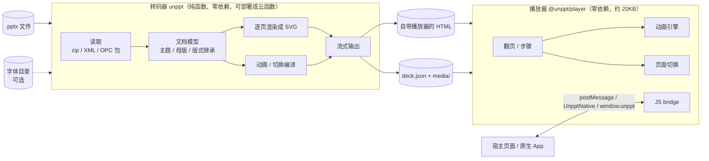
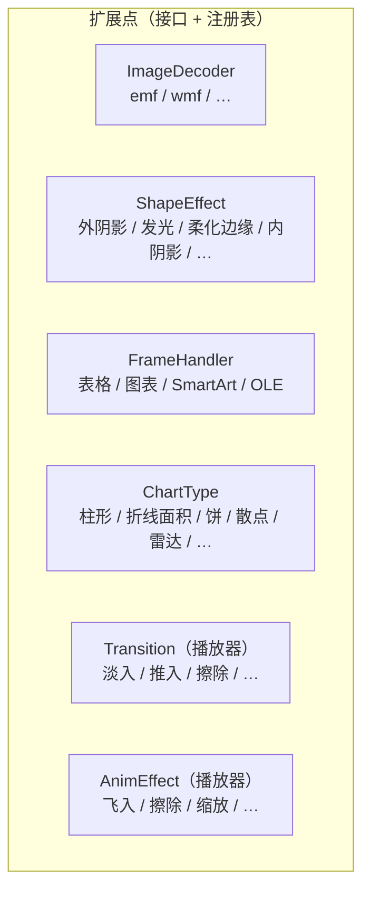
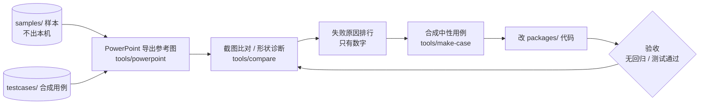

# unppt 技术架构

> 这份文档和代码一起迭代：改了模块结构、加了扩展点，就在同一个提交里更新这里的图。
> 图用 Mermaid 写，GitHub 上直接显示成图，改图就是改文本。

## 1. 总体



- **转码器和播放器只通过 `@unppt/format` 里定义的数据格式交流**（`Deck`、`DeckSlide`、`AnimAction`、`SlideTransition`、bridge 协议）。两边可以独立部署、独立升级。
- 转码器不依赖任何环境：输入是字节（或按需读取的数据源），输出是字节流；字体只是可选输入。

## 2. 转码器内部分层

上层可以依赖下层，下层不能依赖上层，不允许循环依赖。这些规则由 `scripts/check-deps.mjs` 自动检查（`npm test` 里的"架构守门"测试），违反了测试直接失败。

```mermaid
flowchart TB
  entry["入口 index.ts / cli.ts<br/>convert：逐页、流式输出 HTML 或数据"]
  anim["anim/<br/>动画时间线、效果、页面切换编译"]
  render["render/<br/>SlideRenderer：形状 / 图片 / 组合<br/>box.ts 位置框、table.ts 表格<br/>frames/ ← FrameHandler 扩展点"]
  chart["chart/<br/>图表"]
  media["media/<br/>图片、音视频、共享资源<br/>decoders ← ImageDecoder 扩展点"]
  text["text/<br/>字体替代、测量、断行、SVG 文字"]
  effects["effects/<br/>← ShapeEffect 扩展点、映像、文字阴影"]
  style["style/<br/>fill 填充、line 线条、blip 图片调整"]
  font["font/<br/>TrueType 解析、字距、子集化"]
  geometry["geometry/<br/>公式引擎、187 种预设形状"]
  model["model/<br/>演示文稿 / 主题 / 母版 / 版式、颜色"]
  common["common/<br/>SVG 输出工具、超链接"]
  io["io/<br/>数据源、ZIP、XML、OPC 包"]
  entry --> anim & render & media & font
  render --> chart & media & text & effects & style & geometry
  chart --> style & font
  text --> effects & style & font
  effects --> model
  style --> model
  media --> model
  anim --> model
  font --> common
  geometry --> common
  model --> common
  common --> io
```

### 重构前的问题和进度（2026-10-13 评估）

| 位置 | 问题 | 违反的原则 |
|---|---|---|
| `player.ts`（约 800 行） | 一个类包了翻页、动画引擎、切换、界面、键盘触屏、bridge、自动启动 | 单一职责 |
| `player.ts` 切换、`anim` 效果 | `switch` 分支，加一种效果要改核心代码 | 开闭 |
| ~~`chart.ts`（约 740 行）~~ | ~~巨型函数、if/else~~ → 已拆成读取 / 格式 / 坐标轴 / 绘制工具 / 编排，每种图表一个文件 | 单一职责、开闭 |
| `text.ts`（约 690 行） | 字体替代、测量、断行、SVG 输出混在一起 | 单一职责 |
| ~~`render.ts`~~ | ~~分派写死、和 `table.ts` 循环依赖~~ → 已改为 `FrameHandler` 注册表，表格只依赖 `FrameRenderer` 接口 | 开闭、依赖倒置 |
| ~~`fill.ts`~~ | ~~填充、线条、图片调整、形状效果混在一起~~ → 已拆成 `style/fill.ts`、`style/line.ts`、`style/blip.ts` 和 `effects/` | 单一职责 |
| ~~`media.ts`~~ | ~~图片格式写死~~ → 已改为 `ImageDecoder` 注册表 | 开闭 |

## 3. 目标结构（重构进行中）

原则：**加一个新功能 = 加一个文件 + 在注册表里加一行**，不改别人的文件。每个扩展点有一个接口。



| 扩展点 | 接口 | 怎么加一个新的 |
|---|---|---|
| 图片格式 | `ImageDecoder`（`media/image-decoder.ts`） | 新建 `media/xxx.ts` 导出一个 `ImageDecoder`，在 `media/decoders.ts` 加一行。例：`emf.ts`、`wmf.ts` |
| 形状效果 | `ShapeEffect`（`effects/shape-effect.ts`） | 新建 `effects/xxx.ts` 导出一个 `ShapeEffect`（返回一层滤镜：画在形状下面 / 替换形状 / 盖在上面），在 `effects/effects.ts` 按叠放顺序加一行。例：`glow.ts`、`soft-edge.ts`、`outer-shadow.ts`、`inner-shadow.ts` |
| graphicFrame 内容 | `FrameHandler`（`render/frames/frame-handler.ts`） | 新建 `render/frames/xxx-frame.ts` 导出一个 `FrameHandler`（按 `a:graphicData` 的 uri 结尾匹配），在 `render/frames/frames.ts` 加一行。handler 只依赖窄接口 `FrameRenderer`。例：表格、图表、SmartArt、OLE |
| 图表类型 | `ChartType`（`chart/chart-type.ts`） | 新建 `chart/types/xxx.ts` 导出一个 `ChartType`：声明对应的 XML 元素名、读系列的规则、图例样式；占满绘图区的图实现 `render`，画在共享分类轴上（可组合）的图实现 `renderOnAxes`。在 `chart/chart-types.ts` 加一行。例：`bar.ts`、`line-area.ts`、`pie.ts`、`scatter.ts`、`radar.ts` |
| 页面切换 | `Transition` | 待实现 |
| 进入/退出动画效果 | `AnimEffect` | 待实现 |

重构的安全网：`node scripts/golden.mjs save` 记录全部测试用例的输出，重构后 `node scripts/golden.mjs check` 必须**逐字节一致**；行为改动（修 bug、加功能）不走这条路，走比对和逐页回归。

## 4. 开发闭环


