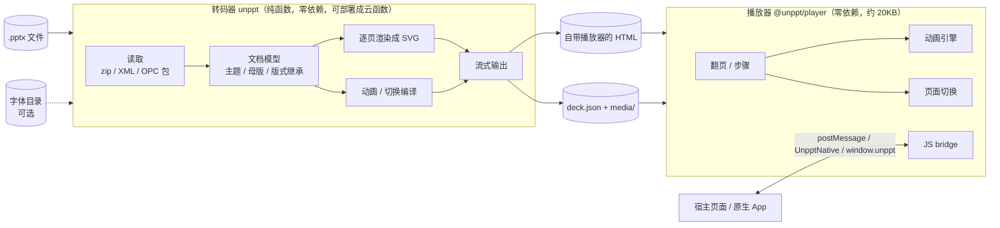
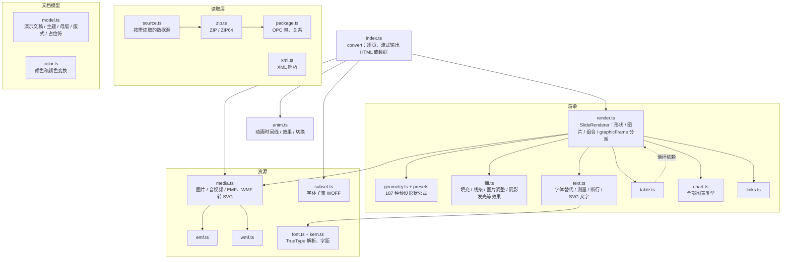
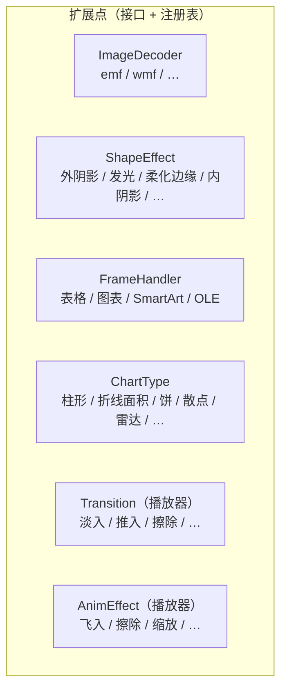
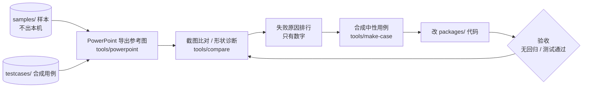

# unppt 技术架构

> 这份文档和代码一起迭代：改了模块结构、加了扩展点，就在同一个提交里更新这里的图。
> 图用 Mermaid 写，GitHub 上直接显示成图，改图就是改文本。

## 1. 总体

- **转码器和播放器只通过 `@unppt/format` 里定义的数据格式交流**（`Deck`、`DeckSlide`、`AnimAction`、`SlideTransition`、bridge 协议）。两边可以独立部署、独立升级。
- 转码器不依赖任何环境：输入是字节（或按需读取的数据源），输出是字节流；字体只是可选输入。

## 2. 转码器内部（现状）

### 现状的问题（2026-10-13 评估）

| 位置 | 问题 | 违反的原则 |
|---|---|---|
| `player.ts`（约 800 行） | 一个类包了翻页、动画引擎、切换、界面、键盘触屏、bridge、自动启动 | 单一职责 |
| `player.ts` 切换、`anim` 效果 | `switch` 分支，加一种效果要改核心代码 | 开闭 |
| `chart.ts`（约 740 行） | 一个巨型函数，图表类型靠 if/else | 单一职责、开闭 |
| `text.ts`（约 690 行） | 字体替代、测量、断行、SVG 输出混在一起 | 单一职责 |
| `render.ts` | 表格 / 图表 / SmartArt / OLE 分派写死；和 `table.ts` 循环依赖 | 开闭、依赖倒置 |
| `fill.ts` | 填充、线条、图片调整、形状效果混在一起 | 单一职责 |
| `media.ts` | 图片格式写死 `if (ext === 'emf' / 'wmf')` | 开闭 |

## 3. 目标结构（重构进行中）

原则：**加一个新功能 = 加一个文件 + 在注册表里加一行**，不改别人的文件。每个扩展点有一个接口。

| 扩展点 | 接口 | 怎么加一个新的 |
|---|---|---|
| 图片格式 | `ImageDecoder` | 待实现 |
| 形状效果 | `ShapeEffect` | 待实现 |
| graphicFrame 内容 | `FrameHandler` | 待实现 |
| 图表类型 | `ChartType` | 待实现 |
| 页面切换 | `Transition` | 待实现 |
| 进入/退出动画效果 | `AnimEffect` | 待实现 |

重构的安全网：`node scripts/golden.mjs save` 记录全部测试用例的输出，重构后 `node scripts/golden.mjs check` 必须**逐字节一致**；行为改动（修 bug、加功能）不走这条路，走比对和逐页回归。

## 4. 开发闭环

