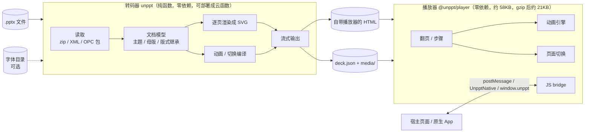
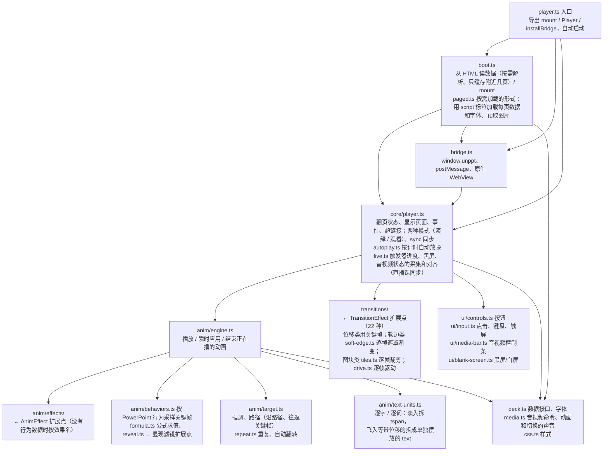
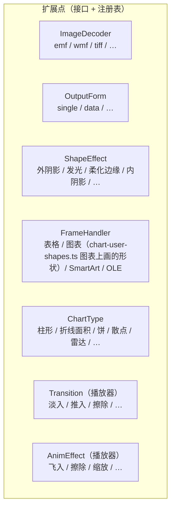
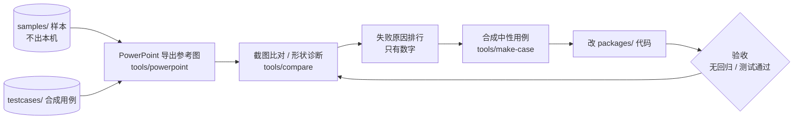

# unppt 技术架构

> 这份文档和代码一起迭代：改了模块结构、加了扩展点，就在同一个提交里更新这里的图。
> 图用 Mermaid 写，GitHub 上直接显示成图，改图就是改文本。

## 1. 总体



- **转码器和播放器只通过 `@unppt/format` 里定义的数据格式交流**（`Deck`、`DeckSlide`、`AnimAction`、`SlideTransition`、bridge 协议）。两边可以独立部署、独立升级。
- 转码器不依赖任何环境：输入是字节（或按需读取的数据源），输出是字节流；字体只是可选输入。

## 2. 转码器内部分层

上层可以依赖下层，下层不能依赖上层，不允许循环依赖。这些规则由 `scripts/check-deps.mjs` 自动检查（`npm test` 里的"架构守门"测试），违反了测试直接失败。

```mermaid
flowchart TB
  entry["入口 index.ts / cli.ts<br/>convert：逐页产出页面数据，交给产物形式写出<br/>node.ts（@unppt/unppt/node）= node-pool.ts Node 的并行出图执行器：工作线程池（raster-worker.ts），按 CPU 和内存自动定线程数；只有命令行用，index.ts 不创建线程<br/>+ node-fonts.ts 读默认字体包 @unppt/fonts（packages/fonts：开源字体 files/、度量包 metrics/、对照规则 map.json），变成 convert 的 fontPack"]
  preview["preview/<br/>整页图、缩略图（prop.json 里的 pic / thum）：slide-images.ts 调度：每页在本线程准备、交给绘制（给了并行出图执行器 RasterPool 时多页同时画），按页码顺序写出<br/>prepare.ts 准备（要字体库和媒体）：剔除遮挡、拆背景层、展开嵌套的 SVG 图片（inline-svg.ts；svg-image.ts 处理序言、DOCTYPE 实体、命名空间前缀；同一页里重复很多次的大 SVG 图片单独画成位图）、字体换成用到的字体文件、发光的外扩拆成两遍（morphology.ts），得到 PaintJob；字体、图片、背景层按编号取<br/>paint.ts 绘制（和运行环境无关，本线程和工作线程共用）：resvg（WASM）光栅化、pattern 里的图片内联（按图缓存 data URI）、叠背景层，整页图存 JPG（media/jpeg-encode.ts：libjpeg-turbo 的 WASM），缩略图从整页图区域平均缩小；resvg 崩溃时 crash-filters.ts 二分找出引起崩溃的那几处滤镜去掉再画（出图线程崩溃多了换新线程）<br/>mesh-warp.ts 透视投影的图片（网格三角形，每个都带一份内容）换成单独画一次的位图、按同样的分段仿射自己贴好（resvg 每个三角形都画满整层）；occlusion.ts 出图前剔除被整页不透明图片盖住的根元素；huge-images.ts 超大图片先缩小（resvg 会整张解码，每个出图线程都多占几百 MB）：超过 5000 万像素或长边是整页图 4 倍以上的 JPEG 按 1/8、1/4 解码，长边是整页图 4 倍以上的 PNG 用 media/png-shrink.ts；layers.ts 重复出现的母版/版式背景只画一次（背景层缓存，svg-root.ts 切顶层元素）"]
  output["output/<br/>← OutputForm 扩展点：single 自包含 HTML、paged 按需加载（目录 + 每页数据文件，pages 再加每页一个 HTML）、data 只出数据（调试）<br/>output.ts 接口和 HTML 公共部分；文件名带内容哈希（common/hash.ts）<br/>prop.ts 所有形式都输出的 prop.json（页数、宽高、每页图片路径、备注、是否隐藏）"]
  anim["anim/<br/>时间线编排 anim.ts、单个效果 effect.ts<br/>进入/退出的行为 behaviors.ts（关键帧、公式、时间变换原样带给播放器）<br/>时间设置和变换 timing-util.ts、动画和切换的声音 sound.ts<br/>音视频放映选项 media-opts.ts、母版和版式上的动画合进幻灯片的时间线 inherited-timing.ts<br/>强调终态 emphasis.ts、运动路径 motion.ts、切换 transition.ts"]
  render["render/<br/>render.ts 分派、继承；context.ts 渲染能力接口<br/>elements/ 形状、图片、组合（bg-fill.ts 用幻灯片背景填充的形状）；table.ts 表格（table-style.ts 表格样式的叠加；builtin-table-styles.ts PowerPoint 导出的内置样式定义、边框、整表背景）；box.ts 位置框<br/>controls.ts ActiveX 控件预览图；projection.ts 透视相机下逐点投影、pixel-snap.ts 形状和图片外框对齐整像素、group-map.ts 组合缩放时子元素换算<br/>frames/ ← FrameHandler 扩展点"]
  chart["chart/<br/>图表：chart.ts 标题和编排、legend.ts 图例（legend-wrap.ts 竖排图例的宽度上限和折行）<br/>cat-chart.ts 分类轴图、cat3d.ts 三维簇状/堆积柱形图、cat3d-depth.ts 系列沿深度排的三维柱形图、box3d.ts 立方体和墙网格线、cat3d-persp.ts 透视的三维折线/面积图（camera3d.ts 相机和光照、persp-layout.ts 箱体比例和摆放、solids3d.ts 带子和厚片的面）、sides.ts 坐标轴在哪一侧和刻度线、cat-labels.ts 分类标签放不下时折行或转斜、多级分类的外层标签、pixel-grid.ts 整像素对齐<br/>axis.ts 刻度（对数、逆序、显示单位）、default-lines.ts 坐标轴线和网格线没写线条时的默认线、format.ts 数字格式（date-format.ts 日期时间）、xy.ts 数值×数值坐标<br/>trendline.ts 趋势线、error-bars.ts 误差线、data-table.ts 数据表、axis-title.ts 坐标轴标题、point-labels.ts 数据标签（系列的和单个点的：拖开、自定义文字、删除）、area-fill.ts 图表区和绘图区背景<br/>layout.ts 实测间距规律、types/ ← ChartType 扩展点"]
  media["media/<br/>图片、音视频、共享资源<br/>decoders ← ImageDecoder 扩展点（emf、wmf、tiff 用 utif2；emf-defs.ts 让 EMF 里相同的裁剪区域、重复的位图只定义一次）<br/>exif-orientation.ts 去掉 JPEG 的方向标记<br/>sniff.ts 按文件头认图片格式（扩展名可能是错的）<br/>color-key.ts 在原图上抠透明色（png-key.ts、jpeg.ts 自研 JPEG 解码、png.ts 编码）<br/>png-shrink.ts PNG 边解压边按整数倍缩小（出图前缩小超大图片用）<br/>bmp.ts BMP 转 PNG（出图用：resvg 不认 BMP）<br/>dib-blit.ts EMF / WMF 位图记录共用的规则：源框、按光栅操作抠透明"]
  text["text/<br/>文本框属性 → 拆段（split-breaks.ts：文字里的回车、换行符是分段）→ 逐段排版（测量、断行、项目符号）→ 排位置 placeLines → 输出 SVG<br/>艺术字变形 warp.ts（字形轮廓弯进包络 / 沿路径排）"]
  effects["effects/<br/>← ShapeEffect 扩展点（形状、文字共用）、映像、三维轮廓 contour"]
  style["style/<br/>fill 填充、pattern 图案（实测点阵）<br/>line 线条（含复合线型、渐变线）、arrowheads 线端箭头（实测几何，线在箭头处截短）、gradient-stops 渐变色标（实测插值规律）、blip 图片调整<br/>lighting 三维正面提亮、camera 三维旋转投影（灯光常量在 model/light-rig.ts、正面颜色实测表 model/face-light-data.ts）、perspective 图片的网格透视"]
  font["font/<br/>TrueType 解析、cmap.ts 码点→字形（含符号字体）、字距、字形轮廓 glyf.ts（TrueType）/ cff.ts（CFF，.otf）、子集化 subset.ts（HarfBuzz 的 hb-subset WASM，打进 JS；glyf-flags.ts 清掉浏览器不认的点标志保留位）<br/>嵌入字体还原 eot.ts → lzcomp.ts → ctf.ts，sfnt.ts 读写公共部分<br/>默认字体包 pack.ts：原字体的度量（度量包）+ 开源字体的字形，按 map.json 对照（SPEC D3）；字体库按优先级 rank 挑：PPT 嵌入的、指定的字体压过字体包<br/>字体检查 check.ts：排版时记下每个字用了什么字体，汇总成每个字体的结论（unppt check、checkFonts()，输出见 cli-check.ts）"]
  geometry["geometry/<br/>公式引擎、187 种预设形状、40 种文字变形<br/>路径遍历 walkGeometry（输出 SVG 或按点采样）<br/>转动后轮廓的外接矩形 turned-bounds"]
  model["model/<br/>演示文稿 / 主题 / 母版 / 版式、颜色、notes 演讲者备注<br/>font-charsets 字体名的字符集（缺失字体选替代字体用）"]
  common["common/<br/>SVG 输出工具、超链接"]
  io["io/<br/>数据源、ZIP（zip.js）、XML（saxes）、OPC 包"]
  entry --> anim & render & media & font & output & preview
  preview --> media
  output --> media
  render --> chart & media & text & effects & style & geometry
  chart --> style & font
  text --> effects & style & font & geometry
  effects --> model
  style --> model
  media --> model
  anim --> model
  font --> common
  geometry --> common
  model --> common
  common --> io
```

## 2b. 播放器内部



### 重构前的问题和进度（2026-10-13 评估）

| 位置 | 问题 | 违反的原则 |
|---|---|---|
| ~~`player.ts`（约 800 行）~~ | ~~一个类包了所有事~~ → 已拆成 core / anim / transitions / ui / bridge / boot | 单一职责 |
| ~~播放器切换、动画效果~~ | ~~`switch` 分支~~ → 已改为 `TransitionEffect`、`AnimEffect` 注册表 | 开闭 |
| ~~`chart.ts`（约 740 行）~~ | ~~巨型函数、if/else~~ → 已拆成读取 / 格式 / 坐标轴 / 绘制工具 / 编排，每种图表一个文件 | 单一职责、开闭 |
| ~~`text.ts`（约 690 行）~~ | ~~混在一起~~ → 已拆成 body（文本框属性）/ style（样式合并）/ measure（测量、字体替代、字距）/ linebreak（断行禁则）/ bullets（项目符号编号）/ paragraph（单段排版）/ emit（定位输出）/ svg-text | 单一职责 |
| ~~`render.ts`~~ | ~~分派写死、和 `table.ts` 循环依赖~~ → 已改为 `FrameHandler` 注册表，表格只依赖 `FrameRenderer` 接口 | 开闭、依赖倒置 |
| ~~`fill.ts`~~ | ~~填充、线条、图片调整、形状效果混在一起~~ → 已拆成 `style/fill.ts`、`style/line.ts`、`style/blip.ts` 和 `effects/` | 单一职责 |
| ~~`media.ts`~~ | ~~图片格式写死~~ → 已改为 `ImageDecoder` 注册表 | 开闭 |

## 3. 扩展点

原则：**加一个新功能 = 加一个文件 + 在注册表里加一行**，不改别人的文件。每个扩展点有一个接口。多人协作的约定见 [CONTRIBUTING.md](../CONTRIBUTING.md)。



| 扩展点 | 接口 | 怎么加一个新的 |
|---|---|---|
| 产物形式 | `OutputForm`（`output/output.ts`） | 新建 `output/xxx.ts` 导出一个 `OutputForm`（名字、小图片要不要内联、怎么把 `OutputSource` 给的逐页数据 / 字体 / 元数据写成文件），在 `output/forms.ts` 加一行。例：`single.ts`、`paged.ts`（paged、pages 两种）、`data.ts`。播放器只认两种入口：`#unppt-meta`（数据都在页面里）和 `#unppt-index`（按需加载），新形式复用其中一种 |
| 图片格式 | `ImageDecoder`（`media/image-decoder.ts`） | 新建 `media/xxx.ts` 导出一个 `ImageDecoder`，在 `media/decoders.ts` 加一行。例：`emf.ts`、`wmf.ts`、`tiff.ts`（解码交给 utif2，编码用 png.ts） |
| 形状效果 | `ShapeEffect`（`effects/shape-effect.ts`） | 新建 `effects/xxx.ts` 导出一个 `ShapeEffect`（返回一层滤镜：画在形状下面 / 替换形状 / 盖在上面），在 `effects/effects.ts` 按叠放顺序加一行。例：`glow.ts`、`soft-edge.ts`、`outer-shadow.ts`、`inner-shadow.ts`。不在 `a:effectLst` 里的层（三维棱台 `bevel.ts`，来自 `a:sp3d`）通过 `effectFilter` 的 `extra` 参数加入；三维轮廓 `contour.ts`（`a:sp3d` 的 contourW）是几何上的一圈描边，由 shape.ts 直接画 |
| graphicFrame 内容 | `FrameHandler`（`render/frames/frame-handler.ts`） | 新建 `render/frames/xxx-frame.ts` 导出一个 `FrameHandler`（按 `a:graphicData` 的 uri 结尾匹配），在 `render/frames/frames.ts` 加一行。handler 只依赖窄接口 `FrameRenderer`；需要内部单独做动画的部分时用传进来的框编号拼子编号（拼法统一在 `common/uid.ts`，例：SmartArt 的每个形状）。例：表格、图表（图表上画的形状 c:userShapes 在 `chart-user-shapes.ts`，换成幻灯片形状交给 `shapes` 画）、SmartArt、OLE |
| 图表类型 | `ChartType`（`chart/chart-type.ts`） | 新建 `chart/types/xxx.ts` 导出一个 `ChartType`：声明对应的 XML 元素名、读系列的规则、图例样式；占满绘图区的图实现 `render`，画在共享分类轴上（可组合）的图实现 `renderOnAxes`，坐标一律用 `CategoryFrame` 的 `catPx` / `catSpan` / `valPx` 换算（坐标轴逆序等由 `cat-chart.ts` 处理，类型不用管）。趋势线由公共部分画（`extras.ts`），误差线由类型在数据点上调用 `error-bars.ts` 画；部件编号见 `common/uid.ts`。横轴、纵轴都是数值轴的类型（散点、气泡）共用 `xy.ts` 的坐标框架，只实现自己的标记。数据标签按点取 `point-labels.ts` 的 `pointLabel(s, i)`（单点设置覆盖系列的，文字用 `pointLabelText`，拖开的用 `shiftLabel` 平移）。数据点、整条线、数据标签用 `draw.ts` 的 `cpart` 包起来（"按系列/按类别"动画的目标，系列序号用 `Series.index`）。在 `chart/chart-types.ts` 加一行。例：`bar.ts`、`line-area.ts`、`pie.ts`、`of-pie.ts`（复合饼图）、`scatter.ts`、`bubble.ts`、`radar.ts`、`stock.ts`（股价图） |
| 页面切换（播放器） | `TransitionEffect`（`player/src/transitions/transition.ts`） | 新建 `transitions/xxx.ts` 导出一个 `TransitionEffect`，在 `transitions/transitions.ts` 加一行；没注册的按淡入。三种画法：位移/透明度用关键帧（`push.ts`、`cover.ts`、`fade.ts`）；软边扫过用 `soft-edge.ts` 的 `maskTransition` 逐帧设遮罩渐变（`wipe.ts`、`circle.ts`、`wheel.ts`）；图块用 `tiles.ts` 的 `tileTransition` 逐帧设裁剪多边形（`dissolve.ts`、`checker.ts`）；`morph.ts`（平滑切换，按 `data-name` 配对前后两页的对象）。转码器里 PowerPoint 的切换名到这些类型的对应在 `anim/transition.ts` 的表里，3D 切换的近似也在那里选。用 `tools/powerpoint/transitions.py` 和 PowerPoint 放映逐帧对照 |
| 进入/退出动画效果（播放器） | `AnimEffect`（`player/src/anim/effects/anim-effect.ts`） | 新建 `anim/effects/xxx.ts` 导出一个 `AnimEffect`（给出关键帧，退出自动倒放），在 `anim/effects/effects.ts` 加一行；没注册的按淡入淡出。例：`fly.ts`、`shape.ts`（形状向内/向外）、`wheel.ts`、`blinds.ts`；裁剪类效果的公共工具在 `clip.ts` |
| 显现滤镜（播放器） | `anim/reveal.ts` 的 `FILTERS` | PowerPoint 动画行为里的 `p:animEffect` 滤镜（`wipe(down)`、`circle(in)`、`wheel(4)`……）。加一种：在 `FILTERS` 里加一项 `名字(进度, 参数, 元素) => clip-path`，不同进度的结果结构要相同（才能插值）；退出时播放器自动取"外框减去它"。转码器把整个效果的行为原样带过来（`transcoder/src/anim/behaviors.ts`），播放器在 `anim/behaviors.ts` 里按元素真实位置代公式、按时间变换采样 |

重构的安全网：`node scripts/golden.mjs save` 记录全部测试用例的输出，重构后 `node scripts/golden.mjs check` 必须**逐字节一致**；行为改动（修 bug、加功能）不走这条路，走比对和逐页回归。

## 4. 开发闭环


