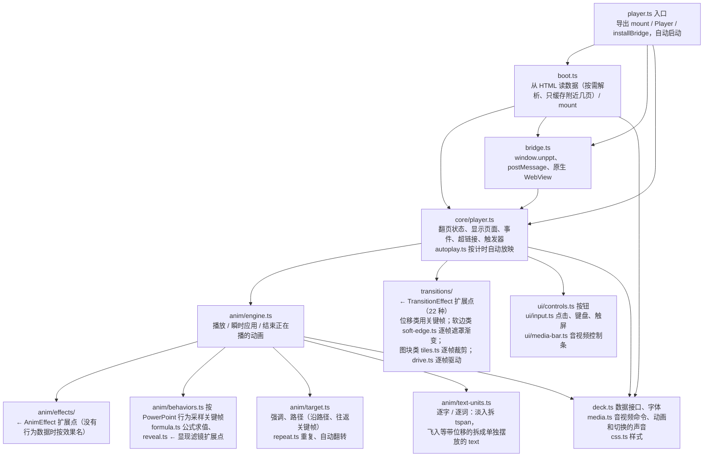
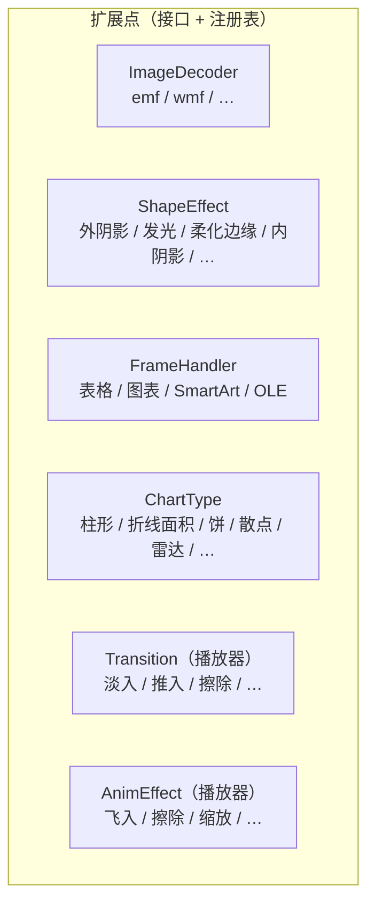
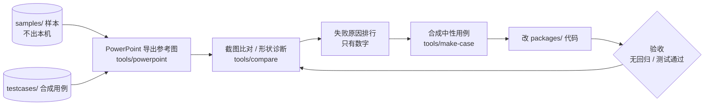

# unppt 技术架构

> 这份文档和代码一起迭代：改了模块结构、加了扩展点，就在同一个提交里更新这里的图。
> 图用 Mermaid 写，GitHub 上直接显示成图，改图就是改文本。

## 1. 总体


- **转码器和播放器只通过 `@unppt/format` 里定义的数据格式交流**（`Deck`、`DeckSlide`、`AnimAction`、`SlideTransition`、bridge 协议）。两边可以独立部署、独立升级。
- 转码器不依赖任何环境：输入是字节（或按需读取的数据源），输出是字节流；字体只是可选输入。

## 2. 转码器内部分层

上层可以依赖下层，下层不能依赖上层，不允许循环依赖。这些规则由 `scripts/check-deps.mjs` 自动检查（`npm test` 里的"架构守门"测试），违反了测试直接失败。

```mermaid
flowchart TB
  entry["入口 index.ts / cli.ts<br/>convert：逐页、流式输出 HTML 或数据"]
  anim["anim/<br/>时间线编排 anim.ts、单个效果 effect.ts<br/>进入/退出的行为 behaviors.ts（关键帧、公式、时间变换原样带给播放器）<br/>时间设置和变换 timing-util.ts、动画和切换的声音 sound.ts<br/>音视频放映选项 media-opts.ts<br/>强调终态 emphasis.ts、运动路径 motion.ts、切换 transition.ts"]
  render["render/<br/>render.ts 分派、继承；context.ts 渲染能力接口<br/>elements/ 形状、图片、组合；table.ts 表格；box.ts 位置框<br/>frames/ ← FrameHandler 扩展点"]
  chart["chart/<br/>图表：chart.ts 标题和编排、legend.ts 图例<br/>cat-chart.ts 分类轴图、sides.ts 坐标轴在哪一侧和刻度线<br/>axis.ts 刻度（对数、逆序、显示单位）、xy.ts 数值×数值坐标<br/>trendline.ts 趋势线、error-bars.ts 误差线<br/>layout.ts 实测间距规律、types/ ← ChartType 扩展点"]
  media["media/<br/>图片、音视频、共享资源<br/>decoders ← ImageDecoder 扩展点"]
  text["text/<br/>文本框属性 → 逐段排版（测量、断行、项目符号）→ 排位置 placeLines → 输出 SVG<br/>艺术字变形 warp.ts（字形轮廓弯进包络 / 沿路径排）"]
  effects["effects/<br/>← ShapeEffect 扩展点（形状、文字共用）、映像"]
  style["style/<br/>fill 填充、pattern 图案（实测点阵）<br/>line 线条（含复合线型、渐变线）、gradient-stops 渐变色标（实测插值规律）、blip 图片调整"]
  font["font/<br/>TrueType 解析、字距、字形轮廓 glyf.ts、子集化 subset.ts<br/>嵌入字体还原 eot.ts → lzcomp.ts → ctf.ts，sfnt.ts 读写公共部分"]
  geometry["geometry/<br/>公式引擎、187 种预设形状、40 种文字变形<br/>路径遍历 walkGeometry（输出 SVG 或按点采样）"]
  model["model/<br/>演示文稿 / 主题 / 母版 / 版式、颜色"]
  common["common/<br/>SVG 输出工具、超链接"]
  io["io/<br/>数据源、ZIP、XML、OPC 包"]
  entry --> anim & render & media & font
  render --> chart & media & text & effects & style & geometry
  chart --> style & font
  text --> effects & style & font & geometry
  effects --> model
  style --> model
  media --> model
  anim --> model
  font --> common
  geometry --> common
  model --> common
  common --> io
```

## 2b. 播放器内部



### 重构前的问题和进度（2026-10-13 评估）

| 位置 | 问题 | 违反的原则 |
|---|---|---|
| ~~`player.ts`（约 800 行）~~ | ~~一个类包了所有事~~ → 已拆成 core / anim / transitions / ui / bridge / boot | 单一职责 |
| ~~播放器切换、动画效果~~ | ~~`switch` 分支~~ → 已改为 `TransitionEffect`、`AnimEffect` 注册表 | 开闭 |
| ~~`chart.ts`（约 740 行）~~ | ~~巨型函数、if/else~~ → 已拆成读取 / 格式 / 坐标轴 / 绘制工具 / 编排，每种图表一个文件 | 单一职责、开闭 |
| ~~`text.ts`（约 690 行）~~ | ~~混在一起~~ → 已拆成 body（文本框属性）/ style（样式合并）/ measure（测量、字体替代、字距）/ linebreak（断行禁则）/ bullets（项目符号编号）/ paragraph（单段排版）/ emit（定位输出）/ svg-text | 单一职责 |
| ~~`render.ts`~~ | ~~分派写死、和 `table.ts` 循环依赖~~ → 已改为 `FrameHandler` 注册表，表格只依赖 `FrameRenderer` 接口 | 开闭、依赖倒置 |
| ~~`fill.ts`~~ | ~~填充、线条、图片调整、形状效果混在一起~~ → 已拆成 `style/fill.ts`、`style/line.ts`、`style/blip.ts` 和 `effects/` | 单一职责 |
| ~~`media.ts`~~ | ~~图片格式写死~~ → 已改为 `ImageDecoder` 注册表 | 开闭 |

## 3. 扩展点

原则：**加一个新功能 = 加一个文件 + 在注册表里加一行**，不改别人的文件。每个扩展点有一个接口。多人协作的约定见 [CONTRIBUTING.md](../CONTRIBUTING.md)。



| 扩展点 | 接口 | 怎么加一个新的 |
|---|---|---|
| 图片格式 | `ImageDecoder`（`media/image-decoder.ts`） | 新建 `media/xxx.ts` 导出一个 `ImageDecoder`，在 `media/decoders.ts` 加一行。例：`emf.ts`、`wmf.ts` |
| 形状效果 | `ShapeEffect`（`effects/shape-effect.ts`） | 新建 `effects/xxx.ts` 导出一个 `ShapeEffect`（返回一层滤镜：画在形状下面 / 替换形状 / 盖在上面），在 `effects/effects.ts` 按叠放顺序加一行。例：`glow.ts`、`soft-edge.ts`、`outer-shadow.ts`、`inner-shadow.ts`。不在 `a:effectLst` 里的层（三维棱台 `bevel.ts`，来自 `a:sp3d`）通过 `effectFilter` 的 `extra` 参数加入 |
| graphicFrame 内容 | `FrameHandler`（`render/frames/frame-handler.ts`） | 新建 `render/frames/xxx-frame.ts` 导出一个 `FrameHandler`（按 `a:graphicData` 的 uri 结尾匹配），在 `render/frames/frames.ts` 加一行。handler 只依赖窄接口 `FrameRenderer`；需要内部单独做动画的部分时用传进来的框编号拼子编号（拼法统一在 `common/uid.ts`，例：SmartArt 的每个形状）。例：表格、图表、SmartArt、OLE |
| 图表类型 | `ChartType`（`chart/chart-type.ts`） | 新建 `chart/types/xxx.ts` 导出一个 `ChartType`：声明对应的 XML 元素名、读系列的规则、图例样式；占满绘图区的图实现 `render`，画在共享分类轴上（可组合）的图实现 `renderOnAxes`，坐标一律用 `CategoryFrame` 的 `catPx` / `catSpan` / `valPx` 换算（坐标轴逆序等由 `cat-chart.ts` 处理，类型不用管）。趋势线由公共部分画（`extras.ts`），误差线由类型在数据点上调用 `error-bars.ts` 画；部件编号见 `common/uid.ts`。横轴、纵轴都是数值轴的类型（散点、气泡）共用 `xy.ts` 的坐标框架，只实现自己的标记。数据点、整条线、数据标签用 `draw.ts` 的 `cpart` 包起来（"按系列/按类别"动画的目标，系列序号用 `Series.index`）。在 `chart/chart-types.ts` 加一行。例：`bar.ts`、`line-area.ts`、`pie.ts`、`scatter.ts`、`radar.ts` |
| 页面切换（播放器） | `TransitionEffect`（`player/src/transitions/transition.ts`） | 新建 `transitions/xxx.ts` 导出一个 `TransitionEffect`，在 `transitions/transitions.ts` 加一行；没注册的按淡入。三种画法：位移/透明度用关键帧（`push.ts`、`cover.ts`、`fade.ts`）；软边扫过用 `soft-edge.ts` 的 `maskTransition` 逐帧设遮罩渐变（`wipe.ts`、`circle.ts`、`wheel.ts`）；图块用 `tiles.ts` 的 `tileTransition` 逐帧设裁剪多边形（`dissolve.ts`、`checker.ts`）；`morph.ts`（平滑切换，按 `data-name` 配对前后两页的对象）。转码器里 PowerPoint 的切换名到这些类型的对应在 `anim/transition.ts` 的表里，3D 切换的近似也在那里选。用 `tools/powerpoint/transitions.py` 和 PowerPoint 放映逐帧对照 |
| 进入/退出动画效果（播放器） | `AnimEffect`（`player/src/anim/effects/anim-effect.ts`） | 新建 `anim/effects/xxx.ts` 导出一个 `AnimEffect`（给出关键帧，退出自动倒放），在 `anim/effects/effects.ts` 加一行；没注册的按淡入淡出。例：`fly.ts`、`shape.ts`（形状向内/向外）、`wheel.ts`、`blinds.ts`；裁剪类效果的公共工具在 `clip.ts` |
| 显现滤镜（播放器） | `anim/reveal.ts` 的 `FILTERS` | PowerPoint 动画行为里的 `p:animEffect` 滤镜（`wipe(down)`、`circle(in)`、`wheel(4)`……）。加一种：在 `FILTERS` 里加一项 `名字(进度, 参数, 元素) => clip-path`，不同进度的结果结构要相同（才能插值）；退出时播放器自动取"外框减去它"。转码器把整个效果的行为原样带过来（`transcoder/src/anim/behaviors.ts`），播放器在 `anim/behaviors.ts` 里按元素真实位置代公式、按时间变换采样 |

重构的安全网：`node scripts/golden.mjs save` 记录全部测试用例的输出，重构后 `node scripts/golden.mjs check` 必须**逐字节一致**；行为改动（修 bug、加功能）不走这条路，走比对和逐页回归。

## 4. 开发闭环


