[中文](../zh/architecture.md)

# unppt Architecture for Beginners

This document is for **people reading unppt's internals for the first time**, especially junior programmers. After reading it you should be able to answer:

- What is each folder in the repository for?
- How does a `.pptx` turn into a web page, step by step?
- Why is the project split into a "transcoder" and a "player"?
- If I want to add a new chart type or animation, which file do I touch?
- What does `npm run build` actually do? Which third-party libraries are used?

> For module-by-module details (what every file does, the full rules of every extension point) read the developer document [docs/architecture.md](../architecture.md) (in Chinese). This page is its beginner-friendly companion. The single source of truth for requirements is [SPEC.md](../../SPEC.md).

---

## 0. A few terms first

| Term | Meaning |
|---|---|
| **pptx** | PowerPoint's file format. It is actually a **ZIP archive** containing many XML files (one per slide, one for the theme, one for the master...) plus images, audio and video. |
| **XML** | A text format that stores data in angle-bracket tags, e.g. `<a:t>Hello</a:t>`. |
| **OPC** | Open Packaging Conventions: the rules for "XML files inside a ZIP that reference each other", used by pptx. |
| **EMU** | English Metric Unit, PowerPoint's internal length unit. 1 inch = 914400 EMU; at 96 DPI **1 pixel = 9525 EMU** (`EMU_PER_PX = 9525` in `model/model.ts`). |
| **SVG** | Scalable Vector Graphics, a vector image format browsers understand natively, also written with tags. unppt draws every slide as a piece of SVG. |
| **Transcoder** | The program that turns a pptx into output files (`packages/transcoder`). |
| **Output** | What the transcoder produces: one HTML file with the player built in, or an HTML file + one data file per slide + a `media/` folder. |
| **Player** | The JavaScript program that plays the output in a browser (`packages/player`): page turning, animations, slide transitions. |
| **iframe** | The `<iframe>` tag, a "window" that embeds one web page inside another. The output can be placed in an iframe. |
| **postMessage** | The browser API for sending messages between windows. The outer page uses it to control the player inside the iframe (next, go to, get state). |
| **WASM** | WebAssembly, binary code that runs directly in Node and browsers. Libraries written in C/C++/Rust can be compiled to WASM and used from JS. |
| **Native addon** | An npm package that must be compiled for each operating system (e.g. ships a `.node` file). unppt does **not** use them. |
| **SSIM** | Structural Similarity, a score from 0 to 1 for how alike two images are (closer to 1 = more alike). unppt compares a PowerPoint screenshot with an unppt screenshot; a page passes at SSIM >= 0.95 (how it is computed: [Fidelity](fidelity.md#ssim)). |
| **esbuild** | A very fast JS/TS bundler that combines many source files into one JS file. |
| **monorepo** | One Git repository holding several related packages. |

---

## 1. The whole picture in one diagram

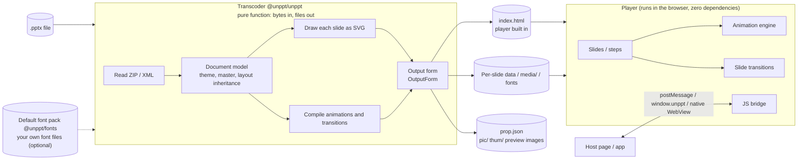

In one sentence: **the transcoder runs on a server (or your computer) and turns a pptx into static files; the player runs in the viewer's browser and plays those static files.** The only thing connecting them is the output format.

---

## 2. Repository layout (monorepo)

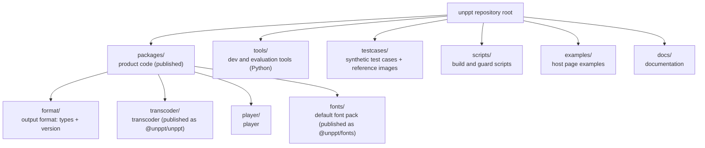

| Folder | What it does | Published to npm? |
|---|---|---|
| `packages/format` | TypeScript types of the output format: `Deck`, `DeckSlide`, `AnimAction`, `SlideTransition`, `PlayerState`, the bridge messages `BridgeCommand` / `BridgeReply` / `BridgeEvent`, and the versions `DECK_FORMAT_VERSION` and `UNPPT_VERSION`. **The only contract between transcoder and player.** | Types only; bundled into transcoder and player |
| `packages/transcoder` | The transcoder, in TypeScript. Entry points: `src/index.ts` (the `convert` function) and `src/cli.ts` (the `unppt` command). | Yes, as `@unppt/unppt` |
| `packages/fonts` | The default font pack: open-source fonts (SIL OFL 1.1; the font files are not in git, run `node scripts/fetch-fonts.mjs` once when developing to download and verify them), the metrics pack `metrics/` (numbers only), and the mapping rules `map.json`. | Yes, as `@unppt/fonts` (a dependency of `@unppt/unppt`) |
| `packages/player` | The player, TypeScript, zero dependencies. Entry `src/player.ts`; `src/host.ts` is a small helper `UnpptFrame` for host pages. | The player code is embedded into the transcoder's output |
| `tools/` | Python dev tools: `tools/powerpoint` drives the local PowerPoint to export reference images; `tools/make-case` builds synthetic cases with PowerPoint; `tools/compare` screenshots, compares and scores; `check-player.py` and friends are end-to-end player tests. | No (dev machine only) |
| `testcases/` | Synthetic test cases: an `xxx.pptx` plus a folder of the same name with the reference images exported by PowerPoint. All content is neutral and can be committed. | No |
| `scripts/` | `build.mjs` builds; `check-deps.mjs` is the architecture guard (layering and cycle checks); `golden.mjs` is the refactoring safety net; `esbuild-libjpeg.mjs` is an esbuild plugin used by the build. | No |
| `examples/` | `iframe-host.html` (embed and control the player in an iframe), `live-class.html` (presenter/viewer sync for a live class). | No |

---

## 3. Why do transcoder and player talk only through the output format?

Think of a parcel delivery: the sender (transcoder) packs things in an agreed format, the receiver (player) unpacks using the same format. Neither needs to know how the other works inside.

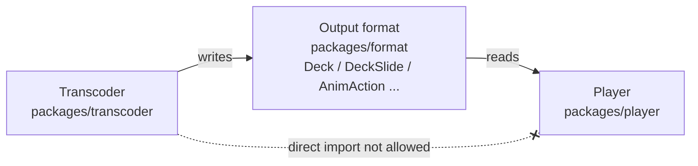

Benefits (SPEC decision D4):

1. **Deploy separately**: the transcoder can run in a cloud function, the player only in browsers.
2. **Upgrade separately**: the format carries a version `DECK_FORMAT_VERSION` (currently `1`); a player that meets an unknown version must fail clearly.
3. **Test separately**: transcoder output can be compared byte by byte; the player has its own end-to-end tests.

This is not left to discipline, it is **checked automatically**: `scripts/check-deps.mjs` allows `player/src` to depend only on `format/src`, and the transcoder layers may use `format/src` but never the player. A violation fails `npm test`.

---

## 4. Design principles

From [SPEC.md](../../SPEC.md) section 2 and the project's `CLAUDE.md`:

| Principle | What it means | Why |
|---|---|---|
| **Pure function: bytes in, files out** | `convert(input, { write, fonts? })`: input is bytes (`Uint8Array` / `ArrayBuffer`) or a random-access source `{ size, read(offset, length) }`; output goes through the caller's `write(path, data)`. The transcoder **never touches the disk or the network** itself. | The caller decides where files come from and go to, so it works in Node, cloud functions and browsers. Big files are read on demand, not loaded whole into memory. |
| **Fonts only as bytes** | Fonts are passed in via the `fonts` option (font file bytes) and the `fontPack` option (the default font pack, loaded in Node with `loadFontPack()`); the transcoder never searches the system. The glyphs used are always embedded as subsets, and playback never uses fonts on the viewer's computer (SPEC D3). | Every viewer sees the same thing, and the same input converts to the same result on a desktop, a server or a cloud function. |
| **No native addons, no external programs** | Product code may only use pure JS and WASM libraries; every new library states its license and a pinned version. | Installs and runs in any Node environment. |
| **Zero-dependency player** | The player imports no third-party library; viewing needs only a browser. | Output opens by double-click, in an iframe, or in an app's WebView. |
| **Self-built core rendering** | The slide SVG and animations used for playback are written in-house and must match PowerPoint pixel by pixel; third-party renderers are only used for side features such as thumbnails (resvg). | Full control over the core result. |
| **PowerPoint is the only reference** | "Correct" means "what the local Microsoft PowerPoint produces". | The goal is "looks like PowerPoint". |
| **SOLID: new feature = new file + one registry line** | New capabilities go through extension points instead of growing big files or big `switch` statements; modules depend only on lower layers and narrow interfaces. | People don't edit each other's files and are less likely to break other features. |

---

## 5. Inside the transcoder: the layered module map

The transcoder source lives in `packages/transcoder/src`, split into folders (modules). **Upper layers may use lower layers; lower layers may not use upper ones, and cycles are forbidden.** The diagram below mirrors the `RULES` table in `scripts/check-deps.mjs` (arrows mean "may depend on"; only the main direct relations are drawn for clarity):

```mermaid
flowchart TB
  entry["Entry<br/>index.ts (convert, checkFonts) / cli.ts (command line), cli-check.ts<br/>node-pool.ts / raster-worker.ts (Node parallel rasterizing), node-fonts.ts (reads the default font pack)"]
  preview["preview/<br/>slide images and thumbnails (rasterized with resvg)"]
  output["output/<br/>output forms: single / paged / pages / data"]
  anim["anim/<br/>animation timeline, transitions"]
  render["render/<br/>per-slide dispatch: shapes, pictures, groups, tables<br/>frames/ graphicFrame contents"]
  chart["chart/<br/>charts"]
  media["media/<br/>images, audio/video, image decoding"]
  text["text/<br/>text layout"]
  effects["effects/<br/>shadow, glow, soft edge, bevel"]
  style["style/<br/>fill, line, gradient, 3D"]
  font["font/<br/>font parsing, font library, default font pack, subsetting"]
  geometry["geometry/<br/>preset shapes, formula engine"]
  model["model/<br/>presentation, theme, master, colors"]
  common["common/<br/>SVG helpers, hyperlinks, ids, line-break punctuation rules"]
  io["io/<br/>data source, ZIP, XML, OPC package"]
  format[("format/<br/>output format")]

  entry --> preview & output & anim & render
  preview --> media & font
  output --> media
  output --> format
  anim --> model
  anim --> format
  render --> chart & media & text & effects & style & geometry
  chart --> style & font
  text --> effects & style & font & geometry
  media --> model
  effects --> model
  style --> model
  font --> common
  geometry --> common
  model --> common
  common --> io
```

Reading bottom-up, what each layer does:

| Layer (folder) | Responsibility | Allowed dependencies (from `check-deps.mjs`) |
|---|---|---|
| `io/` | Turns input into a random-access source (`source.ts`), reads ZIP (`zip.ts`, via zip.js), parses XML (`xml.ts`, via saxes), finds parts and relationships by OPC rules (`package.ts`). | none |
| `common/` | SVG output helpers (`svg.ts`), hyperlinks (`links.ts`), content hashes (`hash.ts`), animation target ids (`uid.ts`), line-break punctuation rules (`kinsoku.ts`: which punctuation may not start or end a line, shared by body text and chart label wrapping). | io |
| `model/` | Presentation / theme / master / layout inheritance (`model.ts`), colors (`color.ts`), speaker notes (`notes.ts`), font-name charsets (`font-charsets.ts`), 3D lighting constants. | io, common |
| `geometry/` | Formula engine, preset shape data (`presets-data.ts`), text warp data (`warps-data.ts`), bounding box after rotation. | io, common |
| `font/` | Reads fonts (`font.ts`, `cmap.ts`, `kern.ts`, glyph outlines `glyf.ts` / `cff.ts`), the font library (`library.ts`: finds a font by name and weight; fonts embedded in the PPT or given by the caller win over the default pack), Regular / Bold instances of variable fonts (`fvar.ts`, `instance.ts`), font subsetting (`subset.ts`, HarfBuzz WASM; symbol fonts get a Unicode cmap first, `symbol-cmap.ts`), restores embedded fonts (`eot.ts` -> `lzcomp.ts` -> `ctf.ts`), the default font pack (`pack.ts`), the font check (`check.ts`). | io, common |
| `style/` | Fill `fill.ts`, patterns `pattern.ts`, lines `line.ts`, arrowheads `arrowheads.ts`, gradients `gradient-stops.ts`, picture adjustments `blip.ts`, 3D `camera.ts` / `lighting.ts`, perspective `perspective.ts`. | io, common, model |
| `effects/` | Shape effects as SVG filters: `outer-shadow.ts`, `inner-shadow.ts`, `glow.ts`, `soft-edge.ts`, `bevel.ts`, reflection `reflection.ts`, 3D contour `contour.ts`. | io, common, model |
| `text/` | Text box properties -> per-paragraph layout (measuring, line breaking, bullets) -> positioning -> SVG text; WordArt warp `warp.ts`. | io, common, model, geometry, font, style, effects |
| `media/` | Image and audio/video resources (`media.ts`), EMF / WMF / TIFF decoding, PNG / JPEG encode/decode, format sniffing by file header (`sniff.ts`). | io, common, model |
| `chart/` | Charts: title, legend, axes, data labels (wrapping in `label-wrap.ts`, pie labels inside or outside the slice in `pie-labels.ts`), trendlines, 3D charts... each chart type lives in `chart/types/`. | io, common, model, font, style |
| `render/` | The per-slide dispatcher `render.ts` (`renderSlide`): routes elements to shape, picture, group, table; `frames/` handles "frames" such as tables, charts, SmartArt and OLE (`chart-fonts.ts`: chart text also uses only fonts embedded in the output). | all lower layers except anim / output / preview |
| `anim/` | Compiles PowerPoint's animation timeline into `AnimAction`s the player can play (`anim.ts`), maps transition names (`transition.ts`), sounds (`sound.ts`). | io, common, model, format |
| `output/` | Output forms (`single.ts`, `paged.ts`, `data.ts`) and `prop.json`, written by every form (`prop.ts`). | io, common, media, format |
| `preview/` | Slide images `pic/` and thumbnails `thum/`: prepare (`prepare.ts`) -> paint with resvg (`paint.ts`) -> save as JPEG. | io, common, media, font |
| Entry | `convert` in `index.ts` wires all layers together, `checkFonts` only lays out and returns the font check; `cli.ts` is the command line (the text output of `unppt check` is in `cli-check.ts`); `node-pool.ts` is the Node rasterizing thread pool, `node-fonts.ts` reads the default font pack from disk (`loadFontPack`). | everything (`*`) |

> Tip: there is no `anim -> render` arrow. Animation compilation only needs data handed over by the render layer (the timeline XML and the `data-uid` ids in the slide), passed along by `index.ts`, so the two layers stay independent.

---

## 6. What happens during one conversion

### 6.1 From the command line to written files

```mermaid
sequenceDiagram
  participant U as User
  participant CLI as cli.ts
  participant C as convert (index.ts)
  participant R as renderSlide (render/)
  participant A as anim/
  participant I as SlideImages (preview/)
  participant O as OutputForm (output/)
  participant W as write callback

  U->>CLI: unppt deck.pptx
  CLI->>CLI: loadFontPack() reads the default font pack; read resvg.wasm, create raster thread pool by CPU and memory
  CLI->>C: convert(source, options)
  C->>C: open ZIP, read OPC package, load Presentation (theme, master, layout)
  C->>C: load fonts (embedded fonts, fonts, default font pack fontPack)
  C->>O: form.write(slides generator, ...)
  loop each slide
    O->>C: ask for next slide
    C->>R: renderSlide(slide, env)
    R-->>C: slide SVG + animation timeline + transition
    C->>A: compileTiming / compileTransition
    A-->>C: steps, auto, hidden, transition
    C->>I: images.add(slide number, SVG) (slide image, thumbnail)
    C-->>O: DeckSlide
    O->>W: stream index.html or per-slide files
  end
  O->>C: fontFiles() - subset the used glyphs
  O->>C: meta() - slide count, size, report
  O->>W: write the tail (metadata + player script)
  C->>W: write prop.json
  C-->>CLI: ConvertResult (slides, width, height, report, font check)
```

Things worth noticing:

- **One slide at a time**: slides come from an `async` generator (`slides()`); the output form writes each slide as soon as it gets it and then releases it, so big files don't exhaust memory.
- **One bad slide does not break the deck**: if rendering a slide throws, a blank white slide is written and a warning goes into the report.
- **Images are optional**: with `images: false`, no `pic/` and `thum/` are produced, but `prop.json` is always written.

### 6.2 Main `convert` options

The structure of `ConvertOptions` (`packages/transcoder/src/index.ts`) and related types:

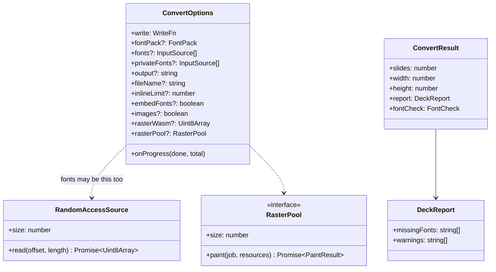

| Option | Meaning |
|---|---|
| `write` | Required. Function that writes a file; paths are relative, e.g. `index.html`, `media/video1.mp4`. |
| `fontPack` | The default font pack (`@unppt/fonts`): layout with the original font's metrics, display with open-source fonts. In Node load it with `loadFontPack()` from `@unppt/unppt/node`. |
| `fonts` | Font files (ttf / otf / ttc) specified by the caller, as bytes; they win over the font pack for the same name. |
| `privateFonts` | Old option, same as `fonts`. |
| `output` | Output form: `single` (default, old name `html`), `paged`, `pages`, `data`. |
| `fileName` | Main file name, default `index.html` (`deck.json` for `data`). |
| `inlineLimit` | Images smaller than this many bytes are inlined into the HTML; default 2MB. |
| `embedFonts` | Subset the used glyphs and embed them in the output; on by default since 0.3.0 (`false` is for debugging only). |
| `images` | Whether to write slide images and thumbnails; on by default. |
| `rasterWasm` | The resvg WASM bytes (the CLI reads `dist/resvg.wasm` from the package automatically). |
| `rasterPool` | Parallel rasterizer, e.g. `createRasterPool` from `@unppt/unppt/node`. |
| `onProgress` | Optional; called once after each slide. |

To only find out whether the fonts are fine, call `checkFonts(input, { fontPack, fonts })`: it lays out every slide but writes nothing and returns the same data as `ConvertResult.fontCheck` (on the command line: `unppt check`).

### 6.3 What the output contains

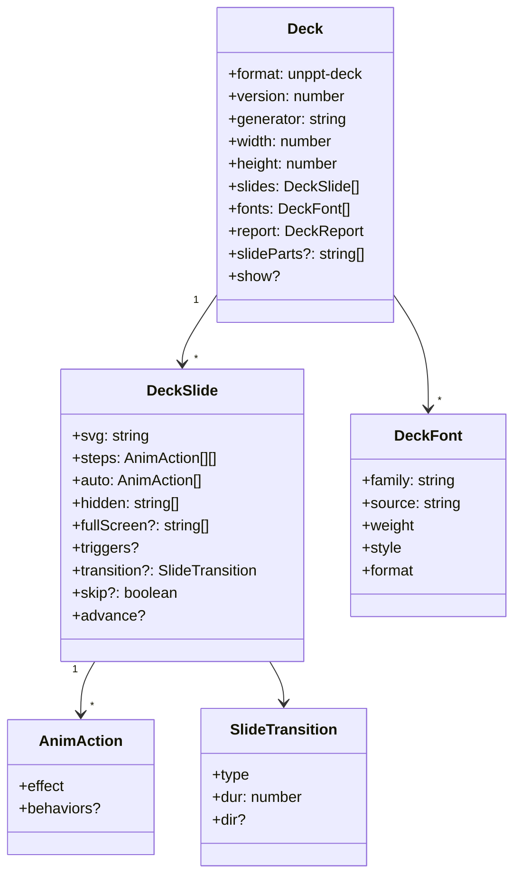

- `svg`: the static picture of the slide. Elements that can animate carry a `data-uid` attribute.
- `steps`: one group of actions per click; `steps.length` is the number of clicks on this slide.
- `auto`: actions run automatically on entering the slide; `hidden`: elements hidden at first (those with entrance animations).

The output forms only **put this data into different files**:

| Form | Files | Where the player reads from |
|---|---|---|
| `single` | One `index.html` containing slides, images, fonts and the player (large media go to `media/`) | `<script id="unppt-meta">` and each slide's `script.unppt-slide` |
| `paged` | Entry `index.html` (player + index) + one data script per slide + resource files | `<script id="unppt-index">`; slides are loaded on demand with `<script>` tags (callbacks `__unpptPage`, `__unpptFont`) |
| `pages` | Like `paged`, plus a standalone HTML per slide | Same as above |
| `data` | Just `deck.json` (for debugging) | — |

---

## 7. Inside the player

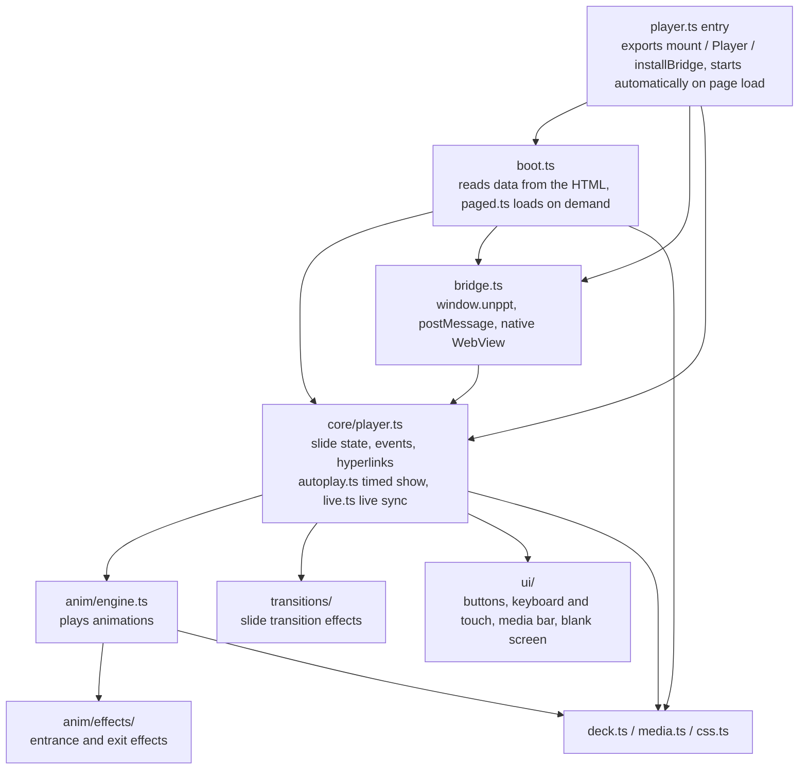

### 7.1 Player state

The player's position is described by `PlayerState`: slide number `slide` and step number `step` (both start at 0; the type is defined in `packages/format`). "Next" first plays this slide's animations step by step, then moves to the next slide. Note: `step` and the `change` event are updated when an animation **starts**, not when it finishes:

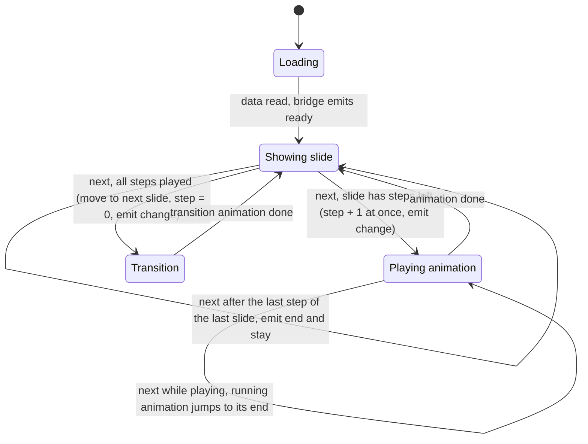

### 7.2 How a host page talks to the player in an iframe

The outer page sends a `BridgeCommand` via `postMessage` (`cmd` is one of `next`, `prev`, `goto`, `sync`, `getState`); the player answers with a `BridgeReply` and sends a `BridgeEvent` (`ready`, `change`, `end`, `link`) when its state changes. Every message carries `unppt: 1`. `UnpptFrame` in `packages/player/src/host.ts` wraps this into Promises:

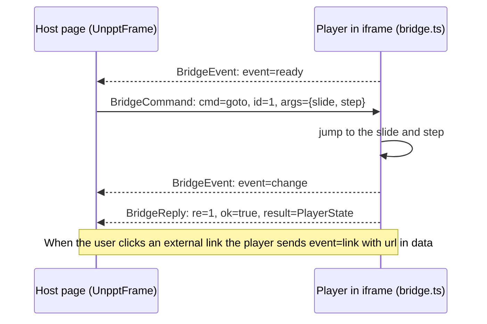

See `examples/iframe-host.html` for a complete example.

---

## 8. Extension points: new feature = new file + one registry line

An "extension point" is **an interface plus a registry array**. To add something new, create a file that implements the interface and add one line to the registry array; nobody else's code changes.

| Extension point | Interface file | Registry | Registered today |
|---|---|---|---|
| graphicFrame contents | `transcoder/src/render/frames/frame-handler.ts` | `FRAME_HANDLERS` (`frames.ts`) | `tableFrame`, `diagramFrame` (SmartArt), `chartFrame`, `oleFrame` |
| Chart types | `transcoder/src/chart/chart-type.ts` | `CHART_TYPES` (`chart-types.ts`) | bar/column, line, area, pie, doughnut, scatter, radar, bubble, pie-of-pie, stock |
| Image formats | `transcoder/src/media/image-decoder.ts` | `IMAGE_DECODERS` (`decoders.ts`) | EMF, WMF, TIFF |
| Shape effects | `transcoder/src/effects/shape-effect.ts` | `SHAPE_EFFECTS` / `TEXT_EFFECTS` (`effects.ts`) | soft edge, outer shadow, glow, inner shadow |
| Output forms | `transcoder/src/output/output.ts` | `OUTPUT_FORMS` (`forms.ts`) | `single`, `paged`, `pages`, `data` |
| Slide transitions (player) | `player/src/transitions/transition.ts` | `TRANSITIONS` (`transitions.ts`) | 22 types; unregistered ones play as fade |
| Entrance/exit effects (player) | `player/src/anim/effects/anim-effect.ts` | `EFFECTS` (`effects.ts`) | fly, wipe, zoom, wheel, blinds and more; unregistered ones play as fade |
| Reveal filters (player) | `player/src/anim/reveal.ts` | the `FILTERS` object | `wipe`, `circle`, `wheel` and more |

### 8.1 Transcoder extension points

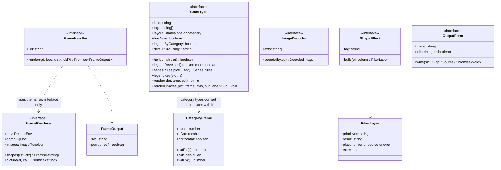

How to read these interfaces:

- **`FrameHandler`**: in a pptx, tables, charts, SmartArt and OLE objects all sit inside a "frame" called graphicFrame; the `uri` of its `a:graphicData` says what is inside. `render.ts` finds the handler with `FRAME_HANDLERS.find((f) => uri.endsWith(f.uri))`. A handler uses rendering only through the narrow `FrameRenderer` interface (draw a list of child shapes, draw a picture) and never depends on the concrete renderer class: this is "dependency inversion".
- **`ChartType`**: charts with `layout: 'standalone'` (pie, radar, scatter) fill the plot area themselves and implement `render`; `'category'` charts (column, line) are drawn on a shared category axis, can be combined, and implement `renderOnAxes`, converting coordinates with `CategoryFrame`'s `catPx` / `catSpan` / `valPx`. Title, legend and axes are handled centrally by `chart.ts`. (`horizontal`, `legendReversed`, `render` and `renderOnAxes` are optional methods in the code.)
- **`ImageDecoder`**: images browsers can't show (EMF, WMF, TIFF) are converted at transcode time; return `undefined` instead of throwing when parsing fails.
- **`ShapeEffect`**: one effect becomes one SVG filter layer; `place` decides whether it is drawn under the shape (shadow, glow), replaces it (soft edge) or goes on top (inner shadow).
- **`OutputForm`**: how per-slide data is written to files.

### 8.2 Player extension points

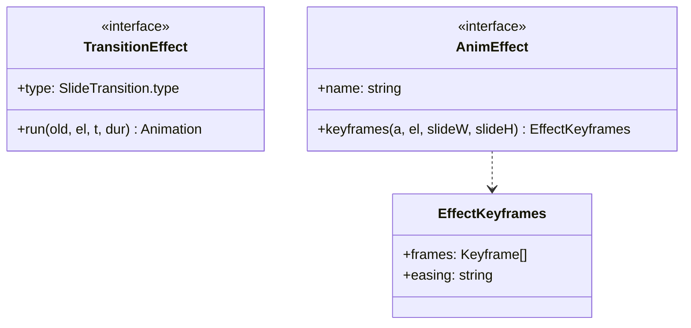

- **`TransitionEffect.run`**: `old` is the old slide, `el` the new one; it returns a Web Animations `Animation`, and the old slide is removed when it ends.
- **`AnimEffect.keyframes`**: returns the keyframes of the entrance effect; exit animations play them in reverse. If the transcoder carried PowerPoint's original animation behaviors (`AnimAction.behaviors`), the player samples keyframes from those first (`anim/behaviors.ts`) and only falls back to the `AnimEffect` by name otherwise.

### 8.3 Example: adding a new chart type

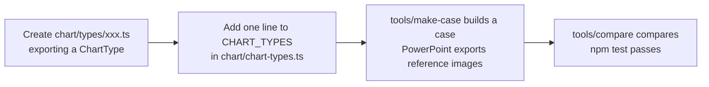

The full rules of every extension point (how data labels are looked up, how animation ids are composed...) are in the developer document [docs/architecture.md section 3](../architecture.md#3-扩展点).

---

## 9. The build pipeline (`npm run build`)

`npm run build` runs `node scripts/build.mjs`, which bundles with **esbuild**. The key idea: **bundle the player first, then inject the player code as a string into the transcoder**, so every HTML the transcoder writes carries its own player.

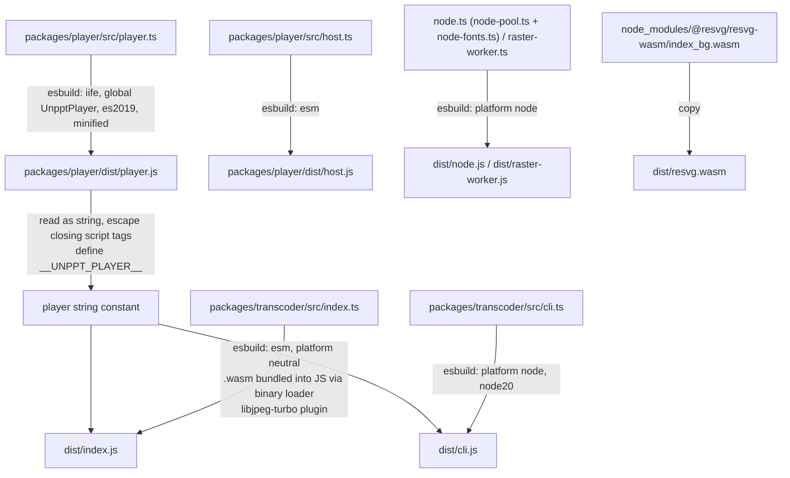

Step by step:

1. **Player**: `player.ts` is bundled into `packages/player/dist/player.js` as an IIFE (immediately invoked function) with the global name `UnpptPlayer`, targeting ES2019 (works in more WebViews). `host.ts` is bundled separately as the ESM module `host.js`.
2. **Embedding the player**: `build.mjs` reads `player.js`, escapes `</script` as `<\/script` (otherwise it would close the HTML `<script>` tag early), and defines it as the constant `__UNPPT_PLAYER__` through esbuild's `define`. The transcoder's `index.ts` declares `declare const __UNPPT_PLAYER__: string;` and passes it as `player` to the `OutputForm`; `single.ts` writes it into the final `<script>` of the HTML.
3. **Transcoder library** `dist/index.js`: `platform: 'neutral'` (tied to neither Node nor browsers), `mainFields: ['module', 'main']` (saxes and others only declare `main`). The `harfbuzz-subset.wasm` used for font subsetting and the libjpeg-turbo WASM used for JPEG encoding are **bundled straight into the JS** via `loader: { '.wasm': 'binary' }`.
4. **libjpeg-turbo plugin** (`scripts/esbuild-libjpeg.mjs`): its glue code calls `require("fs")` under Node to read the wasm file, which can't work once bundled as ESM. The plugin pins "is Node" to false and strips those `require`s and `__dirname`; if a library upgrade changes that code, the plugin throws instead of silently producing a broken bundle.
5. **utif2 patch**: `define` sets `window.UDOC` to `undefined`; otherwise it would throw in Node, where there is no `window`.
6. **Command line** `dist/cli.js` and **Node parallel rasterizing** `dist/node.js`, `dist/raster-worker.js`: `platform: 'node'`, target `node20`.
7. **resvg.wasm**: resvg's JS part is already bundled into the transcoder; the `.wasm` file is copied to `dist/resvg.wasm` and published next to `cli.js`. At runtime the CLI reads `resvg.wasm` from its own folder; if it can't, no images are produced, but `prop.json` is still written.

In the published `@unppt/unppt` `package.json`:

| Field | Value |
|---|---|
| `exports["."]` | `./dist/index.js` (`convert` etc.) |
| `exports["./node"]` | `./dist/node.js` (Node-only, e.g. `createRasterPool`, `loadFontPack`) |
| `exports["./resvg.wasm"]` | `./dist/resvg.wasm` |
| `bin.unppt` | `dist/cli.js` |
| `engines.node` | `>=20.12` |
| `dependencies` | `@unppt/fonts` (default font pack: open font files + metrics pack, used only while converting; the output contains only subsets of the glyphs used) |

### 9.1 Tests and guards

| Command | What it does |
|---|---|
| `npm test` | Runs the unit tests `packages/*/test/*.test.mjs`; `architecture.test.mjs` runs `scripts/check-deps.mjs` to check layering and cycles. |
| `npm run typecheck` | TypeScript type check (`tsconfig` enables `noUnusedLocals` / `noUnusedParameters`). |
| `node scripts/golden.mjs save` / `check` | Refactoring safety net: transcode all of `testcases/` and record hashes; after a refactor the output must be byte-identical. |

---

## 10. Third-party libraries

Product code uses only pure JS and WASM libraries, all with pinned versions (list and licenses in `packages/transcoder/THIRD-PARTY-NOTICES.md`). **The player uses no third-party library at all.**

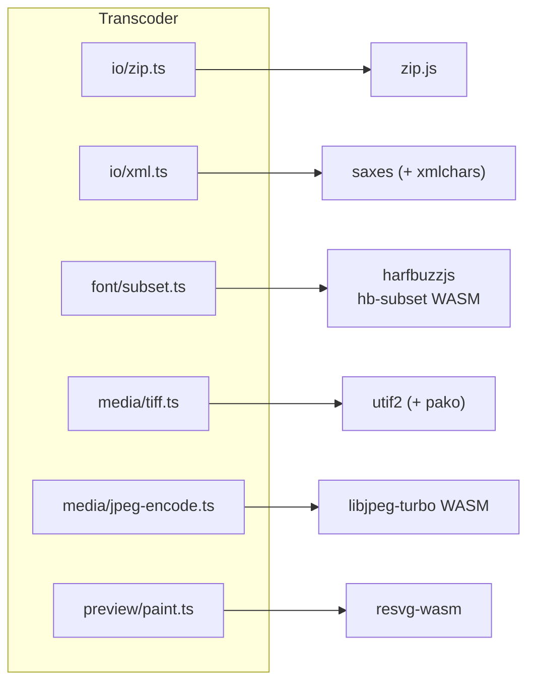

| Library | Version | License | Used in | Purpose |
|---|---|---|---|---|
| @zip.js/zip.js (read-only part) | 2.23.0 | BSD-3-Clause | `io/zip.ts` | Reads the pptx ZIP directory and entries |
| saxes (depends on xmlchars 2.2.0, MIT) | 6.0.0 | ISC | `io/xml.ts` | XML parsing |
| harfbuzzjs (its harfbuzz-subset.wasm) | 1.6.3 | MIT | `font/subset.ts` | Font subsetting: keep only the used glyphs to shrink the output; fixed-weight instances of variable fonts (`font/instance.ts`) |
| utif2 (depends on pako 1.0.11, MIT AND Zlib) | 4.1.0 | MIT | `media/tiff.ts` | Decodes TIFF images into PNG or JPEG |
| @cornerstonejs/codec-libjpeg-turbo-8bit (encoder only) | 1.2.8 | libjpeg-turbo: IJG + BSD-3-Clause + Zlib; wrapper: ISC | `media/jpeg-encode.ts` | JPEG encoding of slide images and thumbnails |
| @resvg/resvg-wasm | 2.7.0-alpha.2 | MPL-2.0 | `preview/paint.ts` | Rasterizes slide SVG into slide images and thumbnails (not used for playback) |

Development also uses `esbuild` (bundling), `typescript` (type checking) and `@types/node`; none of them ship in the package.

---

## 11. The development loop: how "looks like PowerPoint" is enforced

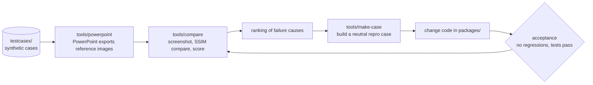

Some side-by-side comparisons, **Microsoft PowerPoint on the left, unppt on the right** (all synthetic test cases):

| Content | Comparison |
|---|---|
| Basic charts |  |
| Data labels |  |
| 3D shapes |  |
| SmartArt |  |
| Table styles |  |
| Text effects |  |
| All preset shapes |  |

The player UI:


Where things stand (0.3.1; full numbers in the [test report](test-report.md)):

| Test set | Size | Pass rate (SSIM >= 0.95) | Mean SSIM |
|---|---|---|---|
| Synthetic cases | 255 decks / 543 pages | 93.0% | 0.984 |
| Real-world decks | 5212 decks / 168662 pages, 0 conversion failures | 70.4% (93.5% of pages at SSIM >= 0.90) | 0.956 |

Most failing pages differ only in details (text a few pixels off, one chart label). Known gaps: chart date-axis time scaling (min/max, month/year intervals), `wordArtVert` vertical text, EMF+ records in EMF images, some SmartArt that needs re-layout, 3D bevel under 180-degree rotation, and the truncation threshold of 45-degree category labels.

---

## 12. Further reading

- [docs/architecture.md](../architecture.md): developer architecture document (Chinese), full rules for every module and extension point.
- [SPEC.md](../../SPEC.md): requirements, confirmed decisions, PowerPoint rules measured in practice.
- [CONTRIBUTING.md](../../CONTRIBUTING.md): collaboration conventions.
- [README.md](../../README.md): installation and quick start.
