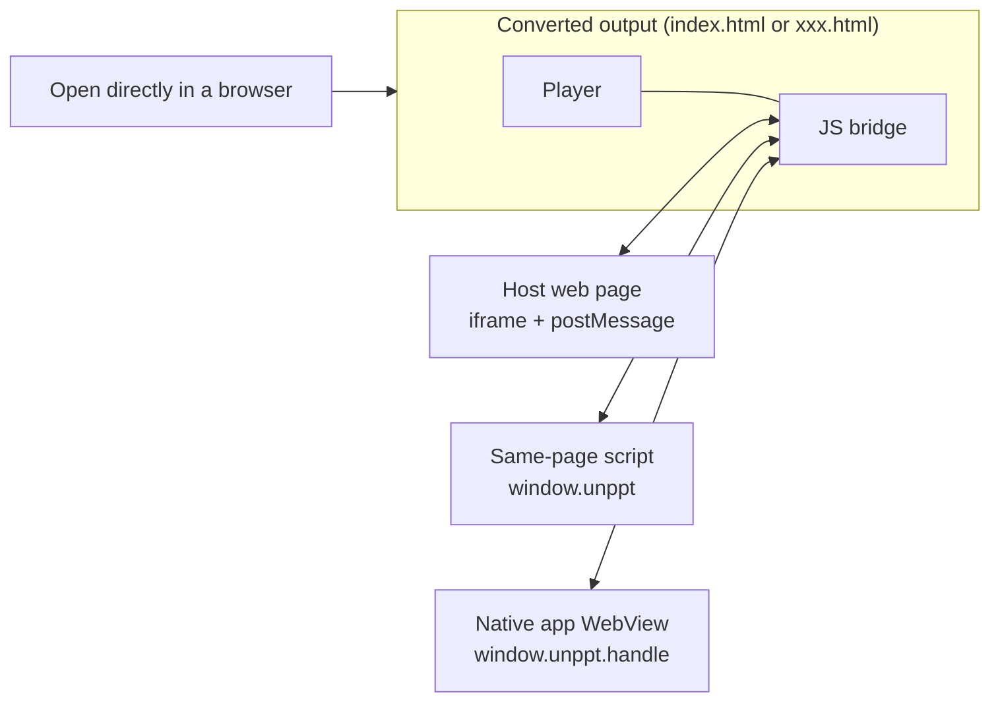
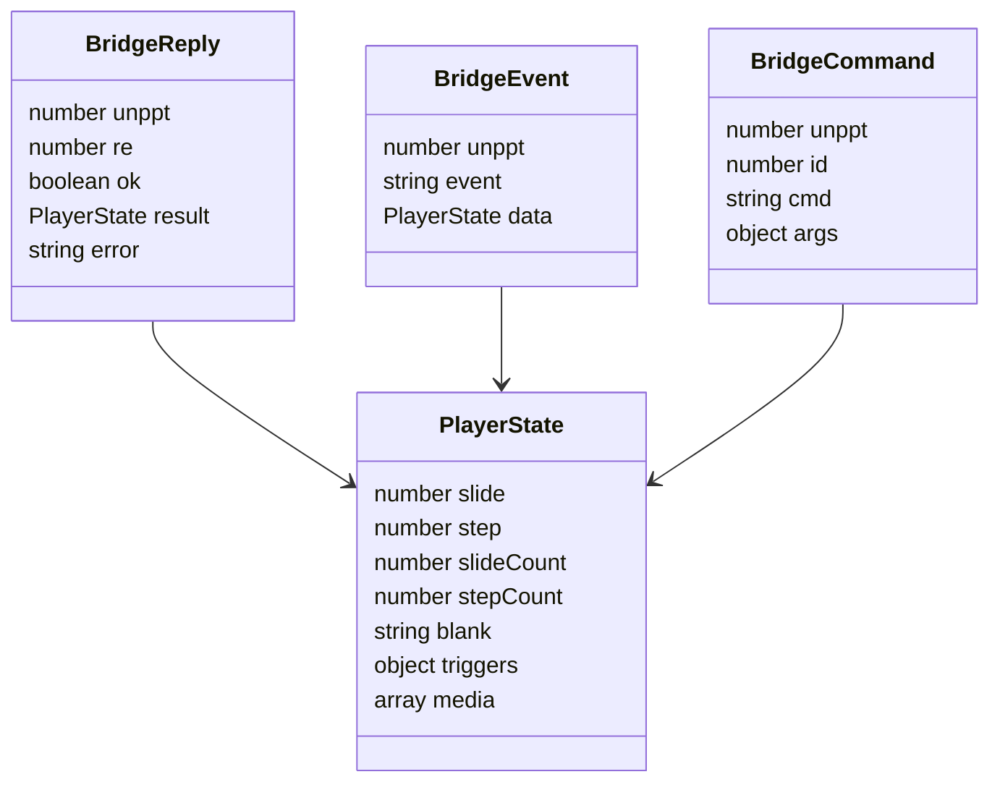
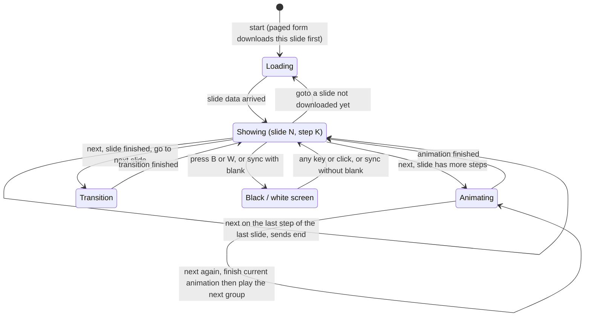
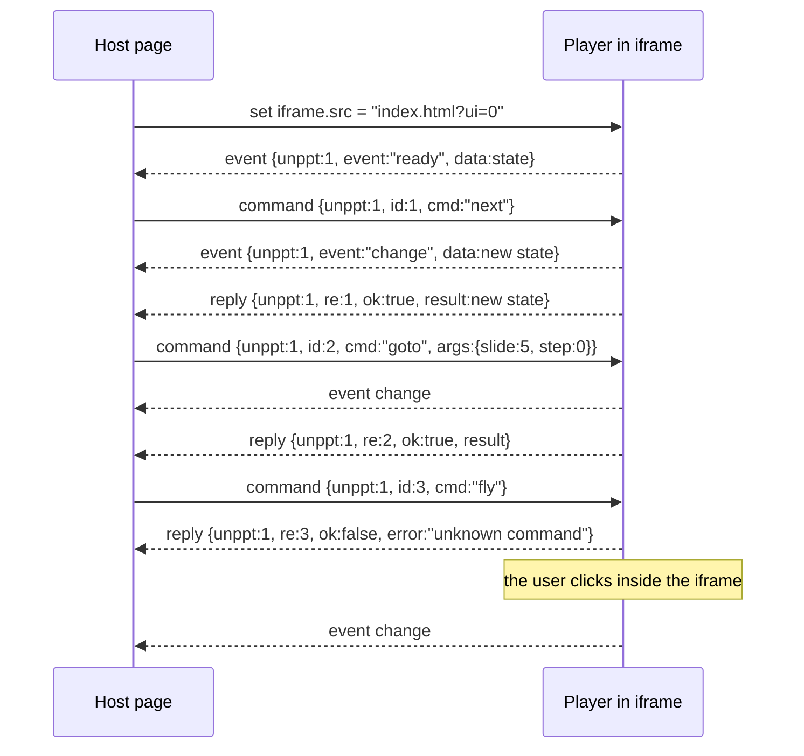
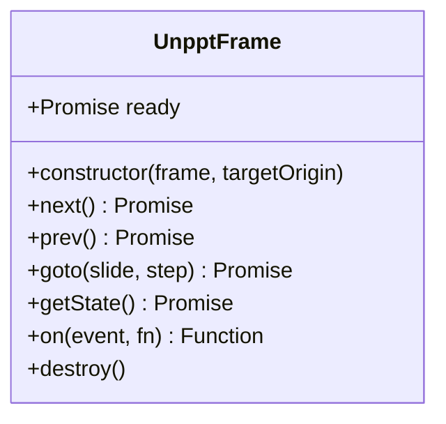
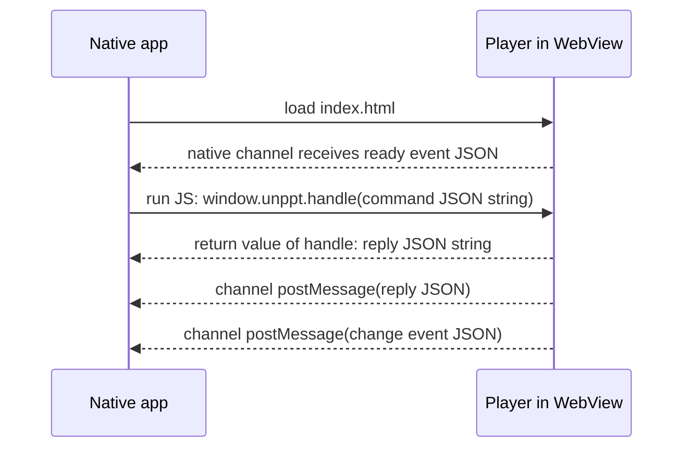
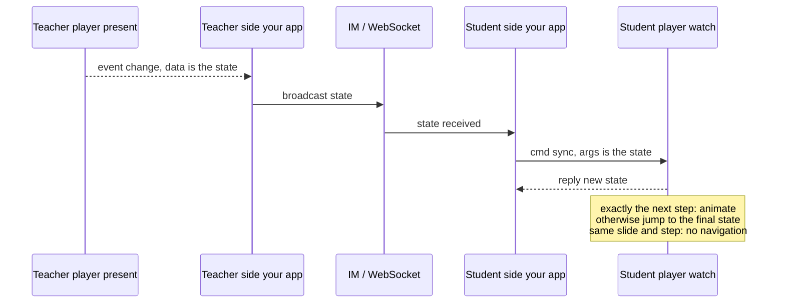
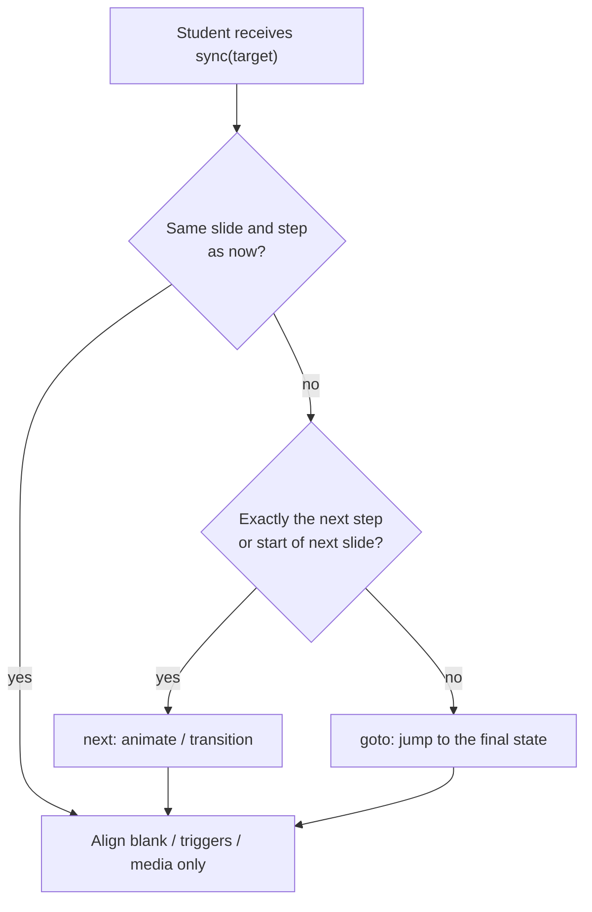
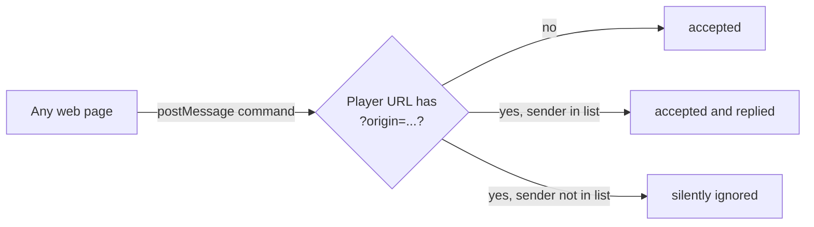

[中文](../zh/embedding.md)

# Embedding and Controlling the Player

This document explains how to put a converted deck into **your own web page or app**, and how to control it from code (next/previous, jump to a slide, listen for slide changes, live-class synchronization).

After reading it you will know:

- The simplest way: open the HTML directly;
- How to embed the player in your page with an `<iframe>`;
- Which commands and events the player's **JS bridge** offers;
- What the `postMessage` messages between the host page and the iframe look like;
- How to connect a native app WebView (iOS / Android / React Native);
- URL parameters (`?ui=0`, `?slide=3`, ...);
- Teacher / student synchronization for live classes;
- Security notes (origin checks).

> Every command, field and parameter name comes from the source code: `packages/format/src/index.ts` (message format), `packages/player/src/bridge.ts` (bridge), `packages/player/src/boot.ts` (URL parameters), `packages/player/src/host.ts` (host helper), `packages/player/src/core/player.ts` (player core).


---

## 1. A few terms first

| Term | Meaning |
|---|---|
| **Player** | A zero-dependency piece of browser JavaScript that shows slides and plays animations and transitions. It is already built into the converted HTML; nothing else to install. |
| **Host page** | Your own web page that contains the player. |
| **iframe** | The HTML tag `<iframe src="...">` that embeds one web page inside another. The embedded page has its own separate JavaScript environment. |
| **postMessage** | The browser's cross-window messaging method: `otherWindow.postMessage(data, targetOrigin)`. When the host page and the iframe are on different domains, this is the only way they can talk. |
| **Origin** | Scheme + host + port, e.g. `https://a.com:443`. Browsers use the origin to decide whether two pages belong to "the same site". |
| **WebView** | A browser component embedded in a native app (`WKWebView` on iOS, `WebView` on Android, `react-native-webview` in React Native). |
| **JS bridge** | The control protocol the unppt player exposes: one set of commands and events that works for three kinds of hosts: same-page JS, iframe, and native WebView. |
| **Slide / step** | Both are counted from **0**. "Step" is how many clicks have been made on the current slide (each click plays one group of animations). Step 0 is the slide right after entering it, before any click. |

---

## 2. The big picture



All three control methods use **exactly the same command and event format** (defined as `BridgeCommand` / `BridgeEvent` / `BridgeReply` in `@unppt/format`); only the "envelope" differs.

---

## 3. Method 1: open the HTML directly

The simplest option. Convert first (see the usage guide for all options):

```bash
npm install -g @unppt/unppt
unppt convert deck.pptx                     # produces deck.html (single form, one file)
unppt convert deck.pptx --output paged      # produces the deck/ folder, entry deck/index.html
```

Then:

- **single form**: double-click `deck.html` to play it, or put this one file on any static server;
- **paged / pages form**: upload the whole folder to a static server and open `index.html`. Each slide's data is loaded on demand with a `<script>` tag (not `fetch`), so double-clicking it from the local disk (`file://`) works too. The `pages` form additionally contains one standalone HTML per slide: `page-001.html`, `page-002.html`, ...

Once it is open you can use it like a PowerPoint slide show (see `packages/player/src/ui/input.ts`):

| Action | Effect |
|---|---|
| Click the slide / → / ↓ / PageDown / Space / Enter | Next step |
| ← / ↑ / PageUp / Backspace | Previous step |
| Home / End | First / last slide |
| Type a number, then Enter (within 2 seconds) | Jump to that slide (counted from 1, hidden slides included) |
| B or `.` | Black screen; W or `,` white screen; any key or a click returns to the slide |
| Swipe left / right on a touch screen | Next / previous step |
| Move the mouse over the slide | Shows the built-in `‹ 1 / 10 ›` navigation buttons |

---

## 4. Method 2: embed it in your page with an iframe

### 4.1 Display only, no control

Put the output on a server (say at `https://cdn.example.com/deck/index.html`) and add this to your page:

```html
<div style="width:960px; aspect-ratio:16/9;">
  <iframe src="https://cdn.example.com/deck/index.html"
          style="width:100%; height:100%; border:0;"
          allow="autoplay; fullscreen"></iframe>
</div>
```

The player **scales proportionally to the iframe size** and fills the remaining space with black bars, so the iframe should ideally have the same aspect ratio as the slides (usually 16:9). `allow="autoplay"` makes it easier for audio and video in the deck to start automatically.

### 4.2 URL parameters

Append parameters to the player URL to change its behaviour (parsed by `readParams` in `packages/player/src/boot.ts`):

| Parameter | Example | Effect |
|---|---|---|
| `slide` | `?slide=3` | Open directly at the 4th slide (counted from 0) |
| `step` | `?slide=3&step=1` | Open at the final state of step 1 on the 4th slide |
| `ui` | `?ui=0` | Hide the built-in navigation buttons (click, keyboard and touch still work) so you can build your own |
| `mode` | `?mode=watch` | Watch mode: driven only by the JS API (live-class student side, see section 8). Default is `present` |
| `links` | `?links=0` | Clicking an external URL in the deck does **not** open a new window; only a `link` event is sent and the host decides |
| `timings` | `?timings=0` / `?timings=1` | Turn off / on "advance slides using rehearsed timings". If omitted: no auto-advance when `slide` or `step` is given, otherwise follow the deck's settings |
| `static` | `?static=1` | Show every object as-is on every slide, no animations (used by the comparison tools; you normally do not need it) |
| `origin` | `?origin=https://a.com,https://b.com` | Accept commands only from these origins (security, see section 9) |

Join several parameters with `&`, e.g. `index.html?ui=0&slide=2&origin=https://a.com`.

---

## 5. JS bridge: commands, events and state

### 5.1 Commands

| Command `cmd` | Arguments `args` | What it does | Returns |
|---|---|---|---|
| `next` | none | Next step; when the slide is finished, go to the next slide (skipping hidden slides); `next` on the last step of the last slide sends an `end` event | new state |
| `prev` | none | Previous step; at step 0 go back to the last step of the previous slide | new state |
| `goto` | `{ slide, step }` | **Deterministic jump**: show the final state of the target slide and step directly, without transitions or animations, independent of what was played before | new state |
| `sync` | a whole state (fields of `PlayerState`) | Make a watcher catch up with the presenter: animate if the target is exactly the next step, otherwise jump (section 8) | new state |
| `getState` | none | Read the current state | current state |

An unknown command fails: `ok: false`, with the reason in `error`.

### 5.2 Events

| Event `event` | When it is sent | Data `data` |
|---|---|---|
| `ready` | The player has started (sent only through the iframe / native channels) | state |
| `change` | After changing slide, advancing a step, clicking a trigger, black/white screen, audio/video play/pause/seek | state |
| `end` | Already at the last step of the last slide and `next` is called again (not sent when the show loops) | state |
| `link` | An external URL in the deck was clicked | state + `url` |

### 5.3 State: `PlayerState`



| Structure | Field | Meaning |
|---|---|---|
| `PlayerState` | `slide` / `step` | Current slide and step, both from 0 |
| | `slideCount` | Total number of slides, **hidden slides included** (sequential navigation skips them, `goto` can jump to them) |
| | `stepCount` | Number of clicks in the current slide's main sequence, trigger animations excluded |
| | `blank` (optional) | Color of the black / white screen; absent while a slide is shown |
| | `triggers` (optional) | For each trigger on this slide, how many groups have been played, `{ shapeId: groups }`; only triggers that were clicked |
| | `media` (optional) | Audio/video played on this slide: `[{ uid, playing, time }]`, `time` in seconds |
| `BridgeCommand` | `unppt` | Always `1` |
| | `id` (optional) | Number or string; the reply's `re` will equal it |
| | `cmd` | `next` / `prev` / `goto` / `sync` / `getState` |
| | `args` (optional) | `goto` uses `slide`, `step`; `sync` carries a whole state |
| `BridgeReply` | `unppt`, `re`, `ok` | `re` equals the command's `id` (0 if no `id` was given); `ok` tells success |
| | `result` / `error` | New state on success; reason on failure |
| `BridgeEvent` | `unppt`, `event`, `data` | `event` is `ready` / `change` / `end` / `link`; for `link`, `data` also has `url` |

A real state example:

```json
{ "slide": 2, "step": 1, "slideCount": 12, "stepCount": 3 }
```

Meaning: the 3rd slide (2 when counting from 0), clicked once so far, this slide needs 3 clicks in total, the deck has 12 slides.

Every message carries `unppt: 1`. The player uses it to recognise "this message is for me" and ignores all other messages.

### 5.4 Player state diagram



> "Showing" actually carries two numbers: `slide` and `step`. Every slide change and every step (and also trigger clicks, black/white screen, audio/video changes) makes the player send a `change` event **immediately**, without waiting for the animation or transition to finish.

---

## 6. postMessage protocol (host page and iframe)

### 6.1 Message flow



Key points:

1. **Commands** are sent by the host: `iframe.contentWindow.postMessage({ unppt: 1, id, cmd, args }, targetOrigin)`;
2. The reply's `re` equals the `id` you sent; use it to match replies to commands;
3. **Events** are sent by the player on its own (whether caused by your command or by the user clicking), distinguished by the `event` field;
4. The player may finish loading before your listener exists and you miss `ready`. Safe approach: send a `getState` in the iframe's `load` event (the official `UnpptFrame` does exactly this).

> The actual error text of an unknown command is in Chinese (`未知指令：fly`); show it to developers, don't parse it.

### 6.2 No library: a complete copy-paste example

Save the following as `host.html` next to the converted `index.html` (or change `src` to your URL) and open it through a static server:

```html
<!doctype html>
<html lang="en">
<head>
<meta charset="utf-8">
<title>My deck page</title>
<style>
  .frame { width: 100%; max-width: 960px; aspect-ratio: 16 / 9; background: #000; }
  .frame iframe { width: 100%; height: 100%; border: 0; display: block; }
</style>
</head>
<body>
<div class="frame">
  <iframe id="player" src="index.html?ui=0" allow="autoplay; fullscreen"></iframe>
</div>
<p>
  <button id="prev">Previous</button>
  <button id="next">Next</button>
  <button id="first">First slide</button>
  <span id="info">Loading...</span>
</p>
<script>
  const iframe = document.getElementById('player');
  // The player's origin. Same origin: location.origin; cross-origin: the player's domain, e.g. 'https://cdn.example.com'
  const PLAYER_ORIGIN = location.origin;
  let seq = 0;
  const waiting = new Map();

  // Send a command; returns a Promise that resolves with the reply
  function send(cmd, args) {
    const id = ++seq;
    return new Promise((resolve, reject) => {
      waiting.set(id, { resolve, reject });
      iframe.contentWindow.postMessage({ unppt: 1, id, cmd, args }, PLAYER_ORIGIN);
    });
  }

  // Receive messages: replies or events
  window.addEventListener('message', (e) => {
    if (e.source !== iframe.contentWindow) return;   // only our own iframe
    const d = e.data;
    if (!d || d.unppt !== 1) return;                 // not an unppt message
    if ('re' in d) {                                 // a reply
      const w = waiting.get(Number(d.re));
      if (!w) return;
      waiting.delete(Number(d.re));
      d.ok ? w.resolve(d.result) : w.reject(new Error(d.error));
      return;
    }
    if (d.event === 'ready' || d.event === 'change') show(d.data);
    if (d.event === 'end') alert('This is the last slide');
  });

  // Don't miss ready: ask once when the iframe has loaded
  iframe.addEventListener('load', () => send('getState').then(show));

  function show(s) {
    document.getElementById('info').textContent =
      `Slide ${s.slide + 1} / ${s.slideCount}, step ${s.step} / ${s.stepCount}`;
  }

  document.getElementById('prev').onclick = () => send('prev');
  document.getElementById('next').onclick = () => send('next');
  document.getElementById('first').onclick = () => send('goto', { slide: 0, step: 0 });
</script>
</body>
</html>
```

> Note: when the host page is opened by double-clicking (`file://`), the browser treats its origin as `"null"` and `PLAYER_ORIGIN` must be `'*'`. Use http(s) in production.

### 6.3 Using the official helper `UnpptFrame` (host.js)

The repository contains a zero-dependency host helper, `packages/player/src/host.ts`, which wraps the code above into a class.

> **How to get it**: only the converter `@unppt/unppt` is currently published on npm (see `docs/release.md`); `@unppt/player` and `host.js` are not published separately yet. Build from source: clone the repository, run `npm install` and `npm run build`, then copy the generated `packages/player/dist/host.js` into your project.



- Constructor: `new UnpptFrame(iframeElement, targetOrigin = '*')`; `ready` resolves with the first state when the player is ready;
- `next` / `prev` / `goto(slide, step = 0)` / `getState` all return `Promise<PlayerState>`;
- `on(event, fn)` returns a function that removes the listener; `destroy()` removes listeners and fails all pending commands;
- `targetOrigin`: the origin of the player page, default `'*'`; **set a concrete domain in production**;
- A command fails if there is no reply within 10 seconds (the error message means "player did not respond");
- The TypeScript type of `on` only lists `'ready' | 'change' | 'end'`; the `link` event is delivered at runtime too (in plain JS just write `on('link', fn)`);
- It has **no** `sync` method; for live-class sync send the postMessage directly (section 8).

Complete example (`examples/iframe-host.html` is a demo page built the same way; it uses `import { UnpptFrame } from './host.js'`, so copy the built `host.js` into `examples/` first, then open it with `?src=<deck URL>`):

```html
<!doctype html>
<html lang="en">
<head><meta charset="utf-8"><title>UnpptFrame example</title></head>
<body>
<iframe id="player" src="https://cdn.example.com/deck/index.html?ui=0"
        style="width:960px;height:540px;border:0" allow="autoplay; fullscreen"></iframe>
<p><button id="prev">Previous</button> <button id="next">Next</button> <span id="info"></span></p>
<script type="module">
  import { UnpptFrame } from './host.js';
  const deck = new UnpptFrame(document.getElementById('player'), 'https://cdn.example.com');
  const info = (s) => { document.getElementById('info').textContent = `${s.slide + 1} / ${s.slideCount}`; };
  info(await deck.ready);
  deck.on('change', info);
  deck.on('end', () => console.log('finished'));
  document.getElementById('prev').onclick = () => deck.prev();
  document.getElementById('next').onclick = () => deck.next();
  // await deck.goto(3, 0);   // jump to the 4th slide
  // deck.destroy();          // destroy when no longer needed (removes listeners)
</script>
</body>
</html>
```

---

## 7. Same-page JS and native app WebView

### 7.1 Same-page JS: `window.unppt`

After starting, the player attaches a `window.unppt` object to **its own page** (`UnpptApi` in `packages/player/src/bridge.ts`). If you can run script inside the player page (for example you modified the output, use the browser console, or run automated tests), use it like this:

```js
await window.unppt.next();
await window.unppt.goto({ slide: 3, step: 0 });   // goto(3, 0) also works
const s = await window.unppt.getState();
const off = window.unppt.on('change', (s) => console.log(s.slide, s.step));
off();                                           // remove the listener, same as window.unppt.off('change', fn)
```

| Method | Notes |
|---|---|
| `next()` / `prev()` / `getState()` | Return `Promise<PlayerState>` |
| `goto(target, step?)` | `target` is a number (slide index) or `{ slide, step }` |
| `sync(target, step?)` | Same shape; used by the live-class watcher |
| `on(event, fn)` / `off(event, fn)` | Listen for `change`, `end`, `link` (`ready` is only sent through the iframe / native channels; `on('ready')` never fires) |
| `handle(message)` | For native apps: pass a JSON string command, get a JSON string reply back **synchronously** |
| `player` | The underlying `Player` object (advanced) |

`window.unppt` exists only after the page's `DOMContentLoaded`; check that it is defined before using it.

### 7.2 Native app WebView



**App to player**: run the JS `window.unppt.handle('<command JSON>')`. You may omit `unppt: 1` (`handle` adds it). The return value is the reply as a JSON string; invalid JSON gives `{"unppt":1,"re":0,"ok":false,"error":"..."}` (the error text is in Chinese and means "the command is not valid JSON").

**Player to app**: the player detects the three channels below and calls whichever exists, always with a **JSON string** (both events and replies):

| Platform | Player calls | What the app must do |
|---|---|---|
| iOS (WKWebView) | `window.webkit.messageHandlers.unppt.postMessage(json)` | Register a `WKScriptMessageHandler` named `unppt` |
| Android (WebView) | `window.UnpptNative.postMessage(json)` | `addJavascriptInterface(obj, "UnpptNative")`, where `obj` has a `@JavascriptInterface postMessage(String)` method |
| React Native | `window.ReactNativeWebView.postMessage(json)` | `<WebView onMessage={...}>` |

Android example (Kotlin):

```kotlin
webView.settings.javaScriptEnabled = true
webView.addJavascriptInterface(object {
    @JavascriptInterface
    fun postMessage(json: String) {
        // e.g. {"unppt":1,"event":"change","data":{"slide":1,"step":0,"slideCount":10,"stepCount":2}}
        Log.d("unppt", json)
    }
}, "UnpptNative")
webView.loadUrl("https://cdn.example.com/deck/index.html?ui=0")

// next step
webView.evaluateJavascript("window.unppt.handle('{\"id\":1,\"cmd\":\"next\"}')", null)
```

iOS example (Swift):

```swift
class Bridge: NSObject, WKScriptMessageHandler {
    func userContentController(_ c: WKUserContentController, didReceive m: WKScriptMessage) {
        if let json = m.body as? String { print("unppt:", json) }
    }
}
let config = WKWebViewConfiguration()
config.userContentController.add(Bridge(), name: "unppt")
let webView = WKWebView(frame: .zero, configuration: config)
webView.load(URLRequest(url: URL(string: "https://cdn.example.com/deck/index.html?ui=0")!))

// jump to the 4th slide
webView.evaluateJavaScript("window.unppt.handle('{\"id\":2,\"cmd\":\"goto\",\"args\":{\"slide\":3,\"step\":0}}')")
```

React Native example:

```jsx
import { WebView } from 'react-native-webview';

const ref = useRef(null);
<WebView
  ref={ref}
  source={{ uri: 'https://cdn.example.com/deck/index.html?ui=0' }}
  onMessage={(e) => console.log('unppt:', JSON.parse(e.nativeEvent.data))}
/>;
// next step
ref.current.injectJavaScript(`window.unppt.handle('{"id":1,"cmd":"next"}'); true;`);
```

> **Exception: mini-program web-view** (SPEC D12): messages from the page to a mini-program are only delivered on back navigation, share or destroy, so real-time events are not possible. Instead, change the web-view URL (`?slide=3&step=1` deep link) to jump.

### 7.3 Hosting the player yourself: `mount` (advanced)

If you want to separate converting and playing (the converter outputs data only, `unppt convert deck.pptx --data` gives `deck.json`, and your own page loads the player), use the player's `mount` function:

```js
// player.js is an IIFE bundle with the global name UnpptPlayer
const player = UnpptPlayer.mount(document.getElementById('box'), deckJson, {
  ui: true, mode: 'present', baseUrl: 'decks/demo/',   // baseUrl: prefix for the relative font paths in deck.json
});
player.on('change', (s) => console.log(s));
player.next();          // note: Player methods are synchronous and return PlayerState directly
player.goto(3, 0);
player.destroy();
```

`mount` options (`MountOptions`): `slide`, `step`, `ui`, `openLinks`, `timings`, `static`, `mode`, `clickToNext` (clicking the slide advances, default on), `keyboard` (keyboard navigation, default on), `baseUrl`. Images and audio/video in the slide SVG use relative `media/...` paths resolved against **your page's URL**, so put the `media/` folder next to your page.

> Like `host.js`, `player.js` is not published on npm separately yet; build it from source to get `packages/player/dist/player.js`. In most cases using the converted HTML in an iframe is simpler.

---

## 8. Live class: teacher / student synchronization

Scenario: a teacher and students watch the same deck; when the teacher advances, the student side follows automatically. **The player only provides the building blocks**; how messages travel from teacher to students (IM, WebSocket, ...) is up to your application.

### 8.1 Two modes

| | Present mode `present` (default) | Watch mode `watch` |
|---|---|---|
| How to open | `index.html` or `?mode=present` | `index.html?mode=watch` |
| Click, keyboard, touch navigation | yes | ignored |
| Navigation buttons, media control bar | shown | no buttons; control bar ignored |
| Hyperlinks, triggers | clickable | ignored |
| Auto-advance by timings | per deck settings | never |
| JS API | available | available (the only way to drive it) |

### 8.2 How sync works, in one sentence

> **Pass the `data` of every `change` event from the teacher side, unchanged, to a `sync` command on the student side.**



The rules of `sync` (the `sync` method in `packages/player/src/core/player.ts`):

- The target is exactly the **next step**, or the current slide is finished and the target is the **start of the next slide**: animations and transitions play, as if clicked locally;
- Slide and step are the **same** as now: no navigation, only the extra parts below are aligned (receiving the same message twice is harmless);
- Any other case (student joins midway, reconnects, lost a few messages): jump straight to the target's final state;
- The extra parts of the state are aligned too: `blank` (black/white screen), `triggers` (how many groups each trigger has played), `media` (whether audio/video is playing and its current time; the position is only changed if it differs by more than **1.5 seconds**, so network delay does not cause jitter).



### 8.3 Complete example (teacher and student simulated in one page)

`examples/live-class.html` in the repository is this example: teacher on the left, student on the right, and the page script plays the role of the "IM". A condensed version (replace `index.html` with your deck URL):

```html
<!doctype html>
<html lang="en">
<head>
<meta charset="utf-8">
<title>Live class sync</title>
<style>
  .row { display: flex; gap: 16px; }
  .row iframe { width: 480px; height: 270px; border: 0; background: #000; }
</style>
</head>
<body>
<div class="row">
  <div>Teacher<br><iframe id="teacher" src="index.html?mode=present" allow="autoplay"></iframe></div>
  <div>Student<br><iframe id="student" src="index.html?mode=watch" allow="autoplay"></iframe>
    <br><button id="rejoin">Simulate student rejoining</button></div>
</div>
<script>
  const teacher = document.getElementById('teacher');
  const student = document.getElementById('student');
  let last = null, id = 0;

  // In a real app: the teacher side sends data to the IM; the student side calls toStudent(data) on receipt
  function toStudent(state) {
    student.contentWindow.postMessage({ unppt: 1, id: ++id, cmd: 'sync', args: state }, '*');
  }

  window.addEventListener('message', (e) => {
    const d = e.data;
    if (!d || d.unppt !== 1 || !d.event) return;
    if (e.source === teacher.contentWindow && (d.event === 'change' || d.event === 'ready')) {
      last = d.data;          // remember the teacher's current state
      toStudent(d.data);
    }
    // When the student side has (re)started, align it with the teacher's current state
    if (e.source === student.contentWindow && d.event === 'ready' && last) toStudent(last);
  });

  document.getElementById('rejoin').onclick = () => {
    student.src = 'index.html?mode=watch&t=' + Date.now();
  };
</script>
</body>
</html>
```

Practical advice:

- **New student joins / reconnects**: wait for the student side's `ready`, then send one `sync` with the teacher's **latest** state;
- **Autoplay restrictions**: the student's browser may block sound that starts without a click; let the student click once in your page first (e.g. an "Enter classroom" button);
- The repository's `tools/check-live.py` checks this behaviour automatically in a browser: watch mode has no navigation buttons, clicks and keys do not navigate, both sides show the same slide after sync, black screen / triggers / media states match, and a student joining midway is aligned.

---

## 9. Security notes



1. **Limit who can control the player**: add `?origin=https://your-domain` to the player URL (comma-separate several). Then:
   - Commands from other origins are **silently ignored** (no reply);
   - The player's events are sent only to the listed origins (`postMessage(msg, thatOrigin)`), so other sites that embed your deck do not receive events.
   - Without this parameter, **any** page that embeds the player can control it and receive its events. Fine for public decks; add it for decks with access restrictions.
2. **The host page must check too**: when receiving a message, first check `e.source === iframe.contentWindow` (only your own iframe), then `e.data.unppt === 1`; cross-origin, also check that `e.origin` is the player's domain.
3. **Name the target origin when sending**: `postMessage(msg, 'https://cdn.example.com')` instead of `'*'`; the same applies to `UnpptFrame`'s second argument. Then even if the iframe is navigated to another site, commands are not delivered there.
4. **External links**: the player only opens `http(s):`, `mailto:` and `tel:` links, always in a new tab (`noopener,noreferrer`), and never navigates the page that hosts the player. To ask the user first, add `?links=0` and handle the `url` in the `link` event yourself.
5. **Native channels**: the JSON the app receives comes from a web page; treat it as ordinary external input, and load only deck URLs you host yourself.

---

## 10. FAQ

| Problem | Cause and fix |
|---|---|
| `ready` never arrives | The player started before your listener. Send a `getState` in the iframe's `load` event. |
| Commands have no effect | Check that the message has `unppt: 1` and a string `cmd`; check that the player URL's `?origin=` includes your origin. |
| `window.unppt` is `undefined` | The host page does not have it; it lives in the **player page**. Across an iframe use postMessage. |
| Slide number off by one | `slide` and `step` in the API start from 0; add 1 when showing them to users. |
| No animation after `goto` | By design: `goto` shows the final state directly. Use `next` for animation. |
| No sound on the student side | Browser autoplay restriction; have the student click the page once. |
