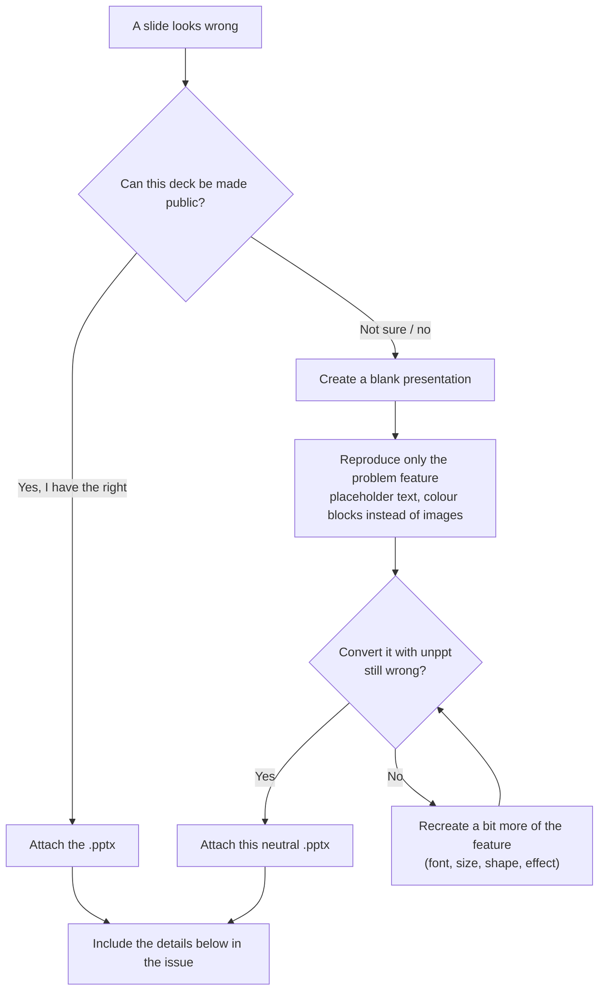

[中文](../zh/faq.md)

# Frequently asked questions (FAQ)

The questions people run into most often when using unppt. Wherever possible the answer includes a command you can copy.

Contents:

- [Fonts](#fonts)
- [Text wraps differently from PowerPoint](#text-wraps-differently-from-powerpoint)
- [Output size and memory](#output-size-and-memory)
- [Very large files](#very-large-files)
- [Supported features](#supported-features)
- [Known gaps](#known-gaps)
- [Supported browsers](#supported-browsers)
- [How to report a bad presentation safely](#how-to-report-a-bad-presentation-safely)
- [Versioning](#versioning)

---

## Fonts

> Font handling changed in 0.3.0; the full explanation is in [Getting started, section 7](getting-started.md#7-fonts-why-they-matter-and-how-they-are-handled-now).

### Q: If the viewer's computer does not have the font, will it show a different font?

No. Since 0.3.0 the player **never uses fonts installed on the viewer's computer**: every character used is packed into the output as a font subset, so viewers on Windows, Mac, Android or iPhone all see the same thing ([SPEC.md](../../SPEC.md) decision D3).

The fonts in the output come from only two sources (unless you explicitly specify fonts with `--fonts` / `--system-fonts`):

| Source | Notes |
|---|---|
| Fonts the author embedded in the PPT | Used as-is ("Embed fonts in the file" in PowerPoint) |
| The default font pack `@unppt/fonts` | Open-source fonts, installed automatically with `@unppt/unppt` |

> A "font subset" is a font file that keeps only the characters actually used, much smaller than the full font.

### Q: What happens to Microsoft YaHei or Calibri when they are not embedded? Are line breaks still right?

Yes. Layout and display are separate:

- **Layout** uses the original font's metrics (width of each character, ascent/descent, kerning), so line breaks, character positions and line spacing are the same as in PowerPoint;
- **Display** uses the matching open-source font: Microsoft YaHei, DengXian, SimHei → Noto Sans SC; SimSun → Noto Serif SC; KaiTi → LXGW WenKai; FangSong → Zhuque Fangsong; Calibri → Carlito; Cambria → Caladea; Arial → Liberation Sans; Times New Roman → Liberation Serif; Courier New → Liberation Mono.

So **glyph shapes** look slightly different from the author's computer, but positions do not change. For identical glyphs, have the author embed the fonts in the PPT, or use `--system-fonts` / `--fonts` if you are licensed to.

### Q: Does unppt distribute commercial fonts such as Microsoft YaHei or Calibri?

No.

- The default font pack contains **only open-source fonts**, all under SIL OFL 1.1, which may be freely distributed and embedded: Noto Sans SC, Noto Serif SC, LXGW WenKai, Zhuque Fangsong, Carlito, Caladea, Liberation Sans / Serif / Mono. The license files are in `packages/fonts/LICENSES/`.
- The **metrics pack** inside the font pack contains **numbers only** (advance widths, ascent/descent, kerning), no glyph shapes, for 457 Windows / Office font faces. It is used only for layout and never ends up in the output.
- The output only ever contains subsets of: the open-source fonts, fonts the author embedded in the PPT, and fonts you explicitly specify with `--fonts` / `--system-fonts`. **For the last two, the author / you are responsible for the distribution license**: embedding means distributing font subsets to every viewer, so check the license of commercial fonts first.

### Q: How do I find out whether a deck has font problems?

Use `unppt check`. It only checks fonts, writes no files and takes a few seconds:

```bash
unppt check deck.pptx
unppt check deck.pptx --json    # JSON output for programs
```

One line per font: ✓ fine; ⚠ warning (e.g. the font pack does not know the font either, so a substitute is used); ✗ must fix (e.g. a symbol font not embedded). The exit code is 1 when there is any ✗, so a product can reject the upload or warn the author. In code use `checkFonts()`, or `fontCheck` in the result of `convert()`; see [Usage 3.8](usage.md#38-checkfontsinput-options-checking-fonts-only).

A normal conversion also lists the fonts with problems at the end (⚠ and ✗ only).

### Q: What about fonts the font pack does not know?

Like PowerPoint, a substitute font is used for layout and the matching open-source font for display; `unppt check` marks them ⚠. Substitution rules (measured):

| Missing font | Replaced by |
|---|---|
| Latin font | Calibri |
| Font marked with a Chinese charset | Microsoft YaHei |
| Font marked with a Japanese charset | Yu Gothic; characters it lacks fall back to the Chinese font |
| Helvetica, Helvetica Neue, Helv | Arial |
| Times, Tms Rmn | Times New Roman |
| Courier | Courier New |

**Source Han Sans / Serif** (a deck naming "思源黑体", "Source Han Sans", "思源宋体" and the like) are handled the same way when not embedded (since 0.3.1), even though the pack has the same-design Noto Sans SC / Noto Serif SC: most computers do not have Source Han installed, and PowerPoint shows these decks there with a substitute (usually Microsoft YaHei), so every viewer sees the same thing. To keep the Source Han look, embed the font in the PPT.

Characters that no font has (rare: emoji, rare CJK characters) are left to the browser's own fallback, so they may differ between devices; `unppt check` lists them.

### Q: Symbols (ticks, arrows, bullets) show as letters. What now?

The deck uses a symbol font such as Webdings or Symbol without embedding it in the PPT. Symbol fonts put pictures where letters normally are, and unppt **never changes your characters**; Wingdings, Wingdings 2 and Wingdings 3 have code-compatible open fonts in the default pack and display as symbols even when not embedded, other symbol fonts do not yet: characters typed as letters show as ordinary letters, and symbols added with Insert → Symbol are left to the browser (symbols on computers that have the font, boxes elsewhere). The conversion output and `unppt check` mark this ✗.

Fix: ask the author to choose **File → Options → Save → "Embed fonts in the file"** in PowerPoint, save again and convert again; or provide the symbol font file with `--fonts` (mind the license).

### Q: My cloud function or server has no fonts at all. What should I do?

Nothing to install. The default font pack comes with `@unppt/unppt`; load it and pass it to `convert()`, and the result is identical to converting on a desktop:

```js
import { convert } from '@unppt/unppt';
import { loadFontPack } from '@unppt/unppt/node';

const fontPack = await loadFontPack();   // finds the installed @unppt/fonts; undefined if missing
const result = await convert(pptxBytes, { write, fontPack });
console.log(result.fontCheck);           // font check result
```

The font pack is about 100 MB installed (about 110 MB together with `@unppt/unppt` itself); mind the code package size limit of your platform, see [Usage 4.3](usage.md#43-cloud-function-read-from-object-storage-convert-write-back).

### Q: How do I use my own fonts?

```bash
# Font folders (repeatable; .ttf / .otf / .ttc found recursively); they win over the font pack for the same name
unppt deck.pptx -o out --fonts ./fonts --fonts ./more-fonts

# This machine's system fonts (on Windows also Office's private and cloud fonts, e.g. Aptos); off by default since 0.3.0
unppt deck.pptx -o out --system-fonts
```

In code use `fonts: [font file bytes, ...]`. These fonts are used for layout and display and the characters used are embedded in the output, so **make sure you are allowed to distribute them**.

### Q: Do the old `--embed-fonts` and `--no-system-fonts` still work?

They are accepted but have no effect: since 0.3.0 every font used is always embedded (`embedFonts` defaults to `true` in code), and system fonts are not used by default. `privateFonts` in code is the same as `fonts`.

---

## Text wraps differently from PowerPoint

The most common causes, most likely first:

1. **A font was missing at conversion time**: run `unppt check` and look for ⚠ / ✗ fonts. Ask the author to embed the fonts in the PPT, or provide them with `--fonts` (previous section);
2. **The default font pack is not installed**: if the CLI starts with the hint `没找到默认字体包 @unppt/fonts` ("default font pack not found"), widths of non-embedded fonts can only be estimated. Reinstall `@unppt/unppt`, or when installing from GitHub install `unppt-fonts.tgz` too;
3. **Different font version**: two versions of the same font can have different widths. The font pack's metrics come from the versions shipped with Windows / Office; if the author's version differs, give the author's font file with `--fonts`;
4. **A known gap**: for example WordArt vertical text (`wordArtVert`); see [Known gaps](#known-gaps).

If none of these apply, please report it as described [below](#how-to-report-a-bad-presentation-safely).

---

## Output size and memory

### Q: How big is the converted HTML?

The output form is chosen with `--output`:

| Form | Command | Output | Good for |
|---|---|---|---|
| `single` | `--output single` | One self-contained HTML with slides, images, fonts and player inlined | Opening locally by double-click, sending a file |
| `paged` (CLI default) | `--output paged` | A folder: entry `index.html` + per-slide data files in `pages/`, `fonts/`, `media/`; only the current slide loads, and the next one is preloaded | Playing online |
| `pages` | `--output pages` | `paged` plus a standalone `page-001.html` for every slide | When you need a link per slide |
| `data` | `--data` or `--output data` | Only the deck data `deck.json` | Development and debugging |

What affects size:

- **The player itself is small**: about 58 KB in the current build, about 21 KB gzipped;
- **each image is stored once**, even when several slides use it;
- **large images are not inlined**: in `single` form, images above 2 MB (change with `--inline-limit <bytes>`) are written to a separate `media/` folder; **video and audio are always written** to `media/`. File names carry a checksum, so a republished deck never mixes with old cached files;
- every form writes `prop.json` next to the entry file (slide count, size, image path per slide, notes, hidden flag), plus a full-slide image `pic/<n>.jpg` and a thumbnail `thum/<n>.jpg` per slide. Add `--no-images` when you do not need the images; it saves a lot of time and space.

> When you put the `media/` folder online, the server must support HTTP Range requests (common web servers do by default); otherwise seeking in videos does not work in Chromium.

### Q: How much memory does conversion need?

The converter **never reads the whole file at once**. It processes one slide at a time and frees it afterwards; video and audio are streamed through unchanged. Measured in the README: a deck of 300 slides plus 800 MB of video, with memory limited to 128 MB, converts in about 1 second with a peak of about 120 MB.

Full-slide images and thumbnails cost extra: by default the CLI picks the number of drawing threads from the CPU count and free memory (about 400 MB per thread). When memory is tight:

```bash
# Draw on the main thread: lowest memory
npx @unppt/unppt deck.pptx -o out/index.html --jobs 1
# Or skip the images entirely
npx @unppt/unppt deck.pptx -o out/index.html --no-images
# Show time taken and peak memory
npx @unppt/unppt deck.pptx -o out/index.html --stats
```

---

## Very large files

### Q: Can it convert a 1 GB deck with hundreds of slides?

Yes, that is a design goal ([SPEC.md](../../SPEC.md) decision D13). The CLI reads the file in pieces automatically. In your own code, **do not** read the whole file into a `Uint8Array`; pass an object that reads by position instead:

```js
import { open, stat } from 'node:fs/promises';
import { convert } from '@unppt/unppt';

const path = 'big.pptx';
const { size } = await stat(path);
const fh = await open(path, 'r');
const source = {
  size,
  async read(offset, length) {
    const buf = new Uint8Array(Math.max(0, Math.min(length, size - offset)));
    const { bytesRead } = await fh.read(buf, 0, buf.length, offset);
    return buf.subarray(0, bytesRead);
  },
};
try {
  await convert(source, { write: async (relPath, data) => { /* write wherever you like */ } });
} finally {
  await fh.close();
}
```

The `data` passed to `write(path, data)` can be a string, a `Uint8Array`, or a stream (`AsyncIterable` — large media files are passed this way, read and written piece by piece), so your write function must handle all three.

For online playback of large decks use `--output paged`: viewers only download the slide they are looking at.

---

## Supported features

This table is based on the modules implemented in the code (detailed rules are in section 7 of [SPEC.md](../../SPEC.md)):

| Category | Support |
|---|---|
| Shapes | All preset shapes, custom shapes (freeforms), groups (rotation, flip, scaling), connectors and arrows |
| Fills and lines | Solid, gradient (linear, radial, rectangular, path), pattern, picture and texture fills (stretch / tile); dashes, compound lines, line ends |
| Effects | Outer shadow, inner shadow, glow, soft edges, reflection, 3D bevel and contour, 3D rotation |
| Text | Master / layout inheritance, bullets and numbering, autofit, vertical text, East Asian line-breaking rules and hanging punctuation, text effects (gradient, picture fill, outline, shadow, glow), WordArt warps, hyperlinks |
| Tables | Merged cells, built-in table styles, diagonal borders, vertical text |
| Charts | Column / bar, line, area, pie, 3D pie, pie-of-pie / bar-of-pie, doughnut, radar, scatter, bubble, stock; data labels, legends, axes, data tables, shapes drawn on charts |
| SmartArt | Rendered from the drawing cache PowerPoint stores in the file |
| Images | PNG, JPEG, GIF, BMP, TIFF, EMF, WMF, SVG; cropping, recolouring, transparent colour, EXIF orientation |
| Equations, ink | The fallback image PowerPoint stores in the file is shown |
| Embedded objects (OLE) | The preview image PowerPoint stores is shown |
| Audio, video | Poster frame, playback control bar, trimming, fade in/out, full-screen playback, animation sounds and transition sounds |
| Animations | Entrance, exit, emphasis and motion-path animations, triggers, timed auto-play |
| Slide transitions | Fade, push, wipe, split, blinds, checkerboard, dissolve, Morph and more — over twenty kinds |
| Slide show | Hidden slides, automatic advance timings, looping, hyperlinks and action buttons, B / W black and white screens, typing a slide number to jump |

**Not supported:**

- **Legacy `.ppt` files**: use "Save As" `.pptx` in PowerPoint first;
- **Chart types added in Office 2016** (waterfall, sunburst, treemap, … stored in the new `cx:` format): there is no drawing module for them in the code; the converter uses the fallback content PowerPoint stores in the file;
- **Surface charts**: there is no chart type for them.

---

## Known gaps

These cases still differ visibly from PowerPoint:

| Area | Gap |
|---|---|
| Chart date axes | time scaling (min / max, month / year intervals) is incomplete |
| Vertical text | WordArt vertical text (`wordArtVert`) |
| Images | EMF+ records inside EMF images |
| SmartArt | some SmartArt that needs re-layout |
| 3D | 3D bevel under 180-degree rotation |
| Chart category labels | truncation threshold of 45-degree labels |

Overall fidelity (0.3.1): 93.0% of synthetic test pages and 70.4% of the pages of 5212 real-world decks reach SSIM ≥ 0.95 (93.5% reach 0.90); most of the rest differ only by a few pixels. Full numbers: [test report](test-report.md); how this is measured: [Fidelity](fidelity.md).

---

## Supported browsers

| Environment | Status |
|---|---|
| Chrome (and other Chromium-based browsers) | Supported; Chrome has end-to-end automated tests |
| Firefox | Supported; end-to-end automated tests |
| Android WebView, iOS WKWebView | Targeted; WebKit has no automated tests yet |
| Mini-program web-view | Plays; but the mini program and the page cannot exchange messages in real time, so jumping works only by changing the URL (`?slide=3&step=1`) |
| Safari | Not a focus yet |

On-demand loading in the output uses `<script>` tags, not fetch, so **opening locally by double-click (file://), hosting on any domain and embedding in an iframe all work**.

---

## How to report a bad presentation safely

Open an issue on GitHub: <https://github.com/spitmaster/unppt/issues>

**Most important: only share files you are allowed to share.** Issues are public and anyone can download attachments. If the deck contains customer material, internal data or personal information, **do not upload the original file**.

Recommended approach:



Please include in the issue:

1. the unppt version (running `npx @unppt/unppt` without arguments prints it on the first line);
2. the full conversion command, for example `unppt demo.pptx -o out` (include any font options);
3. the CLI lines under `字体：` (fonts) and starting with `提示：` (notice), or the output of `unppt check`;
4. the browser and its version;
5. side-by-side screenshots: the PowerPoint slide show and the unppt player (screenshots, too, may only show content you can make public).

> The project follows the same rule itself: real-world decks used in development never leave the development machine, and the repository contains only neutral test cases rebuilt in PowerPoint. See [Fidelity · sample safety](fidelity.md#7-sample-safety-customer-files-never-leave-the-machine).

---

## Versioning

- The current version is **0.3.1**; the npm package is `@unppt/unppt` and needs Node.js 20.12 or later;
- versions have the form "major.minor.patch". 0.x means early stage: interfaces and options may change between versions, so read the release notes on GitHub before upgrading;
- every release has a matching tag on GitHub (in the form `v0.1.0`); a version number is published to npm only once;
- to pin a version: `npm install @unppt/unppt@0.3.1`, or `npx @unppt/unppt@0.3.1 ...`; to see the latest version on npm: `npm view @unppt/unppt version`;
- **the output format has its own version**: `"format": "unppt-deck", "version": 1` in `deck.json`. The number goes up when the format changes, and a player that meets a newer version than it knows reports a clear error (asking for a player upgrade);
- every output **carries its own player**, so decks you have already converted are not affected by later upgrades; to get the improvements of a new version, simply convert again.
