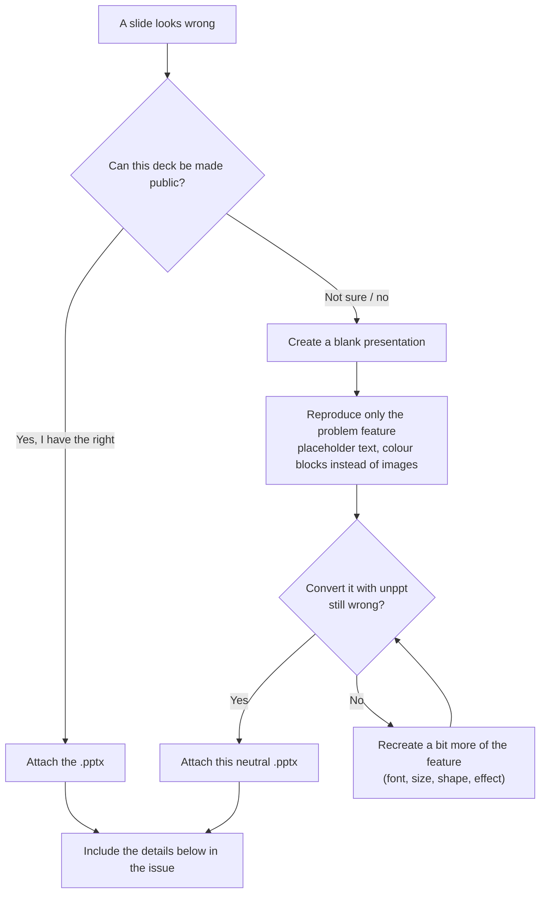

[中文](../zh/faq.md)

# Frequently asked questions (FAQ)

The questions people run into most often when using unppt. Wherever possible the answer includes a command you can copy.

Contents:

- [Fonts](#fonts)
- [Text wraps differently from PowerPoint](#text-wraps-differently-from-powerpoint)
- [Output size and memory](#output-size-and-memory)
- [Very large files](#very-large-files)
- [Supported features](#supported-features)
- [Known gaps](#known-gaps)
- [Supported browsers](#supported-browsers)
- [How to report a bad presentation safely](#how-to-report-a-bad-presentation-safely)
- [Versioning](#versioning)

---

## Fonts

### Q: The converter prints "缺少字体：xxx" (missing font). What does it mean?

To know where a line breaks, the converter must know how wide every character is. It **can only use the font files you give it** (the converter is a pure function and never searches system folders on its own). When the deck uses a font you did not supply, the converter:

1. prints `缺少字体：xxx` ("missing font") on the command line; in code the names are in `result.report.missingFonts`;
2. lays the text out with a substitute font following PowerPoint's rules (table below);
3. **does not fail**; output is written as usual.

PowerPoint's substitution rules (measured, as implemented in the code):

| Missing font | Replaced by |
|---|---|
| Latin font | Calibri → Arial → Liberation Sans → Helvetica (the first one you supplied) |
| Font marked with a Chinese charset | Microsoft YaHei → DengXian → PingFang SC → Noto Sans CJK SC → Source Han Sans SC |
| Font marked with a Japanese charset | Yu Gothic; characters it lacks fall back to the Chinese list above |
| Helvetica, Helvetica Neue, Helv | Arial |
| Times, Tms Rmn | Times New Roman |
| Courier | Courier New |

If the substitute is missing too, the layout uses estimated widths, and line breaks will probably differ from PowerPoint.

### Q: How do I give fonts to the converter?

**Command line:**

```bash
# Use the system fonts (on Windows this also picks up Office's private and cloud fonts, e.g. Aptos)
npx @unppt/unppt convert deck.pptx -o out/index.html --system-fonts

# Point at font folders (repeatable; .ttf / .otf / .ttc are found recursively)
npx @unppt/unppt convert deck.pptx -o out/index.html --fonts ./fonts --fonts ./more-fonts
```

**In code (for example in a cloud function — Linux usually has no Microsoft fonts, so bring your own):**

```js
import { readFile } from 'node:fs/promises';
import { convert } from '@unppt/unppt';

const fonts = [
  await readFile('fonts/msyh.ttc'),     // bytes of the font file (Uint8Array / Buffer)
  await readFile('fonts/calibri.ttf'),
];
const result = await convert(pptxBytes, { write, fonts, embedFonts: true });
console.log(result.report.missingFonts);  // fonts still missing
```

### Q: If the viewer's computer does not have the font, will it show a different font?

It depends:

| Situation | What the viewer sees |
|---|---|
| `--embed-fonts` was used (`embedFonts: true` in code) | The characters used are embedded as a **font subset**, so every device looks the same as at conversion time. **Recommended** |
| The deck embeds its own fonts ("Embed fonts in the file" in PowerPoint) | Always embedded as a subset, regardless of the switch |
| Office private / cloud fonts found by `--system-fonts` | Always embedded when used (browsers cannot use fonts that are not installed in the system) |
| Anything else | The browser uses the viewer's own font with the same name; if there is none, the browser's default sans-serif font, so glyphs look different |

> A "font subset" is a font file that keeps only the characters actually used, much smaller than the full font.
> Note: distributing commercial fonts requires a licence. Make sure you are allowed to embed a font before doing so.

---

## Text wraps differently from PowerPoint

The most common causes, most likely first:

1. **Fonts missing at conversion time**: check whether the CLI printed `缺少字体：` (missing font). Giving the font to the converter (previous section) usually fixes it;
2. **Different font version**: two versions of the same font can have different widths. Use the same font files as the machine the deck was made on, if you can;
3. **Different font on the viewer's side**: without `--embed-fonts` the viewer uses their own fonts, whose widths differ from those measured during conversion. `--embed-fonts` guarantees "the font measured at conversion = the font displayed" ([SPEC.md](../../SPEC.md) decision D3);
4. **A known gap**: for example WordArt vertical text (`wordArtVert`) or variable fonts; see [Known gaps](#known-gaps).

If none of these apply, please report it as described [below](#how-to-report-a-bad-presentation-safely).

---

## Output size and memory

### Q: How big is the converted HTML?

The output form is chosen with `--output`:

| Form | Command | Output | Good for |
|---|---|---|---|
| `single` (default) | `--output single` | One self-contained HTML with slides, images, fonts and player inlined | Opening locally by double-click, sending a file |
| `paged` | `--output paged` | A folder: entry `index.html` + per-slide data files in `pages/`, `fonts/`, `media/`; only the current slide loads, and the next one is preloaded | Playing online |
| `pages` | `--output pages` | `paged` plus a standalone `page-001.html` for every slide | When you need a link per slide |
| `data` | `--data` or `--output data` | Only the deck data `deck.json` | Development and debugging |

What affects size:

- **The player itself is small**: about 58 KB in the current build, about 21 KB gzipped;
- **each image is stored once**, even when several slides use it;
- **large images are not inlined**: in `single` form, images above 2 MB (change with `--inline-limit <bytes>`) are written to a separate `media/` folder; **video and audio are always written** to `media/`. File names carry a checksum, so a republished deck never mixes with old cached files;
- every form writes `prop.json` next to the entry file (slide count, size, image path per slide, notes, hidden flag), plus a full-slide image `pic/<n>.jpg` and a thumbnail `thum/<n>.jpg` per slide. Add `--no-images` when you do not need the images; it saves a lot of time and space.

> When you put the `media/` folder online, the server must support HTTP Range requests (common web servers do by default); otherwise seeking in videos does not work in Chromium.

### Q: How much memory does conversion need?

The converter **never reads the whole file at once**. It processes one slide at a time and frees it afterwards; video and audio are streamed through unchanged. Measured in the README: a deck of 300 slides plus 800 MB of video, with memory limited to 128 MB, converts in about 1 second with a peak of about 120 MB.

Full-slide images and thumbnails cost extra: by default the CLI picks the number of drawing threads from the CPU count and free memory (about 400 MB per thread). When memory is tight:

```bash
# Draw on the main thread: lowest memory
npx @unppt/unppt convert deck.pptx -o out/index.html --jobs 1
# Or skip the images entirely
npx @unppt/unppt convert deck.pptx -o out/index.html --no-images
# Show time taken and peak memory
npx @unppt/unppt convert deck.pptx -o out/index.html --stats
```

---

## Very large files

### Q: Can it convert a 1 GB deck with hundreds of slides?

Yes, that is a design goal ([SPEC.md](../../SPEC.md) decision D13). The CLI reads the file in pieces automatically. In your own code, **do not** read the whole file into a `Uint8Array`; pass an object that reads by position instead:

```js
import { open, stat } from 'node:fs/promises';
import { convert } from '@unppt/unppt';

const path = 'big.pptx';
const { size } = await stat(path);
const fh = await open(path, 'r');
const source = {
  size,
  async read(offset, length) {
    const buf = new Uint8Array(Math.max(0, Math.min(length, size - offset)));
    const { bytesRead } = await fh.read(buf, 0, buf.length, offset);
    return buf.subarray(0, bytesRead);
  },
};
try {
  await convert(source, { write: async (relPath, data) => { /* write wherever you like */ } });
} finally {
  await fh.close();
}
```

The `data` passed to `write(path, data)` can be a string, a `Uint8Array`, or a stream (`AsyncIterable` — large media files are passed this way, read and written piece by piece), so your write function must handle all three.

For online playback of large decks use `--output paged`: viewers only download the slide they are looking at.

---

## Supported features

This table is based on the modules implemented in the code (detailed rules are in section 7 of [SPEC.md](../../SPEC.md)):

| Category | Support |
|---|---|
| Shapes | All preset shapes, custom shapes (freeforms), groups (rotation, flip, scaling), connectors and arrows |
| Fills and lines | Solid, gradient (linear, radial, rectangular, path), pattern, picture and texture fills (stretch / tile); dashes, compound lines, line ends |
| Effects | Outer shadow, inner shadow, glow, soft edges, reflection, 3D bevel and contour, 3D rotation |
| Text | Master / layout inheritance, bullets and numbering, autofit, vertical text, East Asian line-breaking rules and hanging punctuation, text effects (gradient, picture fill, outline, shadow, glow), WordArt warps, hyperlinks |
| Tables | Merged cells, built-in table styles, diagonal borders, vertical text |
| Charts | Column / bar, line, area, pie, 3D pie, pie-of-pie / bar-of-pie, doughnut, radar, scatter, bubble, stock; data labels, legends, axes, data tables, shapes drawn on charts |
| SmartArt | Rendered from the drawing cache PowerPoint stores in the file |
| Images | PNG, JPEG, GIF, BMP, TIFF, EMF, WMF, SVG; cropping, recolouring, transparent colour, EXIF orientation |
| Equations, ink | The fallback image PowerPoint stores in the file is shown |
| Embedded objects (OLE) | The preview image PowerPoint stores is shown |
| Audio, video | Poster frame, playback control bar, trimming, fade in/out, full-screen playback, animation sounds and transition sounds |
| Animations | Entrance, exit, emphasis and motion-path animations, triggers, timed auto-play |
| Slide transitions | Fade, push, wipe, split, blinds, checkerboard, dissolve, Morph and more — over twenty kinds |
| Slide show | Hidden slides, automatic advance timings, looping, hyperlinks and action buttons, B / W black and white screens, typing a slide number to jump |

**Not supported:**

- **Legacy `.ppt` files**: use "Save As" `.pptx` in PowerPoint first;
- **Chart types added in Office 2016** (waterfall, sunburst, treemap, … stored in the new `cx:` format): there is no drawing module for them in the code; the converter uses the fallback content PowerPoint stores in the file;
- **Surface charts**: there is no chart type for them.

---

## Known gaps

These cases still differ visibly from PowerPoint:

| Area | Gap |
|---|---|
| Chart date axes | time scaling (min / max, month / year intervals) is incomplete |
| Vertical text | WordArt vertical text (`wordArtVert`) |
| Fonts | variable fonts |
| Images | EMF+ records inside EMF images |
| SmartArt | some SmartArt that needs re-layout |
| 3D | 3D bevel under 180-degree rotation |
| Chart category labels | truncation threshold of 45-degree labels |

Overall fidelity: 92.3% of synthetic test pages and 78.8% of pages in a random batch of real-world decks reach SSIM ≥ 0.95; most of the rest differ only by a few pixels. How this is measured: see [Fidelity](fidelity.md).

---

## Supported browsers

| Environment | Status |
|---|---|
| Chrome (and other Chromium-based browsers) | Supported; Chrome has end-to-end automated tests |
| Firefox | Supported; end-to-end automated tests |
| Android WebView, iOS WKWebView | Targeted; WebKit has no automated tests yet |
| Mini-program web-view | Plays; but the mini program and the page cannot exchange messages in real time, so jumping works only by changing the URL (`?slide=3&step=1`) |
| Safari | Not a focus yet |

On-demand loading in the output uses `<script>` tags, not fetch, so **opening locally by double-click (file://), hosting on any domain and embedding in an iframe all work**.

---

## How to report a bad presentation safely

Open an issue on GitHub: <https://github.com/spitmaster/unppt/issues>

**Most important: only share files you are allowed to share.** Issues are public and anyone can download attachments. If the deck contains customer material, internal data or personal information, **do not upload the original file**.

Recommended approach:



Please include in the issue:

1. the unppt version (running `npx @unppt/unppt` without arguments prints it on the first line);
2. the full conversion command, for example `unppt convert demo.pptx -o out/index.html --system-fonts --embed-fonts`;
3. the CLI lines starting with `缺少字体：` (missing font) and `提示：` (notice);
4. the browser and its version;
5. side-by-side screenshots: the PowerPoint slide show and the unppt player (screenshots, too, may only show content you can make public).

> The project follows the same rule itself: real-world decks used in development never leave the development machine, and the repository contains only neutral test cases rebuilt in PowerPoint. See [Fidelity · sample safety](fidelity.md#7-sample-safety-customer-files-never-leave-the-machine).

---

## Versioning

- The current version is **0.1.0**; the npm package is `@unppt/unppt` and needs Node.js 20.12 or later;
- versions have the form "major.minor.patch". 0.x means early stage: interfaces and options may change between versions, so read the release notes on GitHub before upgrading;
- every release has a matching tag on GitHub (in the form `v0.1.0`); a version number is published to npm only once;
- to pin a version: `npm install @unppt/unppt@0.1.0`, or `npx @unppt/unppt@0.1.0 convert ...`; to see the latest version on npm: `npm view @unppt/unppt version`;
- **the output format has its own version**: `"format": "unppt-deck", "version": 1` in `deck.json`. The number goes up when the format changes, and a player that meets a newer version than it knows reports a clear error (asking for a player upgrade);
- every output **carries its own player**, so decks you have already converted are not affected by later upgrades; to get the improvements of a new version, simply convert again.
