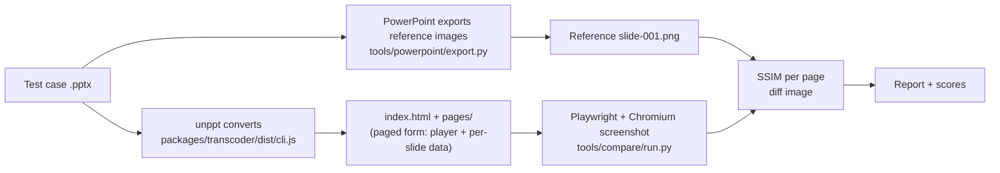
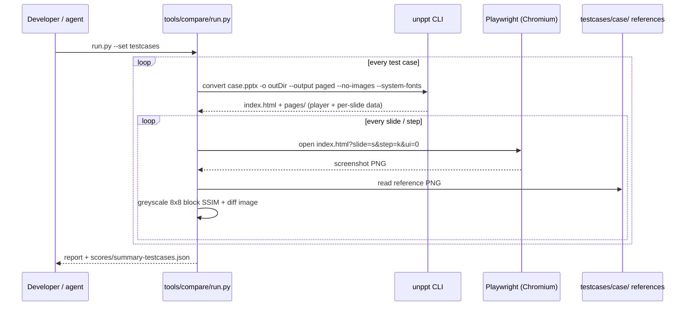
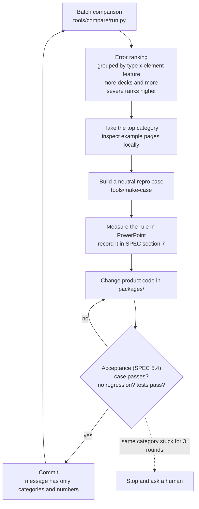
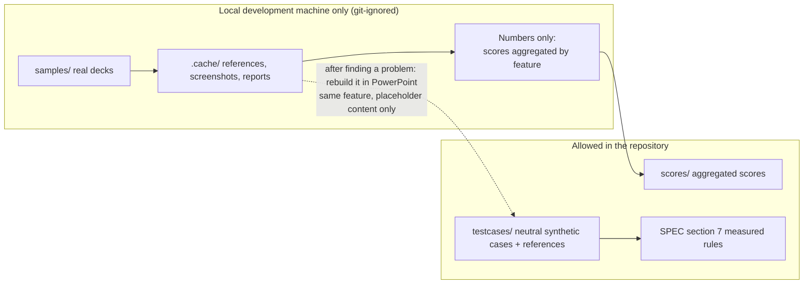

[中文](../zh/fidelity.md)

# Fidelity: what "looks like PowerPoint" means

unppt has one goal: **the converted slides must look exactly like Microsoft PowerPoint's slide show**.
This document explains three things:

1. what standard decides whether two slides "look the same";
2. how that standard is measured automatically (which tools, what each step does);
3. how close we are today and where the gaps are.

> You do not need to know the PowerPoint file format to read this. Every term is explained the first time it appears.

---

## 1. The only reference: a local copy of PowerPoint

We do not compare against "another converter" or "what I think it should look like". **The only reference is the image exported by Microsoft PowerPoint on the local machine** ([SPEC.md](../../SPEC.md) decision D5).

The reason is simple: users compare unppt's result with PowerPoint. Whatever PowerPoint draws, we draw — even when PowerPoint's behaviour looks "unreasonable".

Terms used below:

| Term | Meaning |
|---|---|
| **Reference image** | An image of one slide exported by PowerPoint (1280 pixels wide): the "correct answer" |
| **Screenshot** | The same slide converted by unppt, opened in a browser with the unppt player, and captured as an image |
| **COM automation** | The Windows interface that lets a program drive Office. Our Python tools use it (through the `pywin32` library) to make PowerPoint open files, export images and create new presentations |
| **Playwright** | A tool that controls a browser from code. We use it to open the player page and take screenshots |
| **SSIM** | Structural Similarity. A number between 0 and 1 that measures how alike two images *look*; 1 means identical. It is closer to human perception than comparing pixel colours one by one; how it is computed, with references: [below](#ssim) |
| **Test case** | A .pptx file in `testcases/` whose content is only neutral placeholder text and colour blocks, built to test one feature |

---

## 2. How one comparison works

One comparison = PowerPoint and unppt each draw the same slide, then we score the difference.



### 2.1 Reference images: `tools/powerpoint/export.py`

- Command: `python tools/powerpoint/export.py run --set testcases` (only some cases: add `--only <case name>`).
- Through COM it makes PowerPoint open the file **read-only**, with **macros forcibly disabled**, links not updated and no passwords filled in, then exports every slide as a 1280-pixel-wide image.
- A detail: a PNG exported directly by PowerPoint is a palette image (only 16 grey levels, dithered), so light shading turns into dots. The tool therefore **exports BMP first and converts it losslessly to PNG**.
- Reference images for test cases live in `testcases/<case name>/` and are committed with the case. Each case folder also has `ref.json` (slide size, position of every shape, position of every text line, animation timeline, number of steps per slide).
- Slides with click animations also get an image of the end of every step (files like `slide-001-step-00.png`).
- If you have PowerPoint open yourself, the script refuses to run so it never touches your documents.

### 2.2 Screenshots and scoring: `tools/compare/run.py`

- Command: `.venv/Scripts/python tools/compare/run.py --set testcases`.
- For each case it first converts the file with the command-line converter into the paged form (`--output paged --no-images --system-fonts`; the entry is `index.html` and each slide's data is a separate file, so a screenshot loads only that slide), then starts Chromium through Playwright with a window the same size as the reference image, and opens:

  ```text
  index.html?slide=<slide>&step=<step>&ui=0
  ```

  Why `--system-fonts`: the comparison measures whether the **layout rules** are right, so it converts with the same local fonts PowerPoint uses (since 0.3.0 this option is off by default; the comparison tool turns it on explicitly). Regular users get the fonts embedded in the PPT plus the default font pack by default; see the end of [section 8](#8-where-we-are-today-031).

  `slide` / `step` jump straight to a slide and step (counting from 0); `ui=0` hides the player's own navigation buttons. If the reference is a "static" image (every object shown, animations ignored), `&static=1` is added so the player also shows every object as is.
- Chromium draws text with **greyscale anti-aliasing** (launch flag `--disable-lcd-text`): PowerPoint's references are greyscale, while Chrome's default sub-pixel anti-aliasing has coloured fringes. We compare layout, not anti-aliasing style.
- Scoring: both images are converted to greyscale and cut into 8×8 blocks; SSIM is computed for each block and averaged. A **diff image** is also produced: the reference is faded and pixels that differ a lot (any colour channel off by more than 40) are painted red.
- **Pass line: SSIM ≥ 0.95** (`PASS_SSIM = 0.95` in the code).
- Output: a local visual report (reference / ours / diff side by side) and per-category scores in `scores/summary-testcases.json` (numbers only, safe to commit).

The full call order of one comparison:



<a id="ssim"></a>

#### How the similarity score (SSIM) is computed

SSIM (Structural Similarity) is a standard image-comparison method, introduced by Zhou Wang et al. in 2004 and widely used to rate how close an image looks to a reference. Standard definition:

- [Wikipedia: Structural similarity index measure](https://en.wikipedia.org/wiki/Structural_similarity_index_measure)
- Original paper: Z. Wang, A. C. Bovik, H. R. Sheikh, E. P. Simoncelli, *Image quality assessment: from error visibility to structural similarity*, IEEE Transactions on Image Processing 13(4), 600–612, 2004 ([doi:10.1109/TIP.2003.819861](https://doi.org/10.1109/TIP.2003.819861))

Intuitively: cut the image into small blocks and compare three things in each — **brightness** (mean luminance), **contrast** (how much the luminance varies) and **structure** (whether patterns, edges and strokes line up) — combine them into a block score and average over all blocks. 1 means identical. This is closer to what the eye notices than comparing pixel by pixel: shift a whole slide by one pixel and people barely see it, while a pixel-by-pixel comparison finds almost every pixel different.

**Our exact computation** (`ssim()` in `tools/compare/run.py`; the full-corpus `sweep_ab.py` uses the same function):

1. The reference is scaled to the size of unppt's image (bilinear) and both are converted to greyscale (0–255);
2. They are cut into **non-overlapping 8×8 blocks** (a remainder narrower than 8 px at the right/bottom is dropped);
3. Each block uses the standard formula: SSIM = ((2·μa·μb + C1)·(2·σab + C2)) / ((μa² + μb² + C1)·(σa² + σb² + C2)), where μ is the block's mean luminance, σ² its variance and σab the covariance of the two blocks; C1 = (0.01×255)² and C2 = (0.03×255)² are the paper's standard constants that keep the denominator away from zero;
4. The block scores are averaged into the slide's score.

**Difference from common implementations**: the paper and most tools (e.g. scikit-image's `structural_similarity`) use a **sliding window** evaluated at every pixel (an 11×11 Gaussian-weighted window in the paper, a 7×7 uniform window by default in scikit-image). We use non-overlapping, uniformly weighted 8×8 blocks, which is much faster (we score 160,000+ slides repeatedly). Trends agree with the standard method, but **the numbers are not directly comparable with SSIM values from other tools**.

**Reading the score** (our experience, not part of the standard): 0.98 or more — practically no visible difference; **0.95 or more counts as a pass**, usually only details like text a pixel or two off; 0.90–0.95 — small visible differences somewhere; below 0.90 — something clearly differs.

**Limitations**: greyscale only (a wrong colour with similar brightness costs little; colour is checked separately); no notion of importance (one wrong number in a chart barely moves the score); very sensitive to dense small text — a reference shifted by half a pixel against itself scores only 0.87–0.94 on such slides. That is why shapes and line breaks are also checked one by one (2.4, 2.5); SSIM is mainly for finding likely problems among many slides quickly and for telling which of two versions is closer to PowerPoint.

### 2.3 Animations and transitions are compared too

A static image only shows the end result. Transitions and animations must also match *while they play*:

- `tools/powerpoint/transitions.py capture FadeSmoothly,PushLeft`: builds a neutral deck (alternating white/blue backgrounds), makes PowerPoint **really run the slide show**, and captures frames at about 60 per second;
- `tools/powerpoint/transitions.py capture-anim Fly:Left,Exit:Fade`: records animations the same way;
- `tools/powerpoint/transitions.py compare`: stops our player at the same moments (10%–90%), takes screenshots, compares pixel by pixel by "share of blue", and prints the mean error.

### 2.4 Finer than SSIM: per-shape checks and the "error book"

SSIM is one overall score. It says *how alike*, not *where they differ*. So the comparison tool also checks **shape by shape**:

- the reference `ref.json` contains the box of every shape and the position of every text line, as reported by PowerPoint;
- the tool reads, inside the browser, the box of every element we drew (elements in the slide SVG carry a `data-uid` number) plus the character count and box of every text line;
- for each shape it computes a "local SSIM" over that shape's area only (areas smaller than 32 pixels are skipped, because anti-aliasing noise would dominate), and compares characters per line to check that **line breaks match**.

On top of that, [SPEC.md](../../SPEC.md) 5.3 defines the "error book": differences are classified as "missing, misplaced, different line break, wrong colour…" and graded in four levels; a page passes only when it has no S2 or S3 errors:

| Level | Examples |
|---|---|
| S0 invisible (not counted) | offset < 1 pixel, colour error < 3 |
| S1 visible on close look | offset 1–2 pixels, colour error 3–10 |
| S2 obvious at a glance | offset > 2 pixels, different line break, clear colour or stroke-width difference |
| S3 wrong content | something missing or extra, missing glyphs, conversion failure |

- The score files and the numbers in this document use the SSIM pass line (0.95); the error book is where evaluation is heading, with SSIM as a helper.
- Helper tools: `tools/compare/clusters.py` (ranking of failure causes, numbers and categories only) and `tools/compare/offsets.py <id>` (how many pixels each text line must move to line up with PowerPoint).

### 2.5 The line-wrapping test: `tools/wraptest`

Many decks never break lines by hand and rely on automatic wrapping; one character off and a line becomes two, shifting the rest of the slide. SSIM is not sensitive to this (only a small area differs), so wrapping is tested separately: **compare the text line by line, not the image**.

| Tool | What it does |
|---|---|
| `gen.py` / `gen_table.py` | Has PowerPoint build dozens of slides of text boxes / tables from a random seed (font, size, box width, alignment, indents, bullets, mixed CJK / Latin / digits / punctuation, ...) and immediately reads back every line PowerPoint actually laid out (`TextRange.Lines`) as the reference; all text is synthetic and neutral |
| `sweep.py` | Width sweep: the same text in a series of ever wider boxes, to find exactly at which width a rule (dashes, ellipses, URLs, ...) flips |
| `shapes.py` | The same text in every preset shape, to check each shape's text area |
| `real.py` | Opens real decks read-only in the local PowerPoint and reads every line of every text box and table cell (kept on the local machine only) |
| `check.mjs` / `real.mjs` | Convert the same file, rebuild every line from the output SVG and compare with PowerPoint line by line; real decks print numbers only |

The loop: run, find the lines that differ → measure the rule exactly with `sweep.py` and neutral text → change the code → rerun everything to make sure nothing else got worse → record the rule in SPEC section 7. Real decks are only compared on slides whose fonts are all installed locally (PowerPoint's own layout is not trustworthy when fonts are missing).

Results for 0.3.0 (with the default font pack, i.e. the product's default behaviour):

| Test set | Size | Lines break exactly like PowerPoint |
|---|---|---|
| Generated by PowerPoint | 3,400+ text boxes, 761 table cells, 181 preset shapes | 99.6%+ |
| Text boxes in real decks | 991 decks, about 40,000 multi-line text boxes (160,000 lines) | 99.8% (238 lines differ) |
| Tables in real decks | 6,051 multi-line cells (17,000 lines) | 99.9% (11 lines differ) |

The remaining differences are mostly lines with letter spacing and mixed superscripts in decks converted from PDF, and a few character width differences.

---

## 3. Where test cases come from: `tools/make-case`

Every .pptx in `testcases/` is **generated by PowerPoint itself**, not hand-written XML:

- in `tools/make-case/make.py`, **each test case is one Python function; the function name with `_` replaced by `-` is the case name** (for example function `charts_basic` produces `charts-basic`; others include `table-styles`, `text-hanging-punct`);
- the function uses COM to make PowerPoint create a presentation and insert shapes / charts / tables / text, all with neutral placeholder content (for example "The quick brown fox…");
- the few things PowerPoint's UI cannot produce (for example special EMF image records) are generated by small dedicated scripts (`emf_alpha.py`, `emf_gradient.py`, …).

Steps to add or change a case:

```bash
# 1. Add a function to tools/make-case/make.py, then generate it
.venv/Scripts/python tools/make-case/make.py case-name
# 2. Let PowerPoint export the reference images
.venv/Scripts/python tools/powerpoint/export.py run --set testcases --only case-name
# 3. Compare
.venv/Scripts/python tools/compare/run.py --set testcases --only case-name
```

> These development tools only run on a Windows machine with PowerPoint. **You do not need them to use unppt.**

---

## 4. Measure first, then implement

Much of PowerPoint's behaviour is not documented (for example "may punctuation hang past the edge when a line is full?" or "which font replaces a missing one?"). Our rule:

1. **Measure with a neutral case first**: build a case that contains only that feature, let PowerPoint export it, and if needed read exact positions through COM;
2. **Then write code** that follows the measured rule;
3. **Write it down**: the rule goes into section 7 of [SPEC.md](../../SPEC.md) ("PowerPoint rules found by measurement"), each with its evidence (which case, score before → after). Calibration constants in the code are also marked as measured.

Example (from a code comment): PowerPoint's smallest layout unit is 1/8 point; each character width is rounded to that unit before line breaking — measured with forty "m" characters in 11-point Calibri.

---

## 5. A/B comparison for every change

"A/B comparison" = run the same set of files through the converter **before (A)** and **after (B)** a change, and compare page by page.

- The comparison tool can switch the converter and report folder with environment variables (`UNPPT_CLI`, `UNPPT_REPORT`), so a new build can be measured in another folder without disturbing a full run in progress;
- what matters is not "did the average go up" but **how many pages got better and how many got worse**. A change might improve 80 pages and worsen 3; those 3 must be explained;
- pure refactoring (changes that must not alter behaviour) is stricter: `node scripts/golden.mjs save` records the output hash of every case, and after the change `node scripts/golden.mjs check` must match byte for byte.

Acceptance criteria every change must meet together ([SPEC.md](../../SPEC.md) 5.4, the single source):

1. the neutral case built for this problem goes from failing to passing;
2. no page in `testcases` gets worse (SSIM drops by no more than 0.005, and no new S2/S3 errors);
3. the targeted error category clearly shrinks on real-world decks, with no new S2/S3 errors where there were none;
4. `npm test` and `tools/check-player.py` pass.

---

## 6. The automatic optimisation loop

Chaining the steps above gives the "automatic optimisation loop" that unppt development runs again and again ([SPEC.md](../../SPEC.md) 5.4).



Key points:

- one round fixes one category and is committed immediately; no big batches;
- if the same category cannot be fixed in 3 rounds in a row, or the output format or acceptance criteria would need to change, stop and let a human decide;
- 20% of real-world decks are held out by a stable id rule as a "final exam": only their scores are looked at, never their images, to check that a fix generalises to unseen decks.

---

## 7. Sample safety: customer files never leave the machine

Real-world decks are used during development to find problems, but they may belong to customers. The rules ([SPEC.md](../../SPEC.md) section 4) can be summarised like this:



The rules in detail:

- real decks live only in `samples/`, and everything derived from them (references, screenshots, reports) lives only in `.cache/`; neither folder goes into the repository;
- in reports and logs a deck is identified only by **the first 12 characters of its content hash**, never by file name (a file name may contain a customer's name);
- deck content is never sent to any online service (search, online tools, issues, pull requests), and not to Microsoft either: references are exported read-only, with macros disabled and every dialog cancelled;
- to turn a problem into a test case, a neutral case with the same feature **must be rebuilt in PowerPoint**; customer files are never copied, cropped or edited;
- the only sample-related data allowed in the repository are scores aggregated by feature (for example "pass rate of pages with gradient fills").

---

## 8. Where we are today (0.3.1)

| Test set | Size | Conversion failures | Pass rate (SSIM ≥ 0.95) | Mean SSIM |
|---|---|---|---|---|
| Synthetic test cases `testcases/` | 255 decks / 543 pages | 0 | **93.0%** | 0.984 |
| All real decks on the test machine | 5,212 decks / 168,662 pages | **0** | **70.4%** (93.5% of pages at SSIM ≥ 0.90) | 0.956 |

Breakdowns (by content, by the app that saved the deck, conversion speed, output size) are in the [test report](test-report.md).

How to read these numbers:

- **0.95 is a strict line.** Most pages below it differ only in details: text a few pixels off, one chart label in a different place. At a glance the page looks the same;
- the synthetic cases deliberately test hard features (3D, WordArt effects, complex charts), so the failing pages cluster around those hard spots;
- these numbers are measured with `--system-fonts` (the same fonts PowerPoint uses). With the default font pack (non-embedded fonts laid out with the original font's metrics and displayed with open-source fonts), **line breaks and text positions stay the same and only glyph shapes differ**: on the synthetic cases the mean SSIM is about 0.024 lower per page, purely from glyph shapes;
- line wrapping is also compared line by line: across 991 real decks 99.8% of multi-line text boxes break exactly like PowerPoint; see [2.5](#25-the-line-wrapping-test-toolswraptest).

### Side-by-side images (PowerPoint on the left, unppt on the right)

Each image below is one synthetic test case: on the left the reference exported by Microsoft PowerPoint, on the right a screenshot of the unppt player.

**Charts (basic)**


**Charts (labels on individual data points)**


**3D shapes**


**SmartArt**


**Table styles**


**Text effects**


**All preset shapes**


### Known gaps

These cases still differ visibly from PowerPoint and will be improved in later versions:

| Area | Gap |
|---|---|
| Chart date axes | time scaling (min / max, month / year intervals) is incomplete |
| Vertical text | the `wordArtVert` (WordArt vertical) mode |
| Images | EMF+ records inside EMF images |
| SmartArt | some SmartArt that needs re-layout (the drawing cache stored in the file cannot be used as is) |
| 3D | 3D bevel under 180-degree rotation |
| Chart category labels | truncation threshold of 45-degree labels |

To report a deck that looks wrong safely, see the [FAQ](faq.md).
