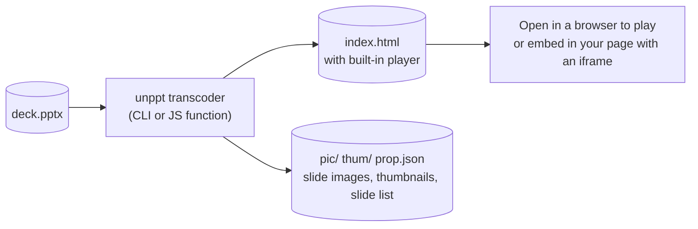
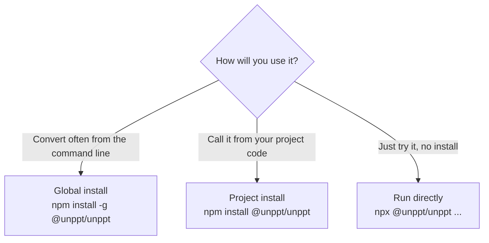
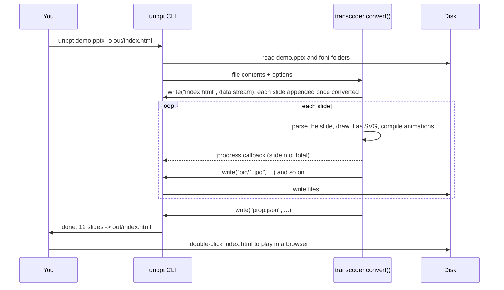
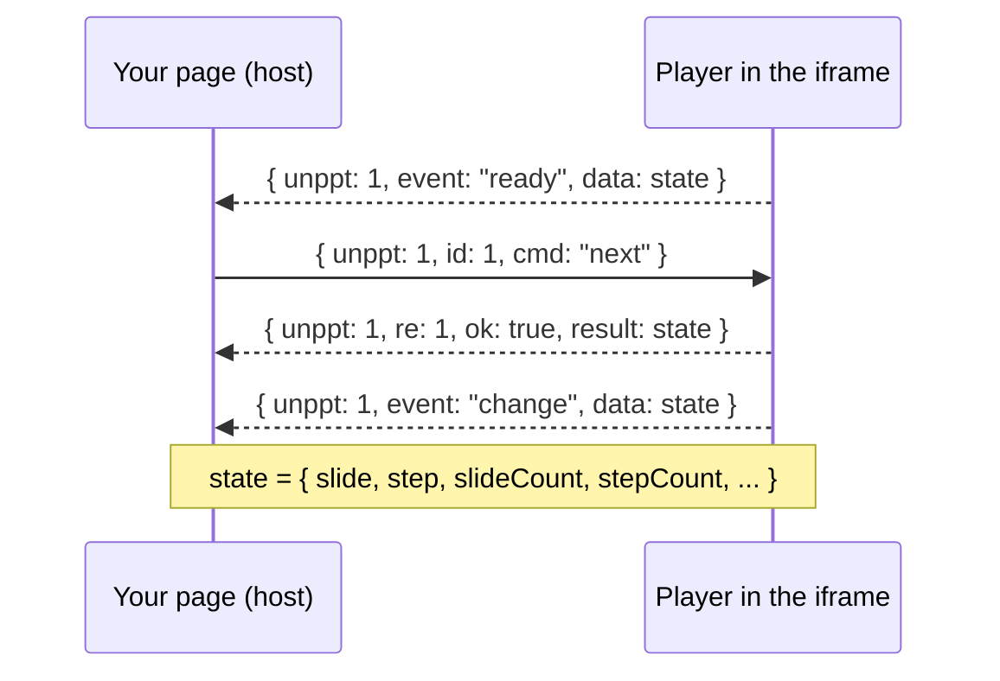
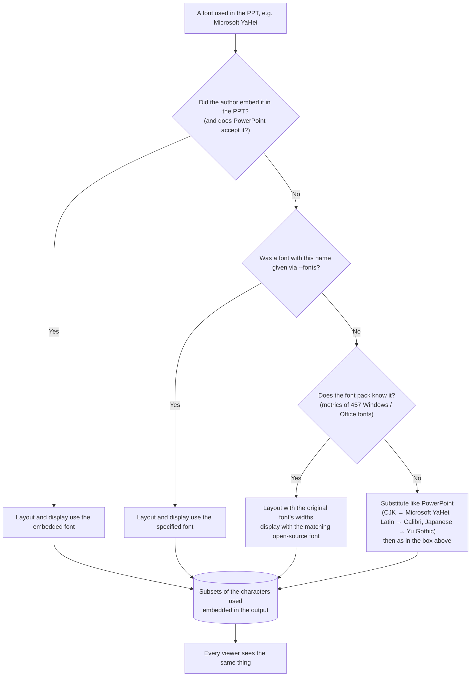

[中文](../zh/getting-started.md)

# Getting Started

This guide takes you from zero to a working result: install unppt, turn your first `.pptx` into a web page, play it, understand every output file, and fix the most common problems. All you need is to type a few commands.

> For the full list of command-line options and the JavaScript API, read [Usage](usage.md).

---

## 1. What unppt does

unppt turns a PowerPoint file (`.pptx`) into a **web page**. The page carries a tiny built-in player that pages through slides, plays animations and slide transitions, just like a PowerPoint slide show.



A few terms first:

| Term | Meaning |
|---|---|
| **Transcode** | Convert one format into another. Here: `.pptx` into a web page. |
| **SVG** | An image format that describes graphics as text. Browsers display it directly and it stays sharp when zoomed. unppt draws each slide as one SVG. |
| **Player** | A piece of JavaScript (about 58 KB, about 21 KB gzipped) written into the page during conversion. It handles paging, animations and transitions. It has **zero dependencies** and loads nothing from the network. |
| **iframe** | The `<iframe>` tag, a "window" that shows one web page inside another. Use it to embed a converted deck in your own product. |
| **Step** | One click's worth of animations on a slide. Step 0 is how the slide looks right after it appears, before any click. |


---

## 2. Requirements

You only need **Node.js 20.12 or newer** (`package.json` says `"node": ">=20.12"`). You do not need PowerPoint or any other program: the transcoder is pure JavaScript plus WASM (binary code that runs in Node and in browsers), with no native add-ons to compile.

Check your Node version:

```bash
node -v
```

`v20.12.0` or higher is fine. If it is older, download the LTS version from <https://nodejs.org/>.

---

## 3. Install

The npm package is **`@unppt/unppt`** and the command it installs is **`unppt`**. Pick one of three ways:



**Option 1: global install (recommended for command-line users)**

```bash
npm install -g @unppt/unppt
unppt deck.pptx -o out/index.html
```

The default font pack `@unppt/fonts` (open-source fonts plus font metrics for layout; about 67 MB to download, about 100 MB installed) is installed automatically with it. It is only needed on the machine that converts; viewers never download it. See [section 7](#7-fonts-why-they-matter-and-how-they-are-handled-now) for why.

**Option 2: install into your project**

```bash
npm install @unppt/unppt
npx unppt deck.pptx -o out/index.html
```

In your code you can then `import { convert } from '@unppt/unppt'`; see [Usage](usage.md#3-javascript-api).

**Option 3: run without installing**

```bash
npx @unppt/unppt deck.pptx -o out/index.html
```

The first run downloads the package temporarily, so give it a moment.

**Option 4: download from GitHub (bypassing the npm registry)**

While npm is still reviewing a new version, or when you cannot reach npm, download the package file from the GitHub Release (attached automatically to every release; `latest` is always the newest) and install those local files. Two steps, because npm 12 and later refuse to install straight from a URL by default.

Since 0.3.0 you need **two files**: the default font pack `unppt-fonts.tgz` and the program itself `unppt.tgz`. Install them together (font pack first).

Windows PowerShell:

```powershell
Invoke-WebRequest https://github.com/spitmaster/unppt/releases/latest/download/unppt-fonts.tgz -OutFile unppt-fonts.tgz
Invoke-WebRequest https://github.com/spitmaster/unppt/releases/latest/download/unppt.tgz -OutFile unppt.tgz
npm install -g .\unppt-fonts.tgz .\unppt.tgz
```

macOS / Linux:

```bash
curl -L -o unppt-fonts.tgz https://github.com/spitmaster/unppt/releases/latest/download/unppt-fonts.tgz
curl -L -o unppt.tgz https://github.com/spitmaster/unppt/releases/latest/download/unppt.tgz
npm install -g ./unppt-fonts.tgz ./unppt.tgz
```

On macOS / Linux, if you get a permission error (`EACCES` / `permission denied`), change the last line to `sudo npm install -g ./unppt-fonts.tgz ./unppt.tgz` and enter your login password.

For a specific version, replace `latest/download/` with something like `download/v0.3.1/` (0.2.x releases have no font pack; download only `unppt.tgz`). Run `unppt -v` afterwards to check the version.

> Running `unppt` with no arguments prints the version and all options.

---

## 4. Convert your first file

Step by step. Suppose you have a file `demo.pptx`.

**Step 1: create an empty folder for the output** (the conversion writes several files and folders next to the output file, so a dedicated folder keeps things tidy)

```bash
mkdir out
```

**Step 2: convert**

```bash
unppt demo.pptx -o out/index.html
```

- `-o out/index.html`: where to write. Without it, a `demo/` folder is created next to `demo.pptx`, holding `index.html` plus `pic/`, `thum/`, `prop.json` etc.
- No font options needed: by default the fonts embedded in the PPT plus the default font pack are used, and every viewer sees the same thing. To check fonts first, run `unppt check demo.pptx`; see [section 7](#7-fonts-why-they-matter-and-how-they-are-handled-now).

**Step 3: read the console output**

While converting it shows progress like `转码中 3/12 页` ("converting page 3 of 12"). At the end you see something like this (the CLI messages are in Chinese):

```text
完成：12 页，用时 4.2 秒 -> D:\work\out\index.html
字体：
  ⚠ 楷体_GB2312  第 1 页   没有这个字体，按 Microsoft YaHei 替代（字形和换行可能和作者电脑上不同）
提示：……
```

- `完成` (done): number of slides, time taken, output path.
- `字体：` (fonts): only fonts **with problems** are listed (⚠ warning, ✗ must fix); the block is absent when there are none. The example says "font not available, substituted with Microsoft YaHei (glyphs and line breaks may differ from the author's computer)". See [section 7.5](#75-checking-fonts-unppt-check) for every status.
- `提示` (notice): problems found during conversion (for example an image that could not be read). Other slides are not affected.

**Step 4: open and play**

Double-click `out/index.html` and it opens in Chrome, Edge or Firefox. No web server needed.

The whole flow:



---

## 5. What is in the output folder

`--output` selects the **output form**; there are four. Every form also writes `prop.json`, and by default slide images `pic/` and thumbnails `thum/`.

### 5.1 The four output forms

| Form | Command | Main file | Characteristics | Good for |
|---|---|---|---|---|
| `single` | `--output single` | one `.html` | Slides, images, fonts and player all inside one HTML; only large images and all audio/video go to `media/` | Sending to people, double-click locally, small decks |
| `paged` (CLI default) | `--output paged` | `index.html` in a folder | Small entry file, one data file per slide; loads only the slide being viewed and preloads the next | Hosting online, many slides, large files |
| `pages` | `--output pages` | `index.html` in a folder | Same as `paged`, plus one `page-001.html` per slide containing just that slide | Opening or embedding a single slide |
| `data` | `--output data` or `--data` | `.json` | Deck data only, no player | Development and debugging |

> `--output html` also works; it is the old name of `single`.

### 5.2 single (one self-contained HTML)

```bash
unppt demo.pptx -o out/index.html
```

```text
out/
├── index.html        ← double-click to play; slides, small images, fonts, player are inside
├── media/            ← audio, video, and images larger than --inline-limit (default 2 MB)
│   └── media1.1a2b3c4d.mp4
├── pic/              ← one full-slide image per slide (JPEG)
│   ├── 1.jpg
│   └── 2.jpg
├── thum/             ← one thumbnail per slide (JPEG, 216 px wide)
│   ├── 1.jpg
│   └── 2.jpg
└── prop.json         ← slide list: count, size, image paths, speaker notes, hidden flag
```

`media/` only appears when the deck has audio/video or large images. File names follow `media/<original name>.<checksum>.<ext>`; the checksum changes whenever the content changes, which makes browser caching safe.

### 5.3 paged (load on demand)

```bash
unppt demo.pptx -o out --output paged
```

Note: for `paged` / `pages`, `-o` is a **folder** (the entry is `index.html` inside it). Without `-o`, it is likewise a folder next to the .pptx named after it (e.g. `demo/`).

```text
out/
├── index.html                 ← entry: player + table of contents (which slides, which file holds each)
├── pages/                     ← per-slide data, one script file per slide
│   ├── 1.9f8e7d6c.js
│   └── 2.0a1b2c3d.js
├── fonts/                     ← subsets of the fonts used (present whenever there is text)
│   └── unppt-f0.5e6f7a8b.js
├── media/                     ← all images, audio, video (images are never inlined in this form)
├── pic/  thum/  prop.json     ← same as single
```

Slide data is loaded with `<script>` tags (not fetch), so it works when double-clicked locally (`file://`), on any domain, and inside an iframe. File names contain a content hash, so long-term caching is safe.

### 5.4 pages (on demand + one HTML per slide)

```bash
unppt demo.pptx -o out --output pages
```

On top of `paged` you get:

```text
out/
├── page-001.html   ← contains only slide 1
├── page-002.html   ← contains only slide 2
└── ...
```

A single-slide HTML knows only its own slide, so links in the deck that jump to other slides do nothing there.

### 5.5 data (data only)

```bash
unppt demo.pptx --data -o out/deck.json
```

```text
out/
├── deck.json       ← deck data (each slide's SVG, animation steps, transition, plus title, size, report)
├── fonts/          ← subsets of the fonts used, as .woff (present whenever there is text)
├── media/          ← all images, audio, video
├── pic/  thum/  prop.json
```

This form has no player and is mainly for development and debugging.

### 5.6 Slide images, thumbnails and prop.json

Slide images and thumbnails are produced with the bundled resvg (a library that draws SVG into bitmaps, WASM build). Use them for deck lists, share cards, or places where JavaScript is not available.

| File | Size |
|---|---|
| `pic/{n}.jpg` | Slide size in points, rounded, as pixels; e.g. 960×540 for a default 16:9 slide |
| `thum/{n}.jpg` | 216 px wide, height in proportion |

Slide numbers start at 1. If you do not need images (conversion gets much faster), add `--no-images`; `prop.json` is still written.

What `prop.json` looks like (fields come from `output/prop.ts`):

```json
{
 "count": 2,
 "picw": 960,
 "pich": 540,
 "thumw": 216,
 "thumh": 122,
 "slides": [
  { "index": 1, "thum": "thum/1.jpg", "pic": "pic/1.jpg", "note": "Speaker notes text" },
  { "index": 2, "thum": "thum/2.jpg", "pic": "pic/2.jpg", "hidden": 1 }
 ]
}
```

| Field | Meaning |
|---|---|
| `count` | Number of slides (hidden slides included) |
| `picw` / `pich` | Slide width / height in points (pt, 1 pt = 1/72 inch) |
| `thumw` / `thumh` | Thumbnail width / height (pixels) |
| `slides[].index` | Slide number, starting at 1 |
| `slides[].pic` / `thum` | Image paths, relative to the folder of `prop.json` |
| `slides[].note` | Speaker notes (absent when there are none) |
| `slides[].hidden` | `1` for a hidden slide (absent otherwise) |

---

## 6. Open and control the player

### 6.1 Mouse, keyboard and touch

These match PowerPoint slide-show habits (from the player source `packages/player/src/ui/input.ts`):

| Action | Effect |
|---|---|
| Click the slide | Next step (animations first, then the next slide); clicking a hyperlink follows it |
| `→` `↓` `PageDown` `Space` `Enter` | Next step |
| `←` `↑` `PageUp` `Backspace` | Previous step |
| `Home` / `End` | First / last slide |
| Type a number then `Enter` (e.g. `5` `Enter`) | Go to slide 5 (the digits expire after 2 seconds without input) |
| `B` or `.` | Black screen; any key or click returns to the slide |
| `W` or `,` | White screen; any key or click returns to the slide |
| Swipe left / right on a touch screen | Next / previous step |
| Move the mouse over the slide | `‹`, `›` buttons and a counter like `3 / 12` appear bottom-right |

Sequential paging skips hidden slides, just like a PowerPoint slide show.

### 6.2 URL parameters

Append parameters to the address, e.g. `index.html?slide=2&step=1&ui=0`:

| Parameter | Effect |
|---|---|
| `slide`, `step` | Open directly at a slide and step (both start at 0). Opening this way disables timed auto-advance by default |
| `ui=0` | Hide the built-in paging buttons; your page controls everything |
| `timings=0` / `timings=1` | Turn off / force on auto-advance using the deck's slide timings |
| `links=0` | Do not open external links in a new window; only send a `link` event to the host |
| `mode=watch` | Watch mode: driven only through the JS interface (e.g. the student side of a live class) |
| `origin=https://a.com,https://b.com` | Accept postMessage commands only from these origins |

### 6.3 Embed in your page and control it from code

**postMessage** is the browser method that lets two pages (including a cross-origin iframe) send each other messages. The player listens for them:

```html
<iframe id="ppt" src="out/index.html?ui=0" style="width:960px;height:540px;border:0"></iframe>
<button onclick="send('prev')">Previous</button>
<button onclick="send('next')">Next</button>
<script>
  const frame = document.getElementById('ppt');
  let id = 0;
  function send(cmd, args) {
    frame.contentWindow.postMessage({ unppt: 1, id: ++id, cmd, args }, '*');
  }
  window.addEventListener('message', (e) => {
    const m = e.data;
    if (!m || m.unppt !== 1) return;
    if (m.event) console.log('event', m.event, m.data);   // ready / change / end / link
    if (m.re) console.log('reply', m.re, m.ok, m.result);
  });
  // Go to slide 4, step 0: send('goto', { slide: 3, step: 0 })
</script>
```



Commands are `next`, `prev`, `goto`, `sync`, `getState`; events are `ready`, `change`, `end`, `link`. On the same page you can also call `window.unppt.next()` or `window.unppt.goto({ slide: 2, step: 1 })` directly. For all embedding options (including native app WebViews) see [Embedding](embedding.md), [Player](player.md) and the example [examples/iframe-host.html](../../examples/iframe-host.html).

---

## 7. Fonts: why they matter and how they are handled now

> Font handling changed in 0.3.0: by default unppt **no longer uses the fonts installed on this machine**; it uses the fonts embedded in the PPT plus the default font pack `@unppt/fonts`. This section explains it from the start.

### 7.1 Why fonts matter

Fonts matter at two moments:

| Moment | What the font decides |
|---|---|
| **Conversion** (layout) | How wide each character is, how many fit on a line, where lines break, how far apart lines are. To match PowerPoint the transcoder must know the real width of every character |
| **Viewing** (display) | What each character looks like (glyph shapes) |

unppt's principle (SPEC D3): **the player never uses fonts installed on the viewer's computer**. Every glyph comes from font subsets (only the characters used) packed into the output. So whether viewers use Windows, Mac, Android or iPhone (for example thousands of students in a live class), they all see exactly the same thing.

### 7.2 Where the fonts in the output come from

Unless you explicitly specify font files, the fonts in the output come from only two sources:

1. **Fonts the author embedded in the `.pptx`**: used as-is. Exception: embedded fonts that PowerPoint itself refuses (CFF `.otf`, fonts with an unsorted table directory) are treated as not embedded, just like PowerPoint does.
2. **The default font pack `@unppt/fonts`**: installed automatically with `@unppt/unppt` (it is a dependency). It contains only open-source fonts, all under SIL OFL 1.1, which may be freely redistributed. About 100 MB installed, needed only on the machine that converts; viewers never download it (the output only contains subsets of the characters used).



Characters that no font has (rare: emoji, rare CJK characters) are left to the browser's own fallback, so they may differ between devices; `unppt check` lists them.

### 7.3 Layout and display are separate: metrics pack + open-source fonts

Microsoft YaHei, SimSun, Calibri and the like are commercial fonts that cannot be shipped with the output. unppt therefore separates "layout" from "display":

- **Layout** uses the original font's **metrics**: the font pack contains a metrics pack with numbers only (advance width of each character, ascent/descent, kerning), **no glyph shapes**, covering 457 Windows / Office font faces. So line breaks, character positions and line spacing are the same as in PowerPoint.
- **Display** uses the matching open-source font. Glyph shapes differ slightly from the original (e.g. Microsoft YaHei is shown as Noto Sans SC), but positions do not change.

| Original font (examples) | Displayed with |
|---|---|
| Microsoft YaHei (微软雅黑), DengXian (等线), SimHei (黑体) and other sans-serif CJK fonts | Noto Sans SC (思源黑体; Light / Regular / Bold) |
| SimSun (宋体) and similar | Noto Serif SC (思源宋体; Regular / Bold) |
| KaiTi (楷体) | LXGW WenKai (霞鹜文楷) |
| FangSong (仿宋) | Zhuque Fangsong (朱雀仿宋) |
| Calibri | Carlito (metric-compatible with Calibri) |
| Cambria | Caladea (metric-compatible with Cambria) |
| Arial and other sans-serif Latin fonts | Liberation Sans (metric-compatible with Arial) |
| Times New Roman and other serif Latin fonts | Liberation Serif (metric-compatible with Times New Roman) |
| Courier New and other monospace fonts | Liberation Mono (metric-compatible with Courier New) |

The mapping rules live in `packages/fonts/map.json`; they are tried in order and the first match wins.

**Source Han Sans / Serif are an exception** (since 0.3.1): the pack does contain Noto Sans SC / Noto Serif SC (the same design), but a deck that names "思源黑体", "Source Han Sans", "思源宋体" and the like, without embedding it, is treated like any other missing font: it is laid out with a substitute by PowerPoint's rules (for Chinese usually Microsoft YaHei), and `unppt check` marks it ⚠. The reason: most computers do not have Source Han installed, and that is how PowerPoint shows these decks there, so every viewer sees the same thing. To keep the Source Han look, embed the font in the PPT. A deck that names Noto Sans SC / Noto Serif SC directly still uses the pack's font of that name.

### 7.4 Symbol fonts (Wingdings, Webdings, Symbol, ...)

Symbol fonts put pictures where letters normally are (e.g. `l` in Wingdings is a solid dot). unppt **never changes your characters**:

- The author embedded the symbol font in the PPT: it is used and displays correctly.
- **Wingdings, Wingdings 2 and Wingdings 3 not embedded**: shown with a code-compatible open font from the default pack — glyphs taken from Noto Sans Symbols and other open fonts, placed at the Wingdings code points, so the characters stay as they are and draw as the intended symbols (■ ➢ ● ✔ ◆ ❖ …), sized and positioned by Wingdings' widths and glyph boxes. The glyph designs differ slightly from Wingdings (like Noto Sans SC vs Microsoft YaHei).
- Other symbol fonts (Webdings, Symbol, ...) not embedded: characters typed as letters show as ordinary letters; symbols added with Insert → Symbol are in no packed font and are left to the browser (symbols on computers that have the font, boxes elsewhere). The conversion report and `unppt check` tell the author to embed fonts.

To embed fonts in PowerPoint: **File → Options → Save → check "Embed fonts in the file"**, then save again. You can also provide the symbol font file with `--fonts`.

### 7.5 Checking fonts: unppt check

To find font problems before converting (for example to check decks users upload to your product), use `unppt check`. It only checks fonts, writes no files and takes a few seconds:

```bash
unppt check text-latin-cjk-font.pptx
```

```text
字体检查：text-latin-cjk-font.pptx（共 1 页）
  ⚠ 楷体_GB2312  第 1 页   没有这个字体，按 Microsoft YaHei 替代（字形和换行可能和作者电脑上不同）
  ✓ 等线         第 1 页   排版按原字体，显示用 思源黑体（Noto Sans SC）
  ✓ 宋体         第 1 页   排版按原字体，显示用 思源宋体（Noto Serif SC）
  ✓ Arial        第 1 页   排版按原字体，显示用 Liberation Sans
结论：0 个必须处理的问题（✗），1 个提醒（⚠）
```

(The CLI prints Chinese. Line by line: 楷体_GB2312 is not available and is substituted with Microsoft YaHei; 等线, 宋体 and Arial are laid out with the original font and displayed with Noto Sans SC, Noto Serif SC and Liberation Sans; summary: 0 problems that must be fixed, 1 warning.)

A deck that uses Webdings without embedding it shows:

```text
  ✗ Webdings   第 1 页   符号字体没有嵌入，符号会显示成字母或方框：请在 PowerPoint 里勾选"将字体嵌入文件"
```

("Symbol font not embedded, symbols will show as letters or boxes: tick 'Embed fonts in the file' in PowerPoint.")

What each status means (the `status` value in `--json` output in parentheses):

| Mark | Status | Meaning |
|---|---|---|
| ✓ | Embedded (`embedded`) | The font is embedded in the PPT and shown as-is |
| ✓ | Specified (`specified`) | A font given with `--fonts` / `--system-fonts` |
| ✓ | Default pack (`default`) | Laid out with the original font's widths, displayed with an open-source font |
| ⚠ | Substituted (`substituted`) | The font pack does not know this font either; a substitute was chosen by PowerPoint's rules, so glyphs and line breaks may differ from the author's computer |
| ✗ | Symbol font missing (`symbol-missing`) | Symbols will show as letters or boxes; see [section 7.4](#74-symbol-fonts-wingdings-webdings-symbol-) |
| ✗ | Missing (`missing`) | Not even a substitute is available; widths can only be estimated (usually the default font pack is not installed) |

- `--json` prints JSON: `fonts` (per font: `font`, `pages`, `status`, plus optional `substitute` and `shownWith`), `missingChars` (characters no font can show, per page), `errors` (number of ✗), `warnings` (number of ⚠) and `slides` (slide count).
- The exit code is `1` when there is any ✗, so a product can reject the upload or warn the author.
- Font options (`--fonts`, `--system-fonts`, `--no-default-fonts`) work the same as for conversion; the result describes a conversion with those fonts.
- A normal conversion also prints the font check at the end, but only the fonts with problems (⚠, ✗).

### 7.6 Font options

| Option | What it does | When to use |
|---|---|---|
| (none) | Fonts embedded in the PPT + the default font pack. If `@unppt/fonts` is not found a hint is printed, and widths of non-embedded fonts can only be estimated | Most of the time |
| `--fonts <dir>` | Reads `.ttf` / `.otf` / `.ttc` from this folder (including sub-folders). These win over the font pack for the same name, are used for layout and display, and the characters used are embedded. Can be repeated | You have your own fonts and the right to distribute them |
| `--system-fonts` | Also uses this machine's system fonts and Office private / cloud fonts (e.g. Aptos, Gill Sans MT) for layout and display, embedding the characters used. **Off by default since 0.3.0** (it was on by default in 0.2.3–0.2.6) | You want glyphs identical to the author's computer. **Mind commercial font licenses**: embedding means distributing font subsets to every viewer |
| `--no-default-fonts` | Do not use the default font pack | Debugging |
| `--no-system-fonts` | Old option, still accepted, no effect (it is off by default now) | — |
| `--embed-fonts` | Old option, still accepted, no effect (every font used is always embedded now) | — |

Folders searched by `--system-fonts`:

| OS | System font folders | Office private / cloud fonts |
|---|---|---|
| Windows | `%WINDIR%\Fonts`, `%LOCALAPPDATA%\Microsoft\Windows\Fonts` | `Program Files\Microsoft Office\root\vfs\Fonts\private`, `%LOCALAPPDATA%\Microsoft\FontCache\4\CloudFonts` |
| macOS | `/System/Library/Fonts`, `/Library/Fonts`, `~/Library/Fonts` | `/Applications/Microsoft PowerPoint.app/Contents/Resources/DFonts` |
| Linux | `/usr/share/fonts`, `/usr/local/share/fonts`, `~/.fonts`, `~/.local/share/fonts` | none |

Recommended:

```bash
# Most of the time: no options; the result is the same on any computer, server or cloud function
unppt demo.pptx -o out

# Check fonts first
unppt check demo.pptx

# Use your own fonts that you may distribute (they win over the font pack)
unppt demo.pptx -o out --fonts /opt/fonts

# Use this machine's fonts so glyphs match the author's computer (mind commercial font licenses)
unppt demo.pptx -o out --system-fonts
```

---

## 8. How good is it

During development unppt compares every slide automatically against images exported by a local PowerPoint (the "answer key"). The comparison uses **SSIM** (structural similarity, from 0 to 1, where 1 means identical images; how it is computed: [Fidelity](fidelity.md#ssim)); a slide passes at SSIM ≥ 0.95. Results for 0.3.1 (full numbers in the [test report](test-report.md)):

| Test set | Size | Pass rate (SSIM ≥ 0.95) | Mean SSIM |
|---|---|---|---|
| Synthetic test cases | 255 decks / 543 slides | 93.0% | 0.984 |
| Real-world decks | 5212 decks / 168662 slides, 0 conversion failures | 70.4% (93.5% of slides at SSIM ≥ 0.90) | 0.956 |

These numbers are measured with `--system-fonts` (the same fonts PowerPoint uses), so they measure whether the layout rules are right. With the default font pack, line breaks and text positions stay the same and only glyph shapes change to the open-source fonts; on the synthetic test cases the mean SSIM is about 0.024 lower per slide, purely from glyph shapes.

Most failing slides differ only in details (text a few pixels off, one chart label). In each image below, Microsoft PowerPoint is on the left and unppt on the right:


Known gaps: time scaling on chart date axes (min/max, month/year intervals), vertical WordArt text (wordArtVert), EMF+ records inside EMF images, some SmartArt that needs re-layout, 3D bevel under a 180-degree rotation, and the truncation threshold of 45-degree category labels.

---

## 9. Troubleshooting

| Symptom | Cause and fix |
|---|---|
| `unppt` is not recognized / command not found | Not installed globally, or the npm global folder is not on PATH. Use `npx @unppt/unppt ...`, or reinstall with `npm install -g @unppt/unppt` |
| Node version error or syntax error on install/run | Node is older than 20.12. Check with `node -v` and upgrade |
| It only prints a long "usage" text | The command is wrong: the first argument must be `convert`, followed by the input file; a misspelled option also prints usage. See [Usage](usage.md#2-cli-reference) |
| Line breaks differ from PowerPoint | A font was missing at conversion time. Run `unppt check file.pptx` to see which fonts are ⚠ substituted or ✗; ask the author to embed fonts in PowerPoint, or provide them with `--fonts <dir>`. See [section 7](#7-fonts-why-they-matter-and-how-they-are-handled-now) |
| Hint saying the default font pack @unppt/fonts was not found (`没找到默认字体包 @unppt/fonts`) | The font pack is not installed (e.g. only `unppt.tgz` was installed). Reinstall with `npm install -g @unppt/unppt`, or when installing from GitHub install `unppt-fonts.tgz` too |
| Glyphs look slightly different from the author's computer | Expected: non-embedded commercial fonts (Microsoft YaHei, Calibri, ...) are displayed with open-source fonts; positions and line breaks do not change. For identical glyphs, have the author embed the fonts, or use `--system-fonts` / `--fonts` if you are licensed to |
| Symbols (ticks, arrows, bullets) show as letters | A symbol font such as Webdings or Symbol is used but not embedded (Wingdings 1–3 no longer do this). Ask the author to "Embed fonts in the file" in PowerPoint; see [section 7.4](#74-symbol-fonts-wingdings-webdings-symbol-) |
| `pic/`, `thum/`, `prop.json` appear next to my `.pptx` | Versions up to 0.2.1 wrote output next to the input when `-o` was omitted. Upgrade to 0.2.2+ (default is a folder named after the .pptx), or use `-o out/index.html` |
| Notice saying there is no resvg.wasm and no slide images/thumbnails are written | The program cannot find `resvg.wasm` (usually an incomplete install). Reinstall; add `--no-images` if you do not need images |
| Slow conversion or out of memory | Image rendering takes the most time. Add `--no-images` to skip it, or use `--jobs 1` / `--jobs 2` to draw with fewer threads. `--stats` shows time and peak memory |
| Video does not play | Videos live in `media/`; copy or upload `media/` together with the rest. The video codec must also be playable by browsers (e.g. MP4/H.264) |
| A slide is blank with a notice "slide N failed to render" (`第 N 页渲染失败`) | That slide hit an error; other slides are unaffected. Please send us a re-created, shareable file that reproduces it |
| The browser shows `无法播放：...` ("cannot play") | The output format and player version do not match, or the file is damaged. Convert again with the same version |

If a deck does not look right, please open an issue on GitHub: <https://github.com/spitmaster/unppt/issues>. Do not upload files with private or customer content; ideally create a small new file in PowerPoint that contains only the problematic element.
