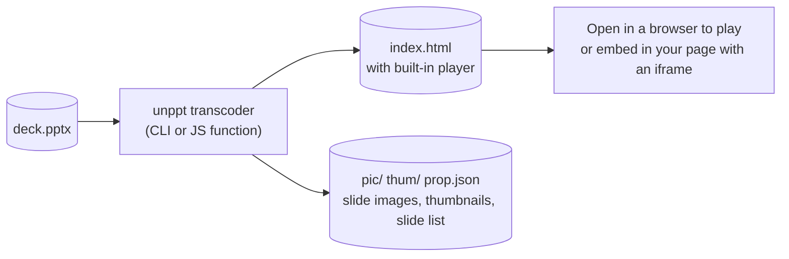
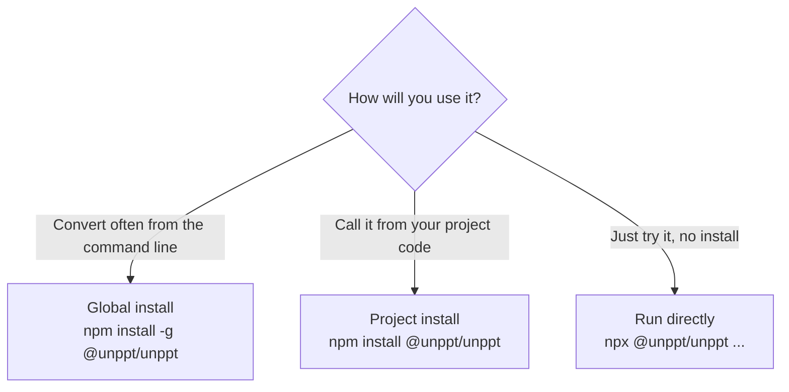
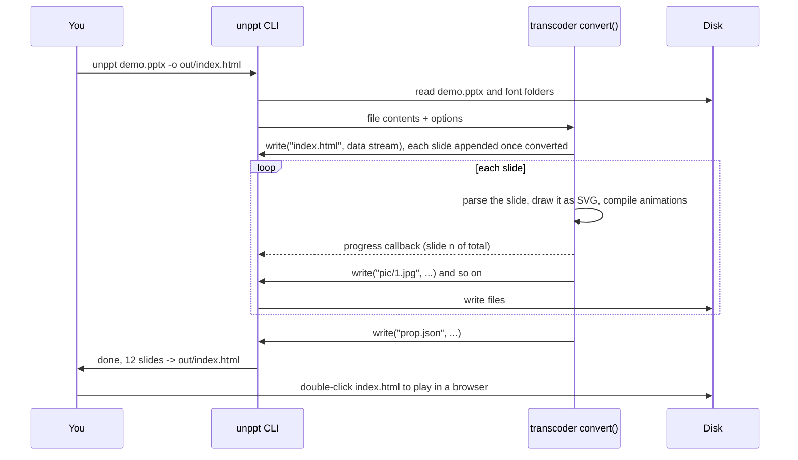
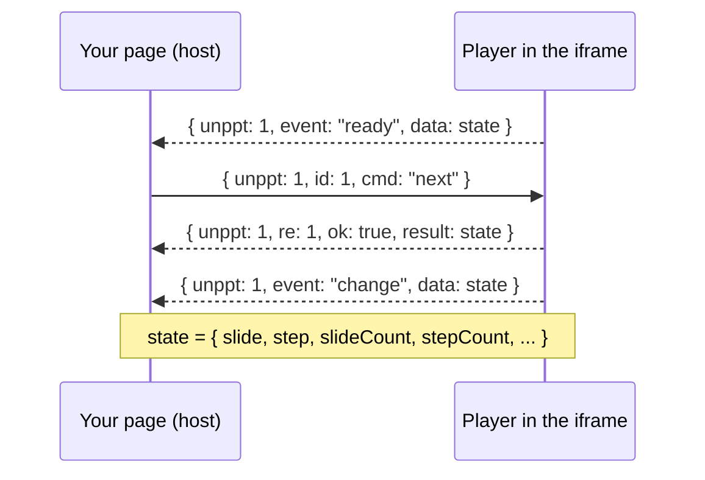
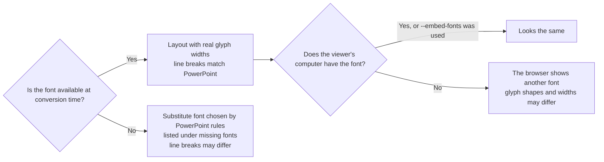

[中文](../zh/getting-started.md)

# Getting Started

This guide takes you from zero to a working result: install unppt, turn your first `.pptx` into a web page, play it, understand every output file, and fix the most common problems. All you need is to type a few commands.

> For the full list of command-line options and the JavaScript API, read [Usage](usage.md).

---

## 1. What unppt does

unppt turns a PowerPoint file (`.pptx`) into a **web page**. The page carries a tiny built-in player that pages through slides, plays animations and slide transitions, just like a PowerPoint slide show.



A few terms first:

| Term | Meaning |
|---|---|
| **Transcode** | Convert one format into another. Here: `.pptx` into a web page. |
| **SVG** | An image format that describes graphics as text. Browsers display it directly and it stays sharp when zoomed. unppt draws each slide as one SVG. |
| **Player** | A piece of JavaScript (about 58 KB, about 21 KB gzipped) written into the page during conversion. It handles paging, animations and transitions. It has **zero dependencies** and loads nothing from the network. |
| **iframe** | The `<iframe>` tag, a "window" that shows one web page inside another. Use it to embed a converted deck in your own product. |
| **Step** | One click's worth of animations on a slide. Step 0 is how the slide looks right after it appears, before any click. |


---

## 2. Requirements

You only need **Node.js 20.12 or newer** (`package.json` says `"node": ">=20.12"`). You do not need PowerPoint or any other program: the transcoder is pure JavaScript plus WASM (binary code that runs in Node and in browsers), with no native add-ons to compile.

Check your Node version:

```bash
node -v
```

`v20.12.0` or higher is fine. If it is older, download the LTS version from <https://nodejs.org/>.

---

## 3. Install

The npm package is **`@unppt/unppt`** and the command it installs is **`unppt`**. Pick one of three ways:



**Option 1: global install (recommended for command-line users)**

```bash
npm install -g @unppt/unppt
unppt deck.pptx -o out/index.html
```

**Option 2: install into your project**

```bash
npm install @unppt/unppt
npx unppt deck.pptx -o out/index.html
```

In your code you can then `import { convert } from '@unppt/unppt'`; see [Usage](usage.md#3-javascript-api).

**Option 3: run without installing**

```bash
npx @unppt/unppt deck.pptx -o out/index.html
```

The first run downloads the package temporarily, so give it a moment.

**Option 4: download from GitHub (bypassing the npm registry)**

While npm is still reviewing a new version, or when a corporate npm mirror fails, download the package file from the GitHub Release (attached automatically to every release; `latest` is always the newest) and install that local file. Two steps, because npm 12 and later refuse to install straight from a URL by default.

Windows PowerShell:

```powershell
Invoke-WebRequest https://github.com/spitmaster/unppt/releases/latest/download/unppt.tgz -OutFile unppt.tgz
npm install -g .\unppt.tgz
```

macOS / Linux:

```bash
curl -L -o unppt.tgz https://github.com/spitmaster/unppt/releases/latest/download/unppt.tgz
npm install -g ./unppt.tgz
```

On macOS / Linux, if you get a permission error (`EACCES` / `permission denied`), use `sudo npm install -g ./unppt.tgz` and enter your login password.

For a specific version, replace `latest/download/unppt.tgz` with something like `download/v0.2.4/unppt-unppt-0.2.4.tgz`. Run `unppt -v` afterwards to check the version.

> Running `unppt` with no arguments prints the version and all options.

---

## 4. Convert your first file

Step by step. Suppose you have a file `demo.pptx`.

**Step 1: create an empty folder for the output** (the conversion writes several files and folders next to the output file, so a dedicated folder keeps things tidy)

```bash
mkdir out
```

**Step 2: convert**

```bash
unppt demo.pptx -o out/index.html --system-fonts
```

- `convert`: the sub-command (currently the only one).
- `-o out/index.html`: where to write. Without it, a `demo/` folder is created next to `demo.pptx`, holding `index.html` plus `pic/`, `thum/`, `prop.json` etc.
- `--system-fonts`: lay text out with the fonts installed on this computer, for more accurate results. See [section 7](#7-fonts-why-they-matter-and-how-to-provide-them) for why fonts matter.

**Step 3: read the console output**

While converting it shows progress like `转码中 3/12 页` ("converting page 3 of 12"). At the end you see something like this (the CLI messages are in Chinese):

```text
完成：12 页，用时 4.2 秒 -> D:\work\out\index.html
缺少字体：Some Font
提示：……
```

- `完成` (done): number of slides, time taken, output path.
- `缺少字体` (missing fonts): fonts used in the file but not found on this machine. A substitute font is used, so the result may differ slightly.
- `提示` (notice): problems found during conversion (for example an image that could not be read). Other slides are not affected.

**Step 4: open and play**

Double-click `out/index.html` and it opens in Chrome, Edge or Firefox. No web server needed.

The whole flow:



---

## 5. What is in the output folder

`--output` selects the **output form**; there are four. Every form also writes `prop.json`, and by default slide images `pic/` and thumbnails `thum/`.

### 5.1 The four output forms

| Form | Command | Main file | Characteristics | Good for |
|---|---|---|---|---|
| `single` | `--output single` | one `.html` | Slides, images, fonts and player all inside one HTML; only large images and all audio/video go to `media/` | Sending to people, double-click locally, small decks |
| `paged` (CLI default) | `--output paged` | `index.html` in a folder | Small entry file, one data file per slide; loads only the slide being viewed and preloads the next | Hosting online, many slides, large files |
| `pages` | `--output pages` | `index.html` in a folder | Same as `paged`, plus one `page-001.html` per slide containing just that slide | Opening or embedding a single slide |
| `data` | `--output data` or `--data` | `.json` | Deck data only, no player | Development and debugging |

> `--output html` also works; it is the old name of `single`.

### 5.2 single (one self-contained HTML)

```bash
unppt demo.pptx -o out/index.html
```

```text
out/
├── index.html        ← double-click to play; slides, small images, fonts, player are inside
├── media/            ← audio, video, and images larger than --inline-limit (default 2 MB)
│   └── media1.1a2b3c4d.mp4
├── pic/              ← one full-slide image per slide (JPEG)
│   ├── 1.jpg
│   └── 2.jpg
├── thum/             ← one thumbnail per slide (JPEG, 216 px wide)
│   ├── 1.jpg
│   └── 2.jpg
└── prop.json         ← slide list: count, size, image paths, speaker notes, hidden flag
```

`media/` only appears when the deck has audio/video or large images. File names follow `media/<original name>.<checksum>.<ext>`; the checksum changes whenever the content changes, which makes browser caching safe.

### 5.3 paged (load on demand)

```bash
unppt demo.pptx -o out --output paged
```

Note: for `paged` / `pages`, `-o` is a **folder** (the entry is `index.html` inside it). Without `-o`, it is likewise a folder next to the .pptx named after it (e.g. `demo/`).

```text
out/
├── index.html                 ← entry: player + table of contents (which slides, which file holds each)
├── pages/                     ← per-slide data, one script file per slide
│   ├── 1.9f8e7d6c.js
│   └── 2.0a1b2c3d.js
├── fonts/                     ← embedded font subsets (only when fonts are embedded)
│   └── unppt-f0.5e6f7a8b.js
├── media/                     ← all images, audio, video (images are never inlined in this form)
├── pic/  thum/  prop.json     ← same as single
```

Slide data is loaded with `<script>` tags (not fetch), so it works when double-clicked locally (`file://`), on any domain, and inside an iframe. File names contain a content hash, so long-term caching is safe.

### 5.4 pages (on demand + one HTML per slide)

```bash
unppt demo.pptx -o out --output pages
```

On top of `paged` you get:

```text
out/
├── page-001.html   ← contains only slide 1
├── page-002.html   ← contains only slide 2
└── ...
```

A single-slide HTML knows only its own slide, so links in the deck that jump to other slides do nothing there.

### 5.5 data (data only)

```bash
unppt demo.pptx --data -o out/deck.json
```

```text
out/
├── deck.json       ← deck data (each slide's SVG, animation steps, transition, plus title, size, report)
├── fonts/          ← embedded font subsets as .woff (only when fonts are embedded)
├── media/          ← all images, audio, video
├── pic/  thum/  prop.json
```

This form has no player and is mainly for development and debugging.

### 5.6 Slide images, thumbnails and prop.json

Slide images and thumbnails are produced with the bundled resvg (a library that draws SVG into bitmaps, WASM build). Use them for deck lists, share cards, or places where JavaScript is not available.

| File | Size |
|---|---|
| `pic/{n}.jpg` | Slide size in points, rounded, as pixels; e.g. 960×540 for a default 16:9 slide |
| `thum/{n}.jpg` | 216 px wide, height in proportion |

Slide numbers start at 1. If you do not need images (conversion gets much faster), add `--no-images`; `prop.json` is still written.

What `prop.json` looks like (fields come from `output/prop.ts`):

```json
{
 "count": 2,
 "picw": 960,
 "pich": 540,
 "thumw": 216,
 "thumh": 122,
 "slides": [
  { "index": 1, "thum": "thum/1.jpg", "pic": "pic/1.jpg", "note": "Speaker notes text" },
  { "index": 2, "thum": "thum/2.jpg", "pic": "pic/2.jpg", "hidden": 1 }
 ]
}
```

| Field | Meaning |
|---|---|
| `count` | Number of slides (hidden slides included) |
| `picw` / `pich` | Slide width / height in points (pt, 1 pt = 1/72 inch) |
| `thumw` / `thumh` | Thumbnail width / height (pixels) |
| `slides[].index` | Slide number, starting at 1 |
| `slides[].pic` / `thum` | Image paths, relative to the folder of `prop.json` |
| `slides[].note` | Speaker notes (absent when there are none) |
| `slides[].hidden` | `1` for a hidden slide (absent otherwise) |

---

## 6. Open and control the player

### 6.1 Mouse, keyboard and touch

These match PowerPoint slide-show habits (from the player source `packages/player/src/ui/input.ts`):

| Action | Effect |
|---|---|
| Click the slide | Next step (animations first, then the next slide); clicking a hyperlink follows it |
| `→` `↓` `PageDown` `Space` `Enter` | Next step |
| `←` `↑` `PageUp` `Backspace` | Previous step |
| `Home` / `End` | First / last slide |
| Type a number then `Enter` (e.g. `5` `Enter`) | Go to slide 5 (the digits expire after 2 seconds without input) |
| `B` or `.` | Black screen; any key or click returns to the slide |
| `W` or `,` | White screen; any key or click returns to the slide |
| Swipe left / right on a touch screen | Next / previous step |
| Move the mouse over the slide | `‹`, `›` buttons and a counter like `3 / 12` appear bottom-right |

Sequential paging skips hidden slides, just like a PowerPoint slide show.

### 6.2 URL parameters

Append parameters to the address, e.g. `index.html?slide=2&step=1&ui=0`:

| Parameter | Effect |
|---|---|
| `slide`, `step` | Open directly at a slide and step (both start at 0). Opening this way disables timed auto-advance by default |
| `ui=0` | Hide the built-in paging buttons; your page controls everything |
| `timings=0` / `timings=1` | Turn off / force on auto-advance using the deck's slide timings |
| `links=0` | Do not open external links in a new window; only send a `link` event to the host |
| `mode=watch` | Watch mode: driven only through the JS interface (e.g. the student side of a live class) |
| `origin=https://a.com,https://b.com` | Accept postMessage commands only from these origins |

### 6.3 Embed in your page and control it from code

**postMessage** is the browser method that lets two pages (including a cross-origin iframe) send each other messages. The player listens for them:

```html
<iframe id="ppt" src="out/index.html?ui=0" style="width:960px;height:540px;border:0"></iframe>
<button onclick="send('prev')">Previous</button>
<button onclick="send('next')">Next</button>
<script>
  const frame = document.getElementById('ppt');
  let id = 0;
  function send(cmd, args) {
    frame.contentWindow.postMessage({ unppt: 1, id: ++id, cmd, args }, '*');
  }
  window.addEventListener('message', (e) => {
    const m = e.data;
    if (!m || m.unppt !== 1) return;
    if (m.event) console.log('event', m.event, m.data);   // ready / change / end / link
    if (m.re) console.log('reply', m.re, m.ok, m.result);
  });
  // Go to slide 4, step 0: send('goto', { slide: 3, step: 0 })
</script>
```



Commands are `next`, `prev`, `goto`, `sync`, `getState`; events are `ready`, `change`, `end`, `link`. On the same page you can also call `window.unppt.next()` or `window.unppt.goto({ slide: 2, step: 1 })` directly. For all embedding options (including native app WebViews) see [Embedding](embedding.md), [Player](player.md) and the example [examples/iframe-host.html](../../examples/iframe-host.html).

---

## 7. Fonts: why they matter and how to provide them

### 7.1 Why fonts matter

When PowerPoint lays out text, the width of each character, how many fit on a line and where lines break all depend on the font. To match PowerPoint, unppt needs **the real width of every character at conversion time**, so it needs the font files (`.ttf`, `.otf`, `.ttc`).



Fonts are needed at two moments: **conversion** (decides the layout) and **viewing** (the browser draws the text).

### 7.2 The three font options

| Option | What it does | When to use |
|---|---|---|
| `--fonts <dir>` | Reads `.ttf` / `.otf` / `.ttc` fonts from this folder (including sub-folders) to lay out text with real widths. Can be repeated | The server has no system fonts, or you have a dedicated font set |
| `--system-fonts` | Uses the system font folders of this machine. Office's private and cloud fonts (e.g. Aptos, Gill Sans MT, Tw Cen MT) are used too and are **automatically embedded when used** (browsers cannot use fonts that are not installed in the system) | **On by default** (since 0.2.3): use the system fonts so text is laid out with real glyph widths and wraps like PowerPoint; Office private and cloud fonts are embedded when used. `--no-system-fonts` turns it off (widths are then estimated and line breaks may differ) |
| `--embed-fonts` | Embeds a subset of each used font (only the characters used), so viewers need not install the fonts | Viewers may not have the fonts. **Mind the distribution license of commercial fonts** |

Folders searched by `--system-fonts`:

| OS | System font folders | Office private / cloud fonts |
|---|---|---|
| Windows | `%WINDIR%\Fonts`, `%LOCALAPPDATA%\Microsoft\Windows\Fonts` | `Program Files\Microsoft Office\root\vfs\Fonts\private`, `%LOCALAPPDATA%\Microsoft\FontCache\4\CloudFonts` |
| macOS | `/System/Library/Fonts`, `/Library/Fonts`, `~/Library/Fonts` | `/Applications/Microsoft PowerPoint.app/Contents/Resources/DFonts` |
| Linux | `/usr/share/fonts`, `/usr/local/share/fonts`, `~/.fonts`, `~/.local/share/fonts` | none |

Fonts embedded inside the `.pptx` itself are preferred and always embedded in the output; no option needed.

Recommended:

```bash
# Converting on your own computer; viewers use the same kind of system
unppt demo.pptx -o out/index.html --system-fonts

# Viewers may not have the fonts (e.g. phones)
unppt demo.pptx -o out/index.html --system-fonts --embed-fonts

# On a Linux server with fonts in /opt/fonts
unppt demo.pptx -o out/index.html --fonts /opt/fonts --embed-fonts
```

---

## 8. How good is it

During development unppt compares every slide automatically against images exported by a local PowerPoint (the "answer key"). The comparison uses **SSIM** (structural similarity, from 0 to 1, where 1 means identical images); a slide passes at SSIM ≥ 0.95.

| Test set | Size | Pass rate (SSIM ≥ 0.95) | Mean SSIM |
|---|---|---|---|
| Synthetic test cases | 228 decks / 504 slides | 92.3% | 0.984 |
| Random batch of 100 real-world decks | 3527 slides, 0 conversion failures | 78.8% (about 95% of slides at SSIM ≥ 0.90) | 0.967 |

Most failing slides differ only in details (text a few pixels off, one chart label). In each image below, Microsoft PowerPoint is on the left and unppt on the right:


Known gaps: time scaling on chart date axes (min/max, month/year intervals), vertical WordArt text (wordArtVert), variable fonts, EMF+ records inside EMF images, some SmartArt that needs re-layout, 3D bevel under a 180-degree rotation, and the truncation threshold of 45-degree category labels.

---

## 9. Troubleshooting

| Symptom | Cause and fix |
|---|---|
| `unppt` is not recognized / command not found | Not installed globally, or the npm global folder is not on PATH. Use `npx @unppt/unppt ...`, or reinstall with `npm install -g @unppt/unppt` |
| Node version error or syntax error on install/run | Node is older than 20.12. Check with `node -v` and upgrade |
| It only prints a long "usage" text | The command is wrong: the first argument must be `convert`, followed by the input file; a misspelled option also prints usage. See [Usage](usage.md#2-cli-reference) |
| Line breaks differ from PowerPoint | Fonts missing at conversion time. Check the `缺少字体` (missing fonts) line and provide them with `--system-fonts` or `--fonts <dir>` |
| Fine on my computer, wrong fonts on others | The viewer's computer lacks the fonts. Add `--embed-fonts` |
| `pic/`, `thum/`, `prop.json` appear next to my `.pptx` | Versions up to 0.2.1 wrote output next to the input when `-o` was omitted. Upgrade to 0.2.2+ (default is a folder named after the .pptx), or use `-o out/index.html` |
| Notice saying there is no resvg.wasm and no slide images/thumbnails are written | The program cannot find `resvg.wasm` (usually an incomplete install). Reinstall; add `--no-images` if you do not need images |
| Slow conversion or out of memory | Image rendering takes the most time. Add `--no-images` to skip it, or use `--jobs 1` / `--jobs 2` to draw with fewer threads. `--stats` shows time and peak memory |
| Video does not play | Videos live in `media/`; copy or upload `media/` together with the rest. The video codec must also be playable by browsers (e.g. MP4/H.264) |
| A slide is blank with a notice "slide N failed to render" (`第 N 页渲染失败`) | That slide hit an error; other slides are unaffected. Please send us a re-created, shareable file that reproduces it |
| The browser shows `无法播放：...` ("cannot play") | The output format and player version do not match, or the file is damaged. Convert again with the same version |

If a deck does not look right, please open an issue on GitHub: <https://github.com/spitmaster/unppt/issues>. Do not upload files with private or customer content; ideally create a small new file in PowerPoint that contains only the problematic element.
