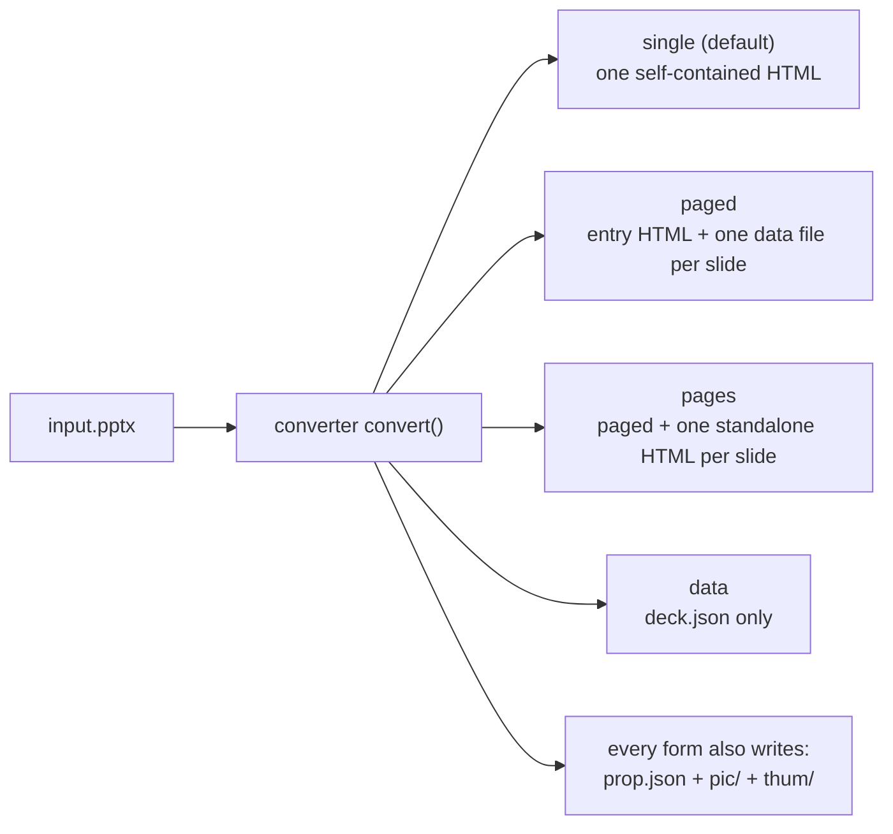
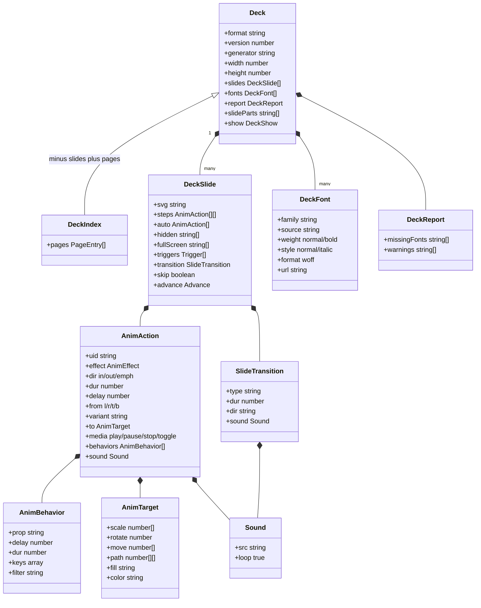

[中文](../zh/output-format.md)

# Output format

This document describes **what the unppt converter produces**: which files end up on disk, what each field of the presentation data (the deck) means, and how animations, transitions, media, fonts, links and speaker notes are represented.

The converter and the player **talk to each other only through this format**. As long as the format matches, the two can be deployed and upgraded separately.

> The single source of truth is `packages/format/src/index.ts` (TypeScript type definitions with a comment on every field, in Chinese). This document is a guide to it. There is no separate JSON Schema file in the repository; the TypeScript types are the specification.
> How the player uses this data is described in [How the player works](player.md).

---

## 1. A few terms first

| Term | Meaning |
|---|---|
| **Deck (presentation data)** | Everything converted from one presentation: each slide's picture, animations and transition, plus fonts, size and so on. The TypeScript type is `Deck`. |
| **SVG** | A text format describing graphics that browsers display directly. Each slide's static picture is one SVG string. |
| **EMU** | The length unit inside PowerPoint files: 1 inch = 914400 EMU. **EMU never appears in the output**: the converter turns everything into pixels (at 96 dpi, 1 inch = 96 px). |
| **Pixels / points** | Output sizes are in pixels; only `prop.json` keeps an older convention and uses points (1 pt = 1/72 inch, so px × 0.75 = pt). A 16:9 slide is 1280 × 720 px = 960 × 540 pt. |
| **uid** | The id of an element that may be animated, written in the SVG `data-uid` attribute. Animation data finds elements by uid. |
| **WOFF** | A web font file format. Embedded fonts are "subsets" that contain only the characters used. |
| **Output form** | The same data can be written in several file layouts: `single`, `paged`, `pages`, `data`. |

---

## 2. Version numbers

`packages/format/src/index.ts` defines three constants:

| Constant | Value | Meaning |
|---|---|---|
| `DECK_FORMAT` | `"unppt-deck"` | Written to every deck's `format` field, identifying "this is unppt data" |
| `DECK_FORMAT_VERSION` | `1` | The data format version, written to the `version` field |
| `UNPPT_VERSION` | `"0.2.6"` | The software version, written to the `generator` field (`"unppt 0.2.6"`) |

Rules:

- when the format changes, `DECK_FORMAT_VERSION` is incremented (the convention stated in the source comment);
- if `format` is wrong, the player reports `不是 unppt 演示数据` ("not unppt presentation data"); if `version` is newer than it knows, it reports `演示数据版本 N 太新，请升级播放器` ("data version N is too new, please upgrade the player");
- fields added to the format later are all **optional** (marked `?` in the types), and the player does not read fields it does not know; unknown animation effect names and transition types play as a fade.

---

## 3. Files on disk: the four output forms

Choose the form on the command line: `unppt input.pptx --output <form>` (`--data` is the same as `--output data`).



| Form | Good for | Main file | Player | Small images |
|---|---|---|---|---|
| `single` | Sending to someone to double-click; modest slide counts | `<name>.html` | Embedded in the HTML | Under 2 MB (`--inline-limit`) inlined into the HTML |
| `paged` | Hosting on a website, many slides, fast opening | `<dir>/index.html` | Embedded in index.html | All written as files under `media/` |
| `pages` | Like paged, plus "one URL per slide" | `<dir>/index.html` + `page-001.html`… | Embedded | Same as paged |
| `data` | Deploying the player yourself and loading data yourself (development / debugging) | `<name>.json` | Not included | All written as files under `media/` |

Video and audio are always separate files under `media/`, in every form.

### 3.1 single

```text
deck.html          ← slide data, images, fonts and the player all inside
prop.json
pic/1.jpg …        ← full-slide images
thum/1.jpg …       ← thumbnails
media/…            ← video, audio, images above the inline limit (only if any)
```

Inside the HTML (in order):

```html
<div id="unppt"></div>                                              <!-- player mount point -->
<script type="application/json" class="unppt-asset" data-id="0">"data:image/png;base64,…"</script>
<script type="application/json" class="unppt-slide">{ DeckSlide of slide 1 }</script>
<script type="application/json" class="unppt-slide">{ DeckSlide of slide 2 }</script>
…
<script type="application/json" class="unppt-font" data-family="unppt-f0">"WOFF as base64"</script>
<script type="application/json" id="unppt-meta">{ all Deck fields except slides }</script>
<script>/* player code */</script>
```

- **Shared images**: each image is stored once. The slide SVG says `unppt:asset/<id>`, the image data is in the `unppt-asset` with that `data-id`, and the player substitutes it before display;
- the file is **written while converting** (each slide is written out and released as soon as it is done), which is why the metadata `unppt-meta` comes last.

### 3.2 paged

```text
deck/
├─ index.html                  ← player + index (<script id="unppt-index">)
├─ pages/1.<hash>.js            ← __unpptPage(0, { DeckSlide of slide 1 });
├─ pages/2.<hash>.js
├─ fonts/unppt-f0.<hash>.js     ← __unpptFont("unppt-f0", "WOFF as base64");
├─ media/image1.<checksum>.png  ← images, video, audio
├─ prop.json
├─ pic/1.jpg …
└─ thum/1.jpg …
```

- File names contain a **content hash**: same content, same name; changed content, new name. Servers can therefore let browsers cache these files for a long time, and a re-publish never serves stale versions;
- `media/` names look like `media/<original>[suffix].<checksum>.<ext>`, where the checksum is the CRC32 recorded in the ZIP, for the same reason;
- each slide is "a script that calls a function" rather than JSON so it can be loaded with a `<script>` tag: opening from `file://` and cross-domain hosting need no extra setup.

The index (`DeckIndex`) = `Deck` without `slides`, plus `pages`:

```json
{
  "format": "unppt-deck", "version": 1, "generator": "unppt 0.2.6",
  "width": 1280, "height": 720, "title": "",
  "fonts": [{ "family": "unppt-f0", "source": "Impact", "weight": "normal", "style": "normal",
              "format": "woff", "url": "fonts/unppt-f0.2e92b8da.js" }],
  "report": { "missingFonts": [], "warnings": [] },
  "slideParts": ["ppt/slides/slide1.xml"],
  "pages": [{ "file": "pages/1.badab6a9.js" }]
}
```

`pages[i].skip` being `true` means slide i is hidden, so the player knows to skip it in sequential playback without downloading it.

The two callback names are part of the format too: `PAGE_CALLBACK = "__unpptPage"`, `FONT_CALLBACK = "__unpptFont"`.

### 3.3 pages

Exactly like paged, plus one `page-001.html`, `page-002.html`… per slide. They share `pages/`, `fonts/` and `media/` with `index.html`, but their index contains only that one slide (so links to other slides do nothing in a single-slide page).

### 3.4 data

```text
deck.json          ← the complete Deck (with the slides array)
fonts/unppt-f0.woff
media/…
prop.json
pic/ thum/
```

`deck.json` is for a player you deploy yourself (`UnpptPlayer.mount(element, deck, { baseUrl })`); font and media paths are relative to `deck.json`.

### 3.5 prop.json, full-slide images and thumbnails

Every form writes `prop.json` next to the main file. It follows an older convention of a live-streaming service (hence the short field names, sizes in points and slide numbers from 1):

```json
{
 "count": 3,
 "picw": 960,
 "pich": 540,
 "thumw": 216,
 "thumh": 122,
 "slides": [
  { "index": 1, "thum": "thum/1.jpg", "pic": "pic/1.jpg", "note": "第一段备注\n第二段：A < B & C\n段内换行" },
  { "index": 2, "thum": "thum/2.jpg", "pic": "pic/2.jpg" },
  { "index": 3, "thum": "thum/3.jpg", "pic": "pic/3.jpg", "note": "隐藏页的备注", "hidden": 1 }
 ]
}
```

(This is the real output of the synthetic test case `testcases/speaker-notes.pptx`, whose notes are in Chinese.)

| Field | Meaning |
|---|---|
| `count` | Number of slides |
| `picw` / `pich` | Slide size in **points** (may have decimals, rounded to two places) |
| `thumw` / `thumh` | Thumbnail size in pixels; width is always 216 |
| `slides[].index` | Slide number, **starting at 1**, same as the image file name |
| `slides[].pic` | Full-slide image path (relative to prop.json); its pixel size is `picw × pich` rounded |
| `slides[].thum` | Thumbnail path |
| `slides[].note` | Speaker notes as **plain text**; paragraphs and line breaks are `\n`; absent when there are no notes |
| `slides[].hidden` | `1` for hidden slides, otherwise absent |

- Images are JPG (quality 85) and show the slide with every object visible (like PowerPoint's thumbnail pane); videos show their poster frame;
- images are drawn with resvg (WASM build); the CLI automatically uses `dist/resvg.wasm` from the package;
- `--no-images` (API: `images: false`) skips the images, but `prop.json` still lists the image paths;
- **speaker notes are only in `prop.json`**, not in the deck data; the player does not display notes.

---

## 4. Data types at a glance



(Only the main fields are shown; the tables below list them all.)

---

## 5. Deck: top-level fields

| Field | Type | Always present | Meaning |
|---|---|---|---|
| `format` | `"unppt-deck"` | Yes | Fixed value identifying the data |
| `version` | number | Yes | Format version, currently `1` |
| `generator` | string | Yes | The software that produced it, e.g. `"unppt 0.2.6"` |
| `width` / `height` | number | Yes | Slide size in **pixels** (96 dpi). 16:9 is 1280 × 720 |
| `title` | string | Always written by the converter | Presentation title (from the pptx document properties; empty string if none). Note: it is not in the TypeScript `Deck` type, but the converter writes it and the player reads it |
| `slides` | `DeckSlide[]` | Yes | Per-slide data, see section 6 (absent in the paged index, replaced by `pages`) |
| `fonts` | `DeckFont[]` | Yes | Embedded font subsets, see section 10 |
| `report` | `DeckReport` | Yes | Conversion report: `missingFonts` names of missing fonts, `warnings` messages |
| `slideParts` | `string[]` | Optional | The pptx part path of each slide, e.g. `"ppt/slides/slide3.xml"`; used to resolve "jump to slide" links |
| `show` | `{ loop?, useTimings? }` | Optional | Slide show settings: `loop: true` loops; `useTimings: false` disables timed advance |

---

## 6. DeckSlide: one slide

| Field | Type | Always present | Meaning |
|---|---|---|---|
| `svg` | string | Yes | The slide's static picture (a complete `<svg>` element), see 6.1 |
| `steps` | `AnimAction[][]` | Yes | The group of actions run on each click. `steps.length` is how many clicks the slide needs |
| `auto` | `AnimAction[]` | Yes | Actions run automatically on entering the slide (before step 0) |
| `hidden` | `string[]` | Yes | uids hidden at step 0 (elements with entrance animations) |
| `fullScreen` | `string[]` | Optional | Videos that play full screen (element uids) |
| `triggers` | `{ uid, steps }[]` | Optional | Triggers: clicking element `uid` plays the groups in `steps` one at a time (one group per click) |
| `transition` | `SlideTransition` | Optional | Transition into this slide, see section 8 |
| `skip` | `boolean` | Optional | Hidden slide: skipped in sequential playback, reachable through links and `goto` |
| `advance` | `{ after?, click? }` | Optional | Advance settings: `after` = automatic advance time (ms, counted from entering the slide); `click: false` = clicking the slide does not advance |

### 6.1 Slide SVG conventions

A slide SVG looks like this (from `testcases/anim-basic.pptx`, shortened; the text is Chinese for "Animation 1"):

```xml
<svg xmlns="http://www.w3.org/2000/svg" viewBox="0 0 1280 720" width="1280" height="720">
  <rect width="1280" height="720" fill="#ffffff"/>
  <g data-uid="s2" data-name="矩形 1">
    <g transform="translate(53.33 200)">
      <path d="M0 0L267 0L267 200L0 200Z" fill="#156082" stroke="#042433" stroke-width="2"/>
      <g data-uid="s2p0">
        <text x="99.75 123.75 147.75" y="109" font-family="'等线',sans-serif" font-size="24" fill="#ffffff">动画 </text>
        …
      </g>
    </g>
  </g>
  …
</svg>
```

- `viewBox` and `width` / `height` are the slide's pixel size;
- **text is already laid out**: every character's x coordinate is fixed (`x="99.75 123.75 147.75"`); the player neither needs nor does any re-layout;
- the SVG carries a few unppt-specific attributes:

| Attribute | On | Meaning |
|---|---|---|
| `data-uid` | Elements that may be animated | The id. A shape is `s` + shape id (e.g. `s2`); its n-th paragraph is `s2p0`, `s2p1`… (for by-paragraph animation); chart and SmartArt parts have their own ids |
| `data-name` | Top-level objects | The object name in PowerPoint; Morph uses it to pair objects across slides |
| `data-link` | Hyperlinks | In-show jumps: `next`, `prev`, `first`, `last`, `slide:<part path>`, `media` (click toggles media) |
| `data-href` | Hyperlinks | External URL (only `http(s):`, `mailto:`, `tel:`) |
| `data-media="1"` | `<video>` / `<audio>` | Media on the slide |
| `data-trim-start` / `data-trim-end` | Media | Trim: seconds cut from the start / end |
| `data-fade-in` / `data-fade-out` | Media | Volume fade-in / fade-out seconds |
| `data-bu="1"` | Bullets | Marks a bullet (not body text) |

- Image addresses can be: a `data:` URI (inlined), `unppt:asset/<id>` (shared image in the single form) or `media/…` (a separate file).

---

## 7. Animations

### 7.1 AnimAction: one action

An action = "which element, which effect, when it starts, how long it plays".

| Field | Type | Meaning |
|---|---|---|
| `uid` | string | Target element (`data-uid` in the SVG) |
| `effect` | string | Effect name: `appear` `fade` `fly` `wipe` `zoom` `split` `float` `wheel` `random` `shape` `blinds` `growTurn` `swivel` `bounce` `emphasis` `path` `media` |
| `dir` | `in` / `out` / `emph` | Entrance / exit / emphasis (emphasis does not change final visibility) |
| `dur` | ms | Duration |
| `delay` | ms | Wait from the start of the group |
| `from` | `l` / `r` / `t` / `b` | Direction for effects such as Fly In |
| `variant` | string | Effect variant, e.g. `circle-in` for shape, `vert-out` for split, spoke count for wheel, `horz` for blinds |
| `to` | `AnimTarget` | State after an emphasis or motion path (see 7.3) |
| `media` | `play` / `pause` / `stop` / `toggle` | Media command (when `effect` is `media`) |
| `start` | seconds | Second to start media playback from |
| `across` | number | Number of slides media keeps playing over (including this one); above 1 it survives slide changes (background music) |
| `loop` | boolean | Loop media until stopped |
| `iterate` | `{ by, gap }` | Text by letter (`letter`) / by word (`word`), `gap` ms between units |
| `repeat` | number | Repeat count; `-1` means repeat until the next click |
| `autoRev` | boolean | Play back in reverse after finishing |
| `behaviors` | `AnimBehavior[]` | PowerPoint's original behaviors (when present the player follows them and ignores `effect` / `from` / `variant`), see 7.2 |
| `accel` / `decel` | 0–1 | Acceleration / deceleration share of the whole effect |
| `sound` | `Sound` | Sound attached to the animation, played when the action starts |

#### How timing works

All actions in `steps[k]` **start their clocks together** on click k; each waits `delay` ms and then plays for `dur` ms. PowerPoint's "With Previous" and "After Previous" have already been converted into `delay`:

```mermaid
flowchart LR
  click["click k (time 0)"] --> a["action A<br/>delay 0, dur 500"]
  click --> b["action B (After Previous)<br/>delay 500, dur 500"]
  click --> c["action C (With Previous)<br/>delay 500, dur 1000"]
```

Actions in `auto` play by the same rules when the slide is entered (e.g. "After Previous, delay 1.5 s" becomes `delay: 1500`).

### 7.2 AnimBehavior: PowerPoint's original behaviors

Internally PowerPoint describes an effect as a set of "behaviors". The converter copies them unchanged, and the player evaluates them against the element's real position, which gives the closest match to PowerPoint.

| Field | Meaning |
|---|---|
| `prop` | Property to change: `x` `y` (element center), `w` `h` (size), all as **fractions of slide width/height**; `sx` `sy` extra scale factors; `r` added rotation (degrees); `o` opacity; `reveal` a reveal filter |
| `delay` / `dur` | Start time and duration inside this effect (ms) |
| `keys` | Keyframes `[time 0–1, value, formula?]`. A value is a number or a PowerPoint formula; `#ppt_x` `#ppt_y` `#ppt_w` `#ppt_h` are the element's original position and size |
| `filter` | Filter for `reveal`, e.g. `wipe(down)`, `barn(inVertical)`, `circle(in)`, `wheel(4)`, `blinds(horizontal)` |
| `out` | A reveal used for exit (the hidden part grows by the filter) |
| `accel` / `decel` / `tmFilter` / `autoRev` / `repeat` | Time transforms: acceleration, `[time, progress]` polyline, auto-reverse, repeat |
| `discrete` | Discrete change: jump straight to the next keyframe value when its time comes |

Example: Fly In from bottom = y goes from `1+#ppt_h/2` (half an element height below the slide's bottom edge) to `#ppt_y` (original position):

```json
{ "prop": "y", "delay": 0, "dur": 500, "keys": [[0, "1+#ppt_h/2"], [1, "#ppt_y"]] }
```

### 7.3 AnimTarget: result of emphasis and motion paths

Emphasis animations (grow, spin, recolor...) and motion paths use `to` to describe "what it looks like afterwards", **accumulated on top of the element's current state**:

| Field | Meaning |
|---|---|
| `scale` | `[x factor, y factor]`, relative to current |
| `rotate` | Rotation in degrees, relative to current |
| `move` | Offset `[dx, dy]` in pixels, relative to current |
| `path` | Points along the path (pixels, relative to current position); the last point equals `move`; travelled at constant speed by length |
| `keys` | Emphasis that is not uniform over time (pulse, teeter...): time-sampled `{ o, s, r, a? }` |
| `accel` / `decel` | Smooth start / smooth end |
| `fill` / `color` / `opacity` | New fill color / text color / opacity |
| `dim` | The "after animation, dim to" color |
| `origin` | Origin for scale and rotation (fraction of the bounding box; default center) |
| `font` | Text style kept afterwards: `bold` / `italic` / `underline` |
| `flash` | Text style shown only during the effect (bold flash etc.); `from` / `to` are positions within the duration (0–1) |

### 7.4 A real example

`testcases/anim-basic.pptx` is a synthetic test case: four rectangles on one slide that "Appear, Fade, Fly In from bottom, Wipe from bottom" in turn, and finally the first rectangle fades out. Look at its data with:

```bash
npx @unppt/unppt testcases/anim-basic.pptx --data -o out/deck.json
```

Result (`svg` omitted):

```json
{
  "format": "unppt-deck",
  "version": 1,
  "generator": "unppt 0.2.6",
  "width": 1280,
  "height": 720,
  "title": "",
  "fonts": [],
  "report": { "missingFonts": ["等线"], "warnings": [] },
  "slideParts": ["ppt/slides/slide1.xml"],
  "slides": [
    {
      "svg": "<svg …>…</svg>",
      "steps": [
        [{ "uid": "s2", "effect": "appear", "dir": "in", "dur": 0, "delay": 0 }],
        [{ "uid": "s3", "effect": "fade", "dir": "in", "dur": 500, "delay": 0,
           "behaviors": [{ "prop": "o", "delay": 0, "dur": 500, "keys": [[0, 0], [1, 1]] }] }],
        [{ "uid": "s4", "effect": "fly", "dir": "in", "dur": 500, "delay": 0, "from": "b",
           "behaviors": [
             { "prop": "x", "delay": 0, "dur": 500, "keys": [[0, "#ppt_x"], [1, "#ppt_x"]] },
             { "prop": "y", "delay": 0, "dur": 500, "keys": [[0, "1+#ppt_h/2"], [1, "#ppt_y"]] }
           ] }],
        [{ "uid": "s5", "effect": "wipe", "dir": "in", "dur": 500, "delay": 0, "from": "b",
           "behaviors": [{ "prop": "reveal", "delay": 0, "dur": 500, "filter": "wipe(down)" }] }],
        [{ "uid": "s2", "effect": "fade", "dir": "out", "dur": 500, "delay": 0,
           "behaviors": [{ "prop": "o", "delay": 0, "dur": 500, "keys": [[0, 1], [1, 0]] }] }]
      ],
      "auto": [],
      "hidden": ["s2", "s3", "s4", "s5"]
    }
  ]
}
```

How to read it:

- `hidden` lists the 4 rectangles → none of them is visible when the slide is entered;
- `steps` has 5 groups → the slide needs 5 clicks;
- click 1: `s2` appears (`dur: 0`, instant); click 2: `s3` goes from transparent to opaque in 500 ms; … click 5: `s2` fades out;
- `"等线"` (DengXian, a Chinese font) in `report.missingFonts` means no file for that font was supplied during conversion (supply it with `--fonts` or `--system-fonts` for more accurate text widths).

### 7.5 A trigger example

`testcases/anim-trigger.pptx`: clicking `s3` fades in `s4`; a normal click fades in `s5`:

```json
{
  "steps": [[{ "uid": "s5", "effect": "fade", "dir": "in", "dur": 500, "delay": 0 }]],
  "auto": [],
  "hidden": ["s4", "s5"],
  "triggers": [
    { "uid": "s3", "steps": [[{ "uid": "s4", "effect": "fade", "dir": "in", "dur": 500, "delay": 0 }]] }
  ]
}
```

(In the real output each action also carries `behaviors` like those in 7.4; they are omitted here.)

---

## 8. Slide transitions: SlideTransition

| Field | Meaning |
|---|---|
| `type` | Transition type: `none` `fade` `cut` `flash` `push` `wipe` `cover` `pull` `split` `strips` `circle` `diamond` `plus` `zoom` `wheel` `wedge` `newsflash` `blinds` `checker` `comb` `randomBar` `dissolve` `morph`. Unknown types play as `fade`; `none` has no effect but may carry a sound |
| `dur` | Duration (ms); the player clamps it to 100–3000 |
| `dir` | Direction of movement (as in PowerPoint): `l` leftwards (new slide enters from the right), `r`, `u`, `d`; Cover, Uncover and Strips also have diagonals `lu` `ru` `ld` `rd` |
| `orient` | `horz` / `vert`: direction of the split line, blinds, checkerboard, comb, random bars |
| `inOut` | `in` / `out`: Split and Box close inwards or open outwards |
| `thruBlk` | Fade, Cut: through black |
| `spokes` / `ccw` | Wheel: number of spokes (default 4), counter-clockwise |
| `sound` | Sound played with the transition |
| `stopSound` | "Stop previous sound" |

Real output from `testcases/transitions.pptx`:

```json
{ "type": "fade", "dur": 2000 }
{ "type": "push", "dir": "l", "dur": 2000 }
{ "type": "split", "orient": "horz", "inOut": "in", "dur": 2000 }
{ "type": "randomBar", "orient": "horz", "dur": 2000 }
```

PowerPoint transitions without a matching type (3D ones, for example) are replaced by the closest type the converter can choose.

---

## 9. Media and sounds

### 9.1 Video and audio on the slide

A video is an HTML `<video>` wrapped in a `foreignObject` in the SVG (`testcases/media-video.pptx`):

```xml
<video xmlns="http://www.w3.org/1999/xhtml" data-media="1" src="media/media1.25edbedf.mp4"
       playsinline="" preload="metadata" poster="media/image1.711690cf.png"
       style="width:100%;height:100%;object-fit:fill"></video>
```

Audio is a hidden `<audio data-media="1" …>`. Click-to-toggle comes from `data-link="media"` on the containing shape.

Playback commands are animation actions (`effect: "media"`):

```json
{ "uid": "s3", "effect": "media", "dir": "emph", "dur": 0, "delay": 0, "media": "play", "start": 0 }
```

Background music across slides (`testcases/media-background.pptx`, plays over 3 slides and loops):

```json
{ "uid": "s3", "effect": "media", "dir": "emph", "dur": 0, "delay": 0, "media": "play", "start": 0, "across": 3, "loop": true }
```

### 9.2 Sound

Animation sounds and transition sounds are both `Sound`:

| Field | Meaning |
|---|---|
| `src` | Sound file path (under `media/`) |
| `loop` | When `true`, loops until the next sound |

---

## 10. Fonts: DeckFont

During conversion, fonts in use are turned into "subsets" (only the characters used) and embedded, so viewers see the same thing as at conversion time. Which fonts get embedded:

- fonts embedded in the pptx itself: always;
- Office private fonts and cloud fonts found by `--system-fonts` (browsers cannot use them): whenever used;
- other fonts: only with `--embed-fonts` (mind the license of commercial fonts).

| Field | Meaning |
|---|---|
| `family` | Unique alias used after embedding, e.g. `unppt-f0`. The SVG `font-family` refers to it |
| `source` | Original font name, e.g. `Impact` |
| `weight` | `normal` / `bold` |
| `style` | `normal` / `italic` |
| `format` | Always `woff` |
| `url` | Path to the font file; depends on the output form (see below) |

| Output form | Where the font is | `url` |
|---|---|---|
| single | `<script class="unppt-font" data-family="<alias>">` in the HTML (base64) | None |
| paged / pages | `fonts/<alias>.<hash>.js`, containing `__unpptFont(alias, base64)` | Yes |
| data | `fonts/<alias>.woff` | Yes |

Missing fonts are not an error; they are only listed in `report.missingFonts`, and the browser uses fallback fonts.

---

## 11. Hyperlinks, hidden slides, timed advance, show settings

| Feature | Representation | Example (synthetic test case) |
|---|---|---|
| Jump to a slide | `data-link="slide:ppt/slides/slide3.xml"` in the SVG, with top-level `slideParts` to find the index | `testcases/links.pptx` |
| Action buttons | `data-link="next"` / `"prev"` / `"first"` / `"last"` | `testcases/links.pptx` |
| External URL | `data-href="https://example.com/"` | `testcases/links.pptx` |
| Hidden slide | `DeckSlide.skip: true`; `pages[i].skip: true` in the paged index; `"hidden": 1` in prop.json | `testcases/hidden-slides.pptx` |
| Automatic advance | `DeckSlide.advance: { "after": 3000 }` | `testcases/slide-timings.pptx` |
| No advance on click | `DeckSlide.advance: { "click": false }` | `testcases/slide-timings.pptx` |
| Loop the show | Top-level `show: { "loop": true }` | `testcases/slide-timings.pptx` |
| Speaker notes | Only in `prop.json` `slides[].note` | `testcases/speaker-notes.pptx` |

---

## 12. Player state and bridge messages

The message types for external control are also defined in `@unppt/format`:

| Type | Direction | Shape |
|---|---|---|
| `PlayerState` | — | `{ slide, step, slideCount, stepCount, blank?, triggers?, media? }` |
| `BridgeCommand` | host → player | `{ unppt: 1, id?, cmd: 'next' \| 'prev' \| 'goto' \| 'sync' \| 'getState', args? }` |
| `BridgeReply` | player → host | `{ unppt: 1, re, ok, result?, error? }` |
| `BridgeEvent` | player → host | `{ unppt: 1, event: 'ready' \| 'change' \| 'end' \| 'link', data }` (`data` of `link` also has `url`) |

How to use them: see [Embedding and external control](embedding.md).

---

## 13. Reading the output yourself: tips

- **To get the deck object**: the easiest way is `--data`, which gives you `deck.json` directly;
- **To extract data from a single HTML**: `JSON.parse` each `script.unppt-slide`; `#unppt-meta` holds the other fields; remember to replace `unppt:asset/<id>` in the SVG with the content of `script.unppt-asset[data-id=<id>]`;
- **To build a slide list / thumbnail wall**: `prop.json` is enough, no need to parse the deck;
- **Do not depend on the SVG's internal structure** (other than the `data-*` attributes in the table above): the converter often changes how it writes SVG to look more like PowerPoint.
