[中文](../zh/player.md)

# How the player works

This document explains what happens inside the unppt player: how it gets slide data, how it puts a slide on the screen, how animations and slide transitions play, how keyboard, mouse and touch input is handled, how audio and video play, and how outside programs control it.

After reading it you should be able to answer:

- When you double-click a converted HTML file, which line of player code runs first?
- What exactly happens when you press the space bar?
- Why does `goto` to slide 5, step 2 always look exactly the same as clicking your way there from the start?

> Only want to embed the player in a web page and control it from JS? Go straight to [Embedding and external control](embedding.md).
> Want to know what the data the player reads looks like? See [Output format](output-format.md).


---

## 1. A few terms first

| Term | Meaning |
|---|---|
| **SVG** | A text format that describes graphics (`<rect>`, `<path>`, `<text>`...). Browsers display it directly. unppt turns every slide into one piece of SVG. |
| **DOM** | The browser's "element tree" of a web page. The player puts the SVG string into a `<div>`, the browser turns it into DOM elements, and JS can then find and change them. |
| **iframe** | A "window" that embeds one web page inside another (`<iframe src="...">`). The player usually runs inside an iframe. |
| **postMessage** | The browser method two windows (for example a parent page and an iframe) use to send each other messages. It works across domains. |
| **Web Animations API** | The browser's built-in animation interface: `element.animate(keyframes, options)` returns an `Animation` object that can be `finish()`ed (jump straight to the end). All player animations and transitions use it. |
| **Keyframe** | What an animation looks like at one moment, such as "opacity 0 at 0%, opacity 1 at 100%". The browser fills in the frames in between. |
| **Slide / step** | A playback position is two numbers: which slide (from 0) and how many clicks have been played on that slide (from 0). |
| **uid** | The id the converter gives every element that may be animated, written in the SVG `data-uid` attribute, for example `s2` (a shape) or `s2p0` (the first paragraph of that shape). Animation data finds its element by uid. |
| **Zero dependencies** | The player uses no third-party library. The build is a single JS file (global name `UnpptPlayer`). |

---

## 2. The player at a glance

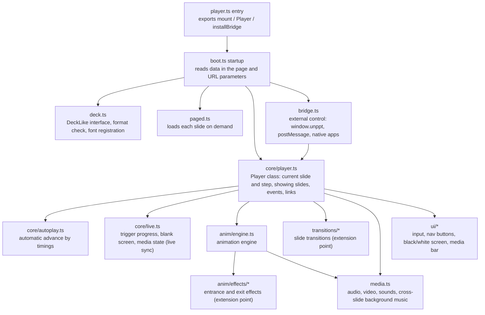

Each file does one job. `core/player.ts` is the "conductor": it does not draw animations or handle key presses itself, it hands the work to the modules below.

| File | Job |
|---|---|
| `player.ts` | Entry. Calls `autoBoot()` once the page has loaded |
| `boot.ts` | Finds the data in the page, creates the `Player`, installs the bridge; also provides `mount()` for standalone use |
| `deck.ts` | Defines `DeckLike`, the player's view of presentation data; `checkFormat` checks format and version; `loadFonts` registers fonts |
| `paged.ts` | On-demand forms (paged / pages): loads slides one by one with `<script>` tags |
| `core/player.ts` | The `Player` class: navigation state, showing slides, events, following links |
| `core/autoplay.ts` | Automatic advance by "advance after" timings |
| `core/live.ts` | The parts of live-class sync beyond "slide and step" |
| `core/emitter.ts` | A small event emitter (`on` / `off` / `emit`; listening to `'*'` receives every event) |
| `anim/engine.ts` | Animation engine: play a group of actions, apply a group instantly, jump running animations to the end |
| `anim/effects/` | One file per entrance / exit effect |
| `anim/behaviors.ts` `formula.ts` `reveal.ts` | Play PowerPoint's original "animation behaviors" (keyframes, formulas, reveal filters) |
| `anim/target.ts` | Emphasis and motion-path animations (scale, rotate, move, recolor...) |
| `anim/text-units.ts` | Text by letter / by word |
| `transitions/` | One file per slide transition |
| `media.ts` | Audio/video playback, trimming, fades, full-screen video, cross-slide background music, animation sounds |
| `ui/input.ts` | Clicks, keys, touch → navigation commands |
| `ui/controls.ts` | Bottom-right nav buttons and page counter (shown on hover) |
| `ui/blank-screen.ts` | Black / white screen |
| `ui/media-bar.ts` | Audio/video control bar |
| `bridge.ts` | External control protocol |
| `host.ts` | A helper class `UnpptFrame` for the **host page** (it does not run inside the player) |
| `css.ts` | The player's own styles, injected once |

---

## 3. Startup: where the player gets its data

There are three ways to start the player. The only difference is where the data comes from:

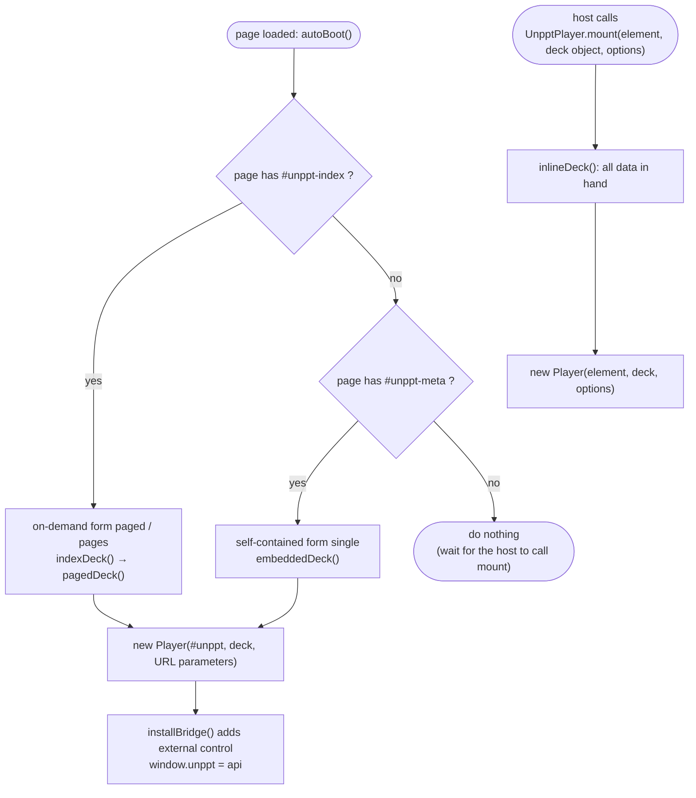

| Way | Where the data is | Who starts it |
|---|---|---|
| **single** (default output) | All in the HTML: `<script id="unppt-meta">` holds deck info, each slide is a `<script class="unppt-slide">` | Automatic |
| **paged / pages** | The HTML holds only an index `<script id="unppt-index">`; slide data is in `pages/*.js` | Automatic |
| **mount** | The host loads `deck.json` itself and passes the object in | Host code |

If startup fails (for example the data version is too new), the mount point shows `无法播放：<reason>` ("cannot play").

### 3.1 Format check

`checkFormat` in `deck.ts` does two things:

1. `format` must be `"unppt-deck"`, otherwise it throws `不是 unppt 演示数据` ("not unppt presentation data");
2. `version` must not be newer than the version the player knows (`DECK_FORMAT_VERSION`, currently `1`), otherwise it throws `演示数据版本 N 太新，请升级播放器` ("data version N is too new, please upgrade the player").

(The player's built-in messages are in Chinese.)

### 3.2 URL parameters

On automatic startup the player reads parameters from the page address (`readParams` in `boot.ts`):

| Parameter | Effect | Default |
|---|---|---|
| `?slide=3` | Open at the 4th slide (counting from 0) | First non-hidden slide |
| `?step=1` | Open after step 1 of that slide | 0 |
| `?ui=0` | Hide the built-in nav buttons | Shown |
| `?mode=watch` | Watch mode: obeys only the JS API, ignores user input | `present` |
| `?links=0` | Do not open external links, only send a `link` event | Open them |
| `?timings=1` / `?timings=0` | Force automatic timed advance on / off | On, but off by default when `slide` or `step` is given (for stable screenshots) |
| `?static=1` | Static display: every object shown as-is, no animation (used by the comparison tools against reference images) | Off |
| `?origin=https://a.com,https://b.com` | Only accept postMessage commands from these origins | Accept all origins |

With `mount()`, the same options go in the third argument (`MountOptions`): `slide`, `step`, `ui`, `openLinks`, `timings`, `static`, `mode`, plus `clickToNext` (clicking advances, default on), `keyboard` (keyboard navigation, default on) and `baseUrl` (prefix for relative paths such as fonts).

---

## 4. Loading slide data

The player never holds "an array of all slides". It asks for one slide at a time through the `DeckLike` interface:

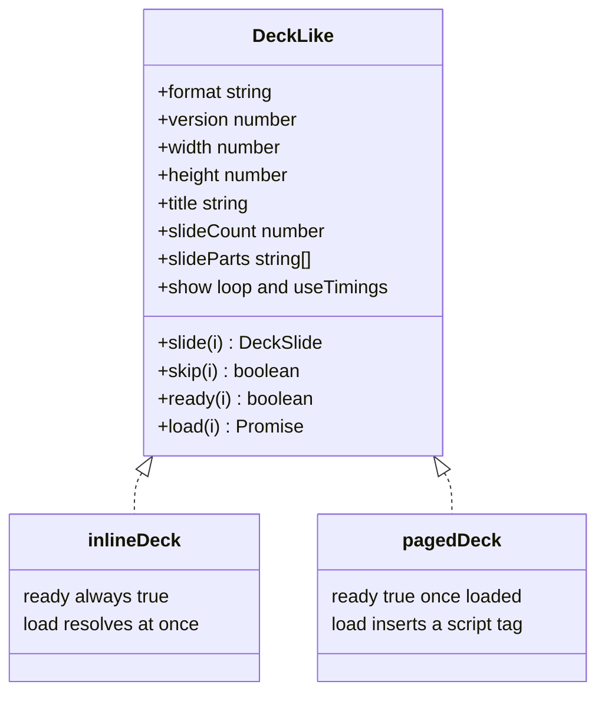

- `slide(i)`: the data of slide i (`DeckSlide`, see [Output format](output-format.md));
- `skip(i)`: whether slide i is hidden. **This is known without loading the slide** (it is in the index);
- `ready(i)` / `load(i)`: has slide i arrived / go and load it.

### 4.1 single form: one download, parse on demand

The whole HTML downloads at once, but the player **does not parse every slide up front**:

- the i-th `<script class="unppt-slide">` is `JSON.parse`d only the first time slide i is needed;
- only about the 8 most recently parsed slides are cached, so even a file with hundreds of slides does not use much memory;
- each image is stored once in the file: the slide SVG says `unppt:asset/<id>`, the actual image data is in `<script class="unppt-asset" data-id="<id>">`, and it is substituted before display;
- fonts are in `<script class="unppt-font" data-family="<alias>">` (base64 WOFF) and are all registered at startup.

### 4.2 paged / pages forms: on-demand loading + preloading

The entry HTML holds only the index. Each slide is a separate script file `pages/<number>.<hash>.js` containing a single function call:

```js
__unpptPage(0, { "svg": "<svg ...>", "steps": [...], ... });
```

Why `<script>` tags instead of `fetch`? Browsers block `fetch` when you double-click a local file (`file://`), but not `<script>`; and cross-domain hosting needs no CORS setup.

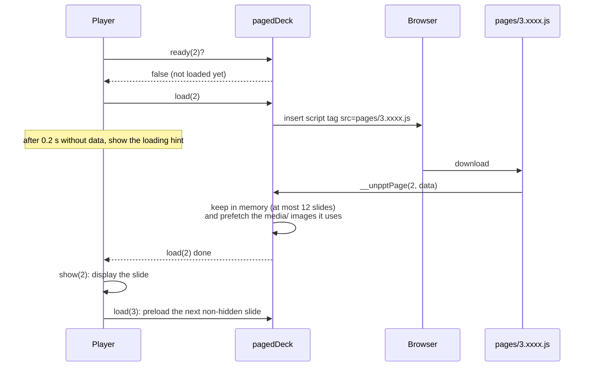

Key points:

- at most 12 slides stay in memory (`KEEP = 12`); beyond that the earliest loaded is dropped and reloaded when needed (it is still in the browser cache);
- every navigation increments `navToken`: if you press several times quickly, data that arrives for earlier requests is ignored and only the last requested slide is shown;
- after a slide is shown, the next non-hidden slide is preloaded;
- when slide data arrives, the `media/` images it references are prefetched with `new Image()`, so they are already cached when you get there;
- fonts: each font in the index has a `fonts/<alias>.<hash>.js` (calling `__unpptFont(alias, base64)`); all start loading at startup without blocking display, and the browser redraws when they arrive;
- if loading fails, the stage shows `第 N 页加载失败：<reason>` ("slide N failed to load").

---

## 5. Showing a slide: rendering and scaling

### 5.1 Stage and scaling

The player's DOM looks like this:

```text
div.unppt-root          ← fills the container, black background
├─ div.unppt-stage      ← the "stage": fixed at the slide's pixel size (e.g. 1280×720), scaled with CSS transform
│   └─ div.unppt-slide  ← the current slide (old and new coexist briefly during a transition)
│       └─ <svg>…</svg>
├─ div (hidden)         ← persistent container: cross-slide background music and animation sounds live here
├─ div.unppt-ui         ← nav buttons and page counter
├─ div.unppt-mbar       ← audio/video control bar
└─ div.unppt-blank      ← black / white screen overlay
```

The stage always has the slide's original pixel size. The player only scales and centers it with `transform` (`Player.fit()`):

```text
scale = min(containerWidth / slideWidth, containerHeight / slideHeight)
x = (containerWidth - slideWidth × scale) / 2
y = (containerHeight - slideHeight × scale) / 2
stage.style.transform = translate(x, y) scale(scale)
```

So the aspect ratio never changes and the extra space becomes black bars (letterboxing). Whenever the container size changes (`ResizeObserver` and the window `resize` event), it is recomputed.

Text positions were calculated during conversion. The player **does no text layout at all**; it just puts the SVG on screen. This is one of the keys to matching PowerPoint.

### 5.2 show(): the steps of displaying a slide

`Player.show(slide, step, animated)` is the player's central function:

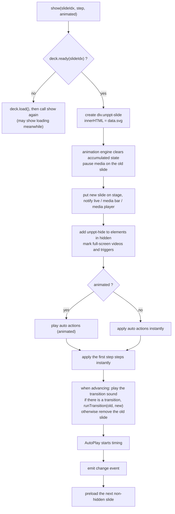

"Apply the first `step` steps instantly" is what makes `goto` **deterministic**: whatever played before, jumping to "slide 5, step 2" redraws slide 5 and then puts the results of steps 0 and 1 directly in place.

---

## 6. Playback state: which slide, which step

### 6.1 The four basic operations

| Operation | What it does |
|---|---|
| `next()` | First jumps running animations to the end; if the slide has steps left → play the next step (animated); if not → go to the next non-hidden slide (with transition); on the last slide → back to the first slide when looping, otherwise emit `end` |
| `prev()` | If the slide has played steps → go back one step (**not played in reverse**, it shows the end state of the previous step); at step 0 → the **last step** of the previous non-hidden slide |
| `goto(slide, step)` | Show the final state of the target slide and step directly, without transition or animation |
| `sync(state)` | A viewer catches up with a presenter: when the target is exactly "next step" or "start of next slide", play the animation/transition normally; when it equals the current position, do nothing; otherwise behave like `goto`. Then align blank screen, triggers and media |

### 6.2 State diagram

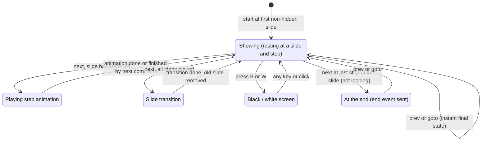

("At the end" is not a real state: the player only emits an `end` event and stays on the last slide.)

### 6.3 The state object PlayerState

`getState()`, every event and every command reply carry this object:

| Field | Meaning |
|---|---|
| `slide` | Current slide (from 0) |
| `step` | Steps played on this slide (from 0) |
| `slideCount` | Total slides (including hidden ones) |
| `stepCount` | Number of clicks in this slide's main sequence (triggers not included) |
| `blank` | Black / white screen color (`#000` / `#fff`); absent when not blanked |
| `triggers` | How many groups each trigger on this slide has played, e.g. `{ "s3": 1 }` (only after a click) |
| `media` | Audio/video played on this slide: `[{ uid, playing, time }]` |

### 6.4 Hidden slides

Slides marked "Hide Slide" in PowerPoint have `skip: true` in the data:

- `next` / `prev`, Home / End skip them;
- `goto`, typing a slide number, hyperlinks and action buttons can still go there;
- `slideCount` includes them.

---

## 7. The animation engine

### 7.1 A slide's animation data

Animation-related fields in each slide (full definitions in [Output format](output-format.md#7-animations)):

| Field | Meaning |
|---|---|
| `steps` | 2-D array: `steps[k]` is the group of actions run on click k. `steps.length` is how many clicks the slide needs |
| `auto` | Actions run automatically on entering the slide (effects that start "With Previous / After Previous" in PowerPoint) |
| `hidden` | uids hidden at step 0 (elements with entrance animations start invisible) |
| `triggers` | Triggers: action groups played in turn when a given element is clicked; they do not affect the normal click order |

Each action (`AnimAction`) says "on which element (`uid`), which effect (`effect`), entrance / exit / emphasis (`dir`), how long to wait (`delay`), how long to play (`dur`)". All times are milliseconds.

All actions in one group **start their clocks together** and are staggered by their own `delay`. For example, PowerPoint's "On Click → Fly In A (0.5 s) → After Previous Fade B (0.5 s)" becomes one group:

```text
timeline (ms)   0        500       1000
A fly in        |=========|
B fade in                 |=========|
                A: delay 0, dur 500
                B: delay 500, dur 500
```

### 7.2 Play vs apply instantly

The animation engine (`AnimationEngine`) has three main methods:

| Method | When | What it does |
|---|---|---|
| `play(actions)` | User advances, slide entered | Really plays with Web Animations |
| `applyInstant(actions)` | `goto`, `prev`, deep links | Does not play; puts the end result in place (shown/hidden, final emphasis state) |
| `finishRunning()` | Whenever a new command arrives | `finish()`es every running animation |

Because every new command calls `finishRunning()` first, rapid clicks make the previous step jump to its end instead of piling up.

### 7.3 How one action is played

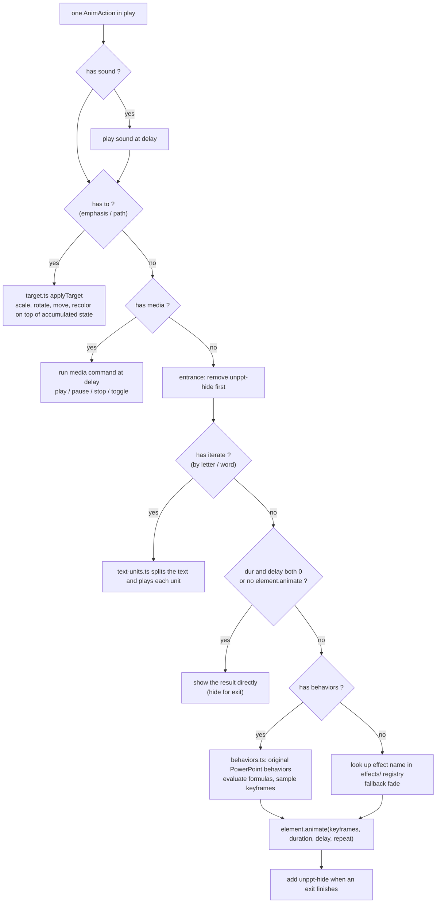

Details:

- **Hiding uses `visibility:hidden`** (CSS class `unppt-hide`): the element keeps its space, so nothing jumps when it appears;
- **entrances with a delay** stay hidden during the delay and appear on time;
- **exits** play the same keyframes in reverse (`reversible()`) and get `unppt-hide` when done;
- **repeat and auto-reverse** (`repeat`, `autoRev`) map to Web Animations `iterations` and `direction: 'alternate'`; `repeat: -1` means repeat until the next click;
- **emphasis accumulates**: if an element is first scaled 1.5× and then rotated 30°, the engine remembers its current state (`TransformState`: translate, scale, rotate) and continues from there. It is cleared on slide change and recomputed from scratch on jumps, which keeps things deterministic.

### 7.4 Two ways to draw: by effect name / by PowerPoint's original behaviors

**By effect name**: `effect` is a name like `fade`, `fly` or `wipe`; the player looks it up in the registry in `anim/effects/effects.ts` and the matching file supplies keyframes. Registered effects:

`fade`, `fly`, `wipe`, `split`, `zoom`, `float`, `shape`, `wheel`, `blinds`, `growTurn`, `swivel`, `bounce`, `emphasis`, `path` (unregistered names such as `appear` or `random` are drawn as `fade`).

**By original behaviors**: internally PowerPoint describes an animation as a set of "behaviors". "Fly In (from bottom)" is:

```json
{ "prop": "y", "keys": [[0, "1+#ppt_h/2"], [1, "#ppt_y"]] }
```

meaning "y goes from `1+#ppt_h/2` (half an element height below the slide's bottom edge) to `#ppt_y` (its original position)". The converter copies these behaviors as they are (the `behaviors` field), and the player, in `anim/behaviors.ts`:

1. measures the element's current position and size on the slide as `#ppt_x`, `#ppt_y`, `#ppt_w`, `#ppt_h` (fractions of slide width/height);
2. evaluates formulas with `formula.ts` (a small hand-written parser, **no `eval`**, supporting `+ - * / ^ %`, functions such as `sin`, `cos`, `sqrt`, and the constants `pi`, `e`; `rand` always returns the middle value so every playback is identical);
3. applies acceleration/deceleration (`accel`/`decel`), `tmFilter`, auto-reverse and repeat to get position, size, rotation, opacity and reveal progress at each moment;
4. samples 6 to 120 keyframes (about one per 25 ms) and hands them to `element.animate()`.

Reveal behaviors (`prop: "reveal"`, such as `wipe(down)`, `circle(in)`, `wheel(4)`) are turned into a CSS `clip-path` by `anim/reveal.ts`, so the element is uncovered bit by bit.

**When `behaviors` is present it wins**, because it is the closest to PowerPoint; only otherwise is the `effect` name used.

### 7.5 Triggers

Trigger animations (PowerPoint's "start effect on click of a shape") are managed by `core/live.ts`:

- on entering the slide, trigger elements get the CSS class `unppt-trigger` (hand cursor);
- on click, the player walks up from the clicked element; if it finds a trigger it plays that trigger's next group and increments its progress; once all groups have played, further clicks do nothing (and do not advance);
- progress resets on slide change;
- progress is reported in `PlayerState.triggers`, and viewers align to it during live sync.

---

## 8. Automatic advance by timings

PowerPoint can set an "advance slide after" time for each slide. In the data it is `advance.after` (ms). `core/autoplay.ts` follows PowerPoint's behavior as measured:

1. timing starts when the slide is entered;
2. the slide's click steps **play automatically one after another**: when one step's animation finishes, the next starts;
3. the slide advances only when the time is up **and** all animations are done (whichever is later);
4. timing restarts when the user navigates or jumps.

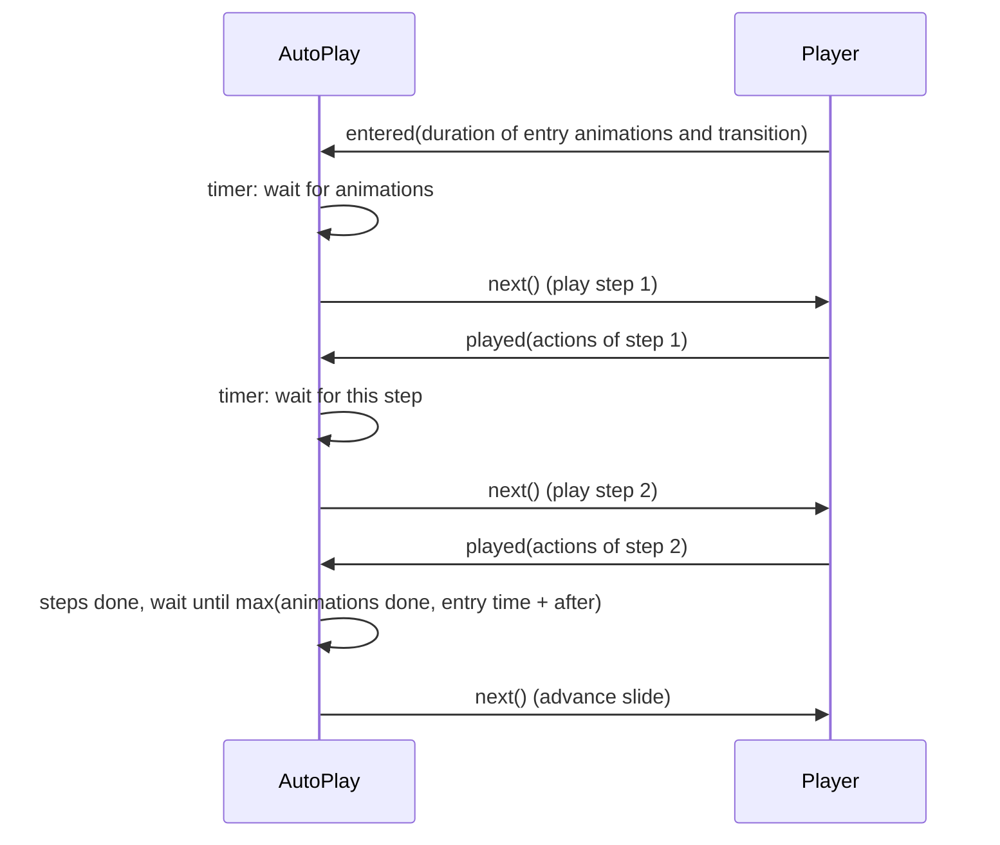

When automatic advance is **off**:

- URL `?timings=0` or `mount` with `timings: false`;
- opened with `?slide=` / `?step=` (screenshots, previews) without `?timings=1`;
- "Use Timings" is off in the slide show settings (`show.useTimings` is `false` in the data);
- watch mode (`mode: 'watch'`).

Also, on slides where `advance.click` is `false` ("On Mouse Click" unchecked in PowerPoint), clicking does not advance, but the keyboard and the API still do.

---

## 9. Slide transitions

When advancing (`show(…, animated=true)`), if the new slide has a `transition` whose type is not `none`, the player calls `runTransition(old, new, transition)` in `transitions/transitions.ts`:

1. the new slide is already placed above the old one;
2. the duration is clamped to 100–3000 ms;
3. the effect is looked up by `type` in the registry, falling back to `fade`;
4. the effect returns an `Animation`; when it finishes (or is cancelled) the old slide is removed;
5. this `Animation` is handed to the animation engine, so pressing again mid-transition jumps it to the end.

Registered transition types:

| Type | PowerPoint name | Type | PowerPoint name |
|---|---|---|---|
| `fade` | Fade (optionally through black) | `zoom` | Box |
| `cut` | Cut | `wheel` | Wheel |
| `flash` | Flash | `wedge` | Wedge |
| `push` | Push | `newsflash` | Newsflash |
| `cover` | Cover | `blinds` | Blinds |
| `pull` | Uncover | `checker` | Checkerboard |
| `wipe` | Wipe | `comb` | Comb |
| `split` | Split | `randomBar` | Random Bars |
| `strips` | Strips | `dissolve` | Dissolve |
| `circle` | Circle | `morph` | Morph |
| `diamond` | Diamond | `plus` | Plus |

Roughly three implementation styles:

- movement / opacity with keyframes (e.g. `push.ts`, `cover.ts`, `fade.ts`);
- soft-edged sweeps that set a mask gradient each frame via `soft-edge.ts` (e.g. `wipe.ts`, `circle.ts`, `wheel.ts`);
- tiles that set a clipping polygon each frame via `tiles.ts` (e.g. `dissolve.ts`, `checker.ts`).

**Morph**: top-level objects with the same name (same `data-name` in the SVG) on the old and new slides move and resize smoothly from the old position/size to the new one while the two copies cross-fade; the rest of the new slide fades in piece by piece.

Speed curves were measured from frame-by-frame screenshots of PowerPoint slide shows, e.g. Fade is `0.5 - 0.5cos(πt)`.

**Transition sounds** play only when advancing; `goto` and deep links are silent.

---

## 10. User input

`ui/input.ts` turns user actions into commands. No input is bound in watch mode.

### 10.1 Keyboard

| Key | Action |
|---|---|
| → ↓ PageDown Space Enter | Next step |
| ← ↑ PageUp Backspace | Previous step |
| Home | First non-hidden slide |
| End | Last non-hidden slide |
| B or `.` | Black screen |
| W or `,` | White screen |
| Digits + Enter | Go to slide N (counting from 1, hidden slides included; digits expire after 2 s without input) |
| Any key while blanked | Back to the slide (no navigation) |

Combinations with Alt / Ctrl / Cmd are ignored, as are keys pressed while focus is in an input (e.g. the media bar's seek slider).

### 10.2 Click

A click on the slide is handled in this priority order:

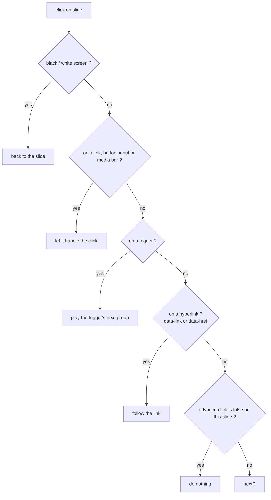

Pass `clickToNext: false` to `mount` to turn click handling off.

### 10.3 Touch

A horizontal swipe of more than 40 px within 600 ms, with horizontal distance more than 1.5× the vertical: swipe left = next, swipe right = previous.

### 10.4 Built-in buttons

`ui/controls.ts` puts `‹`, a counter `N / total` and `›` in the bottom-right corner, visible when the mouse is over the player. Turn them off with `?ui=0` or `ui: false` and call `next` / `prev` / `goto` from your own buttons.

---

## 11. Hyperlinks

The converter writes PowerPoint hyperlinks as SVG attributes; the player handles them in `Player.follow()`:

| Attribute | Meaning | What the player does |
|---|---|---|
| `data-link="next"` / `"prev"` / `"first"` / `"last"` | Action buttons: next, previous, first, last slide | Goes to the matching non-hidden slide |
| `data-link="slide:ppt/slides/slide3.xml"` | Jump to a slide (by its part path inside the pptx) | Finds the index in `slideParts` and calls `goto` |
| `data-link="media"` | Click on media | Toggles play / pause of that media |
| `data-href="https://..."` | External URL | Emits `link`; by default opens it in a new tab |

Only `http:`, `https:`, `mailto:` and `tel:` URLs are accepted. They always open in a new tab with `noopener,noreferrer`, so the page hosting the player never navigates away. With `?links=0` (or `openLinks: false`) the player only emits the event and the host decides (e.g. shows a prompt first).

---

## 12. Audio, video and sounds

`media.ts` handles all sound and video.

### 12.1 Media on the slide

The converter writes a video as `<foreignObject><video data-media="1" src="media/..." poster="..."></video></foreignObject>` in the SVG; audio is a hidden `<audio>`.

| Feature | How |
|---|---|
| Poster frame before playing | `<video poster="...">` |
| Click video to play / pause | The element has `data-link="media"`; clicking toggles without advancing |
| Play / pause / stop in animations | Action with `effect: "media"`, `media` = `play` / `pause` / `stop` / `toggle`, `start` = start second |
| Trim | `data-trim-start` / `data-trim-end` (seconds): stop at the trim end, loop back to the trim start |
| Fade in / out | `data-fade-in` / `data-fade-out` (seconds): volume adjusted each frame by position |
| Full-screen playback | Videos listed in the slide's `fullScreen` get a black-backed, aspect-fit copy over the whole slide while playing; removed when finished, stopped or on slide change |
| Play across slides (background music) | Action with `across: N` (N > 1): the media element moves to the persistent container and keeps playing across slide changes until it leaves the N-slide range |
| Loop | Action with `loop: true` |

External media files in `media/` should be served by a server that supports HTTP Range requests (common web servers do); otherwise Chromium cannot seek.

### 12.2 Control bar

`ui/media-bar.ts`: when the mouse is over a video or an audio icon, a control bar appears below it (play/pause, seek slider, `current / total` time); on touch screens, tap to show it. Clicks on the bar never advance; trimmed media can only be dragged within the trimmed range.

### 12.3 Animation and transition sounds

`sound` on an action or a transition:

- only one sound plays at a time; a new one stops the current one;
- it keeps playing across slide changes (as in PowerPoint);
- the transition's `stopSound` means "stop previous sound";
- if the browser blocks autoplay, it is silently ignored.

> Browsers usually block sound before the user has interacted with the page. In a live class the viewer side should ask the user to click once (e.g. a "Join class" button).

---

## 13. Two modes: present and watch

| | Present mode `present` (default) | Watch mode `watch` |
|---|---|---|
| Who navigates | The viewer: clicks, keys, swipes | Only the JS API |
| Built-in buttons | Yes (turn off with `ui=0`) | No |
| Click / keyboard / touch | Handled | Ignored (stage has `pointer-events:none`) |
| Links, triggers, media bar | Clickable | Not clickable |
| Automatic timed advance | Yes | No |

Live-class usage: the teacher uses present mode and sends the state of every `change` event through your own messaging; students use watch mode and call `sync(state)` on each message. See [Embedding and external control](embedding.md).

---

## 14. External control (bridge)

`bridge.ts` lets outside programs control the player. Three kinds of host share one command format:

| Host | Send a command | Receive replies and events |
|---|---|---|
| JS in the same page | `window.unppt.goto({ slide: 3, step: 0 })` (returns a Promise) | `window.unppt.on('change', fn)` |
| iframe parent page (cross-domain OK) | `iframe.contentWindow.postMessage({ unppt: 1, id: 7, cmd: 'goto', args: { slide: 3 } }, '*')` | Reply `{ unppt: 1, re: 7, ok: true, result }`, event `{ unppt: 1, event: 'change', data }` |
| Native app WebView | `window.unppt.handle('<JSON string>')` | The player calls `window.webkit.messageHandlers.unppt` (iOS), `window.UnpptNative.postMessage` (Android), `window.ReactNativeWebView.postMessage` (React Native) |

Commands: `next`, `prev`, `goto`, `sync`, `getState`. Events: `ready`, `change`, `end`, `link`.

A complete round trip through an iframe:

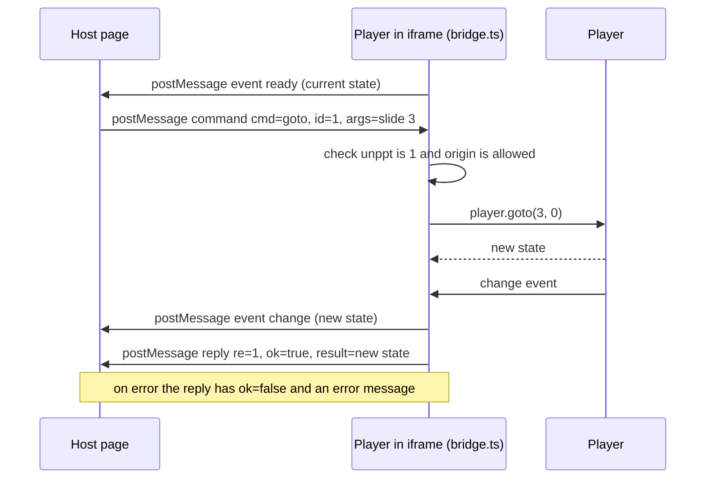

The host page can use the `UnpptFrame` class from `packages/player/dist/host.js` instead of hand-writing postMessage:

```js
import { UnpptFrame } from './host.js';
const deck = new UnpptFrame(document.querySelector('iframe'));
await deck.ready;
await deck.goto(3, 0);
deck.on('change', (s) => console.log(s.slide, s.step));
```

`UnpptFrame` numbers each command, waits for the matching reply (failing after 10 seconds without one), and asks for the state once when the iframe finishes loading, so it never misses the `ready` event.

For full usage, security advice (the `?origin=` allow-list) and a live-sync example see [Embedding and external control](embedding.md); runnable examples are `examples/iframe-host.html` and `examples/live-class.html` in the repository.

---

## 15. Adding new effects (extension points)

The player follows "new capability = new file + one line in a registry":

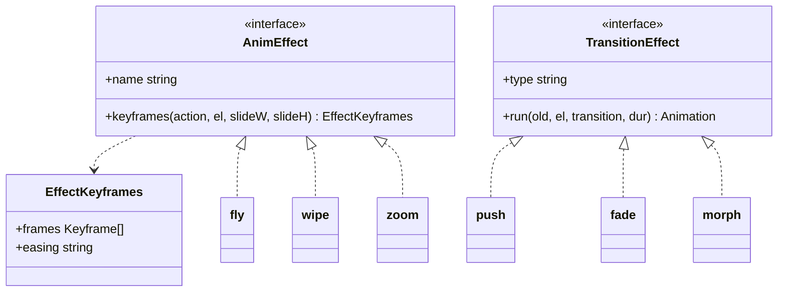

| To add | How |
|---|---|
| Entrance / exit effect | Create `anim/effects/xxx.ts` exporting an `AnimEffect` (give the entrance keyframes; exits are reversed automatically), add one line to `EFFECTS` in `anim/effects/effects.ts` |
| Slide transition | Create `transitions/xxx.ts` exporting a `TransitionEffect`, add one line to `TRANSITIONS` in `transitions/transitions.ts` |
| Reveal filter | Add an entry `name(progress, argument, element) => clip-path` to `FILTERS` in `anim/reveal.ts` |

Every unregistered effect has a fallback (drawn as a fade), so an older player can still play new effect names produced by a newer converter, just more simply.

More architecture notes are in [docs/architecture.md](../architecture.md) (Chinese).

---

## 16. Compatibility summary

- Animations and transitions rely on the browser's Web Animations API (`element.animate`). On old Android WebViews without it, the player shows animation results and switches slides directly, without errors;
- fonts are registered with the `FontFace` API, falling back to `@font-face` styles; if a font fails to load, a fallback font is used;
- the build target is ES2019.
