[中文](../zh/transcoding.md)

# How Transcoding Works: Turning a .pptx into a Web Page

This document walks through the code: from the moment you type `unppt deck.pptx` until `deck.html`, `prop.json`, `pic/` and `thum/` appear on disk. For each step it explains what happens and which file the code lives in.

After reading it you should be able to answer:

- What is actually inside a .pptx file?
- Where does the transcoder start, and what does it do first and last?
- How is one slide drawn, layer by layer, into an SVG?
- How can the text wrap at exactly the same place as in PowerPoint?
- How are animations, fonts, slide images and output files produced?

> Every function, file and option name in this document comes from the code in `packages/transcoder/src/`. Paths are relative to that folder: `render/render.ts` means `packages/transcoder/src/render/render.ts`.

---

## Contents

1. [A few terms first](#1-a-few-terms-first)
2. [What is inside a .pptx](#2-what-is-inside-a-pptx)
3. [One conversion end to end (overview)](#3-one-conversion-end-to-end-overview)
4. [Step 1: the command line, cli.ts](#4-step-1-the-command-line-clits)
5. [Step 2: reading the zip and XML lazily](#5-step-2-reading-the-zip-and-xml-lazily)
6. [Step 3: the Presentation model](#6-step-3-the-presentation-model)
7. [Step 4: rendering each slide to SVG](#7-step-4-rendering-each-slide-to-svg)
8. [The text layout engine](#8-the-text-layout-engine)
9. [Charts](#9-charts)
10. [Animations and transitions](#10-animations-and-transitions)
11. [Fonts: lookup, substitution, embedding and subsetting](#11-fonts-lookup-substitution-embedding-and-subsetting)
12. [Images, audio and video](#12-images-audio-and-video)
13. [Slide images and thumbnails (pic/ and thum/)](#13-slide-images-and-thumbnails-pic-and-thum)
14. [Writing the output: four output forms](#14-writing-the-output-four-output-forms)
15. [What happens when something goes wrong](#15-what-happens-when-something-goes-wrong)
16. [PowerPoint concepts mapped to source files](#16-powerpoint-concepts-mapped-to-source-files)
17. [Known gaps](#17-known-gaps)

---

## 1. A few terms first

| Term | Meaning |
|---|---|
| **Transcoder** | The program that turns a .pptx into web files, in `packages/transcoder/`. It is a "pure function": you give it bytes, it hands files back through the `write` callback you provide. It never touches the disk or the network itself |
| **Player** | The JS program that plays the output in a browser (`packages/player/`). Not covered in detail here |
| **Output** | What the conversion produces: the HTML file, `prop.json`, `media/`, `pic/`, `thum/`, etc. |
| **SVG** | A text format that describes vector graphics. Browsers support it natively and it stays sharp when zoomed. unppt draws every slide as one SVG |
| **XML** | A text format that describes data with angle-bracket tags, e.g. `<a:off x="0" y="0"/>`. Almost everything in a .pptx is XML |
| **zip** | An archive format. A .pptx is simply a zip file with a different extension |
| **EMU** | English Metric Unit, PowerPoint's internal length unit. 1 inch = 914400 EMU, 1 pixel (96 DPI) = **9525** EMU (the constant `EMU_PER_PX` in the code) |
| **Part** | One file inside the zip, e.g. `ppt/slides/slide1.xml` |
| **Relationship (rels)** | A table of "who references whom" between parts, stored in `_rels/xxx.rels` files. A slide finds its layout and its images through relationships |
| **Master / layout / theme** | PowerPoint's template system, see section 2 |
| **Placeholder** | A reserved "title box" or "body box" on a layout; the title on a slide inherits its position and style |
| **data-uid** | An id attribute written on SVG elements, e.g. `data-uid="s5"`. The animation data uses it to say "animate this element" |
| **WASM** | WebAssembly, a binary program format that runs in browsers and Node. unppt uses it to run resvg (rasterising), HarfBuzz (font subsetting) and libjpeg-turbo (JPEG encoding) |

---

## 2. What is inside a .pptx

Rename any .pptx to .zip and extract it. You will see something like this:

```text
[Content_Types].xml          the type of every part
_rels/.rels                  entry point: where the main part is
docProps/core.xml            title, author... (unppt uses dc:title as the page title)
ppt/presentation.xml         slide size, slide list, embedded font list
ppt/_rels/presentation.xml.rels
ppt/presProps.xml            show settings (loop, use timings)
ppt/slides/slide1.xml        content of slide 1
ppt/slides/_rels/slide1.xml.rels   which layout and images slide 1 uses
ppt/slideLayouts/slideLayout1.xml  layout
ppt/slideMasters/slideMaster1.xml  master
ppt/theme/theme1.xml         theme: colours, fonts, effect styles
ppt/media/image1.png         images, audio, video
ppt/charts/chart1.xml        chart (with a cached copy of its data)
ppt/diagrams/drawing1.xml    SmartArt drawing cache
ppt/fonts/font1.fntdata      embedded fonts
ppt/notesSlides/...          speaker notes
```

### 2.1 Parts and relationships

Parts do not find each other by file name, they use **relationship tables**. Next to every part, `_rels/<part name>.rels` lists the parts it references. Each relationship has an id (such as `rId2`), a type (such as `slideLayout` or `image`) and a target path.

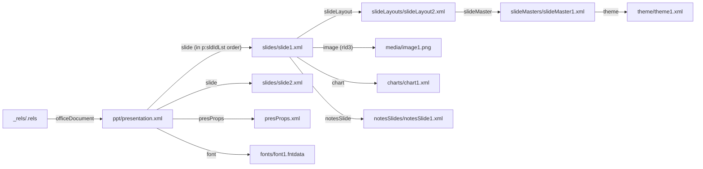

### 2.2 The inheritance chain: theme, master, layout, slide

PowerPoint is designed around layered inheritance:

- **Theme**: a colour scheme (`accent1`...`accent6`, `dk1`, `lt1`...), a font scheme (major font for titles, minor font for body text) and a set of fill / line / effect styles.
- **Slide master**: uses one theme and defines the default title style, body style, background, and anything that appears on every slide (such as a logo).
- **Slide layout**: based on a master, defines arrangements like "Title and Content" or "Two Content", and can override the master's colour mapping.
- **Slide**: based on one layout, holds the real content.

If a property (say, the title font size) is not written on the slide, unppt looks at the matching placeholder on the layout; if the layout does not have it, it looks at the master; if the master's text styles do not have it either, it uses the presentation's default text style.

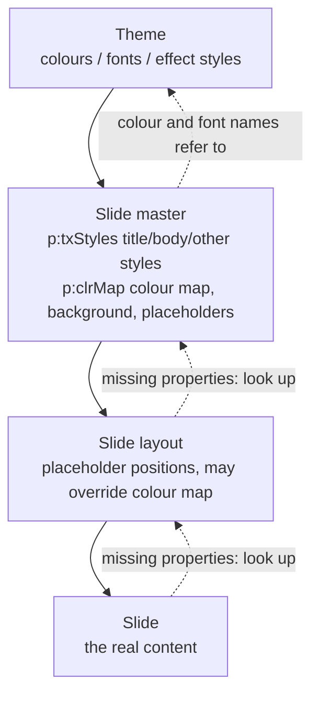

### 2.3 EMU: PowerPoint's length unit

Positions and sizes in the XML are EMU integers, for example:

```xml
<a:xfrm>
  <a:off x="914400" y="457200"/>     <!-- top-left: x = 1 inch, y = 0.5 inch -->
  <a:ext cx="4572000" cy="914400"/>  <!-- 5 inches wide, 1 inch high -->
</a:xfrm>
```

unppt converts everything to 96 DPI pixels: `pixels = EMU / 9525`. So the box above is x=96, y=48, 480 wide and 96 high. A standard 16:9 slide is 12192000 EMU = **1280 pixels** wide.

Other common units:

| Written as | Meaning | Example |
|---|---|---|
| EMU | length, 9525 EMU = 1 pixel | `x="914400"` |
| 1/100 point | font size | `sz="1800"` = 18 pt = 24 px |
| 1/60000 degree | angle | `rot="5400000"` = 90 degrees |
| 1/1000 percent | ratio, transparency | `alpha="50000"` = 50% |

---

## 3. One conversion end to end (overview)

Here is the big picture first; later sections expand each step.

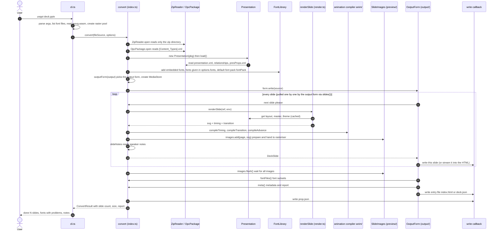

Key points:

- **Streaming**: slides are "pulled" one at a time (`slides()` is an async generator, `AsyncGenerator`). Each finished slide goes straight to the output form and its memory is released, so even a deck with hundreds of slides does not blow up memory.
- **The transcoder never touches the disk**: every file is handed out through `options.write(relativePath, data)`. The CLI's `write` writes to disk; in a cloud function you could write to object storage.
- **One bad slide does not break the deck**: if rendering a slide throws, unppt outputs a blank white slide and records a warning in the report.

---

## 4. Step 1: the command line, cli.ts

The CLI only does the file-system work. The conversion itself is done by `convert`.

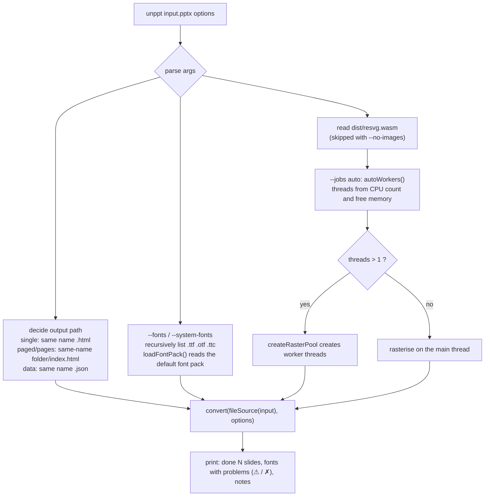

Details worth knowing (all in `cli.ts`):

- **`fileSource`**: the input file is not read into memory at once. It is wrapped as a random-access object `{ size, read(offset, length) }`, and the transcoder reads only the ranges it needs. Font files work the same way.
- **Default font pack**: `loadFontPack()` (`node-fonts.ts`) finds the installed `@unppt/fonts` (`packages/fonts/` when developing in the repo) and passes it as `fontPack`; if it is not found a hint is printed and widths of non-embedded fonts can only be estimated. `--no-default-fonts` skips it.
- **`--system-fonts`** (off by default since 0.3.0): passes the fonts in the system font folders and in Office's private and cloud font folders (on Windows, e.g. `Microsoft Office\root\vfs\Fonts\private`) as `fonts`; they are used for layout and display, and the characters used are embedded.
- **`unppt check`**: same font options, but calls `checkFonts()` to check fonts only and prints with `formatFontCheck()` from `cli-check.ts`; exit code 1 when there is any ✗. A normal conversion also uses it to print the fonts with problems at the end.
- **`autoWorkers()`** (`node-pool.ts`): thread count = min(CPU count, free memory / 400 MB). Inside Linux containers it also reads the cgroup CPU quota.
- **If the thread pool cannot be created** (for example resvg.wasm is broken), it falls back to the main thread. Conversion continues; the report just gets a "resvg failed to load" warning.

CLI options and the matching `ConvertOptions` fields:

| CLI | `ConvertOptions` field | Notes |
|---|---|---|
| `-o, --out` | (handled by the CLI) | output file or folder |
| `--output single\|paged\|pages\|data` | `output` | output form; CLI default `paged` (since 0.2.4), `convert()` default `single` |
| `--data` | `output: 'data'` | same as `--output data` |
| `--fonts <dir>` | `fonts` | may be repeated |
| `--system-fonts` | `fonts` | system fonts + Office private / cloud fonts; off by default since 0.3.0 |
| (default) | `fontPack: await loadFontPack()` | default font pack `@unppt/fonts` |
| `--no-default-fonts` | no `fontPack` | for debugging |
| `--embed-fonts` | — | old option, no effect (`embedFonts` is `true` by default) |
| `--no-images` | `images: false` | no `pic/`, `thum/` |
| `--jobs <n\|auto>` | `rasterPool` | raster threads |
| `--inline-limit <bytes>` | `inlineLimit` | images smaller than this are inlined, default 2097152 (2 MB) |
| `-q, --quiet` | no `onProgress` | no progress output |
| `--stats` | — | print time and peak memory |

If you call it from your own Node program instead of the CLI, it looks roughly like this (using only exports that really exist in the code):

```js
import { readFile, writeFile, mkdir } from 'node:fs/promises';
import { dirname, join } from 'node:path';
import { convert } from '@unppt/unppt';

const pptx = await readFile('deck.pptx');
const outDir = 'out';
const result = await convert(new Uint8Array(pptx), {
  output: 'single',
  images: false,                     // no slide images, so no resvg.wasm needed
  write: async (path, data) => {
    const target = join(outDir, path);
    await mkdir(dirname(target), { recursive: true });
    if (typeof data === 'string' || data instanceof Uint8Array) {
      await writeFile(target, data);
    } else {                         // AsyncIterable<Uint8Array>: produced in chunks
      const chunks = [];
      for await (const c of data) chunks.push(c);
      await writeFile(target, Buffer.concat(chunks));
    }
  },
});
console.log(result.slides, result.fontCheck, result.report.warnings);
```

`write` receives one of three data types: a string, a `Uint8Array`, or an `AsyncIterable<Uint8Array>` (a large file streamed in chunks).

The shape of `ConvertOptions` and `ConvertResult`:

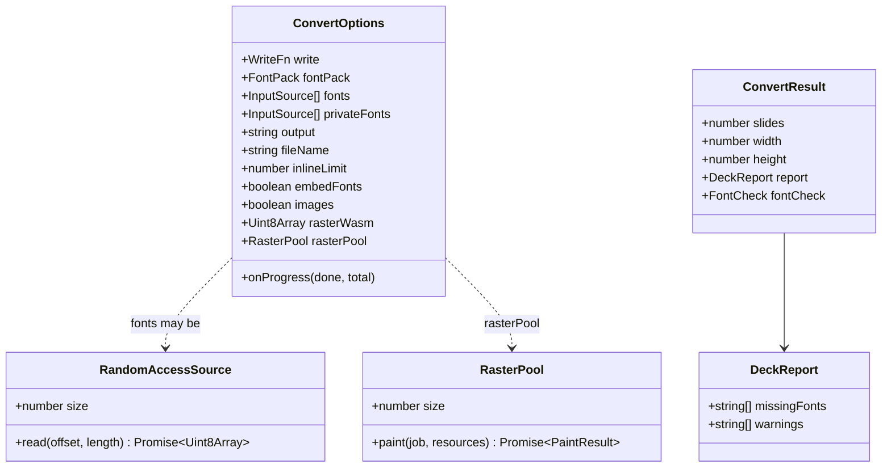

Everything except `write` is optional. An `InputSource` can be a `Uint8Array`, an `ArrayBuffer` or a `RandomAccessSource`.

---

## 5. Step 2: reading the zip and XML lazily

The first three lines of `convert` are the reading layer (`io/`):

```ts
const zip = await ZipReader.open(toSource(input));
const pkg = await OpcPackage.open(zip);
const pres = new Presentation(pkg);
```

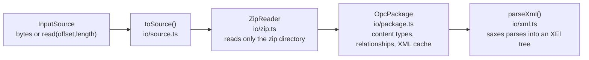

| Layer | File | What it does |
|---|---|---|
| Source | `io/source.ts` | `toSource` wraps plain byte arrays as a `RandomAccessSource` too, so everything later reads "by position" |
| zip | `io/zip.ts` | Uses zip.js to parse only the **directory** (where each file is, how big), without decompressing content. `read(name)` decompresses one file when needed; `stream(entry)` reads large files (videos) as a stream with constant memory. An old-format .ppt or an encrypted file raises an error telling you it is an old .ppt |
| OPC package | `io/package.ts` | `xml(part, cache)` reads and parses an XML part; `rels(part)` reads a relationship table and resolves relative paths to absolute in-package paths; `relByType` finds a relationship by type |
| XML | `io/xml.ts` | Uses saxes to parse XML into a simple tree `XEl { name, attrs, children, text }`. **Namespaces are mapped to fixed prefixes** (`p:`, `a:`, `c:`...), whatever prefix the file actually uses, so later code can simply look up `"p:sp"`. Malformed XML does not throw; whatever was parsed is kept |

**Why lazy?** Some decks are 1 GB (videos inside). Reading the whole file into memory and decompressing everything up front would run out of memory. Instead:

- only the zip directory is read up front;
- masters, layouts and themes are few, so they are parsed once and cached;
- slide XML is read with `pkg.xml(ref.part, false)`, **not cached**, and thrown away after rendering;
- audio and video are streamed straight from the zip to the output file.

`io/xml.ts` also has an important function, `expandAlternate`. New PowerPoint features are often written as `mc:AlternateContent` ("new versions use Choice, old versions use Fallback"). unppt picks a Choice it supports; if the Choice contains something it cannot draw (Office math, ink), it uses the picture PowerPoint stored in the Fallback.

---

## 6. Step 3: the Presentation model

The `Presentation` class in `model/model.ts` is the in-memory model of the whole deck. `load()` does this:

1. finds the main part from the root relationships `_rels/.rels` (usually `ppt/presentation.xml`);
2. reads the slide size `p:sldSz` and converts it to pixels, `width` and `height` (sizes outside PowerPoint's allowed 1 to 56 inches are repaired to defaults, as PowerPoint does);
3. lists all slides in `p:sldIdLst` order into `slides: SlideRef[]` (only part path and index, content is not read);
4. reads the show settings in `presProps.xml` (loop, use timings) into `show`;
5. reads the embedded font list `p:embeddedFontLst` into `embeddedFonts`;
6. pre-scans the font charsets used on each slide (`model/font-charsets.ts`), needed to choose substitutes for missing fonts.

Masters, layouts and themes are **read on first use and cached**: `pres.layout(part)`, `pres.master(part)`, `pres.theme(part)`.

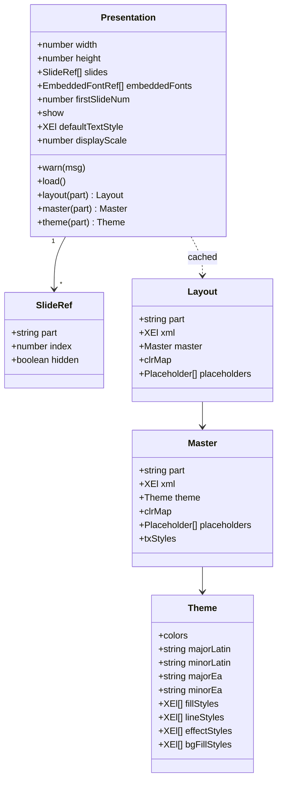

`warn(msg)` is used everywhere: when a module meets something it does not support, it calls it. Identical messages are counted and end up in `report.warnings` (for example a message about an unsupported graphic followed by "(3 处)", meaning 3 occurrences; the messages themselves are in Chinese).

**Colour mapping (clrMap)**: colours on a slide are often written as `<a:schemeClr val="tx1"/>` ("text colour 1"). `tx1` is first mapped through the master's `p:clrMap` to `dk1`, then looked up in the theme's colour scheme to get the real RGB. Layouts and slides can override this mapping (`p:clrMapOvr`).

---

## 7. Step 4: rendering each slide to SVG

The entry point is `renderSlide(ref, env)` in `render/render.ts`. `env` (`RenderEnv` in `render/env.ts`) carries what the whole deck shares: `pres`, the font library `fonts`, the set of missing fonts `missingFonts`, the media store `media`, and the font embedding recorder `embed`.

### 7.1 Drawing order of one slide

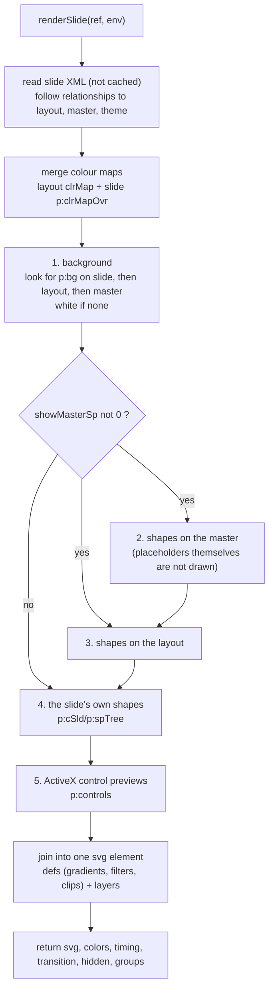

Notes:

- elements on the master and layout **do not take part in animations** (`ownSlide: false`) and get no `data-uid`;
- **placeholders on the master and layout are not drawn**; they only provide inherited properties to slides;
- objects hidden in the Selection Pane (`hidden="1"`) are not drawn;
- `timing` (`p:timing`) and `transition` (`p:transition`) in the result are still raw XML; they are compiled later.

### 7.2 Dispatching each element by type

`SlideRenderer.element()` looks at the tag name and calls a different function:

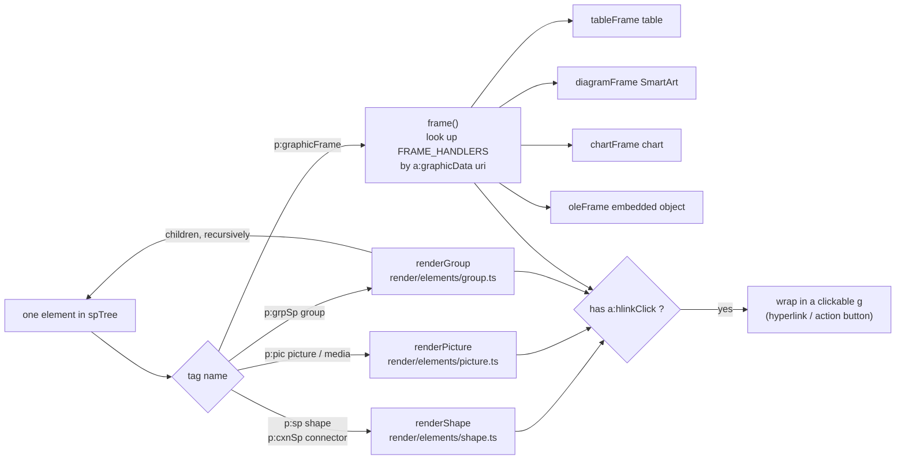

### 7.3 Placeholder inheritance

A title on a slide usually only contains text; its position, size and colour are inherited. `SlideRenderer.inherited()` finds the "parent":

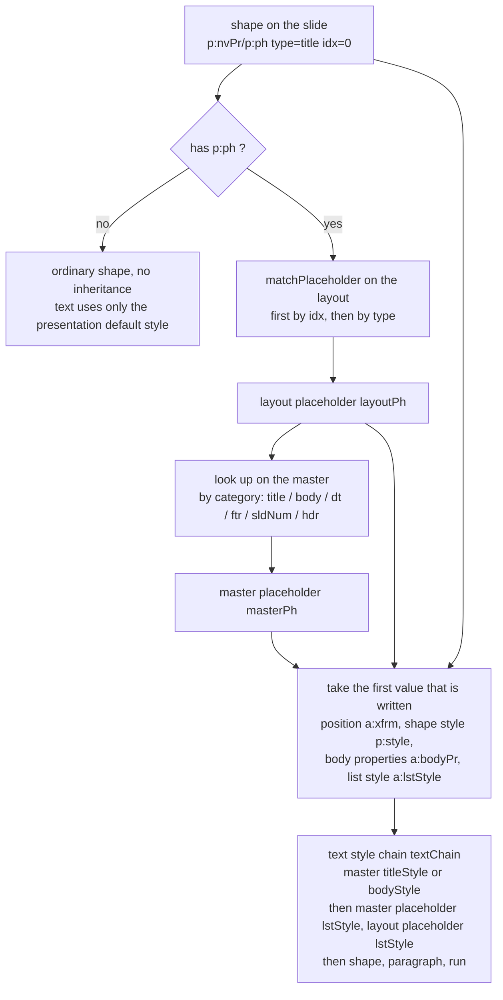

For example, `renderShape` gets the position like this:

```ts
const box = readXfrm(child(spPr, 'a:xfrm')) ?? readXfrm(child(lSpPr, 'a:xfrm')) ?? readXfrm(child(mSpPr, 'a:xfrm'));
```

Meaning: use the slide's value if written, otherwise the layout's, otherwise the master's.

The code also records some special rules found by measurement, for example: a placeholder with index `4294967295` ("no index", common in decks converted from old .ppt) does not inherit from the layout, only from the master by type; date, footer and slide-number placeholders use the presentation default style as their base, not the master's otherStyle.

### 7.4 Shapes: geometry + fill + line + effects + text

A `p:sp` shape is drawn like this (`render/elements/shape.ts`):

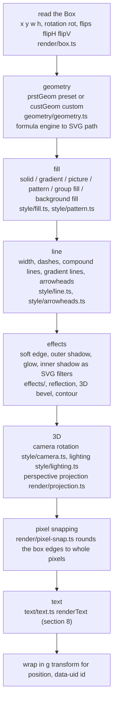

**Geometry**: PowerPoint has 187 preset shapes (rectangle, rounded rectangle, arrows, stars...). Each is defined by a set of formulas (from `presetShapeDefinitions.xml` that ships with the ECMA-376 standard, converted into `geometry/presets-data.ts`). The formulas use adjust values (such as the corner size `adj` of a rounded rectangle) and built-in variables (`w` width, `h` height, `ss` short side...), and evaluate to paths. Custom shapes (`custGeom`) use the same formula engine. There are also 40 WordArt text warps (`warps-data.ts`).

**Style references**: shapes often say `<p:style><a:fillRef idx="1"><a:schemeClr val="accent1"/></a:fillRef>...`, meaning "use the theme's fill style number 1 in colour accent1". `styleRef` in `style/fill.ts` resolves that into a concrete fill.

**Pixel snapping**: when PowerPoint draws a shape it rounds the four edges of its box to whole pixels, so rectangle edges are crisp. unppt measured this and does the same (`render/pixel-snap.ts`); it is one of the keys to pixel-level fidelity.

### 7.5 Pictures, audio and video

`render/elements/picture.ts` handles `p:pic`:

- cropping (`a:srcRect`), shape masks (a picture can be cropped to a circle etc.), borders, effects;
- picture adjustments (brightness, contrast, recolour, set transparent colour...) live in `style/blip.ts`;
- the image URL comes from `MediaStore` (section 12);
- audio / video become `<video>` / `<audio>` tags inside a `<foreignObject>` (with `data-media="1"`); the video's poster frame becomes the `poster`. Play and pause are controlled by the player from the animation data.

### 7.6 Groups

`render/elements/group.ts`: a group has its own box (`a:off`/`a:ext`) and a child coordinate system (`a:chOff`/`a:chExt`). Child coordinates are in the child system and need converting (`render/group-map.ts`). When a child uses `a:grpFill` ("group fill"), it uses the group's fill, laid out over the group's box (each child shows only its own piece).

### 7.7 graphicFrame: tables, charts, SmartArt, OLE

A `p:graphicFrame` is "a box that holds something else". What it holds is decided by the `uri` of `a:graphicData`. This is an **extension point**:

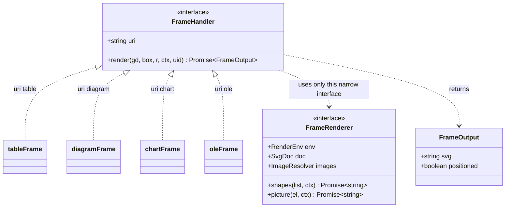

The registry is in `render/frames/frames.ts`:

```ts
export const FRAME_HANDLERS: readonly FrameHandler[] = [tableFrame, diagramFrame, chartFrame, oleFrame];
```

An unknown uri produces an "unsupported graphic" warning.

| Content | Files | How |
|---|---|---|
| Table | `render/frames/table-frame.ts`, `render/table.ts`, `render/table-style.ts`, `render/builtin-table-styles.ts` | Column widths come from `a:tblGrid`; row height is the larger of "set row height" and "actual text height"; the table style (header row, banded rows...) is applied first, then each cell's own fill and borders override it |
| Chart | `render/frames/chart-frame.ts` then `chart/` | see section 9 |
| SmartArt | `render/frames/diagram-frame.ts` | **No layout of its own**: it draws the "drawing cache" PowerPoint saved in the file (`dsp:drawing`, a ready-made set of shapes). Each shape gets its own `data-uid` wrapper so "one by one" animations can find it. A missing or empty cache produces a warning |
| OLE object | `render/frames/ole-frame.ts` | shows the preview picture PowerPoint stored (drawn as a picture) |

### 7.8 What rendering one slide returns

`renderSlide` returns a `RenderedSlide`:

| Field | Meaning |
|---|---|
| `svg` | the whole slide as an SVG string; `viewBox` in slide pixels; animatable elements carry `data-uid` |
| `colors` | the slide's colour context (needed by colour animations) |
| `timing` | raw `p:timing` XML |
| `transition` | raw `p:transition` XML |
| `hidden` | whether it is a hidden slide (`show="0"`) |
| `groups` | animation ids of groups |

---

## 8. The text layout engine

This is the biggest difference between unppt and approaches that "just hand the text to the browser": **lines are laid out at conversion time using the real glyph widths from the font files**, and the x coordinate of every character is written straight into the SVG `<text x="...">`. Line breaks are therefore fixed and do not depend on the viewer's browser or fonts.

The entry point is `renderText` in `text/text.ts`.

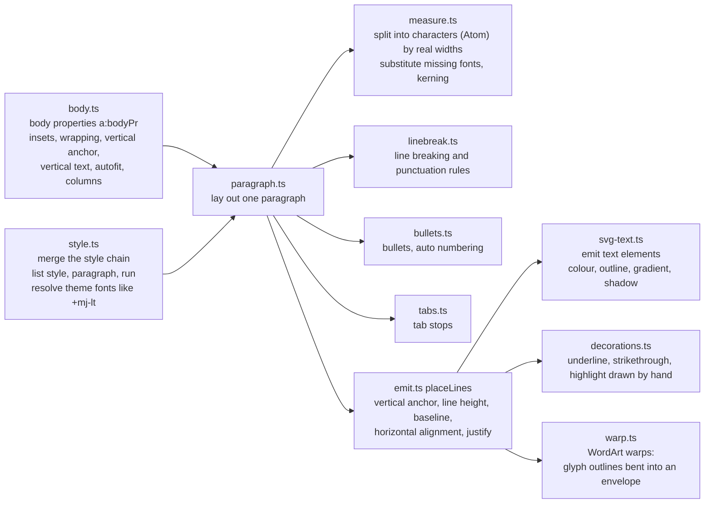

### 8.1 Measuring (measure.ts)

- Font files are parsed by `font/font.ts`: glyph widths (`hmtx`), line metrics (`OS/2`, `hhea`), kerning (`GPOS`/`kern`).
- PowerPoint's smallest layout unit is 1/8 point (= 1/6 pixel). Each character width is first rounded to that unit (constant `LAYOUT_UNIT`); this was found by measurement.
- **Substitution for missing fonts** (also measured rules):
  - missing Latin font: the first available of `Calibri`, `Arial`, `Liberation Sans`, `Helvetica`;
  - missing font marked with a Chinese charset: `Microsoft YaHei` and similar;
  - marked with a Japanese charset: `Yu Gothic`;
  - some old names have aliases: `Helvetica` to `Arial`, `Times` to `Times New Roman`, `Courier` to `Courier New`.
- With the default font pack, the metrics of these substitutes (Calibri, Microsoft YaHei, Yu Gothic) are in the pack, so line breaks after substitution also match PowerPoint.
- Missing font names are collected in `missingFonts` and end up in `report.missingFonts`; which font each character used is also recorded through `fontUse` in the font check (`FontCheckLog` in `font/check.ts`), which becomes `ConvertResult.fontCheck`.

### 8.2 Line breaking (linebreak.ts)

- a line may break after spaces and tabs, and between CJK characters;
- **punctuation rules (kinsoku)**: full stops, commas, closing brackets etc. may not start a line; opening brackets and opening quotes may not end a line (the `NO_START` and `NO_END` sets);
- a word too long for the line is broken in the middle.

### 8.3 Bullets and numbering (bullets.ts)

Supports character bullets (`a:buChar`), picture bullets (`a:buBlip`) and auto numbering (`a:buAutoNum`: Arabic numerals, Roman numerals, letters...). Numbers count continuously per level within one text box (`BulletNumbering`).

### 8.4 Alignment and spacing (emit.ts)

- vertical anchor: top / middle / bottom (`anchor`);
- horizontal alignment: left / centre / right / justify / distributed;
- line spacing, space before and after paragraphs;
- **baseline pixel snapping**: for font sizes up to 20 pt the baseline y is rounded to a whole pixel (`SNAP_MAX_SIZE`), matching PowerPoint's display.

### 8.5 Autofit

The body property `a:normAutofit` stores the shrink values PowerPoint computed: `fontScale` (font size scale) and `lnSpcReduction` (line spacing reduction). unppt reads these two numbers (`text/body.ts`) and applies them during layout instead of recomputing them, because the stored values are exactly what PowerPoint uses on screen.

### 8.6 Emitting the text

Each line (each run of the same style within a line) becomes one SVG `<text>` with `font-family`, `font-size`, `fill` and the x coordinate of every character. Underline, strikethrough and highlight are **drawn by hand as rectangles / lines** instead of using the browser's `text-decoration` (browsers disagree on its position and thickness). Paragraphs get their own sub-ids so "by paragraph" animations can target them.

---

## 9. Charts

The data of a PowerPoint chart lives in an embedded Excel workbook, but the chart XML also stores a **data cache** (`c:numCache`, `c:strCache`). unppt draws from the cache directly; no Excel needed.

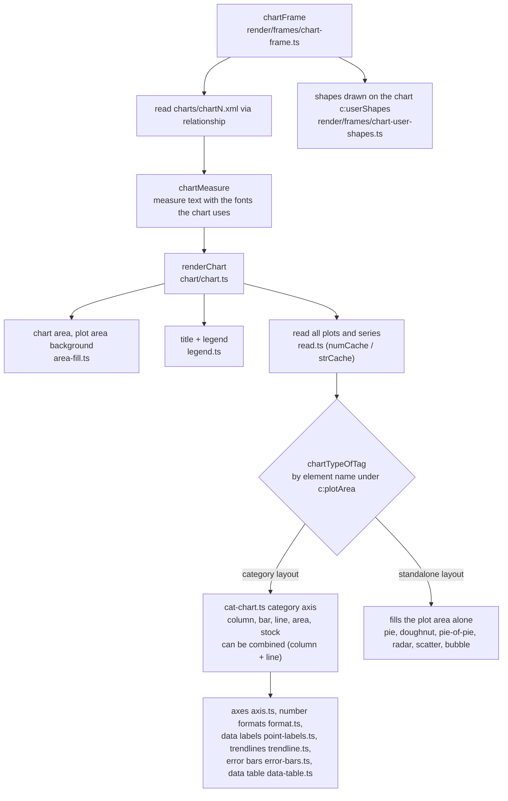

The chart type is an extension point (`chart/chart-type.ts`, where `layout` is either `standalone` or `category`), registered in `chart/chart-types.ts`:

```ts
export const CHART_TYPES: readonly ChartType[] = [barType, lineType, areaType, pieType, doughnutType, scatterType, radarType, bubbleType, ofPieType, stockType];
```

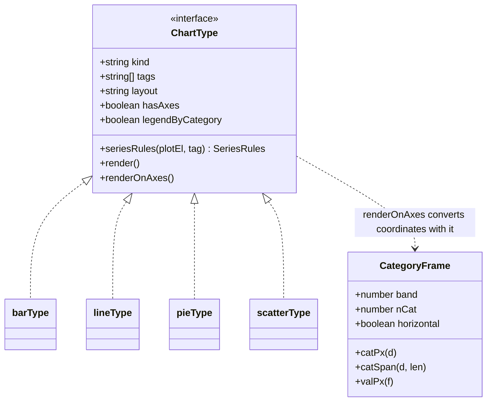

Every part of a chart (data points, whole lines, data labels) has its own id (`chartUid` in `common/uid.ts`), so "by series" and "by category" chart animations can play.

Layout (how far the title is from the top, how wide the legend is...) approximates PowerPoint's default automatic layout using measured rules; the constants are in `chart/layout.ts` and other files, with comments saying "measured" (实测).


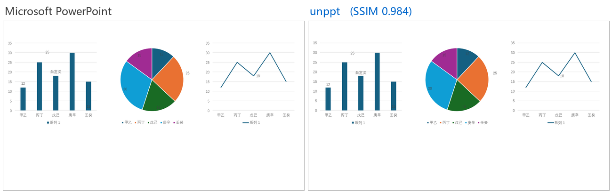

---

## 10. Animations and transitions

PowerPoint stores animations in each slide's `p:timing`, a deep tree of time nodes. The player should not have to understand that structure, so **the transcoder compiles it into a simple "what to do on each click" list**.

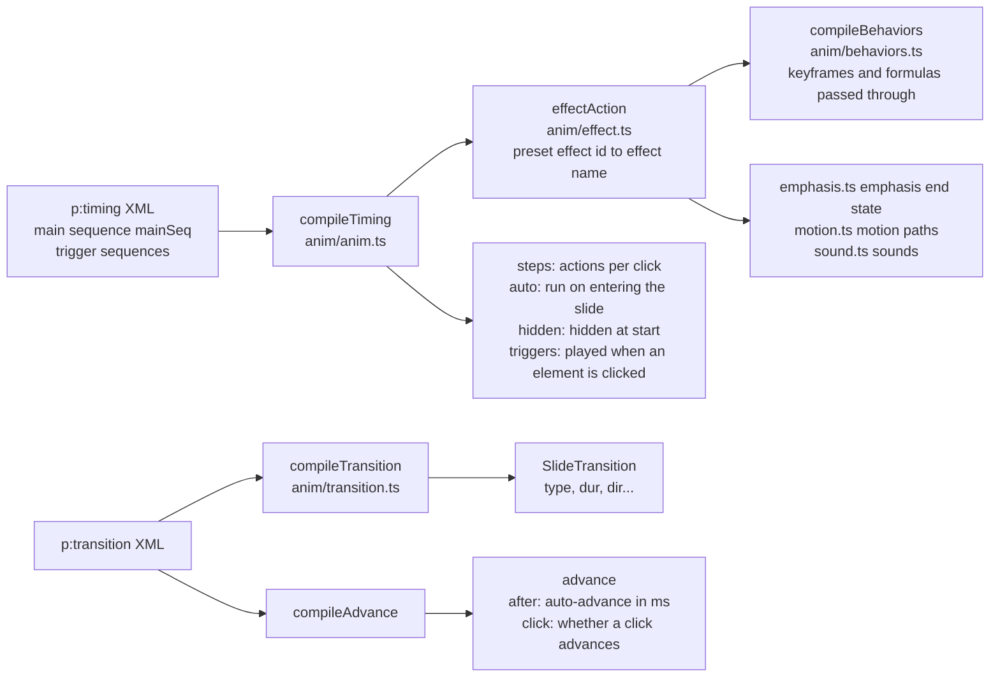

During compilation the targets are checked against the set of `data-uid`s found in the SVG: if an animation points at an element that does not exist (for example an empty paragraph), it falls back to the whole shape; if that is missing too, the action is dropped.

Main fields of one `AnimAction` (defined in `packages/format/src/index.ts`):

| Field | Meaning | Example |
|---|---|---|
| `uid` | target element id | `"s5"` |
| `effect` | effect name | `'fade'`, `'fly'`, `'wipe'`, `'zoom'`, `'emphasis'`, `'path'`, `'media'` ... |
| `dir` | `in` entrance, `out` exit, `emph` emphasis | `'in'` |
| `dur` / `delay` | duration / delay (ms) | `500` / `0` |
| `from` | fly-in direction | `'l'` |
| `behaviors` | keyframes of PowerPoint's original behaviours (the player follows them when present) | — |
| `media` | media command | `'play'` |
| `iterate` | by letter / by word | `{ by: 'letter', gap: 50 }` |

Supported `SlideTransition.type` values: `none`, `fade`, `cut`, `flash`, `push`, `wipe`, `cover`, `pull`, `split`, `strips`, `circle`, `diamond`, `plus`, `zoom`, `wheel`, `wedge`, `newsflash`, `blinds`, `checker`, `comb`, `randomBar`, `dissolve`, `morph`. The table mapping PowerPoint transition names to these types is in `anim/transition.ts`; the player plays unknown types as `fade`.

Sounds used by animations and transitions are found in `index.ts` with `soundRids` (relationship ids) and written as media files by `media.media(...)`.

---

## 11. Fonts: lookup, substitution, embedding and subsetting

Fonts have two jobs in unppt:

1. **Layout**: measure widths to decide where lines break (section 8);
2. **Display**: playback **never uses fonts on the viewer's computer** (SPEC D3); the glyphs used are always "embedded" in the output as subsets, so everyone sees the same thing.

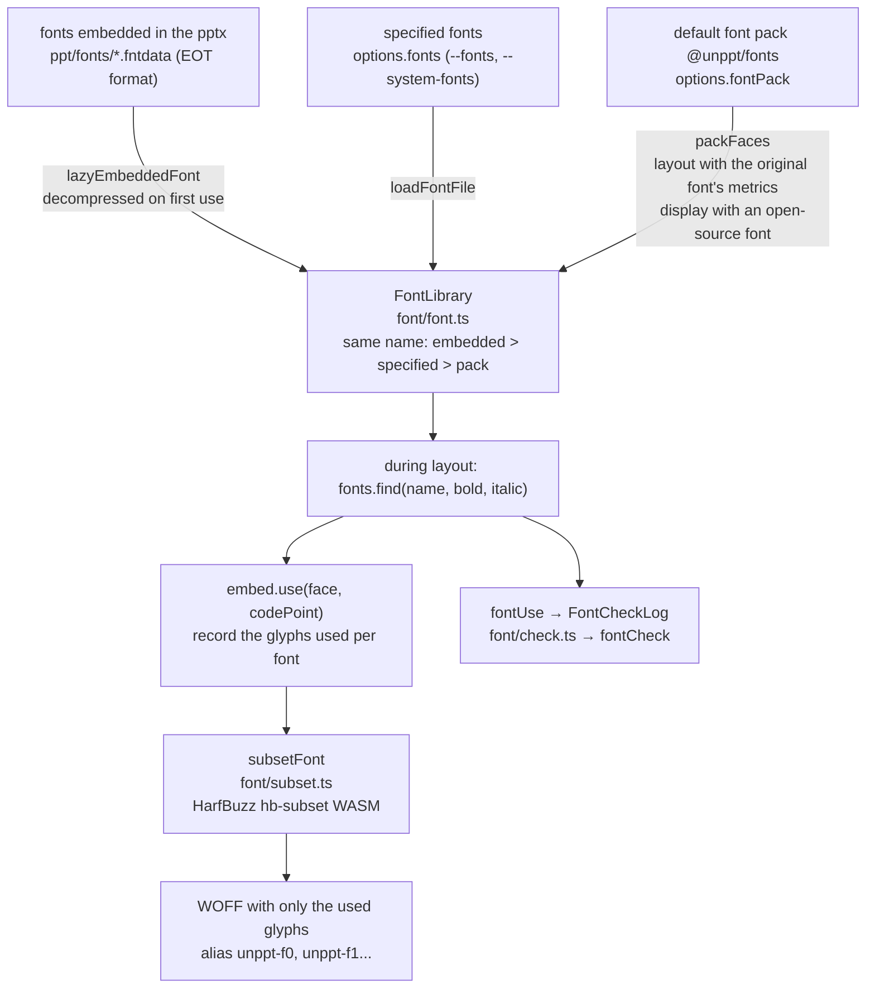

Key points:

- **Font parsing is home-grown** (`font/font.ts`): it reads only the tables layout needs (`name`, `cmap`, `hmtx`/`hhea`, `head`, `OS/2`, `GPOS`/`kern`), lazily. Building the index reads only the table directory and the `name` table; widths are read on first use.
- **Restoring embedded fonts**: PowerPoint embeds fonts in an EOT wrapper, usually MicroType Express compressed. `font/eot.ts`, `font/lzcomp.ts` and `font/ctf.ts` turn it back into a normal TTF.
- Embedded fonts that PowerPoint itself refuses (CFF `.otf`, an unsorted table directory) are treated as not embedded, like PowerPoint.
- **Default font pack** (`font/pack.ts`): each original font (Microsoft YaHei, Calibri, ...) becomes a `FontFace` whose names, bold/italic, widths and line metrics come from the metrics pack (`metrics/`, numbers only, covering 458 Windows / Office font faces) and whose glyphs come from the matching open-source font file (`files/`, mapped by the rules in `map.json`); subsetting and slide images use the open-source font. Symbol fonts (Wingdings etc.) have no display font in `map.json`; when not embedded they are reported as `symbol-missing`.
- **When fonts are embedded**: since 0.3.0 `embedFonts` defaults to `true` and every used font is embedded (`false` is for debugging; then only the pptx's own embedded fonts are). By default the only fonts embedded are open-source fonts and fonts the author embedded in the PPT; for commercial fonts given with `--fonts` / `--system-fonts`, the caller is responsible for the distribution licence.
- **Subsetting**: `font/subset.ts` uses HarfBuzz's `hb-subset` (WASM, bundled into the JS at build time) to keep only used glyphs and packs them as WOFF. Each font gets a unique alias `unppt-f{n}`; the SVG `font-family` lists the alias first, then the original name.
- Subsetting really happens only after all slides are done, when the output form calls `fontFiles()`; by then every used glyph is known.

---

## 12. Images, audio and video

`MediaStore` in `media/media.ts` manages all media:

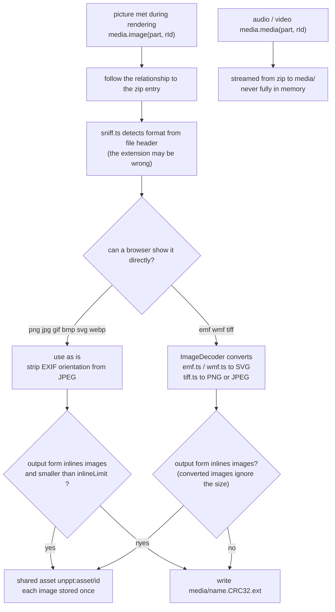

- **File names carry a checksum**: the 8 hex digits in `media/image1.1a2b3c4d.png` are the CRC32 stored in the zip directory. After republishing, stale browser or CDN caches cannot mix versions.
- **Shared images**: an image used on several slides is stored once; the slide refers to it as `unppt:asset/<id>` and the player substitutes the real data before display.
- **Image format extension point**: `ImageDecoder` (`media/image-decoder.ts`), registry `media/decoders.ts`: `[emfDecoder, wmfDecoder, tiffDecoder]`. EMF/WMF are Windows vector metafiles; unppt parses their GDI records itself and converts them to SVG.
- **Set transparent colour**: PowerPoint's "Set Transparent Color" is keyed out on the original image (`media/color-key.ts`), with a home-grown JPEG decoder and PNG encoder.
- SVG pictures inserted in PowerPoint are stored both as a PNG fallback and as the original SVG (`asvg:svgBlip`); unppt uses the SVG, so it stays sharp when zoomed.

---

## 13. Slide images and thumbnails (pic/ and thum/)

Besides the web page, the output by default contains a full-slide image `pic/{n}.jpg` and a thumbnail `thum/{n}.jpg` for every slide, plus a `prop.json` describing them. Uses: previews in a list page, places without JS, etc.

- full image size: slide pixels × 0.75, rounded (i.e. the size in points). A 1280×720 slide gives 960×540;
- thumbnails are always 216 wide (`THUMB_WIDTH`), height in proportion;
- the image shows the slide with all objects visible; audio and video are removed (the video poster frame is still shown).

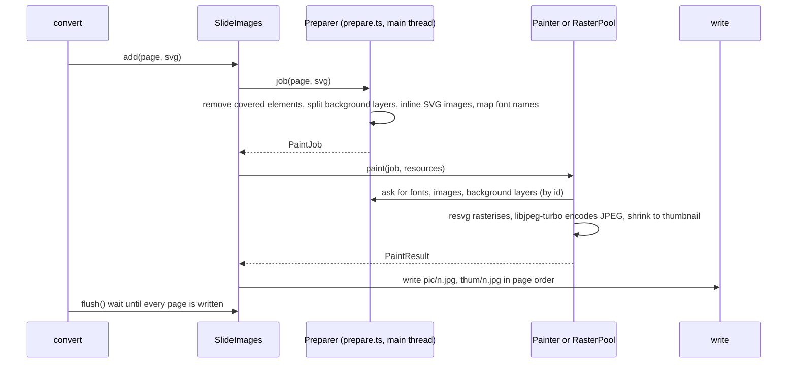

- **resvg** is a library that rasterises SVG (written in Rust, compiled to WASM). unppt uses it only for peripheral features like thumbnails; the rendering used for actual playback is home-grown.
- **Prepare and paint are separate**: preparing (`preview/prepare.ts`) needs the font library and media, so it runs on the main thread; painting (`preview/paint.ts`) is environment-independent and can run on worker threads. The CLI creates a pool with `createRasterPool` from `node-pool.ts` and paints several pages at once; **the result is byte-for-byte identical to single-threaded painting**, and files are still written in page order.
- The transcoder itself (`index.ts`) never creates threads: the caller passes a pool via `options.rasterPool` (in Node it can be imported from `@unppt/unppt/node`).
- Without resvg.wasm, or if it fails to load: no images, one warning, and `prop.json` is still written.

What `prop.json` looks like (field names from `output/prop.ts`):

```json
{
 "count": 2,
 "picw": 960,
 "pich": 540,
 "thumw": 216,
 "thumh": 122,
 "slides": [
  { "index": 1, "thum": "thum/1.jpg", "pic": "pic/1.jpg", "note": "Notes of slide 1" },
  { "index": 2, "thum": "thum/2.jpg", "pic": "pic/2.jpg", "hidden": 1 }
 ]
}
```

---

## 14. Writing the output: four output forms

`convert` does not decide what the files look like. It hands an `OutputSource` to the selected `OutputForm`, which decides how to write. This is another extension point (`output/output.ts`, registry `output/forms.ts`).

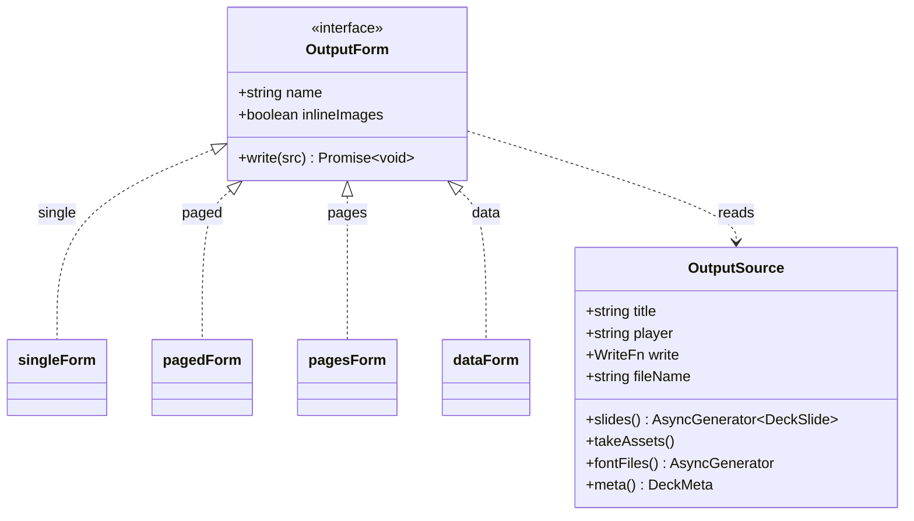

The call order is fixed: first `slides()` one by one, then **after all slides** `fontFiles()` (only now are all used glyphs known), and finally `meta()` (only now is the report complete).

| Form | Inlines small images | Files | Good for |
|---|---|---|---|
| `single` (default, old name `html`) | yes | one self-contained `index.html` (slides, images, fonts, player all inside), large media in `media/` | sending to someone, double-click to open locally |
| `paged` | no | `index.html` (player + index) + `pages/<n>.<hash>.js` + `fonts/<alias>.<hash>.js` + `media/` | web hosting, on-demand loading, preloads the next slide |
| `pages` | no | same as `paged`, plus one standalone `page-001.html`... per slide | when you need per-slide links |
| `data` | no | only `deck.json` + `fonts/*.woff` + `media/` | development and debugging |

In **every form**, `prop.json` is written next to the entry file, plus `pic/` and `thum/` when images are enabled.

### 14.1 What the single-form HTML looks like

`output/single.ts` writes the HTML while converting, in this order:

```mermaid
flowchart TD
  h["htmlHead<br/>doctype, meta, title, div id=unppt"] --> loop
  loop["each slide"] --> a["shared images first used on this slide<br/>script type=application/json class=unppt-asset"]
  a --> s["this slide's DeckSlide<br/>script type=application/json class=unppt-slide"]
  s --> loop
  loop -->|after all slides| f["font subsets (base64)<br/>script class=unppt-font"]
  f --> m["metadata<br/>script id=unppt-meta"]
  m --> p["player script<br/>script"]
```

On start-up the player reads `#unppt-meta` (all data is in the page). The paged form instead reads `#unppt-index` (the index) and loads each slide's data on demand with `<script>` tags, whose callbacks are `__unpptPage` and `__unpptFont` (`PAGE_CALLBACK`, `FONT_CALLBACK`). Loading with `<script>` rather than `fetch` means it also works when opened locally from `file://`.

### 14.2 Per-slide data: DeckSlide

Each slide the output form receives is a `DeckSlide` (`packages/format/src/index.ts`), the contract between transcoder and player:

```mermaid
classDiagram
  class Deck {
    +string format
    +number version
    +string generator
    +number width
    +number height
    +DeckSlide[] slides
    +DeckFont[] fonts
    +DeckReport report
    +string[] slideParts
    +show
  }
  class DeckSlide {
    +string svg
    +AnimAction[][] steps
    +AnimAction[] auto
    +string[] hidden
    +string[] fullScreen
    +triggers
    +SlideTransition transition
    +boolean skip
    +advance
  }
  class DeckFont {
    +string family
    +string source
    +string weight
    +string style
    +string format
    +string url
  }
  Deck "1" --> "*" DeckSlide
  Deck "1" --> "*" DeckFont
  DeckSlide --> AnimAction
  DeckSlide --> SlideTransition
```

`Deck.format` is always `"unppt-deck"`, and `version` is the format version (currently `DECK_FORMAT_VERSION = 1`). `steps.length` is the number of clicks the slide needs.

---

## 15. What happens when something goes wrong

unppt's principle is "produce a result whenever possible":

| Situation | Result |
|---|---|
| not a zip, no zip directory found | throws "not a valid pptx file" (message in Chinese) |
| old .ppt format, encrypted pptx | throws, asking you to save as .pptx in PowerPoint |
| one slide fails to render | that slide becomes a blank white slide, with a "slide N failed to render" warning |
| one element fails to render | the element is skipped, with a warning |
| unsupported graphicFrame | skipped, "unsupported graphic" warning |
| SmartArt without drawing cache | skipped, "SmartArt is missing its drawing cache" warning |
| missing font | laid out with a substitute; the name goes into `report.missingFonts` and the verdict into `fontCheck` (a symbol font that is not embedded also adds a notice) |
| font subsetting fails | that font is not embedded, warning |
| no resvg.wasm | no `pic/`, `thum/`, warning; `prop.json` still written |
| a slide image cannot be painted | no image for that slide, warning |

All warnings are de-duplicated and counted into `ConvertResult.report.warnings`. The CLI prints them, and a copy is in the output metadata. (Warning texts are currently in Chinese.)

---

## 16. PowerPoint concepts mapped to source files

| PowerPoint concept | What it looks like in XML | Source files |
|---|---|---|
| the .pptx file itself | zip | `io/zip.ts` |
| parts, relationships, content types | `_rels/*.rels`, `[Content_Types].xml` | `io/package.ts` |
| XML parsing, new/old version compatibility | `mc:AlternateContent` | `io/xml.ts` |
| presentation, slide size, slide list | `ppt/presentation.xml` | `model/model.ts` (`Presentation`) |
| theme, master, layout | `theme/`, `slideMasters/`, `slideLayouts/` | `model/model.ts` |
| colours (theme colours, luminance tweaks...) | `a:schemeClr`, `a:srgbClr`, `a:lumMod` | `model/color.ts` |
| speaker notes | `notesSlides/` | `model/notes.ts` |
| drawing one slide, placeholder inheritance, background | `p:sld`, `p:bg`, `p:ph` | `render/render.ts` |
| shapes, connectors | `p:sp`, `p:cxnSp` | `render/elements/shape.ts` |
| position, rotation, flip | `a:xfrm` | `render/box.ts` |
| preset shapes, custom shapes | `a:prstGeom`, `a:custGeom` | `geometry/geometry.ts`, `geometry/presets-data.ts` |
| fills | `a:solidFill`, `a:gradFill`, `a:blipFill`, `a:pattFill` | `style/fill.ts`, `style/pattern.ts`, `style/gradient-stops.ts` |
| lines, arrowheads | `a:ln`, `a:headEnd` | `style/line.ts`, `style/arrowheads.ts` |
| shadow, glow, soft edge | `a:effectLst` | `effects/` (`outer-shadow.ts`, `glow.ts`, `soft-edge.ts`, `inner-shadow.ts`) |
| reflection | `a:reflection` | `effects/reflection.ts` |
| 3D rotation, bevel, lighting | `a:scene3d`, `a:sp3d` | `style/camera.ts`, `style/lighting.ts`, `effects/bevel.ts`, `effects/contour.ts` |
| pictures, picture adjustments | `p:pic`, `a:blip` | `render/elements/picture.ts`, `style/blip.ts` |
| video, audio | `a:videoFile`, `a:audioFile` | `render/elements/picture.ts`, `media/media.ts` |
| groups | `p:grpSp` | `render/elements/group.ts`, `render/group-map.ts` |
| tables | `a:tbl` | `render/frames/table-frame.ts`, `render/table.ts`, `render/table-style.ts` |
| charts | `c:chartSpace` | `render/frames/chart-frame.ts`, `chart/` |
| SmartArt | `dgm:relIds`, `dsp:drawing` | `render/frames/diagram-frame.ts` |
| OLE embedded objects | `p:oleObj` | `render/frames/ole-frame.ts` |
| ActiveX controls | `p:controls` | `render/controls.ts` |
| body properties, autofit | `a:bodyPr`, `a:normAutofit` | `text/body.ts` |
| paragraphs, text styles | `a:p`, `a:pPr`, `a:rPr`, `a:lstStyle` | `text/style.ts`, `text/paragraph.ts` |
| bullets, numbering | `a:buChar`, `a:buAutoNum` | `text/bullets.ts` |
| line breaking | — | `text/linebreak.ts` |
| WordArt warps | `a:prstTxWarp` | `text/warp.ts` |
| hyperlinks, action buttons | `a:hlinkClick` | `common/links.ts` |
| animations | `p:timing` | `anim/anim.ts`, `anim/effect.ts`, `anim/behaviors.ts` |
| transitions, advance settings | `p:transition` | `anim/transition.ts` |
| embedded fonts | `p:embeddedFontLst`, `fonts/*.fntdata` | `font/eot.ts`, `font/lzcomp.ts`, `font/ctf.ts` |
| font parsing, subsetting, default font pack, font check | — | `font/font.ts`, `font/subset.ts`, `font/pack.ts`, `font/check.ts` |
| EMF / WMF / TIFF images | — | `media/emf.ts`, `media/wmf.ts`, `media/tiff.ts` |
| slide images, thumbnails | — | `preview/`, `node-pool.ts`, `raster-worker.ts` |
| output files | — | `output/` (`single.ts`, `paged.ts`, `data.ts`, `prop.ts`) |

---

## 17. Known gaps

Current version: 0.1.0. On the synthetic test cases (228 decks / 504 slides), 92.3% of slides pass (SSIM ≥ 0.95, mean 0.984). On a random batch of 100 real-world decks / 3527 slides there were 0 conversion failures and 78.8% of slides pass (about 95% at SSIM ≥ 0.90, mean 0.967). SSIM (structural similarity) is a number from 0 to 1 that measures how alike two images look; 1 means identical. Most failing slides differ only in details (text a few pixels off, one chart label).

Known gaps:

- time scaling on chart date axes (min, max, month/year intervals);
- `wordArtVert` vertical text;
- variable fonts;
- EMF+ records inside EMF images (only the GDI part is drawn);
- some SmartArt that needs re-layout (unppt only draws the drawing cache; it has no SmartArt layout engine);
- 3D bevels under 180-degree rotation;
- the truncation threshold for category labels rotated 45 degrees.

Some comparisons (PowerPoint on the left, unppt on the right, all synthetic test cases):

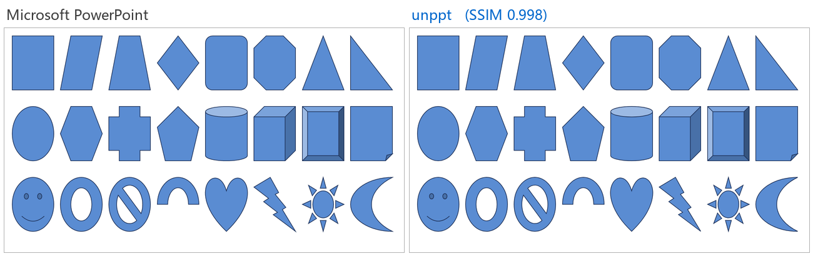


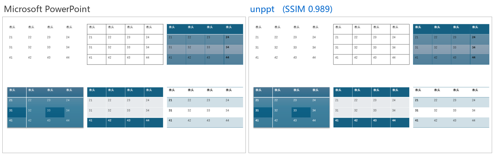


For the overall architecture and extension points, see [architecture.md](../architecture.md) (in Chinese).
