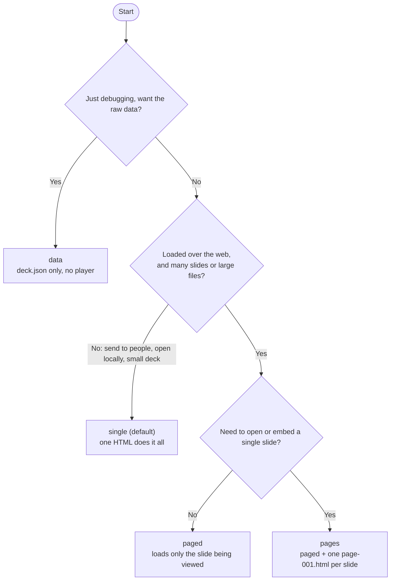
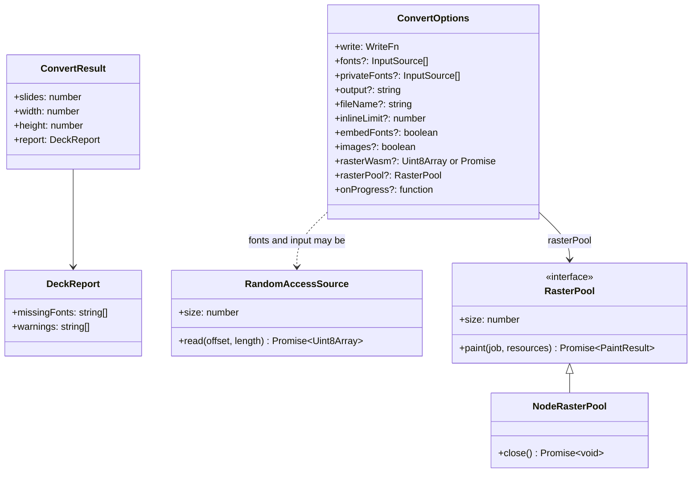
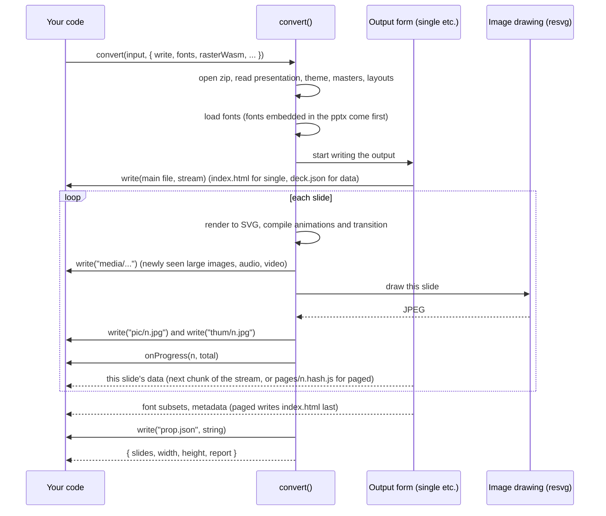
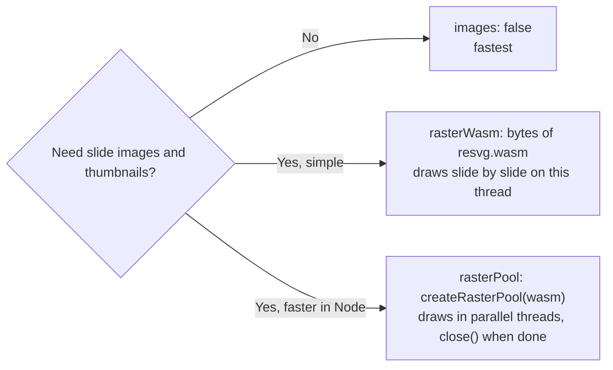
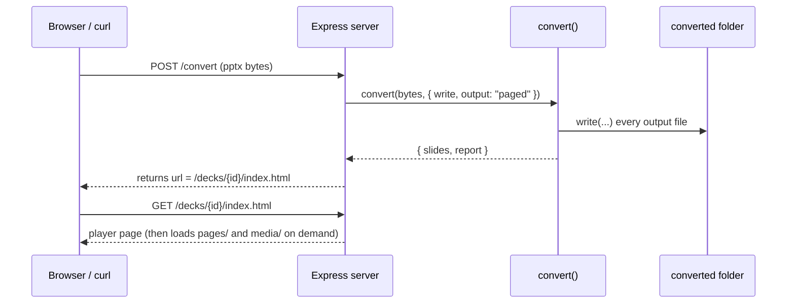

[中文](../zh/usage.md)

# Usage

This is the reference manual: section 2 lists **every** command-line option, section 3 explains how to call `convert()` from JavaScript, and section 4 gives three examples you can adapt directly: a Node script, an HTTP server and a cloud function.

Haven't installed unppt yet? Start with [Getting Started](getting-started.md).

---

## 1. Choose an output form first

unppt writes four output forms (the `--output` / `output` option). If you are not sure which one, follow this chart:



| Form | Images | Font subsets | Audio/video | Main file |
|---|---|---|---|---|
| `single` | Smaller than `inlineLimit` (default 2 MB) are inlined in the HTML, the rest go to `media/` | Inlined in the HTML | `media/` | `index.html` (or the name given by `-o`) |
| `paged` | All written to `media/` | `fonts/<alias>.<hash>.js` | `media/` | `index.html` + `pages/<n>.<hash>.js` |
| `pages` | Same as `paged` | Same as `paged` | `media/` | Same as `paged`, plus `page-001.html`… |
| `data` | All written to `media/` | `fonts/<alias>.woff` | `media/` | `deck.json` |

Every form also writes `prop.json`, and by default `pic/{n}.jpg` and `thum/{n}.jpg`. Each file is explained in [Getting Started, section 5](getting-started.md#5-what-is-in-the-output-folder).

---

## 2. CLI reference

### 2.1 Syntax

```bash
unppt <input.pptx> [-o output] [options]
```

- The first argument is the input file. With no options it creates a folder named after the .pptx next to it and writes everything there (open `index.html` inside to play). Everything else is an option.
- The 0.1.0-and-earlier form `unppt convert <input.pptx>` still works (`convert` is optional since 0.2.0).
- `unppt -v` prints the version, `unppt -h` prints the usage.
- With no arguments, wrong arguments, or an unknown option, it prints the version and usage and exits with code 1.
- If conversion fails (e.g. the file is not a valid pptx) it prints the error and exits with code 1. On success the exit code is 0.

### 2.2 All options

Everything below comes from `packages/transcoder/src/cli.ts`:

| Option | Value | Default | Description |
|---|---|---|---|
| `-o`, `--out <path>` | file or folder | see 2.3 | For `single` / `data` the output file; for `paged` / `pages` the output **folder** (entry is `index.html` inside it) |
| `--output <form>` | `single`, `paged`, `pages`, `data` (`html` is the old name of `single`) | `single` | Output form. An unknown form is an error |
| `--data` | none | off | Same as `--output data` |
| `--fonts <dir>` | folder | none | Font folder; `.ttf` / `.otf` / `.ttc` inside it are read recursively and used to lay out text with real widths. Can be repeated |
| `--system-fonts` | none | off | Use the system font folders; Office private and cloud fonts are used for layout too, and the characters used from them are always embedded |
| `--embed-fonts` | none | off | Embed subsets of the used fonts so viewers need not install them (mind commercial font licenses) |
| `--no-images` | none | images on | Do not write slide images `pic/` and thumbnails `thum/` (`prop.json` is still written) |
| `--jobs <n\|auto>` | positive integer or `auto` | `auto` | How many threads draw slide images in parallel. `auto` takes the smaller of the CPU count (the CPU quota inside a container) and available memory (400 MB budgeted per thread); `1` draws on the main thread |
| `--inline-limit <bytes>` | number | `2097152` (2 MB) | Images smaller than this are inlined in the HTML (only affects `single`) |
| `--stats` | none | off | Print slide count, time and peak memory at the end |
| `-q`, `--quiet` | none | off | Show no progress and no result lines (including missing fonts and notices) |
| `-v`, `--version` | none | — | Print the version only |
| `-h`, `--help` | none | — | Print the usage (exit code 0) |

### 2.3 Where output goes without `-o`

It goes into **a new folder next to the input, named after it** (since 0.2.2; earlier versions wrote next to the input):

| Form | Output of `unppt D:\work\demo.pptx` |
|---|---|
| `single` | `D:\work\demo\index.html` |
| `paged` / `pages` | `D:\work\demo\index.html` |
| `data` | `D:\work\demo\deck.json` |

`media/`, `pic/`, `thum/`, `fonts/` and `prop.json` are written in **the folder of the main file**, so without `-o` they all stay inside that folder instead of mixing with your `.pptx`. With `-o` they follow the path you give, e.g. `-o new-folder/index.html`.

### 2.4 Console output

The CLI messages are in Chinese:

```text
转码中 12/12 页                                   ← progress, "converting 12/12" (to stderr)
统计：12 页，用时 4.2 秒，峰值内存 310 MB         ← stats: slides, time, peak memory (with --stats; printed before the "done" line)
完成：12 页，用时 4.2 秒 -> D:\work\out\index.html  ← done: slides, seconds, output path
缺少字体：Font A、Font B                          ← missing fonts, when any
提示：……                                          ← one line per warning ("notice")
```

### 2.5 Common combinations

```bash
# Most common: self-contained HTML with local fonts
unppt demo.pptx -o out/index.html --system-fonts

# For a website: on-demand loading, fonts embedded so viewers need not install them
unppt demo.pptx -o site/demo --output paged --system-fonts --embed-fonts

# One HTML per slide
unppt demo.pptx -o site/demo --output pages

# On a server: explicit font folder, no images, quiet
unppt demo.pptx -o out/index.html --fonts /opt/fonts --no-images -q

# Low-memory machine: one image thread, show peak memory
unppt demo.pptx -o out/index.html --jobs 1 --stats

# Data only
unppt demo.pptx --data -o out/deck.json
```

---

## 3. JavaScript API

### 3.1 What the package contains

| Import path | Contents | Runs in |
|---|---|---|
| `@unppt/unppt` | `convert()`, `createPainter()`, `UNPPT_VERSION`, and the types `ConvertOptions`, `ConvertResult`, `InputSource`, `RandomAccessSource`, `WriteData`, `WriteFn`, `RasterPool` etc. | Any environment (Node, browser, cloud function); no disk, no network |
| `@unppt/unppt/node` | `createRasterPool()`, `autoWorkers()`, type `NodeRasterPool` | Node only (multi-threaded image drawing with `worker_threads`) |
| `@unppt/unppt/resvg.wasm` | The resvg WASM file used to draw images | Read as a file and pass to `rasterWasm` or `createRasterPool` |

The package is an ES module (`"type": "module"`); load it with `import`.

**Pure function** means: `convert()` never touches the file system or the network itself. You hand it the pptx **bytes**, and it **hands the output files back** through your `write` callback. Where they go (disk, memory, object storage) is up to you.

### 3.2 `convert(input, options)`

```ts
function convert(input: InputSource, options: ConvertOptions): Promise<ConvertResult>
```



#### Input `input: InputSource`

```ts
type InputSource = Uint8Array | ArrayBuffer | RandomAccessSource;

interface RandomAccessSource {
  size: number;                                           // total size in bytes
  read(offset: number, length: number): Promise<Uint8Array>; // read `length` bytes starting at `offset`
}
```

For small files pass a `Uint8Array` (a Node `Buffer` is a `Uint8Array`). For large files pass a `RandomAccessSource`; the transcoder reads only the parts it needs, see [3.5](#35-large-files-random-access-reading).

#### Options `options: ConvertOptions`

| Option | Type | Default | Description |
|---|---|---|---|
| `write` | `(path, data) => Promise<void>` | **required** | Writes an output file, see [3.3](#33-the-write-callback) |
| `fonts` | `InputSource[]` | `[]` | Font files (ttf / otf / ttc), one entry per file |
| `privateFonts` | `InputSource[]` | `[]` | Fonts viewers do not have (e.g. Office private or cloud fonts): used for layout, and the characters used are **always** embedded regardless of `embedFonts` |
| `output` | `'single' \| 'paged' \| 'pages' \| 'data'` | `'single'` | Output form (`'html'` is the old name of `'single'`); an unknown name throws |
| `fileName` | `string` | `'index.html'` (`'deck.json'` for `data`) | Main file name |
| `inlineLimit` | `number` (bytes) | `2097152` | Images smaller than this are inlined in the HTML; only affects `single`. Audio and video are always separate files |
| `embedFonts` | `boolean` | `false` | Embed subsets of the used fonts in the output |
| `images` | `boolean` | `true` | Whether to write `pic/{n}.jpg` and `thum/{n}.jpg`. `prop.json` is always written |
| `rasterWasm` | `Uint8Array \| Promise<Uint8Array \| undefined>` | none | Bytes of the resvg WASM. **When `images` is `true` you must pass this or `rasterPool`**, otherwise no images are drawn and a warning is recorded |
| `rasterPool` | `RasterPool` | none | Parallel image executor (e.g. the result of `createRasterPool()`). With it, `rasterWasm` is not needed; output is byte-identical to single-threaded drawing |
| `onProgress` | `(done: number, total: number) => void` | none | Called once after each slide is processed |

#### Result `ConvertResult`

| Field | Description |
|---|---|
| `slides` | Number of slides written |
| `width` / `height` | Slide size (pixels at 96 DPI; `picw`/`pich` in `prop.json` are these times 0.75, in points) |
| `report.missingFonts` | Font names used by the document for which no font file was provided (sorted) |
| `report.warnings` | Notices from the conversion, e.g. "slide 3 failed to render: …" (the text is in Chinese). A message that occurs several times is written once with a count "（N 处）" |

#### Errors

- If the file is not a valid pptx, or `output` is misspelled, the Promise returned by `convert()` rejects.
- An error on **one slide** does not fail the whole conversion: that slide becomes a blank white slide and a "slide N failed to render" warning (`第 N 页渲染失败`) goes into `report.warnings`.
- An error thrown by your `write` callback makes `convert()` fail.

### 3.3 The `write` callback

```ts
type WriteData = Uint8Array | string | AsyncIterable<Uint8Array>;
type WriteFn = (path: string, data: WriteData) => Promise<void>;
```

- `path` is relative and uses `/`, e.g. `index.html`, `media/media1.1a2b3c4d.mp4`, `pic/3.jpg`, `pages/2.9f8e7d6c.js`, `prop.json`.
- `data` is one of three things: a string, bytes, or a **stream** (`AsyncIterable<Uint8Array>`, read chunk by chunk with `for await`). The main file and large videos arrive as streams so the whole file never has to sit in memory.
- Resolve the Promise only after the file is **completely** written.

> **Important: do not queue writes behind each other.** The `single` and `data` forms call `write(mainFileName, stream)` **first** (`index.html` for `single`, `deck.json` for `data`); the transcoder does its slide-by-slide work while you read that stream, and meanwhile calls `write('media/…')`, `write('pic/…')` for other files. If your `write` waits for the previous write to finish before starting the next, they deadlock. Handle each call independently.

The simplest version in Node: `fs.promises.writeFile` already accepts strings, `Uint8Array` and `AsyncIterable`:

```js
import { mkdir, writeFile } from 'node:fs/promises';
import { dirname, join } from 'node:path';

const outDir = 'out';
const write = async (path, data) => {
  const target = join(outDir, path);
  await mkdir(dirname(target), { recursive: true });
  await writeFile(target, data);
};
```

Collecting any `WriteData` into one `Buffer` (handy for memory or object storage):

```js
async function toBuffer(data) {
  if (typeof data === 'string') return Buffer.from(data);
  if (data instanceof Uint8Array) return Buffer.from(data);
  const chunks = [];
  for await (const chunk of data) chunks.push(chunk);
  return Buffer.concat(chunks);
}
```

### 3.4 What happens during one `convert` call



The transcoder "writes as it goes": once a slide is done its data is handed out and its memory released, so even decks with hundreds of slides use little memory.

### 3.5 Large files: random-access reading

Don't read a 1 GB file into memory. Pass a `RandomAccessSource`; the transcoder reads only what it needs (e.g. the directory and each slide's XML; videos are streamed out in chunks):

```js
import { open, stat } from 'node:fs/promises';
import { convert } from '@unppt/unppt';

async function fileSource(path) {
  const { size } = await stat(path);
  const fh = await open(path, 'r');
  return {
    size,
    fh, // keep it so you can close it afterwards
    async read(offset, length) {
      const buf = new Uint8Array(Math.max(0, Math.min(length, size - offset)));
      const { bytesRead } = await fh.read(buf, 0, buf.length, offset);
      return buf.subarray(0, bytesRead);
    },
  };
}

const source = await fileSource('big.pptx');
try {
  await convert(source, { write, images: false });
} finally {
  await source.fh.close();
}
```

Fonts can be passed the same way (`fonts: [await fileSource('C:/Windows/Fonts/msyh.ttc')]`), which also saves memory with big `.ttc` collections. In a browser, implement `read` with `Blob.slice(offset, offset + length).arrayBuffer()`.

### 3.6 Slide images and thumbnails

`images` defaults to `true`, but `convert()` does not look for `resvg.wasm` by itself; you provide it. Three ways:



**Single thread:**

```js
import { readFile } from 'node:fs/promises';
import { convert } from '@unppt/unppt';

const wasm = new Uint8Array(await readFile(new URL(import.meta.resolve('@unppt/unppt/resvg.wasm'))));
const result = await convert(pptxBytes, { write, rasterWasm: wasm });
```

**Multiple threads (Node only):**

```js
import { readFile } from 'node:fs/promises';
import { convert } from '@unppt/unppt';
import { createRasterPool, autoWorkers } from '@unppt/unppt/node';

const wasm = new Uint8Array(await readFile(new URL(import.meta.resolve('@unppt/unppt/resvg.wasm'))));
const pool = await createRasterPool(wasm, autoWorkers()); // the 2nd argument is optional; it defaults to autoWorkers()
try {
  await convert(pptxBytes, { write, rasterPool: pool });
} finally {
  await pool.close(); // stop the worker threads
}
```

- `autoWorkers()`: the smaller of the CPU count (the cgroup CPU quota inside Linux containers) and "available memory ÷ 400 MB", at least 1.
- One pool can be shared by many `convert()` calls. The CLI's `--jobs` is implemented with these two functions.

### 3.7 Progress, warnings, missing fonts

```js
const result = await convert(pptxBytes, {
  write,
  images: false,
  onProgress: (done, total) => console.log(`progress ${done}/${total}`),
});
console.log('slides', result.slides);
if (result.report.missingFonts.length) console.warn('missing fonts:', result.report.missingFonts.join(', '));
for (const w of result.report.warnings) console.warn('notice:', w);
```

---

## 4. Examples

All examples are ES modules (`.mjs` extension, or `"type": "module"` in `package.json`).

### 4.1 Node script: convert a whole folder

```js
// batch.mjs   usage: node batch.mjs <input folder> <output folder>
import { mkdir, readdir, readFile, writeFile } from 'node:fs/promises';
import { basename, dirname, extname, join } from 'node:path';
import { convert } from '@unppt/unppt';
import { createRasterPool } from '@unppt/unppt/node';

const [inDir, outRoot] = process.argv.slice(2);
const wasm = new Uint8Array(await readFile(new URL(import.meta.resolve('@unppt/unppt/resvg.wasm'))));
const pool = await createRasterPool(wasm);

try {
  for (const name of await readdir(inDir)) {
    if (extname(name).toLowerCase() !== '.pptx') continue;
    const outDir = join(outRoot, basename(name, extname(name)));
    const write = async (path, data) => {
      const target = join(outDir, path);
      await mkdir(dirname(target), { recursive: true });
      await writeFile(target, data);
    };
    try {
      const bytes = await readFile(join(inDir, name));
      const r = await convert(bytes, { write, output: 'paged', rasterPool: pool });
      console.log(`${name}: ${r.slides} slides, ${r.report.missingFonts.length} missing fonts, ${r.report.warnings.length} notices`);
    } catch (e) {
      console.error(`${name} failed: ${e.message}`);
    }
  }
} finally {
  await pool.close();
}
```

### 4.2 HTTP server (Express): upload a pptx, get a player URL

Run `npm install express` first. The upload sends the file bytes as the request body (`Content-Type: application/octet-stream`).

```js
// server.mjs
import express from 'express';
import { randomUUID } from 'node:crypto';
import { mkdir, readFile, writeFile } from 'node:fs/promises';
import { dirname, join } from 'node:path';
import { convert } from '@unppt/unppt';

const app = express();
const OUT = join(process.cwd(), 'converted');
const wasm = new Uint8Array(await readFile(new URL(import.meta.resolve('@unppt/unppt/resvg.wasm'))));

// Serve the converted files as static files
app.use('/decks', express.static(OUT));

app.post('/convert', express.raw({ type: 'application/octet-stream', limit: '500mb' }), async (req, res) => {
  const id = randomUUID();
  const dir = join(OUT, id);
  const write = async (path, data) => {
    const target = join(dir, path);
    await mkdir(dirname(target), { recursive: true });
    await writeFile(target, data);
  };
  try {
    const result = await convert(new Uint8Array(req.body), { write, output: 'paged', rasterWasm: wasm });
    res.json({
      url: `/decks/${id}/index.html`,
      prop: `/decks/${id}/prop.json`,
      slides: result.slides,
      missingFonts: result.report.missingFonts,
      warnings: result.report.warnings,
    });
  } catch (e) {
    res.status(400).json({ error: e.message });
  }
});

app.listen(3000, () => console.log('http://localhost:3000'));
```

Try it:

```bash
curl -X POST --data-binary @demo.pptx -H "Content-Type: application/octet-stream" http://localhost:3000/convert
```

The returned `url` can go straight into `<iframe src="...">`.



### 4.3 Cloud function: read from object storage, convert, write back

Cloud functions usually have no persistent writable disk and limited memory. `convert()` never touches the disk, so it fits well. `getObject` / `putObject` below are **placeholders**; replace them with the matching calls of your cloud provider's SDK:

```js
// handler.mjs
import { convert } from '@unppt/unppt';

// --- replace with your object storage SDK ---
async function getObject(key) { /* return a Uint8Array */ }
async function putObject(key, body) { /* body is a Buffer */ }
// --------------------------------------------

async function toBuffer(data) {
  if (typeof data === 'string') return Buffer.from(data);
  if (data instanceof Uint8Array) return Buffer.from(data);
  const chunks = [];
  for await (const chunk of data) chunks.push(chunk);
  return Buffer.concat(chunks);
}

export async function handler(event) {
  const { inputKey, outputPrefix } = event;   // e.g. "uploads/a.pptx", "decks/a/"
  const bytes = await getObject(inputKey);
  const result = await convert(bytes, {
    output: 'paged',
    images: false,                            // for images pass rasterWasm (deploy resvg.wasm with the function)
    write: async (path, data) => putObject(outputPrefix + path, await toBuffer(data)),
  });
  return {
    entry: outputPrefix + 'index.html',
    slides: result.slides,
    missingFonts: result.report.missingFonts,
    warnings: result.report.warnings,
  };
}
```

Notes:

- For big files, `toBuffer` holds a whole video in memory. If your SDK supports streaming uploads, pass `data` (the `AsyncIterable`) straight to it to save memory; the input can also be read by range as in [3.5](#35-large-files-random-access-reading) (many object stores support Range requests).
- Cloud functions usually have no CJK fonts; pass font file bytes with `fonts: [...]` and consider `embedFonts: true`.
- Put `index.html`, `pages/` and `media/` under the same prefix and serve them through a CDN; no server-side code is needed.

### 4.4 Converting in the browser

The main entry of `@unppt/unppt` does not depend on Node, so bundlers (e.g. Vite, webpack) can include it in a front end. A user-selected file can be read by position:

```js
import { convert } from '@unppt/unppt';

const file = input.files[0];              // <input type="file">
const source = {
  size: file.size,
  read: async (offset, length) => new Uint8Array(await file.slice(offset, offset + length).arrayBuffer()),
};
const files = new Map();
const result = await convert(source, {
  images: false,
  write: async (path, data) => {
    if (typeof data === 'string' || data instanceof Uint8Array) { files.set(path, data); return; }
    const parts = [];
    for await (const c of data) parts.push(c);
    files.set(path, new Blob(parts));
  },
});
// `files` now holds index.html, media/... and the other outputs
```
