[English](../en/architecture.md)

# unppt 架构入门

这篇文档写给**第一次接触 unppt 内部代码的人**，尤其是刚入行的程序员。读完你应该能回答这些问题：

- 仓库里这么多文件夹，各自是干什么的？
- 一个 `.pptx` 是怎么一步一步变成网页的？
- 为什么要把"转码器"和"播放器"拆成两半？
- 想加一种新图表、新动画，应该改哪个文件？
- `npm run build` 背后到底做了什么？用了哪些第三方库？

> 想看更细的模块说明（每个文件干什么、每个扩展点的完整规则），请读开发者文档 [docs/architecture.md](../architecture.md)。本文是它的"入门导读版"。需求的唯一真相源是 [SPEC.md](../../SPEC.md)。

---

## 0. 先认识几个词

| 词 | 意思 |
|---|---|
| **pptx** | PowerPoint 的文件格式。它其实是一个 **ZIP 压缩包**，里面装着很多 XML 文件（每页一个、主题一个、母版一个……）和图片、音视频。 |
| **XML** | 一种用尖括号标签写数据的文本格式，例如 `<a:t>你好</a:t>`。 |
| **OPC** | Open Packaging Conventions，pptx 这种"ZIP 里装 XML、XML 之间互相引用"的打包规则。 |
| **EMU** | English Metric Unit，PowerPoint 内部的长度单位。1 英寸 = 914400 EMU，按 96 DPI 换算 **1 像素 = 9525 EMU**（代码里是 `EMU_PER_PX = 9525`，在 `model/model.ts`）。 |
| **SVG** | Scalable Vector Graphics，浏览器原生支持的矢量图格式，也是用标签写的。unppt 把每一页画成一段 SVG。 |
| **转码器（transcoder）** | 把 pptx 转成产物的程序（`packages/transcoder`）。 |
| **产物** | 转码器的输出：一个自带播放器的 HTML，或者 HTML + 每页数据文件 + `media/` 资源。 |
| **播放器（player）** | 在浏览器里播放产物的 JS 程序（`packages/player`），负责翻页、动画、页面切换。 |
| **iframe** | 网页里嵌入另一个网页的"窗口"标签 `<iframe>`。产物可以放进 iframe 里。 |
| **postMessage** | 浏览器提供的跨窗口发消息的方法。外层页面就是用它控制 iframe 里的播放器（翻页、跳页、查询状态）。 |
| **WASM** | WebAssembly，一种能在 Node 和浏览器里直接运行的二进制代码。C/C++/Rust 写的库可以编译成 WASM 给 JS 用。 |
| **原生插件** | 需要按操作系统编译的 npm 包（例如带 `.node` 文件的）。unppt **不用**它们。 |
| **SSIM** | Structural Similarity，结构相似度，衡量两张图有多像，0~1，越接近 1 越像。unppt 用它比较"PowerPoint 截图"和"unppt 截图"，一页 SSIM ≥ 0.95 算通过。 |
| **esbuild** | 一个非常快的 JS/TS 打包工具，把很多源文件合成一个 JS 文件。 |
| **monorepo** | 一个 Git 仓库里放好几个相关的包。 |

---

## 1. 一张图看懂整体

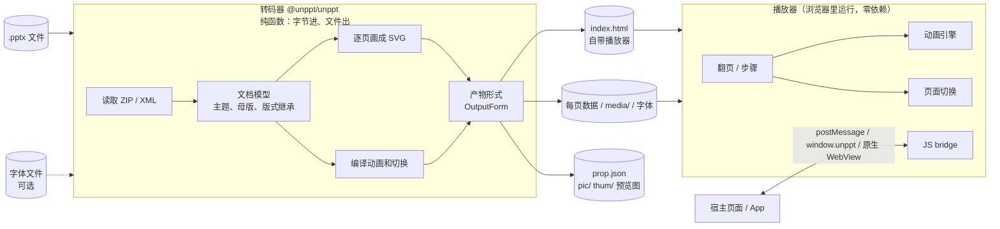

一句话：**转码器在服务器（或你的电脑）上把 pptx 变成静态文件；播放器在用户的浏览器里把这些静态文件播出来**。两者之间只靠"产物格式"联系。

---

## 2. 仓库目录（monorepo 布局）

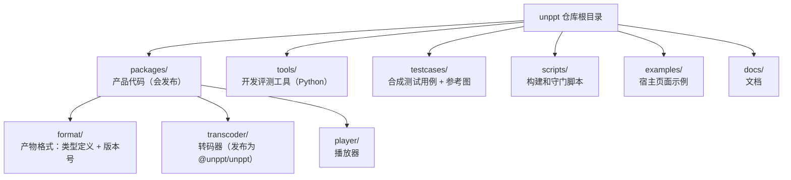

| 目录 | 做什么 | 会不会发布到 npm |
|---|---|---|
| `packages/format` | 产物格式的 TypeScript 类型：`Deck`、`DeckSlide`、`AnimAction`、`SlideTransition`、`PlayerState`、bridge 消息 `BridgeCommand` / `BridgeReply` / `BridgeEvent`，以及版本号 `DECK_FORMAT_VERSION`、`UNPPT_VERSION`。**转码器和播放器之间唯一的约定**。 | 只是类型，打包时被合进转码器和播放器 |
| `packages/transcoder` | 转码器，TypeScript。入口 `src/index.ts`（`convert` 函数）和 `src/cli.ts`（命令行 `unppt`）。 | 是，包名 `@unppt/unppt` |
| `packages/player` | 播放器，TypeScript，零依赖。入口 `src/player.ts`；`src/host.ts` 是给宿主页面用的小工具 `UnpptFrame`。 | 播放器代码被内嵌进转码器的产物里 |
| `tools/` | 开发用的 Python 工具：`tools/powerpoint` 调本机 PowerPoint 导出参考图；`tools/make-case` 用 PowerPoint 生成合成用例；`tools/compare` 截图、比对、打分；`check-player.py` 等是播放器端到端测试。 | 否（只在开发机运行） |
| `testcases/` | 合成测试用例：每个用例一个 `xxx.pptx` 和同名文件夹（PowerPoint 导出的参考图）。内容都是中性的，可以提交。 | 否 |
| `scripts/` | `build.mjs` 构建；`check-deps.mjs` 架构守门（检查分层和循环依赖）；`golden.mjs` 重构安全网；`esbuild-libjpeg.mjs` 构建用的 esbuild 插件。 | 否 |
| `examples/` | `iframe-host.html`（在 iframe 里嵌入并控制播放器）、`live-class.html`（直播课的演绎端/观看端同步）。 | 否 |

---

## 3. 为什么转码器和播放器只通过"产物格式"联系？

想象一下快递：寄件人（转码器）只要按规定格式打包，收件人（播放器）只要按同样格式拆包。双方不用知道对方内部怎么工作。

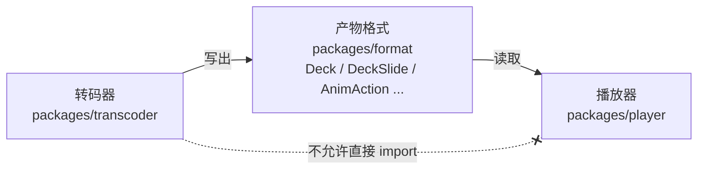

这样做的好处（SPEC 决策 D4）：

1. **可以分开部署**：转码器放在云函数里跑，播放器只在浏览器里跑。
2. **可以分开升级**：格式带版本号 `DECK_FORMAT_VERSION`（当前是 `1`），播放器遇到不认识的版本要明确报错。
3. **可以分开测试**：转码器的输出可以逐字节比较，播放器单独做端到端测试。

这条规则不是靠自觉，而是**自动检查**：`scripts/check-deps.mjs` 规定 `player/src` 只能依赖 `format/src`，转码器各层也只能依赖 `format/src` 而不是播放器。违反了 `npm test` 直接失败。

---

## 4. 设计原则

这些原则来自 [SPEC.md](../../SPEC.md) 第 2 节和项目的 `CLAUDE.md`：

| 原则 | 具体意思 | 为什么 |
|---|---|---|
| **纯函数：字节进、文件出** | `convert(input, { write, fonts? })`：输入是字节（`Uint8Array` / `ArrayBuffer`）或按位置读取的数据源 `{ size, read(offset, length) }`；输出通过调用方给的 `write(路径, 数据)` 写出。转码器自己**不读写磁盘、不联网**。 | 文件从哪来、写到哪去交给调用方，所以 Node、云函数、浏览器都能用。大文件可以按需读取，不必整个放进内存。 |
| **字体只接收字节** | 字体也通过 `fonts` / `privateFonts` 选项以字节传入，不去系统里找。 | 转码时测量用的字体就是播放时显示用的字体，换行位置在任何浏览器里都一致。 |
| **不用原生插件和外部程序** | 产品代码只能用纯 JS 和 WASM 类库，新类库要注明许可证、固定版本。 | 任何 Node 环境都能装、都能跑，不会出现"装不上"。 |
| **播放器零依赖** | 播放器不引用任何第三方库，产物里只需要一个浏览器。 | 产物可以本地双击打开、放进 iframe、放进 App 的 WebView。 |
| **核心渲染自研** | 正式播放的页面 SVG 和动画全部自己写，要逐像素对齐 PowerPoint；第三方渲染库只用在缩略图这类周边功能（resvg）。 | 核心效果完全可控。 |
| **以 PowerPoint 为唯一标准** | 正确不正确，看本机 Microsoft PowerPoint 的输出。 | 目标就是"和 PPT 一样"。 |
| **SOLID：加功能 = 加文件 + 注册表一行** | 新能力优先走扩展点，不往大文件、大 `switch` 里堆；模块只依赖下层和窄接口。 | 多人协作时不互相改文件，也不容易改坏别的功能。 |

---

## 5. 转码器内部：分层模块图

转码器的源码在 `packages/transcoder/src`，按文件夹分成若干模块。**上层可以用下层，下层不能用上层，也不能循环依赖**。下面这张图就是 `scripts/check-deps.mjs` 里 `RULES` 表的样子（箭头表示"可以依赖"，为了清楚只画了直接的主要关系）：

```mermaid
flowchart TB
  entry["入口<br/>index.ts（convert）/ cli.ts（命令行）<br/>node-pool.ts / raster-worker.ts（Node 并行出图）"]
  preview["preview/<br/>整页图、缩略图（用 resvg 光栅化）"]
  output["output/<br/>产物形式：single / paged / pages / data"]
  anim["anim/<br/>动画时间线、切换"]
  render["render/<br/>逐页分派：形状、图片、组合、表格<br/>frames/ graphicFrame 内容"]
  chart["chart/<br/>图表"]
  media["media/<br/>图片、音视频、图片解码"]
  text["text/<br/>文字排版"]
  effects["effects/<br/>阴影、发光、柔化边缘、棱台"]
  style["style/<br/>填充、线条、渐变、三维"]
  font["font/<br/>字体解析、子集化"]
  geometry["geometry/<br/>预设形状、公式引擎"]
  model["model/<br/>演示文稿、主题、母版、颜色"]
  common["common/<br/>SVG 工具、超链接、编号"]
  io["io/<br/>数据源、ZIP、XML、OPC 包"]
  format[("format/<br/>产物格式")]

  entry --> preview & output & anim & render
  preview --> media & font
  output --> media
  output --> format
  anim --> model
  anim --> format
  render --> chart & media & text & effects & style & geometry
  chart --> style & font
  text --> effects & style & font & geometry
  media --> model
  effects --> model
  style --> model
  font --> common
  geometry --> common
  model --> common
  common --> io
```

从下往上读，每一层负责什么：

| 层（文件夹） | 负责什么 | 允许依赖（来自 `check-deps.mjs`） |
|---|---|---|
| `io/` | 把输入变成"按位置读取"的数据源（`source.ts`）、读 ZIP（`zip.ts`，用 zip.js）、解析 XML（`xml.ts`，用 saxes）、按 OPC 规则找部件和关系（`package.ts`）。 | 无 |
| `common/` | SVG 输出工具（`svg.ts`）、超链接（`links.ts`）、内容哈希（`hash.ts`）、动画目标编号（`uid.ts`）。 | io |
| `model/` | 演示文稿 / 主题 / 母版 / 版式的继承（`model.ts`）、颜色（`color.ts`）、演讲者备注（`notes.ts`）、字体名的字符集（`font-charsets.ts`）、三维灯光常量。 | io、common |
| `geometry/` | 公式引擎、预设形状数据（`presets-data.ts`）、文字变形数据（`warps-data.ts`）、转动后的外接矩形。 | io、common |
| `font/` | 读 TrueType（`font.ts`、`cmap.ts`、`glyf.ts`、`kern.ts`）、字体子集化（`subset.ts`，用 HarfBuzz WASM）、还原嵌入字体（`eot.ts` → `lzcomp.ts` → `ctf.ts`）。 | io、common |
| `style/` | 填充 `fill.ts`、图案 `pattern.ts`、线条 `line.ts`、箭头 `arrowheads.ts`、渐变 `gradient-stops.ts`、图片调整 `blip.ts`、三维 `camera.ts` / `lighting.ts`、透视 `perspective.ts`。 | io、common、model |
| `effects/` | 形状效果转 SVG 滤镜：`outer-shadow.ts`、`inner-shadow.ts`、`glow.ts`、`soft-edge.ts`、`bevel.ts`、映像 `reflection.ts`、三维轮廓 `contour.ts`。 | io、common、model |
| `text/` | 文本框属性 → 逐段排版（测量、断行、项目符号）→ 定位 → 输出 SVG 文字；艺术字变形 `warp.ts`。 | io、common、model、geometry、font、style、effects |
| `media/` | 图片和音视频资源（`media.ts`）、EMF / WMF / TIFF 解码、PNG / JPEG 编解码、按文件头识别格式（`sniff.ts`）。 | io、common、model |
| `chart/` | 图表：标题、图例、坐标轴、数据标签、趋势线、三维图表……每种图表类型在 `chart/types/`。 | io、common、model、font、style |
| `render/` | 每一页的总调度 `render.ts`（`renderSlide`）：按元素类型分派到形状、图片、组合、表格；`frames/` 处理表格、图表、SmartArt、OLE 这类"框"。 | 除了 anim / output / preview 之外的所有下层 |
| `anim/` | 把 PowerPoint 的动画时间线编译成播放器能播的 `AnimAction`（`anim.ts`），页面切换的名字对应（`transition.ts`），声音（`sound.ts`）。 | io、common、model、format |
| `output/` | 产物形式（`single.ts`、`paged.ts`、`data.ts`）和所有形式都输出的 `prop.json`（`prop.ts`）。 | io、common、media、format |
| `preview/` | 整页图 `pic/` 和缩略图 `thum/`：准备（`prepare.ts`）→ 用 resvg 画（`paint.ts`）→ 存 JPEG。 | io、common、media、font |
| 入口 | `index.ts` 的 `convert` 把上面各层串起来；`cli.ts` 是命令行；`node-pool.ts` 是 Node 的出图线程池。 | 全部（`*`） |

> 小提示：图里没有 `anim → render` 的箭头。动画编译只需要 render 层交给它的数据（时间线 XML、页面里的 `data-uid` 编号），这些在入口 `index.ts` 里传过去，所以两层互不依赖。

---

## 6. 一次转码是怎么跑的

### 6.1 命令行到写文件

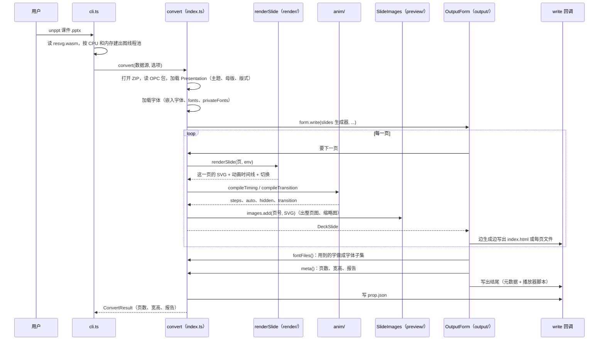

几个值得注意的点：

- **逐页处理**：页面是一个 `async` 生成器（`slides()`），产物形式拿到一页就写一页，写完就释放，所以大文件也不会撑爆内存。
- **单页出错不影响整份**：某一页渲染抛异常时，输出一张白页，并在报告里记一条警告。
- **出图是可选的**：`images: false` 时不出 `pic/` 和 `thum/`，但 `prop.json` 总是输出。

### 6.2 `convert` 的主要选项

下面是 `ConvertOptions`（`packages/transcoder/src/index.ts`）和相关类型的结构：

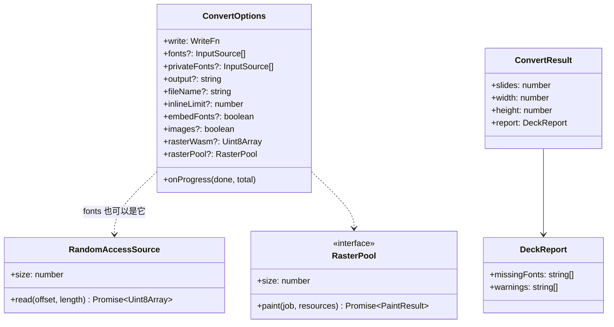

| 选项 | 含义 |
|---|---|
| `write` | 必填。写文件的函数，路径是相对路径，如 `index.html`、`media/video1.mp4`。 |
| `fonts` | 字体文件（ttf / otf / ttc）的字节。 |
| `privateFonts` | 观看端没有的字体：用到的字总是嵌入产物。 |
| `output` | 产物形式：`single`（默认，旧名 `html`）、`paged`、`pages`、`data`。 |
| `fileName` | 主文件名，默认 `index.html`（`data` 形式是 `deck.json`）。 |
| `inlineLimit` | 小于这个字节数的图片内联进 HTML，默认 2MB。 |
| `embedFonts` | 把用到的字做成字体子集嵌入产物，默认关闭。 |
| `images` | 是否输出整页图和缩略图，默认输出。 |
| `rasterWasm` | resvg 的 WASM 字节（命令行自动读取发布包里的 `dist/resvg.wasm`）。 |
| `rasterPool` | 并行出图执行器，例如 `@unppt/unppt/node` 的 `createRasterPool`。 |
| `onProgress` | 每处理完一页回调一次。 |

### 6.3 产物里有什么

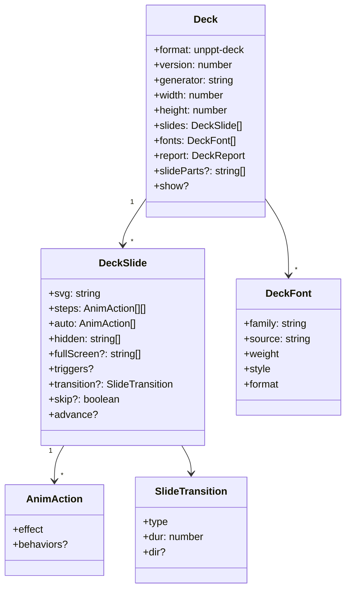

- `svg`：这一页的静态画面。能做动画的元素带 `data-uid` 属性。
- `steps`：每点击一次执行的一组动作，`steps.length` 就是这一页要点几次。
- `auto`：进入页面时自动执行的动作；`hidden`：一开始隐藏的元素（有进入动画的）。

不同产物形式只是把这些数据**装进不同的文件**：

| 形式 | 文件 | 播放器从哪读 |
|---|---|---|
| `single` | 一个 `index.html`，页面、图片、字体、播放器全在里面（大媒体放 `media/`） | `<script id="unppt-meta">` 和每页的 `script.unppt-slide` |
| `paged` | 入口 `index.html`（播放器 + 目录）+ 每页一个数据脚本 + 资源文件 | `<script id="unppt-index">`，每页用 `<script>` 标签按需加载（回调名 `__unpptPage`、`__unpptFont`） |
| `pages` | 在 `paged` 基础上每页再出一个独立 HTML | 同上 |
| `data` | 只有 `deck.json`（调试用） | — |

---

## 7. 播放器内部

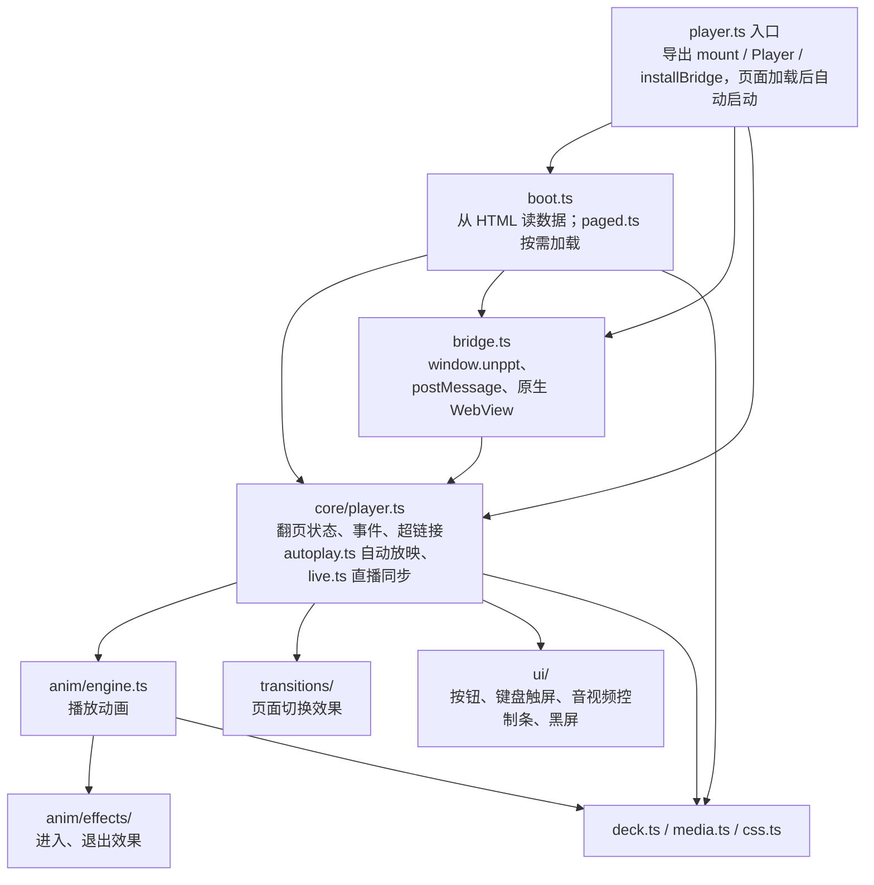

### 7.1 播放器的状态

播放器的位置用 `PlayerState` 描述：第几页 `slide`、第几步 `step`（都从 0 开始，类型定义在 `packages/format`）。"下一步"会先把这一页的动画一步步播完，再翻到下一页。注意：`step` 和 `change` 事件在动画**开始**时就更新，不等动画播完：

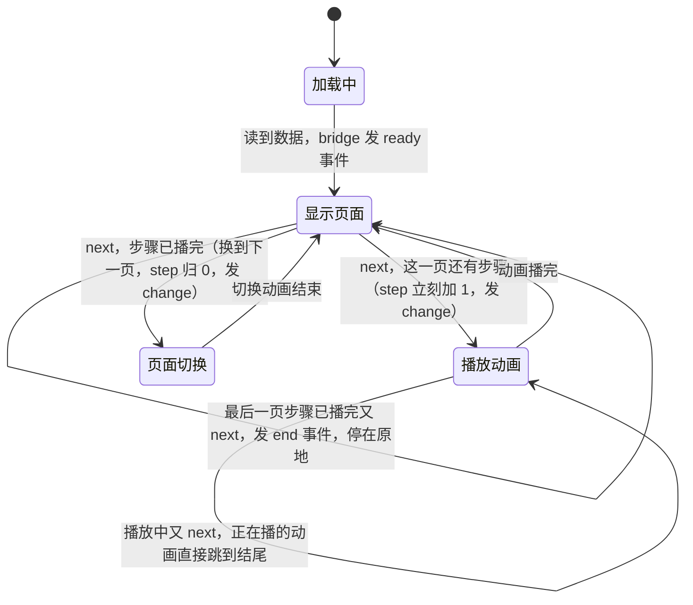

### 7.2 宿主页面和 iframe 里的播放器怎么通信

外层页面通过 `postMessage` 发 `BridgeCommand`（`cmd` 是 `next`、`prev`、`goto`、`sync`、`getState` 之一），播放器回 `BridgeReply`，状态变化时主动发 `BridgeEvent`（`ready`、`change`、`end`、`link`）。所有消息都带 `unppt: 1`。`packages/player/src/host.ts` 里的 `UnpptFrame` 把这些包装成了 Promise：

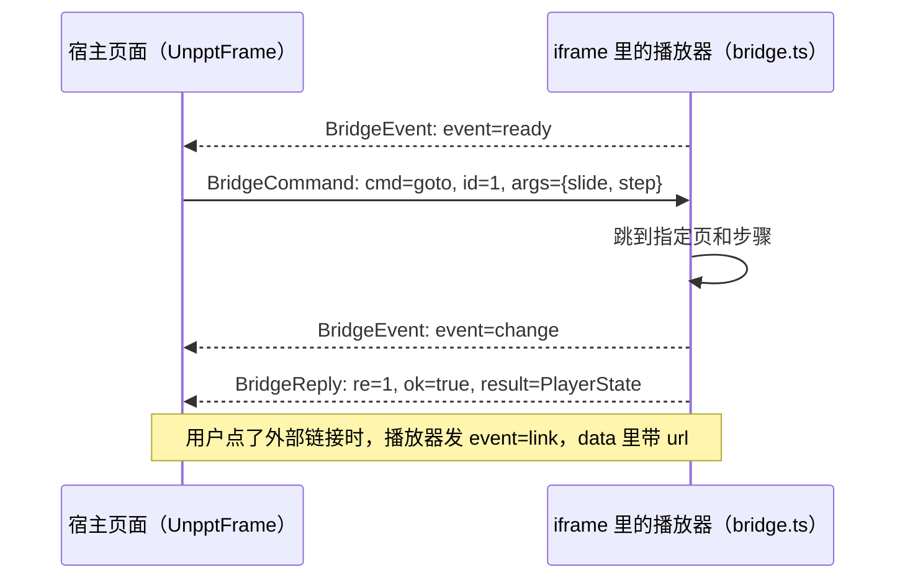

完整的使用方法见 `examples/iframe-host.html`。

---

## 8. 扩展点：加功能 = 加文件 + 注册表一行

"扩展点"就是一个**接口 + 一个注册表数组**。想加一种新东西，新建一个实现这个接口的文件，然后在注册表数组里加一行，不用改别人的代码。

| 扩展点 | 接口所在文件 | 注册表 | 现在注册了什么 |
|---|---|---|---|
| graphicFrame 内容 | `transcoder/src/render/frames/frame-handler.ts` | `FRAME_HANDLERS`（`frames.ts`） | `tableFrame`、`diagramFrame`（SmartArt）、`chartFrame`、`oleFrame` |
| 图表类型 | `transcoder/src/chart/chart-type.ts` | `CHART_TYPES`（`chart-types.ts`） | 柱形/条形、折线、面积、饼、圆环、散点、雷达、气泡、复合饼、股价 |
| 图片格式 | `transcoder/src/media/image-decoder.ts` | `IMAGE_DECODERS`（`decoders.ts`） | EMF、WMF、TIFF |
| 形状效果 | `transcoder/src/effects/shape-effect.ts` | `SHAPE_EFFECTS` / `TEXT_EFFECTS`（`effects.ts`） | 柔化边缘、外阴影、发光、内阴影 |
| 产物形式 | `transcoder/src/output/output.ts` | `OUTPUT_FORMS`（`forms.ts`） | `single`、`paged`、`pages`、`data` |
| 页面切换（播放器） | `player/src/transitions/transition.ts` | `TRANSITIONS`（`transitions.ts`） | 22 种，没注册的按淡入 |
| 进入/退出效果（播放器） | `player/src/anim/effects/anim-effect.ts` | `EFFECTS`（`effects.ts`） | 飞入、擦除、缩放、轮子、百叶窗等，没注册的按淡入淡出 |
| 显现滤镜（播放器） | `player/src/anim/reveal.ts` | `FILTERS` 对象 | `wipe`、`circle`、`wheel` 等 |

### 8.1 转码器的扩展点

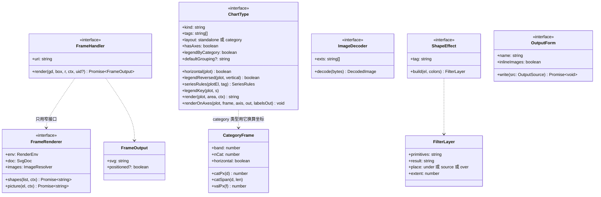

怎么理解这几个接口：

- **`FrameHandler`**：pptx 里表格、图表、SmartArt、OLE 都装在一种叫 graphicFrame 的"框"里，框里 `a:graphicData` 的 `uri` 说明装的是什么。`render.ts` 用 `FRAME_HANDLERS.find((f) => uri.endsWith(f.uri))` 找到对应的 handler。handler 只能通过窄接口 `FrameRenderer` 使用渲染能力（画一组子形状、画一张图片），不依赖具体的渲染器类——这就是"依赖倒置"。
- **`ChartType`**：`layout` 是 `'standalone'` 的图（饼、雷达、散点）自己占满绘图区，实现 `render`；`'category'` 的图（柱形、折线）画在共享的分类轴上，可以组合，实现 `renderOnAxes`，坐标统一用 `CategoryFrame` 的 `catPx` / `catSpan` / `valPx` 换算。标题、图例、坐标轴由 `chart.ts` 统一处理。（图里的 `horizontal`、`legendReversed`、`render`、`renderOnAxes` 在代码里都是可选的方法。）
- **`ImageDecoder`**：浏览器不能直接显示的图片（EMF、WMF、TIFF）在转码时转成能显示的格式；解析不了时返回 `undefined`，不要抛异常。
- **`ShapeEffect`**：一种效果变成 SVG 滤镜的一层，`place` 决定画在形状下面（阴影、发光）、替换形状（柔化边缘）还是盖在上面（内阴影）。
- **`OutputForm`**：怎么把逐页数据写成文件。

### 8.2 播放器的扩展点

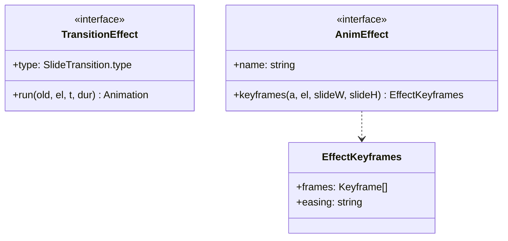

- **`TransitionEffect.run`**：`old` 是旧页面，`el` 是新页面，返回一个 Web Animations 的 `Animation`；它结束时旧页面被移除。
- **`AnimEffect.keyframes`**：给出进入效果的关键帧，退出动画自动倒着播。如果转码器带来了 PowerPoint 原始的动画行为（`AnimAction.behaviors`），播放器优先按行为采样关键帧（`anim/behaviors.ts`），否则才按效果名找 `AnimEffect`。

### 8.3 例子：加一种新的图表类型


每个扩展点的完整规则（例如数据标签怎么取、动画编号怎么拼）见开发者文档 [docs/architecture.md 第 3 节](../architecture.md#3-扩展点)。

---

## 9. 构建流程（`npm run build`）

`npm run build` 执行 `node scripts/build.mjs`，用 **esbuild** 打包。关键是：**先打包播放器，再把播放器代码当作一个字符串"塞进"转码器**，这样转码出来的 HTML 自带播放器。

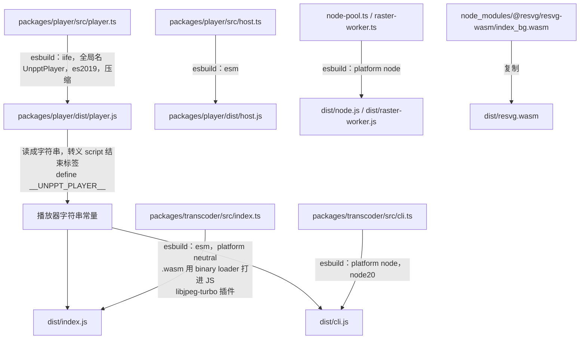

一步一步解释：

1. **播放器**：`player.ts` 打包成 `packages/player/dist/player.js`，格式是 IIFE（立即执行的函数），全局变量名 `UnpptPlayer`，目标 ES2019（兼容更多 WebView）。`host.ts` 单独打成 ESM 模块 `host.js`。
2. **内嵌播放器**：`build.mjs` 读出 `player.js` 的内容，把里面的 `</script` 转义成 `<\/script`（不然会提前结束 HTML 里的 `<script>` 标签），然后通过 esbuild 的 `define` 把它定义成常量 `__UNPPT_PLAYER__`。转码器的 `index.ts` 里声明了 `declare const __UNPPT_PLAYER__: string;`，写产物时作为 `player` 交给 `OutputForm`，`single.ts` 把它写在 HTML 末尾的 `<script>` 里。
3. **转码器库** `dist/index.js`：`platform: 'neutral'`（不绑定 Node 或浏览器），`mainFields: ['module', 'main']`（saxes 等库只写了 `main` 字段）。字体子集化用的 `harfbuzz-subset.wasm` 和 JPEG 编码用的 libjpeg-turbo WASM 通过 `loader: { '.wasm': 'binary' }` **直接打进 JS**。
4. **libjpeg-turbo 插件**（`scripts/esbuild-libjpeg.mjs`）：它的胶水代码在 Node 下会 `require("fs")` 去读 wasm 文件，打成 ESM 后跑不了。插件在打包时把"是否 Node"固定为否、去掉那几处 `require` 和 `__dirname`；如果库升级后写法变了，插件会直接报错，不会悄悄打出坏包。
5. **utif2 的小补丁**：`define` 里把 `window.UDOC` 定义成 `undefined`，否则 Node 里没有 `window` 会抛错。
6. **命令行** `dist/cli.js` 和 **Node 并行出图** `dist/node.js`、`dist/raster-worker.js`：`platform: 'node'`，目标 `node20`。
7. **resvg.wasm**：resvg 的 JS 部分已经打进转码器，`.wasm` 文件复制到 `dist/resvg.wasm`，和 `cli.js` 放在一起发布。命令行运行时读同目录的 `resvg.wasm`；读不到就不出图，但 `prop.json` 照常输出。

发布包 `@unppt/unppt` 的 `package.json` 里：

| 字段 | 值 |
|---|---|
| `exports["."]` | `./dist/index.js`（`convert` 等） |
| `exports["./node"]` | `./dist/node.js`（`createRasterPool` 等 Node 专用） |
| `exports["./resvg.wasm"]` | `./dist/resvg.wasm` |
| `bin.unppt` | `dist/cli.js` |
| `engines.node` | `>=20.12` |

### 9.1 测试和守门

| 命令 | 做什么 |
|---|---|
| `npm test` | 运行 `packages/*/test/*.test.mjs` 单元测试，其中 `architecture.test.mjs` 会运行 `scripts/check-deps.mjs` 检查分层和循环依赖。 |
| `npm run typecheck` | TypeScript 类型检查（`tsconfig` 开了 `noUnusedLocals` / `noUnusedParameters`）。 |
| `node scripts/golden.mjs save` / `check` | 重构安全网：把 `testcases/` 全部转码记下哈希，重构后必须逐字节一致。 |

---

## 10. 第三方库

产品代码只用纯 JS 和 WASM 库，全部固定版本（清单和许可证见 `packages/transcoder/THIRD-PARTY-NOTICES.md`）。**播放器不用任何第三方库**。

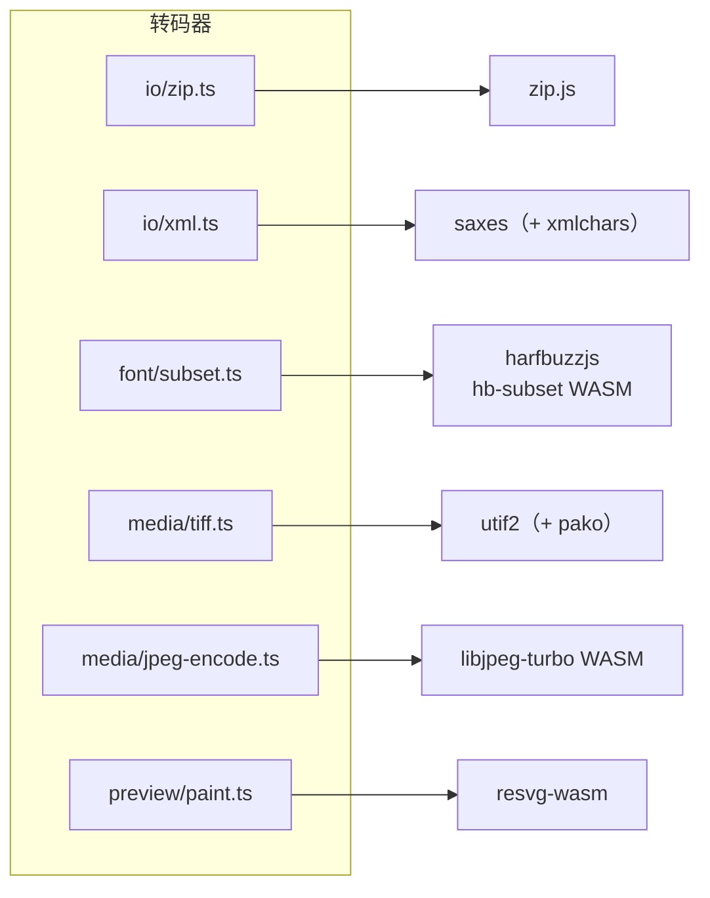

| 库 | 版本 | 许可证 | 在哪用 | 干什么 |
|---|---|---|---|---|
| @zip.js/zip.js（只用只读部分） | 2.23.0 | BSD-3-Clause | `io/zip.ts` | 读 pptx 的 ZIP 目录和条目 |
| saxes（依赖 xmlchars 2.2.0，MIT） | 6.0.0 | ISC | `io/xml.ts` | XML 解析 |
| harfbuzzjs（用其中的 harfbuzz-subset.wasm） | 1.6.3 | MIT | `font/subset.ts` | 字体子集化：只保留用到的字，减小产物体积 |
| utif2（依赖 pako 1.0.11，MIT AND Zlib） | 4.1.0 | MIT | `media/tiff.ts` | TIFF 图片解码，转成 PNG 或 JPEG |
| @cornerstonejs/codec-libjpeg-turbo-8bit（只用编码） | 1.2.8 | libjpeg-turbo：IJG + BSD-3-Clause + Zlib；封装：ISC | `media/jpeg-encode.ts` | 整页图和缩略图的 JPEG 编码 |
| @resvg/resvg-wasm | 2.7.0-alpha.2 | MPL-2.0 | `preview/paint.ts` | 把页面 SVG 画成整页图和缩略图（不用于正式播放） |

开发时还会用到 `esbuild`（打包）、`typescript`（类型检查）、`@types/node`，它们不进发布包。

---

## 11. 开发闭环：怎么保证"和 PowerPoint 一样"

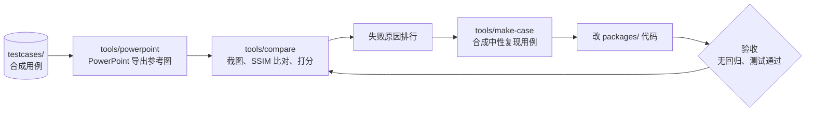

下面是几张对照图，**左边是 Microsoft PowerPoint，右边是 unppt**（都是合成测试用例）：

| 内容 | 对照图 |
|---|---|
| 基础图表 |  |
| 数据标签 |  |
| 三维形状 |  |
| SmartArt |  |
| 表格样式 |  |
| 文字效果 |  |
| 全部预设形状 |  |

播放器界面：


目前的效果（0.1.0）：

| 测试集 | 规模 | 通过率（SSIM ≥ 0.95） | 平均 SSIM |
|---|---|---|---|
| 合成用例 | 228 份 / 504 页 | 92.3% | 0.984 |
| 随机抽取的真实课件 | 100 份 / 3527 页，0 份转码失败 | 78.8%（约 95% 的页 SSIM ≥ 0.90） | 0.967 |

多数没通过的页只差在细节上（文字位置差几个像素、某个图表标签）。已知还没做好的：图表日期轴的时间刻度（最小值/最大值、按月/年的间隔）、`wordArtVert` 竖排文字、可变字体、EMF 图片里的 EMF+ 记录、部分需要重新布局的 SmartArt、180 度旋转下的三维棱台、45 度分类标签的截断阈值。

---

## 12. 延伸阅读

- [docs/architecture.md](../architecture.md)：开发者版架构文档，每个模块、每个扩展点的完整规则。
- [SPEC.md](../../SPEC.md)：需求、已确认的决策、实测得到的 PowerPoint 规则。
- [CONTRIBUTING.md](../../CONTRIBUTING.md)：多人协作约定。
- [README.md](../../README.md)：安装和快速上手。
