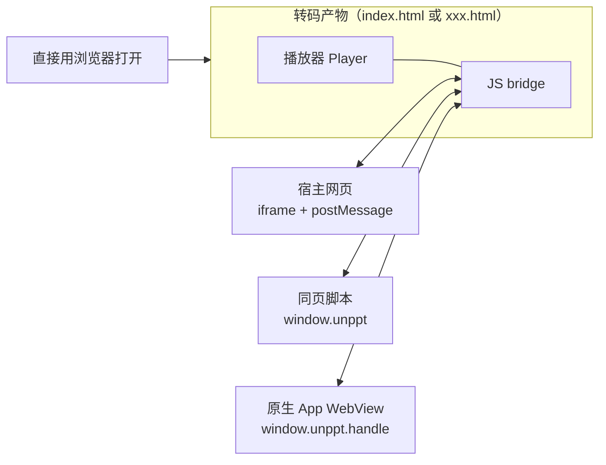
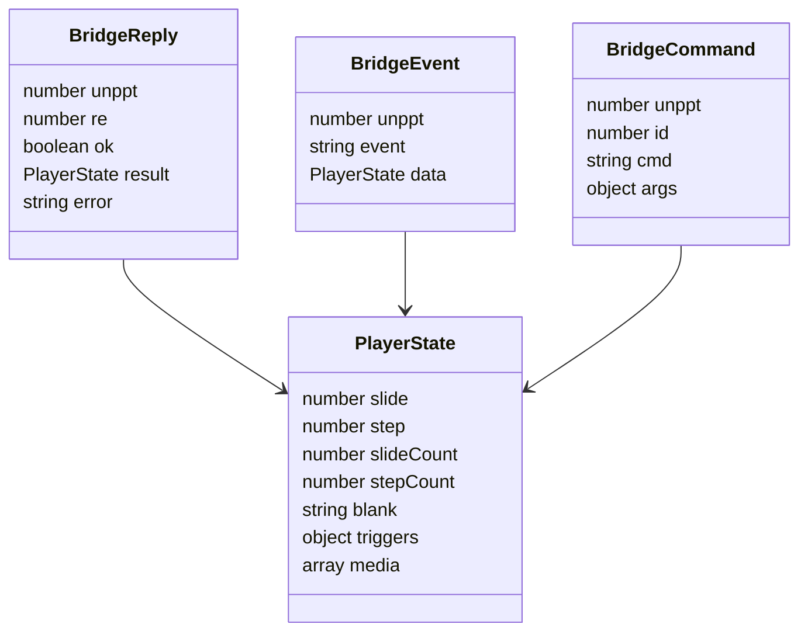
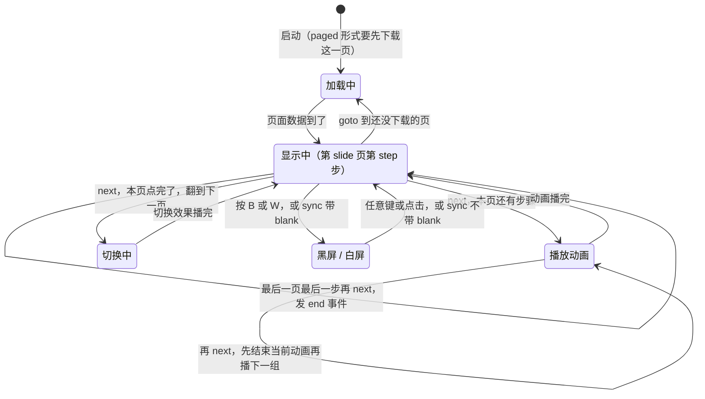
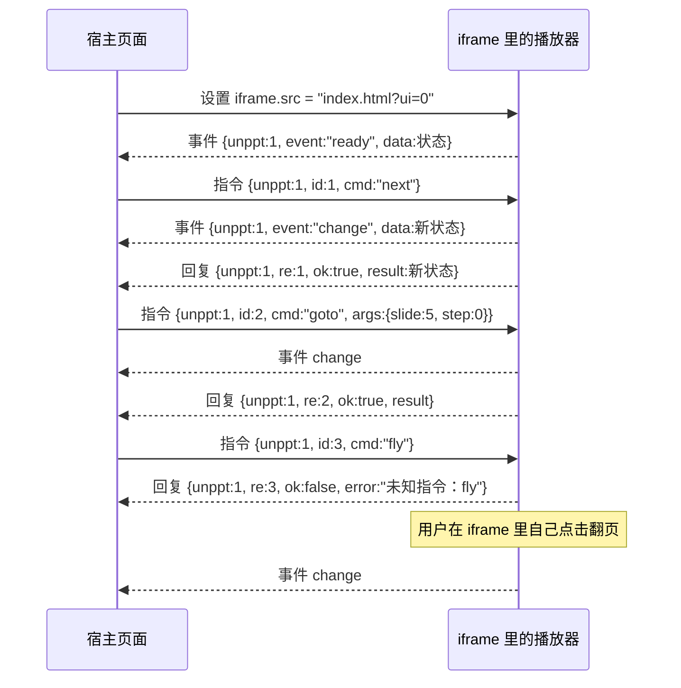
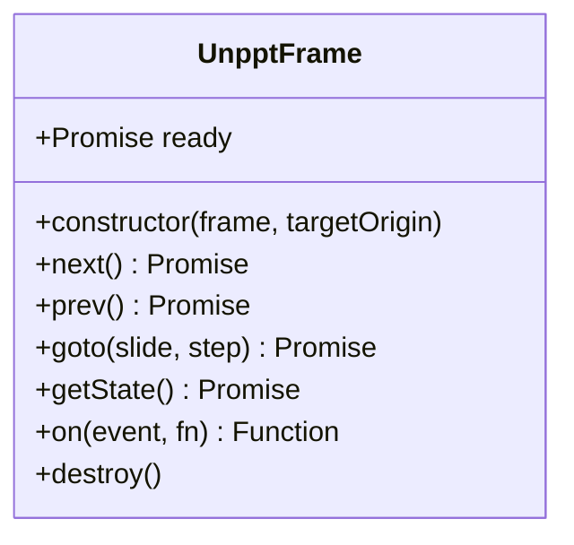
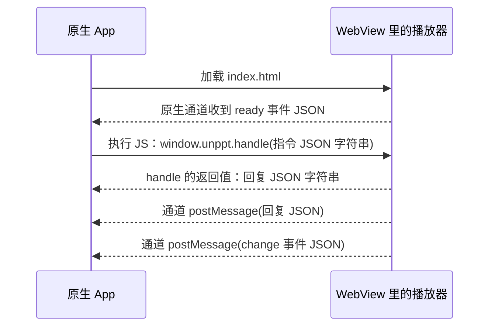
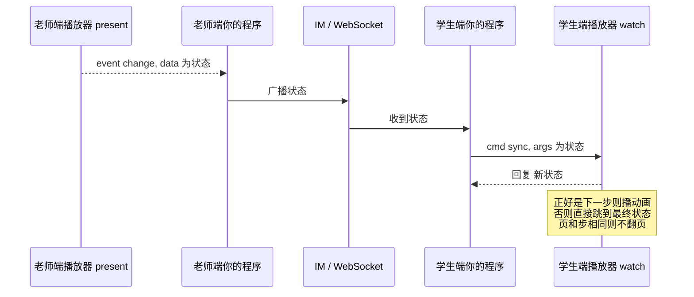
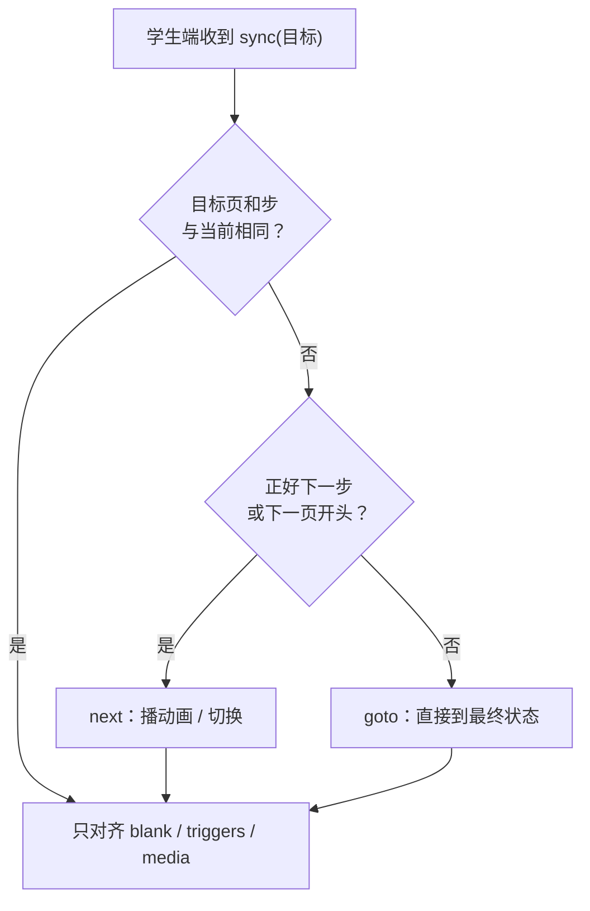
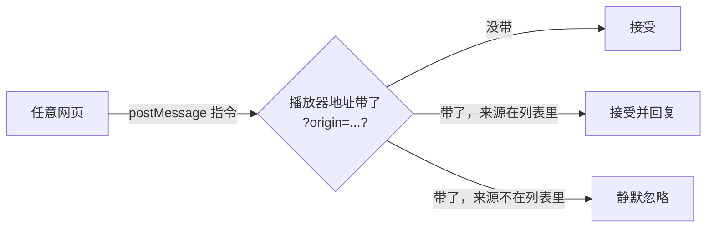

[English](../en/embedding.md)

# 嵌入与控制播放器

这篇文档讲：转码出来的课件怎么放进**你自己的网页或 App**，以及怎么用代码控制它（翻页、跳页、监听页码变化、直播课同步）。

读完你会知道：

- 最简单的用法：直接打开 HTML；
- 用 `<iframe>` 把播放器嵌进自己的页面；
- 播放器的 **JS bridge**（JS 桥接口）有哪些指令和事件；
- 宿主页面和 iframe 之间的 `postMessage` 消息长什么样；
- 原生 App（iOS / Android / React Native）的 WebView 怎么接；
- 地址参数（`?ui=0`、`?slide=3` 等）；
- 直播课的"老师端 / 学生端"同步；
- 安全注意事项（来源检查）。

> 所有指令名、字段名、参数名都来自源码：`packages/format/src/index.ts`（消息格式）、`packages/player/src/bridge.ts`（桥接口）、`packages/player/src/boot.ts`（地址参数）、`packages/player/src/host.ts`（宿主小工具）、`packages/player/src/core/player.ts`（播放器核心）。


---

## 1. 先认识几个词

| 词 | 意思 |
|---|---|
| **播放器** | 一段零依赖的浏览器 JS，负责显示幻灯片、播放动画和切换效果。转码出来的 HTML 里已经自带，不用另外装。 |
| **宿主页面（host）** | 你自己的网页，播放器被嵌在它里面。 |
| **iframe** | HTML 标签 `<iframe src="...">`，在一个网页里嵌入另一个网页。被嵌入的网页有自己独立的 JS 环境。 |
| **postMessage** | 浏览器提供的跨窗口通信方法：`otherWindow.postMessage(数据, 目标源)`。宿主页面和 iframe 不在同一个域名时，只能靠它通信。 |
| **源（origin）** | 协议 + 域名 + 端口，例如 `https://a.com:443`。浏览器按源来判断"是不是同一个网站"。 |
| **WebView** | 原生 App 里嵌入的浏览器控件（iOS 的 `WKWebView`、Android 的 `WebView`、React Native 的 `react-native-webview`）。 |
| **JS bridge** | unppt 播放器对外提供的一套控制协议：同一套指令和事件，支持同页 JS、iframe、原生 WebView 三种宿主。 |
| **页（slide）/ 步（step）** | 都从 **0** 开始数。"步"是这一页已经点击了几次（每次点击播放一组动画）。第 0 步是刚进入这一页、还没点击的样子。 |

---

## 2. 整体关系图



三种控制方式，**指令和事件格式完全一样**（定义在 `@unppt/format` 的 `BridgeCommand` / `BridgeEvent` / `BridgeReply`），只是"信封"不同。

---

## 3. 方式一：直接打开 HTML

最简单。先转码（命令详见使用说明）：

```bash
npm install -g @unppt/unppt
unppt convert 课件.pptx                     # 得到 课件.html（single 形式，一个文件）
unppt convert 课件.pptx --output paged      # 得到 课件/ 目录，入口 课件/index.html
```

然后：

- **single 形式**：双击 `课件.html` 就能播放，也可以把这个文件放到任何静态服务器上；
- **paged / pages 形式**：把整个目录上传到静态服务器，打开 `index.html`。每页数据用 `<script>` 标签按需加载（不用 `fetch`），所以本地 `file://` 双击打开也能用。`pages` 形式另外还有每页一个独立的 `page-001.html`、`page-002.html`……

打开后可以这样操作（和 PowerPoint 放映习惯一致，见 `packages/player/src/ui/input.ts`）：

| 操作 | 效果 |
|---|---|
| 单击画面 / → / ↓ / PageDown / 空格 / 回车 | 下一步 |
| ← / ↑ / PageUp / Backspace | 上一步 |
| Home / End | 第一页 / 最后一页 |
| 输入数字后按回车（2 秒内） | 跳到那一页（从 1 开始，含隐藏页） |
| B 或 `.` | 黑屏；W 或 `,` 白屏；再按任意键或点击回到幻灯片 |
| 触屏左右滑动 | 下一步 / 上一步 |
| 鼠标移到画面上 | 显示自带的 `‹ 1 / 10 ›` 翻页按钮 |

---

## 4. 方式二：用 iframe 嵌入自己的页面

### 4.1 只显示，不控制

把产物放到服务器上（假设地址是 `https://cdn.example.com/deck/index.html`），在你的页面里写：

```html
<div style="width:960px; aspect-ratio:16/9;">
  <iframe src="https://cdn.example.com/deck/index.html"
          style="width:100%; height:100%; border:0;"
          allow="autoplay; fullscreen"></iframe>
</div>
```

播放器会**按比例缩放到 iframe 大小**，多余的地方留黑边，所以 iframe 的宽高比最好和幻灯片一样（常见 16:9）。`allow="autoplay"` 让课件里的音视频更容易自动播放。

### 4.2 地址参数

在播放器地址后面加参数就能改变行为（读取代码在 `packages/player/src/boot.ts` 的 `readParams`）：

| 参数 | 例子 | 作用 |
|---|---|---|
| `slide` | `?slide=3` | 打开时直接到第 4 页（从 0 开始） |
| `step` | `?slide=3&step=1` | 打开到第 4 页第 1 步的最终状态 |
| `ui` | `?ui=0` | 隐藏自带的翻页按钮（点击、键盘、触屏照常能翻页），由你自己做按钮 |
| `mode` | `?mode=watch` | 观看模式：只能由 JS 接口驱动（直播课学生端，见第 8 节）。默认 `present` 演绎模式 |
| `links` | `?links=0` | 点课件里的外部网址时**不**自动打开新窗口，只发 `link` 事件，由宿主决定怎么办 |
| `timings` | `?timings=0` / `?timings=1` | 关闭 / 打开"按排练计时自动换片"。没写时：带了 `slide` 或 `step` 就不自动换片，否则按课件里的设置 |
| `static` | `?static=1` | 每页所有对象原样显示，不放动画（比对工具用，一般不需要） |
| `origin` | `?origin=https://a.com,https://b.com` | 只接受这些源发来的指令（安全，见第 9 节） |

多个参数用 `&` 连接，例如 `index.html?ui=0&slide=2&origin=https://a.com`。

---

## 5. JS bridge：指令、事件和状态

### 5.1 指令

| 指令 `cmd` | 参数 `args` | 作用 | 返回 |
|---|---|---|---|
| `next` | 无 | 下一步；本页点完了就翻到下一页（跳过隐藏页）；最后一页最后一步再 `next` 会发 `end` 事件 | 新状态 |
| `prev` | 无 | 上一步；在第 0 步时回到上一页的最后一步 | 新状态 |
| `goto` | `{ slide, step }` | **确定性跳转**：直接显示目标页、目标步的最终状态，不播切换和动画，不依赖之前播过什么 | 新状态 |
| `sync` | 整个状态（`PlayerState` 的各项） | 观看端跟上演绎端：正好是下一步时播动画，否则直接跳（第 8 节） | 新状态 |
| `getState` | 无 | 读当前状态 | 当前状态 |

不认识的指令会返回失败：`ok: false`，`error` 里写原因。

### 5.2 事件

| 事件 `event` | 什么时候发 | 数据 `data` |
|---|---|---|
| `ready` | 播放器启动好（只通过 iframe / 原生通道发） | 状态 |
| `change` | 翻页、走一步、点触发器、黑屏/白屏、音视频播放/暂停/拖进度之后 | 状态 |
| `end` | 已经在最后一页最后一步，还继续 `next`（循环放映时不发） | 状态 |
| `link` | 点击了课件里的外部网址 | 状态 + `url` |

### 5.3 状态 `PlayerState`



| 结构 | 字段 | 说明 |
|---|---|---|
| `PlayerState` | `slide` / `step` | 当前页、当前步，都从 0 开始 |
| | `slideCount` | 总页数，**包含隐藏页**（顺序翻页会跳过隐藏页，`goto` 可以跳过去） |
| | `stepCount` | 当前页主序列的点击次数，不含触发器动画 |
| | `blank`（可选） | 黑屏 / 白屏的颜色，正常显示幻灯片时没有这一项 |
| | `triggers`（可选） | 这一页每个触发器已经播到第几组，`{ 形状编号: 组数 }`，点过的才有 |
| | `media`（可选） | 这一页播放过的音视频：`[{ uid, playing, time }]`，`time` 单位秒 |
| `BridgeCommand` | `unppt` | 固定为 `1` |
| | `id`（可选） | 数字或字符串，回复里的 `re` 会等于它 |
| | `cmd` | `next` / `prev` / `goto` / `sync` / `getState` |
| | `args`（可选） | `goto` 用 `slide`、`step`；`sync` 带整个状态 |
| `BridgeReply` | `unppt`、`re`、`ok` | `re` 等于指令的 `id`（没给 `id` 时是 0）；`ok` 是否成功 |
| | `result` / `error` | 成功时是新状态；失败时是原因 |
| `BridgeEvent` | `unppt`、`event`、`data` | `event` 是 `ready` / `change` / `end` / `link`；`link` 的 `data` 额外带 `url` |

一个真实的状态例子：

```json
{ "slide": 2, "step": 1, "slideCount": 12, "stepCount": 3 }
```

意思是：第 3 页（从 0 数是 2），已经点了 1 次，这一页一共要点 3 次，整套 12 页。

每条消息都带 `unppt: 1`，播放器靠它区分"这是给我的消息"，其他消息一律忽略。

### 5.4 播放器状态图



> "显示中"其实带着两个数字：页 `slide` 和步 `step`。每次翻页、走一步（以及点触发器、黑屏白屏、音视频变化），播放器都会**马上**发一次 `change` 事件，不等动画或切换效果播完。

---

## 6. postMessage 协议（宿主页面 ↔ iframe）

### 6.1 消息流程



要点：

1. **指令**由宿主发：`iframe.contentWindow.postMessage({ unppt: 1, id, cmd, args }, 目标源)`；
2. **回复**里的 `re` 等于你发的 `id`，用它把回复和指令对上；
3. **事件**是播放器主动发的（不管是你的指令引起的还是用户自己点的），用 `event` 字段区分；
4. 播放器可能比你的监听代码先加载完，错过 `ready`。保险做法：iframe 的 `load` 事件里再发一次 `getState`（官方的 `UnpptFrame` 就是这么做的）。

### 6.2 不用任何库：完整可复制的例子

把下面保存成 `host.html`，和转码出来的 `index.html` 放在同一个目录（或者把 `src` 改成你的地址），用静态服务器打开即可：

```html
<!doctype html>
<html lang="zh">
<head>
<meta charset="utf-8">
<title>我的课件页面</title>
<style>
  .frame { width: 100%; max-width: 960px; aspect-ratio: 16 / 9; background: #000; }
  .frame iframe { width: 100%; height: 100%; border: 0; display: block; }
</style>
</head>
<body>
<div class="frame">
  <iframe id="player" src="index.html?ui=0" allow="autoplay; fullscreen"></iframe>
</div>
<p>
  <button id="prev">上一步</button>
  <button id="next">下一步</button>
  <button id="first">回到第一页</button>
  <span id="info">加载中…</span>
</p>
<script>
  const iframe = document.getElementById('player');
  // 播放器所在的源。同源时写 location.origin；跨域时写播放器的域名，例如 'https://cdn.example.com'
  const PLAYER_ORIGIN = location.origin;
  let seq = 0;
  const waiting = new Map();

  // 发指令，返回 Promise（拿到回复后 resolve）
  function send(cmd, args) {
    const id = ++seq;
    return new Promise((resolve, reject) => {
      waiting.set(id, { resolve, reject });
      iframe.contentWindow.postMessage({ unppt: 1, id, cmd, args }, PLAYER_ORIGIN);
    });
  }

  // 收消息：回复 or 事件
  window.addEventListener('message', (e) => {
    if (e.source !== iframe.contentWindow) return;   // 只认自己的 iframe
    const d = e.data;
    if (!d || d.unppt !== 1) return;                 // 不是 unppt 的消息
    if ('re' in d) {                                 // 回复
      const w = waiting.get(Number(d.re));
      if (!w) return;
      waiting.delete(Number(d.re));
      d.ok ? w.resolve(d.result) : w.reject(new Error(d.error));
      return;
    }
    if (d.event === 'ready' || d.event === 'change') show(d.data);
    if (d.event === 'end') alert('已经是最后一页了');
  });

  // 防止错过 ready：iframe 加载完主动问一次
  iframe.addEventListener('load', () => send('getState').then(show));

  function show(s) {
    document.getElementById('info').textContent =
      `第 ${s.slide + 1} / ${s.slideCount} 页，第 ${s.step} / ${s.stepCount} 步`;
  }

  document.getElementById('prev').onclick = () => send('prev');
  document.getElementById('next').onclick = () => send('next');
  document.getElementById('first').onclick = () => send('goto', { slide: 0, step: 0 });
</script>
</body>
</html>
```

> 注意：用 `file://` 双击打开宿主页面时，浏览器把源当成 `"null"`，`PLAYER_ORIGIN` 只能写 `'*'`。正式部署请用 http(s)。

### 6.3 用官方小工具 `UnpptFrame`（host.js）

仓库里有一个零依赖的宿主小工具 `packages/player/src/host.ts`，它把上面那段代码封装成了一个类。

> **获取方式**：npm 上目前只发布了转码器 `@unppt/unppt`（见 `docs/release.md`），`@unppt/player` 和 `host.js` 还没有单独发布。请从源码构建：克隆仓库后执行 `npm install`、`npm run build`，把生成的 `packages/player/dist/host.js` 拷到你的项目里。



- 构造参数：`new UnpptFrame(iframe元素, targetOrigin = '*')`；`ready` 在播放器就绪时得到第一份状态；
- `next` / `prev` / `goto(slide, step = 0)` / `getState` 都返回 `Promise<PlayerState>`；
- `on(event, fn)` 返回一个取消监听的函数；`destroy()` 移除监听，未完成的指令全部失败；
- `targetOrigin`：播放器页面所在的源，默认 `'*'`，**生产环境建议填写具体域名**；
- 每条指令 10 秒没有回复就失败（错误信息"播放器没有响应"）；
- `on` 的 TypeScript 类型只列了 `'ready' | 'change' | 'end'`；`link` 事件在运行时也能收到（普通 JS 里直接写 `on('link', fn)` 即可）；
- 它**没有** `sync` 方法，直播课同步请直接发 postMessage（见第 8 节）。

完整例子（`examples/iframe-host.html` 是同样思路的演示页；它用 `import { UnpptFrame } from './host.js'`，运行前要先把构建出的 `host.js` 拷到 `examples/` 目录，再用 `?src=课件地址` 打开）：

```html
<!doctype html>
<html lang="zh">
<head><meta charset="utf-8"><title>UnpptFrame 示例</title></head>
<body>
<iframe id="player" src="https://cdn.example.com/deck/index.html?ui=0"
        style="width:960px;height:540px;border:0" allow="autoplay; fullscreen"></iframe>
<p><button id="prev">上一步</button> <button id="next">下一步</button> <span id="info"></span></p>
<script type="module">
  import { UnpptFrame } from './host.js';
  const deck = new UnpptFrame(document.getElementById('player'), 'https://cdn.example.com');
  const info = (s) => { document.getElementById('info').textContent = `${s.slide + 1} / ${s.slideCount}`; };
  info(await deck.ready);
  deck.on('change', info);
  deck.on('end', () => console.log('放完了'));
  document.getElementById('prev').onclick = () => deck.prev();
  document.getElementById('next').onclick = () => deck.next();
  // await deck.goto(3, 0);   // 跳到第 4 页
  // deck.destroy();          // 不用了记得销毁，移除监听
</script>
</body>
</html>
```

---

## 7. 同页 JS 与原生 App WebView

### 7.1 同页 JS：`window.unppt`

播放器启动后会在**它自己的页面**里挂一个 `window.unppt` 对象（`packages/player/src/bridge.ts` 的 `UnpptApi`）。如果你能在播放器页面里运行脚本（比如自己改了产物、或者用浏览器控制台、或者自动化测试），可以这样用：

```js
await window.unppt.next();
await window.unppt.goto({ slide: 3, step: 0 });   // 也可以写 goto(3, 0)
const s = await window.unppt.getState();
const off = window.unppt.on('change', (s) => console.log(s.slide, s.step));
off();                                           // 取消监听，等同于 window.unppt.off('change', fn)
```

| 方法 | 说明 |
|---|---|
| `next()` / `prev()` / `getState()` | 返回 `Promise<PlayerState>` |
| `goto(target, step?)` | `target` 可以是数字（页号）或 `{ slide, step }` |
| `sync(target, step?)` | 同上，直播课观看端用 |
| `on(event, fn)` / `off(event, fn)` | 监听 `change`、`end`、`link`（`ready` 只通过 iframe / 原生通道发，`on('ready')` 收不到） |
| `handle(message)` | 给原生 App 用：传入 JSON 字符串指令，**同步**返回 JSON 字符串回复 |
| `player` | 底层的 `Player` 对象（高级用法） |

`window.unppt` 在页面 `DOMContentLoaded` 之后才有，使用前先判断它是否存在。

### 7.2 原生 App 的 WebView



**App → 播放器**：执行 JS `window.unppt.handle('<指令 JSON>')`。`unppt: 1` 可以不写（`handle` 会自动补上）。返回值就是回复的 JSON 字符串；不是合法 JSON 时回复 `{"unppt":1,"re":0,"ok":false,"error":"指令不是合法的 JSON"}`。

**播放器 → App**：播放器会自动探测下面三个通道，存在哪个就调用哪个，发的都是 **JSON 字符串**（事件和回复都发）：

| 平台 | 播放器调用 | App 端要做的事 |
|---|---|---|
| iOS（WKWebView） | `window.webkit.messageHandlers.unppt.postMessage(json)` | 注册名字叫 `unppt` 的 `WKScriptMessageHandler` |
| Android（WebView） | `window.UnpptNative.postMessage(json)` | `addJavascriptInterface(对象, "UnpptNative")`，对象上有 `@JavascriptInterface postMessage(String)` 方法 |
| React Native | `window.ReactNativeWebView.postMessage(json)` | `<WebView onMessage={...}>` |

Android 示例（Kotlin）：

```kotlin
webView.settings.javaScriptEnabled = true
webView.addJavascriptInterface(object {
    @JavascriptInterface
    fun postMessage(json: String) {
        // json 例如 {"unppt":1,"event":"change","data":{"slide":1,"step":0,"slideCount":10,"stepCount":2}}
        Log.d("unppt", json)
    }
}, "UnpptNative")
webView.loadUrl("https://cdn.example.com/deck/index.html?ui=0")

// 翻到下一步
webView.evaluateJavascript("window.unppt.handle('{\"id\":1,\"cmd\":\"next\"}')", null)
```

iOS 示例（Swift）：

```swift
class Bridge: NSObject, WKScriptMessageHandler {
    func userContentController(_ c: WKUserContentController, didReceive m: WKScriptMessage) {
        if let json = m.body as? String { print("unppt:", json) }
    }
}
let config = WKWebViewConfiguration()
config.userContentController.add(Bridge(), name: "unppt")
let webView = WKWebView(frame: .zero, configuration: config)
webView.load(URLRequest(url: URL(string: "https://cdn.example.com/deck/index.html?ui=0")!))

// 跳到第 4 页
webView.evaluateJavaScript("window.unppt.handle('{\"id\":2,\"cmd\":\"goto\",\"args\":{\"slide\":3,\"step\":0}}')")
```

React Native 示例：

```jsx
import { WebView } from 'react-native-webview';

const ref = useRef(null);
<WebView
  ref={ref}
  source={{ uri: 'https://cdn.example.com/deck/index.html?ui=0' }}
  onMessage={(e) => console.log('unppt:', JSON.parse(e.nativeEvent.data))}
/>;
// 下一步
ref.current.injectJavaScript(`window.unppt.handle('{"id":1,"cmd":"next"}'); true;`);
```

> **小程序 web-view 例外**（SPEC D12）：小程序里网页发给小程序的消息只在后退、分享、销毁时才送达，收不到实时事件。替代办法是修改 web-view 的地址（`?slide=3&step=1` 深链接）来跳页。

### 7.3 自己托管播放器：`mount`（高级）

如果你想把转码和播放拆开——转码只输出数据（`unppt convert 课件.pptx --data` 得到 `deck.json`），播放器由你自己的页面加载——可以用播放器的 `mount` 函数：

```js
// player.js 是 IIFE 格式，全局名 UnpptPlayer
const player = UnpptPlayer.mount(document.getElementById('box'), deckJson, {
  ui: true, mode: 'present', baseUrl: 'decks/demo/',   // baseUrl：deck.json 里字体文件的相对路径前缀
});
player.on('change', (s) => console.log(s));
player.next();          // 注意：Player 的方法是同步的，直接返回 PlayerState
player.goto(3, 0);
player.destroy();
```

`mount` 的选项（`MountOptions`）：`slide`、`step`、`ui`、`openLinks`、`timings`、`static`、`mode`、`clickToNext`（点击画面是否翻页，默认是）、`keyboard`（键盘翻页，默认开）、`baseUrl`。页面 SVG 里的图片和音视频是 `media/...` 相对路径，按**你的页面地址**解析，所以要把 `media/` 目录放在页面旁边。

> 和 `host.js` 一样，`player.js` 目前没有单独发布到 npm，需要从源码构建得到 `packages/player/dist/player.js`。大多数情况下直接用转码出来的 HTML + iframe 更省事。

---

## 8. 直播课：老师端 / 学生端同步

场景：老师和学生看同一份课件，老师翻页，学生端自动跟着翻。**播放器只提供基础能力**，消息怎么从老师传到学生（IM、WebSocket……）由你的程序负责。

### 8.1 两种模式

| | 演绎模式 `present`（默认） | 观看模式 `watch` |
|---|---|---|
| 打开方式 | `index.html` 或 `?mode=present` | `index.html?mode=watch` |
| 点击、键盘、触屏翻页 | 可以 | 不响应 |
| 翻页按钮、音视频控制条 | 有 | 没有按钮，控制条不响应 |
| 超链接、触发器 | 能点 | 不响应 |
| 按计时自动换片 | 按课件设置 | 不自动 |
| JS 接口 | 可以用 | 可以用（唯一的驱动方式） |

### 8.2 同步原理：一句话

> **把老师端的每个 `change` 事件的 `data`，原样交给学生端的 `sync` 指令。**



`sync` 的规则（`packages/player/src/core/player.ts` 的 `sync` 方法）：

- 目标正好是**下一步**，或者当前页已经播完、目标是**下一页的开头**：和自己点一样，播动画和切换效果；
- 页和步都和现在**一样**：不翻页，只对齐下面说的附加部分（重复收到同一条消息没关系）；
- 其它情况（学生中途进入、掉线重连、丢了几条消息）：直接跳到目标的最终状态；
- 状态里的附加部分也会对齐：`blank`（黑屏/白屏）、`triggers`（触发器播到第几组）、`media`（音视频是否在播、当前时间；相差超过 **1.5 秒**才拖进度，避免网络延迟导致来回抖动）。



### 8.3 完整例子（同一个页面里模拟老师和学生）

仓库里的 `examples/live-class.html` 就是这个例子：左边老师端、右边学生端，页面脚本扮演"IM"。精简版如下（把 `index.html` 换成你的课件地址）：

```html
<!doctype html>
<html lang="zh">
<head>
<meta charset="utf-8">
<title>直播课同步</title>
<style>
  .row { display: flex; gap: 16px; }
  .row iframe { width: 480px; height: 270px; border: 0; background: #000; }
</style>
</head>
<body>
<div class="row">
  <div>老师端<br><iframe id="teacher" src="index.html?mode=present" allow="autoplay"></iframe></div>
  <div>学生端<br><iframe id="student" src="index.html?mode=watch" allow="autoplay"></iframe>
    <br><button id="rejoin">模拟学生重新进入</button></div>
</div>
<script>
  const teacher = document.getElementById('teacher');
  const student = document.getElementById('student');
  let last = null, id = 0;

  // 真实场景里：老师端把 data 发到 IM，学生端从 IM 收到后执行 toStudent(data)
  function toStudent(state) {
    student.contentWindow.postMessage({ unppt: 1, id: ++id, cmd: 'sync', args: state }, '*');
  }

  window.addEventListener('message', (e) => {
    const d = e.data;
    if (!d || d.unppt !== 1 || !d.event) return;
    if (e.source === teacher.contentWindow && (d.event === 'change' || d.event === 'ready')) {
      last = d.data;          // 记住老师当前的状态
      toStudent(d.data);
    }
    // 学生端（重新）启动好以后，用老师当前状态对齐
    if (e.source === student.contentWindow && d.event === 'ready' && last) toStudent(last);
  });

  document.getElementById('rejoin').onclick = () => {
    student.src = 'index.html?mode=watch&t=' + Date.now();
  };
</script>
</body>
</html>
```

实践建议：

- **新学生进来 / 掉线重连**：等学生端发出 `ready`，再把老师**最新**的状态发一次 `sync`；
- **自动播放限制**：学生端浏览器可能禁止"没有点击就自动播放声音"，请在你的页面上先让学生点一下（例如"进入课堂"按钮）；
- 仓库的 `tools/check-live.py` 会用浏览器自动检查这些行为：观看模式没有翻页按钮、点击和按键不翻页、同步后两边页码一致、黑屏/触发器/音视频状态一致、学生中途进入能对齐。

---

## 9. 安全注意事项



1. **限制谁能控制播放器**：在播放器地址上加 `?origin=https://你的域名`（多个用逗号分隔）。之后：
   - 其他源发来的指令会被**静默忽略**（不回复）；
   - 播放器的事件只发给列表里的源（`postMessage(msg, 那个源)`），别的网站嵌了你的课件也收不到事件。
   - 不加这个参数时，**任何**嵌入了播放器的页面都能控制它、收到它的事件。公开课件无所谓；有权限要求的课件请加上。
2. **宿主页面也要检查来源**：收消息时先判断 `e.source === iframe.contentWindow`（只认自己的 iframe），再判断 `e.data.unppt === 1`；跨域时最好再检查 `e.origin` 是不是播放器的域名。
3. **发指令时写明目标源**：`postMessage(msg, 'https://cdn.example.com')` 而不是 `'*'`，`UnpptFrame` 的第二个参数同理。这样即使 iframe 被导航到别的网站，指令也不会发过去。
4. **外部链接**：播放器只打开 `http(s):`、`mailto:`、`tel:` 链接，并且总是在新标签页打开（`noopener,noreferrer`），不会把播放器所在页面跳走。如果你想先提示用户，加 `?links=0`，然后自己处理 `link` 事件里的 `url`。
5. **原生通道**：App 端收到的 JSON 来自网页，解析时按普通外部输入对待；只加载你自己托管的课件地址。

---

## 10. 常见问题

| 问题 | 原因和办法 |
|---|---|
| 收不到 `ready` | 播放器比你的监听代码先启动好了。在 iframe 的 `load` 事件里发一次 `getState`。 |
| 指令发出去没反应 | 检查消息里有没有 `unppt: 1` 和字符串类型的 `cmd`；检查播放器地址的 `?origin=` 是否包含你的源。 |
| `window.unppt` 是 `undefined` | 宿主页面里没有这个对象——它在**播放器页面**里。跨 iframe 请用 postMessage。 |
| 页码差 1 | 接口里的 `slide`、`step` 都从 0 开始，显示给用户时加 1。 |
| `goto` 之后没有动画 | 这是设计：`goto` 直接显示最终状态。想要动画请用 `next`。 |
| 学生端没有声音 | 浏览器自动播放限制，让学生先点一下页面。 |
