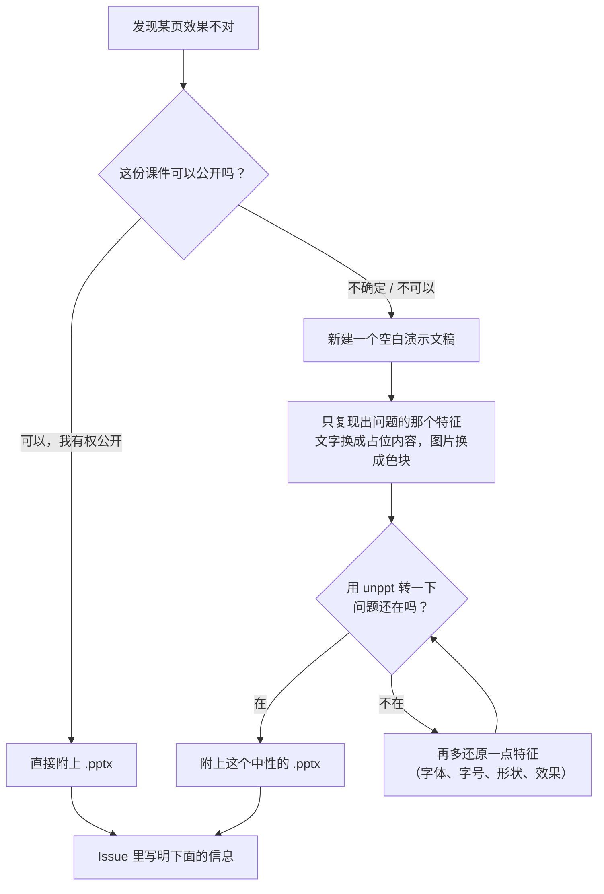

[English](../en/faq.md)

# 常见问题（FAQ）

这里收集使用 unppt 时最常遇到的问题。每个问题都尽量给出可以直接复制的命令。

目录：

- [字体](#字体)
- [文字换行和 PowerPoint 不一样](#文字换行和-powerpoint-不一样)
- [产物大小和内存](#产物大小和内存)
- [超大文件](#超大文件)
- [支持哪些功能](#支持哪些功能)
- [已知差距](#已知差距)
- [支持哪些浏览器](#支持哪些浏览器)
- [怎样安全地反馈效果不对的课件](#怎样安全地反馈效果不对的课件)
- [版本号](#版本号)

---

## 字体

### 问：转码时提示"缺少字体：xxx"，是什么意思？

转码器要知道每个字有多宽，才能算出一行放几个字、在哪里换行。它**只能使用你交给它的字体文件**（转码器是纯函数，自己不会去翻系统目录）。如果课件用到的字体你没提供，就会：

1. 在命令行输出 `缺少字体：xxx`，代码里在 `result.report.missingFonts` 里列出；
2. 按 PowerPoint 的替代规则换一个字体来排版（见下表）；
3. **不会报错**，照常输出。

PowerPoint 的替代规则（代码里实测得到的）：

| 缺的字体 | 替代成 |
|---|---|
| 西文字体 | Calibri → Arial → Liberation Sans → Helvetica（按顺序找第一个你提供了的） |
| 标了中文字符集的字体 | 微软雅黑（Microsoft YaHei）→ 等线 → PingFang SC → Noto Sans CJK SC → 思源黑体 |
| 标了日文字符集的字体 | Yu Gothic（游ゴシック），它没有的字再用上一行的中文字体 |
| Helvetica、Helvetica Neue、Helv | Arial |
| Times、Tms Rmn | Times New Roman |
| Courier | Courier New |

替代字体也没有时，只能按估算的字宽排版，换行位置就很可能和 PowerPoint 不同。

### 问：怎么把字体交给转码器？

**命令行：**

```bash
# 用本机系统字体（Windows 上还会用到 Office 自带的私有字体、云字体，例如 Aptos）
npx @unppt/unppt 演示文稿.pptx -o out/index.html --system-fonts

# 指定字体目录（可以写多次；会递归查找 .ttf / .otf / .ttc）
npx @unppt/unppt 演示文稿.pptx -o out/index.html --fonts ./fonts --fonts ./more-fonts
```

**代码里（例如云函数，Linux 上通常没有微软字体，必须自己带）：**

```js
import { readFile } from 'node:fs/promises';
import { convert } from '@unppt/unppt';

const fonts = [
  await readFile('fonts/msyh.ttc'),     // 字体文件的字节（Uint8Array / Buffer）
  await readFile('fonts/calibri.ttf'),
];
const result = await convert(pptxBytes, { write, fonts, embedFonts: true });
console.log(result.report.missingFonts);  // 还缺哪些字体
```

### 问：观看的电脑上没装这个字体，会显示成别的字体吗？

分三种情况：

| 情况 | 观看端显示 |
|---|---|
| 加了 `--embed-fonts`（代码里 `embedFonts: true`） | 用到的字做成**字体子集**嵌入产物，任何设备上都和转码时一样。**推荐** |
| 课件自己嵌入了字体（PowerPoint 里"将字体嵌入文件"） | 总是做成子集嵌入产物，不受开关影响 |
| `--system-fonts` 找到的 Office 私有字体、云字体 | 用到时总是嵌入（浏览器用不了这些没装进系统的字体） |
| 其它情况 | 浏览器用观看端自己装的同名字体；没有就用浏览器的默认无衬线字体，字形会不一样 |

> "字体子集"= 只保留用到的那些字的字体文件，体积比完整字体小得多。
> 注意：商业字体的分发需要相应授权，嵌入前请确认你有权这样做。

---

## 文字换行和 PowerPoint 不一样

最常见的原因，按可能性排序：

1. **转码时缺字体**：看命令行有没有 `缺少字体：` 的输出。把字体交给转码器（见上一节）通常就能解决；
2. **字体版本不同**：同名字体不同版本，字宽可能不同。尽量用和做课件的电脑相同的字体文件；
3. **观看端字体不同**：没开 `--embed-fonts` 时，观看端用的是自己的字体，字宽和转码时算的不一样。开 `--embed-fonts` 可以保证"转码时测量用的字体 = 播放时显示的字体"（[SPEC.md](../../SPEC.md) 决策 D3）；
4. **属于已知差距**：例如艺术字竖排（`wordArtVert`）、可变字体，见[已知差距](#已知差距)。

如果以上都排除了，欢迎按[下面的方法](#怎样安全地反馈效果不对的课件)反馈。

---

## 产物大小和内存

### 问：转出来的 HTML 有多大？

产物形式由 `--output` 选择：

| 形式 | 命令 | 输出 | 适合 |
|---|---|---|---|
| `single` | `--output single` | 一个自包含的 HTML，页面、图片、字体、播放器全部内联 | 本地双击打开、发文件 |
| `paged`（命令行默认） | `--output paged` | 目录：入口 `index.html` + 每页单独的数据文件 `pages/`、`fonts/`、`media/`；打开时只加载当前页，并预加载下一页 | 放到网上播放 |
| `pages` | `--output pages` | 在 `paged` 基础上每页再输出一个独立的 `page-001.html` | 需要单页链接时 |
| `data` | `--data` 或 `--output data` | 只输出演示数据 `deck.json` | 开发调试 |

几个影响大小的点：

- **播放器本身很小**：当前构建约 58KB，gzip 后约 21KB；
- **同一张图片只存一份**，多页共用；
- **大图片不内联**：`single` 形式下，超过 2MB（`--inline-limit <字节>` 可改）的图片单独输出到 `media/` 目录；**视频、音频总是单独输出**到 `media/`；文件名带校验码，重新发布后不会被旧缓存串版本；
- 所有形式都会在入口文件旁边输出 `prop.json`（页数、尺寸、每页图片路径、备注、是否隐藏），以及每页的整页图 `pic/<n>.jpg` 和缩略图 `thum/<n>.jpg`。不需要图片时加 `--no-images`，能省下不少时间和空间。

> 把 `media/` 目录放到网上时，服务器要支持 HTTP Range 请求（常见 Web 服务器默认都支持），否则 Chromium 里视频拖不动进度。

### 问：转码要多少内存？

转码器**不会一次性读入整个文件**，而是逐页处理、处理完就释放；视频音频以流的方式原样拷贝。README 里的实测：300 页 + 800MB 视频的文件，限制 128MB 内存，1 秒左右转完，峰值内存约 120MB。

整页图、缩略图是另外的开销：命令行默认按 CPU 数和可用内存（每个线程按 400MB 估）自动决定用几个线程同时画。内存紧张时：

```bash
# 在主线程画图，最省内存
npx @unppt/unppt 演示文稿.pptx -o out/index.html --jobs 1
# 或者干脆不出图
npx @unppt/unppt 演示文稿.pptx -o out/index.html --no-images
# 看用时和峰值内存
npx @unppt/unppt 演示文稿.pptx -o out/index.html --stats
```

---

## 超大文件

### 问：1GB、几百页的课件能转吗？

能，这是设计目标之一（[SPEC.md](../../SPEC.md) 决策 D13）。命令行会自动按位置分段读文件。在自己的代码里，**不要**把整个文件读成 `Uint8Array`，而是传一个"按位置读取"的对象：

```js
import { open, stat } from 'node:fs/promises';
import { convert } from '@unppt/unppt';

const path = 'big.pptx';
const { size } = await stat(path);
const fh = await open(path, 'r');
const source = {
  size,
  async read(offset, length) {
    const buf = new Uint8Array(Math.max(0, Math.min(length, size - offset)));
    const { bytesRead } = await fh.read(buf, 0, buf.length, offset);
    return buf.subarray(0, bytesRead);
  },
};
try {
  await convert(source, { write: async (relPath, data) => { /* 写到你想写的地方 */ } });
} finally {
  await fh.close();
}
```

`write(路径, 数据)` 里的 `data` 可能是字符串、`Uint8Array`，也可能是数据流（`AsyncIterable`，大媒体文件就是这样边读边写的），你的写入函数要三种都能处理。

对网上播放，大课件建议用 `--output paged`：观看者打开时只下载当前页。

---

## 支持哪些功能

下表根据代码里已实现的模块整理（细节规则见 [SPEC.md](../../SPEC.md) 第 7 节）：

| 类别 | 支持情况 |
|---|---|
| 形状 | 全部预设形状、自定义形状（自由曲线）、组合（旋转、翻转、缩放）、连接线和箭头 |
| 填充和线条 | 纯色、渐变（线性、射线、矩形、路径）、图案、图片和纹理填充（拉伸 / 平铺）；虚线、复合线、线端 |
| 效果 | 外阴影、内阴影、发光、柔化边缘、映像、三维棱台和轮廓、三维旋转 |
| 文字 | 母版 / 版式继承、项目符号和编号、自动调整、竖排、中文禁则和标点溢出、文字效果（渐变、图片填充、描边、阴影、发光）、艺术字变形、超链接 |
| 表格 | 合并单元格、内置表格样式、斜线表头、竖排文字 |
| 图表 | 柱形 / 条形、折线、面积、饼图、三维饼图、复合饼图、圆环、雷达、散点、气泡、股价图；数据标签、图例、坐标轴、数据表、图表上画的形状 |
| SmartArt | 用文件里 PowerPoint 保存的绘图缓存显示 |
| 图片 | PNG、JPEG、GIF、BMP、TIFF、EMF、WMF、SVG；裁剪、重新着色、透明色、EXIF 方向 |
| 公式、墨迹 | 显示 PowerPoint 在文件里保存的替代图片 |
| 嵌入对象（OLE） | 显示 PowerPoint 保存的预览图 |
| 音频、视频 | 封面帧、播放控制条、剪裁、淡入淡出、全屏播放、动画声音和切换声音 |
| 动画 | 进入、退出、强调、动作路径动画，触发器，按计时自动播放 |
| 页面切换 | 淡入、推入、擦除、分割、百叶窗、棋盘、溶解、平滑（Morph）等二十多种 |
| 放映 | 隐藏的幻灯片、自动换片时间、循环放映、超链接和动作按钮、B / W 黑屏白屏、输入页码跳转 |

**不支持的：**

- **老格式 `.ppt`**：请先在 PowerPoint 里"另存为" `.pptx` 再转；
- **Office 2016 起新增的图表类型**（瀑布图、旭日图、树状图等，文件里存成 `cx:` 新格式）：代码里没有对应的绘制模块，转码器会使用文件里 PowerPoint 存的替代内容；
- **曲面图**：没有对应的图表类型。

---

## 已知差距

这些情况目前和 PowerPoint 还有明显差别：

| 方面 | 差距 |
|---|---|
| 图表日期坐标轴 | 按时间缩放（最小值 / 最大值、按月 / 年的间隔）还不完整 |
| 竖排文字 | 艺术字竖排（`wordArtVert`） |
| 字体 | 可变字体 |
| 图片 | EMF 图片里的 EMF+ 记录 |
| SmartArt | 部分需要重新布局的 SmartArt |
| 3D | 旋转 180° 时的三维棱台 |
| 图表分类标签 | 45° 倾斜标签的截断阈值 |

整体还原度：合成用例 92.3% 的页、随机真实课件 78.8% 的页达到 SSIM ≥ 0.95，没过线的大多只是细节差几个像素。怎么测的见[还原度](fidelity.md)。

---

## 支持哪些浏览器

| 环境 | 状态 |
|---|---|
| Chrome（及其它 Chromium 内核浏览器） | 支持，Chrome 有端到端自动测试 |
| Firefox | 支持，有端到端自动测试 |
| Android WebView、iOS WKWebView | 目标支持；WebKit 内核还没有自动测试 |
| 小程序 web-view | 能播放；但小程序和网页之间不能实时传消息，只能用改地址（`?slide=3&step=1`）的方式跳转 |
| Safari | 暂不重点兼容 |

产物里的页面按需加载用的是 `<script>` 标签，不用 fetch，所以**本地双击打开（file://）、任意域名托管、iframe 嵌入都能用**。

---

## 怎样安全地反馈效果不对的课件

请到 GitHub 提 Issue：<https://github.com/spitmaster/unppt/issues>

**最重要的一条：只分享你有权分享的文件。** Issue 是公开的，任何人都能下载附件。课件里如果有客户资料、内部数据、个人信息，**不要上传原文件**。

推荐的做法：



Issue 里请写明：

1. unppt 版本（`npx @unppt/unppt` 不带参数运行时第一行就是版本号）；
2. 完整的转码命令，例如 `unppt demo.pptx -o out/index.html --system-fonts --embed-fonts`；
3. 命令行输出的 `缺少字体：` 和 `提示：` 两类信息；
4. 用的浏览器和版本；
5. 对照截图：PowerPoint 放映的画面和 unppt 播放的画面（截图同样只能用可以公开的内容）。

> 这也是项目自己遵守的规则：开发中用到的真实课件从不离开开发机，仓库里只有用 PowerPoint 重新合成的中性测试用例。见[还原度 · 样本安全](fidelity.md#7-样本安全客户文件绝不离开本机)。

---

## 版本号

- 当前版本 **0.2.4**，npm 包名 `@unppt/unppt`，需要 Node.js 20.12 或更高版本；
- 版本号格式是"主版本.次版本.修订号"。0.x 表示还在早期阶段，接口和选项可能随版本调整，升级前请看 GitHub 上的发布说明；
- 每个发布版本在 GitHub 上有对应的标签（`v0.1.0` 这样的格式）；同一个版本号在 npm 上只发布一次；
- 想固定版本：`npm install @unppt/unppt@0.2.4`，或 `npx @unppt/unppt@0.2.4 ...`；查看 npm 上的最新版本：`npm view @unppt/unppt version`；
- **产物格式有自己的版本号**：`deck.json` 里的 `"format": "unppt-deck", "version": 1`。格式有变化时增加这个数字，播放器遇到比自己新的版本会明确报错（提示升级播放器）；
- 每份产物都**带着自己的播放器**，所以已经转好的课件不受以后升级影响；想用新版本的效果，重新转码即可。
