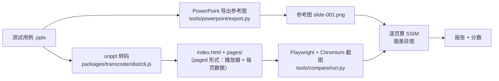
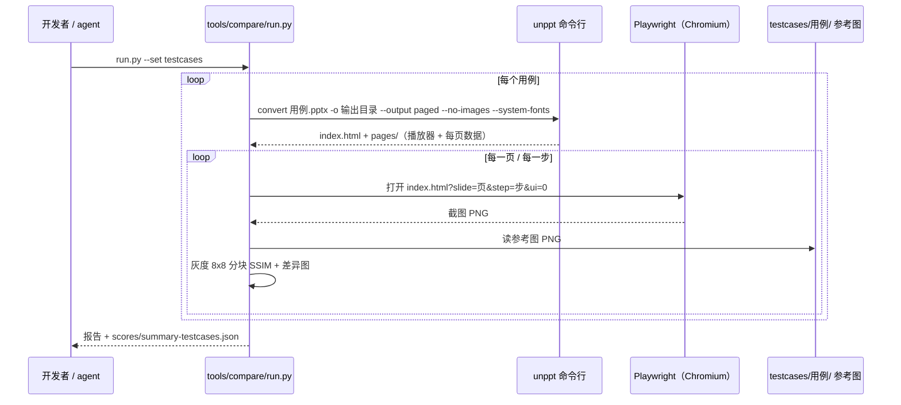
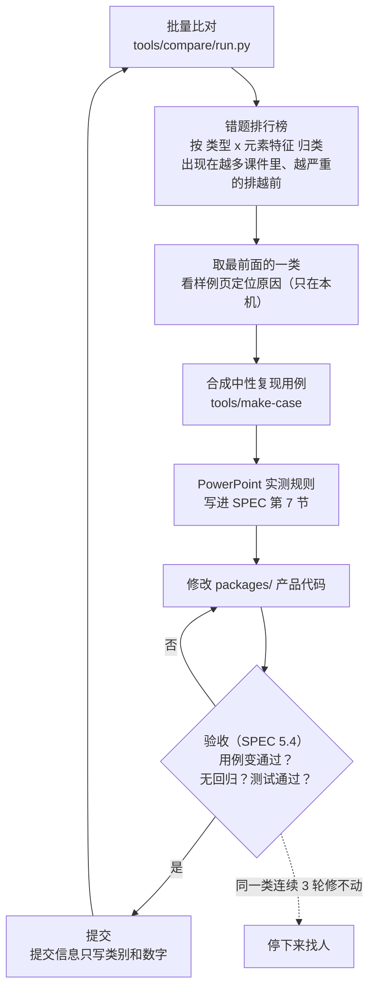
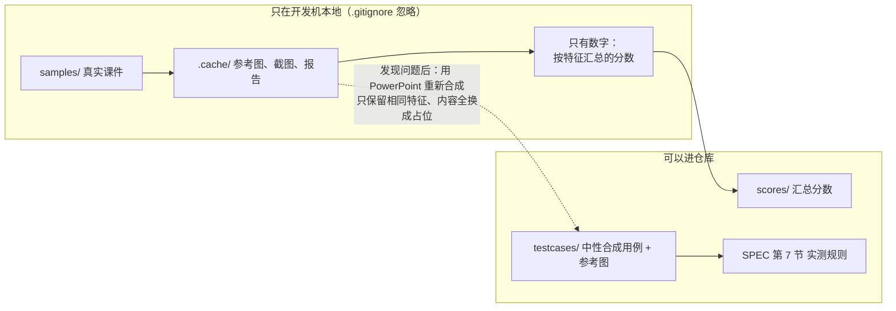

[English](../en/fidelity.md)

# 还原度：怎样才算"和 PowerPoint 一样"

unppt 的目标只有一个：**转出来的页面，看起来要和 Microsoft PowerPoint 放映时一模一样**。
这篇文档讲清楚三件事：

1. "一样"用什么标准来判断；
2. 这个标准是怎么自动测量的（用到哪些工具、每一步做什么）；
3. 现在做到了什么程度，还差在哪里。

> 读这篇文档不需要懂 PowerPoint 文件格式。遇到的术语第一次出现时都会解释。

---

## 1. 唯一的标准答案：本机的 PowerPoint

我们不拿"别的转换器"或者"我觉得应该长这样"做标准，**唯一的标准答案是本机 Microsoft PowerPoint 导出的图片**（[SPEC.md](../../SPEC.md) 决策 D5）。

原因很简单：用户最终是拿 unppt 的结果和 PowerPoint 比的。只要 PowerPoint 怎么画，我们就怎么画——哪怕 PowerPoint 的做法看起来"不合理"。

几个后面会用到的术语：

| 术语 | 意思 |
|---|---|
| **参考图** | 让 PowerPoint 把每一页导出成的图片（宽 1280 像素），也就是"标准答案" |
| **截图** | 用 unppt 转码、在浏览器里用 unppt 播放器打开同一页、截下来的图片 |
| **COM 自动化** | Windows 上用程序远程操作 Office 的接口。我们的 Python 工具通过它（`pywin32` 库）让 PowerPoint 打开文件、导出图片、生成新的演示文稿 |
| **Playwright** | 一个用程序控制浏览器的工具，我们用它打开播放器页面并截图 |
| **SSIM** | Structural Similarity，结构相似度。一个 0~1 之间的数，衡量两张图片"看起来有多像"，1 表示完全一样。它比"逐像素比颜色"更接近人眼的感觉；计算方法和链接见 [下文](#ssim) |
| **测试用例** | `testcases/` 里的 .pptx 文件，内容全部是中性占位文字和色块，专门用来测某一个特征 |

---

## 2. 一次比对是怎么做的

一次比对 = 让 PowerPoint 和 unppt 各画一遍同一页，然后打分。



### 2.1 参考图：`tools/powerpoint/export.py`

- 命令：`python tools/powerpoint/export.py run --set testcases`（只导某几个用例：加 `--only 用例名`）。
- 它通过 COM 让 PowerPoint **只读打开**文件、**强制禁用宏**、不更新链接、不填密码，然后把每一页导出成宽 1280 的图片。
- 一个细节：PowerPoint 直接导出的 PNG 是调色板图（灰度只剩 16 级、带抖动），浅色底纹会变成网点。所以工具**先导出 BMP，再无损转成 PNG**。
- 测试用例的参考图放在 `testcases/<用例名>/` 里，和用例一起提交；每个用例目录里还有 `ref.json`（页面尺寸、每页形状位置、每行文字位置、动画时间线、每页步数）。
- 有点击动画的页，还会导出每一步结束时的画面（`slide-001-step-00.png` 这样的文件）。
- 如果你自己正开着 PowerPoint，脚本会拒绝运行，避免动到你的文档。

### 2.2 截图和打分：`tools/compare/run.py`

- 命令：`.venv/Scripts/python tools/compare/run.py --set testcases`。
- 对每个用例：先用命令行转码器转成 paged 形式（`--output paged --no-images --system-fonts`，入口是 `index.html`，每页数据单独一个文件，截哪页只加载哪页），再用 Playwright 启动 Chromium，把浏览器窗口设成和参考图一样大，打开地址：

  ```text
  index.html?slide=<页>&step=<步>&ui=0
  ```

  为什么要加 `--system-fonts`：比对衡量的是**排版规则**对不对，所以转码时用和 PowerPoint 同一套本机字体（0.3.0 起这个选项默认关闭，比对工具明确打开它）。普通用户默认用的是 PPT 嵌入字体 + 默认字体包，见 [第 8 节](#8-现在做到了什么程度031)末尾。

  `slide` / `step` 直接跳到第几页第几步（从 0 开始），`ui=0` 隐藏播放器自带的翻页按钮。如果参考图是"静态图"（所有对象都显示、不管动画），还会加上 `&static=1`，让播放器也把所有对象原样显示。
- Chromium 用**灰度抗锯齿**画字（启动参数 `--disable-lcd-text`）：PowerPoint 参考图是灰度的，而 Chrome 默认的彩色子像素抗锯齿会带彩边。我们比的是排版，不是抗锯齿方式。
- 打分：两张图都转成灰度，切成 8×8 的小块，每块算一个 SSIM，再取平均。同时生成一张**差异图**：参考图变淡，差别大的像素（任一颜色通道相差超过 40）标成红色。
- **通过线：SSIM ≥ 0.95**（代码里的 `PASS_SSIM = 0.95`）。
- 输出：本机的可视化报告（参考图 / 我们的结果 / 差异图并排）和按类别汇总的分数 `scores/summary-testcases.json`（只有数字，可以提交）。

下面是一次比对的完整调用顺序：



<a id="ssim"></a>

#### 相似度（SSIM）是怎么算的

SSIM（Structural Similarity，结构相似度）是图像处理领域通用的图像比较方法，2004 年由 Zhou Wang 等人提出，常用来评价"一张图和原图看起来有多接近"。标准定义：

- [Wikipedia: Structural similarity index measure](https://en.wikipedia.org/wiki/Structural_similarity_index_measure)
- 原始论文：Z. Wang, A. C. Bovik, H. R. Sheikh, E. P. Simoncelli, *Image quality assessment: from error visibility to structural similarity*, IEEE Transactions on Image Processing 13(4), 600–612, 2004（[doi:10.1109/TIP.2003.819861](https://doi.org/10.1109/TIP.2003.819861)）

直观地说：把图切成小块，每块比较三件事——**明暗**（平均亮度）、**对比**（亮度起伏的大小）、**结构**（图案、边缘、笔画的形状和位置对不对得上）——合成这一块的分数，再对所有块取平均。1 表示完全一样。它比"逐个像素比颜色"更接近人眼的感觉：整页挪 1 个像素，人几乎看不出来，逐像素比较却会认为几乎每个像素都不一样。

**我们的具体算法**（`tools/compare/run.py` 的 `ssim()`，真实课件全量比对 `sweep_ab.py` 用的是同一个函数）：

1. 参考图缩放到和 unppt 的图一样大（双线性插值），两张图都转成灰度（0~255）；
2. 切成**不重叠的 8×8 小块**（右边、下边不够 8 像素的余量不算）；
3. 每块按标准公式算：SSIM = ((2·μa·μb + C1)·(2·σab + C2)) / ((μa² + μb² + C1)·(σa² + σb² + C2))。μ 是块内平均亮度，σ² 是方差，σab 是两块的协方差；C1 = (0.01×255)²、C2 = (0.03×255)²，是论文的标准取值，防止分母接近 0；
4. 所有块的分数取平均，就是这一页的相似度。

**和常见实现的区别**：论文和多数工具（例如 scikit-image 的 `structural_similarity`）用**滑动窗口**，每个像素位置算一次（论文是 11×11 的高斯加权窗口，scikit-image 默认 7×7 的均匀窗口）；我们用不重叠的 8×8 块、块内等权，快得多（16 万多页要反复算），高低趋势和标准做法一致，但**数值不能直接和别的工具算出来的 SSIM 比较**。

**怎么理解分数**（我们的经验，不是标准规定）：0.98 以上基本看不出区别；**0.95 以上算通过**，通常只差文字一两个像素这类细节；0.90～0.95 局部有能看出来的小差别；0.90 以下有明显不同的地方。

**局限**：只看灰度（颜色画错但明暗接近时分数掉得少，另有颜色检查）；不分轻重（图表里一个数字写错，分数可能只降一点点）；对密集小字很敏感——把参考图自己挪半个像素再和原图比，密集小字的页也只有 0.87～0.94。所以还要逐个形状、逐行换行对照（2.4、2.5）；SSIM 主要用来在大量页面里快速找出可能不对的地方，以及比较两个版本谁更像 PowerPoint。

### 2.3 动画和切换也要比

静态图只能比"最后长什么样"。页面切换和动画还要比"过程"：

- `tools/powerpoint/transitions.py capture FadeSmoothly,PushLeft`：生成中性用例（白/蓝背景交替），让 PowerPoint **真正放映**，以约 60 帧/秒连续截图；
- `tools/powerpoint/transitions.py capture-anim Fly:Left,Exit:Fade`：同样的方式录动画；
- `tools/powerpoint/transitions.py compare`：把我们的播放器停在 10%~90% 的同样时刻截图，按"蓝色所占比例"逐像素比较，打印平均误差。

### 2.4 比 SSIM 更细的"错题本"

SSIM 是一个总分，只能说明"像不像"，说不出"哪里不像"。所以比对工具还会**逐个形状**对照：

- 参考结果 `ref.json` 里有 PowerPoint 报告的每个形状的外框和每行文字的位置；
- 比对工具在浏览器里读出我们画的每个元素（页面 SVG 里的元素带 `data-uid` 编号）的外框、每行文字的字数和外框；
- 对每个形状算一个"局部 SSIM"（只算这个形状所在的区域；小于 32 像素的区域不算，避免被抗锯齿噪声主导），并比较每行字数，看**换行是否一致**。

[SPEC.md](../../SPEC.md) 5.3 在此基础上定义了"错题本"的打分方式：把差异归成"少画了、位置偏、换行不一样、颜色不对……"等类型，再分成四级轻重，一页没有 S2、S3 错题才算通过：

| 级别 | 例子 |
|---|---|
| S0 看不出（不计） | 偏移 < 1 像素、颜色误差 < 3 |
| S1 细看能看出 | 偏移 1~2 像素、颜色误差 3~10 |
| S2 一眼看出 | 偏移 > 2 像素、换行不同、明显的颜色或粗细差别 |
| S3 内容错 | 少了或多了东西、缺字、转码失败 |

- 目前的分数文件和本文的数字都按 SSIM 通过线（0.95）统计；错题本是评测的方向，SSIM 作为辅助参考。
- 相关小工具：`tools/compare/clusters.py`（失败原因排行，只输出数字和类别）、`tools/compare/offsets.py 编号`（每一行文字要移动多少像素才能和 PowerPoint 对齐）。

### 2.5 自动换行专项测试：`tools/wraptest`

很多课件不手动换行，全靠文本框自动换行；换行位置差一个字，一行字就变成两行，后面整页错位。SSIM 对这种错不敏感（只是一小块不像），所以换行单独测：**逐行比文字，不比图**。

| 工具 | 做什么 |
|---|---|
| `gen.py` / `gen_table.py` | 用 PowerPoint 按随机种子造几十页文本框 / 表格（字体、字号、框宽、对齐、缩进、项目符号、中英数标点混排……），造完立刻读出 PowerPoint 实际排出的每一行（`TextRange.Lines`）当标准答案；内容都是合成的中性文字 |
| `sweep.py` | 框宽扫描：同一段文字放进一组逐渐变宽的框，精确找出一条规则（破折号、省略号、网址……）在哪个宽度翻转 |
| `shapes.py` | 每种预设形状放同一段文字，检查形状的文字区域 |
| `real.py` | 用本机 PowerPoint 只读打开真实课件，读出每个文本框、每个表格单元格的每一行（只存在本机） |
| `check.mjs` / `real.mjs` | 用转码器转同一份文件，从产物 SVG 还原每一行，和 PowerPoint 逐行比；真实课件只输出数字 |

做法：跑一遍找出不一致的行 → 用 `sweep.py` 和中性文字把规则测准 → 改代码 → 全部重跑，确认没有别处变差 → 规则写进 SPEC 第 7 节。真实课件只比本机字体齐全的页（缺字体时 PowerPoint 自己的排法也不可信）。

0.3.0 的结果（用默认字体包，也就是产品的默认行为）：

| 测试集 | 规模 | 换行和 PowerPoint 完全一致 |
|---|---|---|
| PowerPoint 随机生成 | 3400 多个文本框、761 个表格单元格、181 种预设形状 | 99.6% 以上 |
| 真实课件的文本框 | 991 份，约 4 万个多行文本框（16 万行） | 99.8%（不一致 238 行） |
| 真实课件的表格 | 6051 个多行单元格（1.7 万行） | 99.9%（不一致 11 行） |

剩下的不一致主要是 PDF 转来的课件里字距、上下标混排的行，以及个别字的字宽差。

---

## 3. 测试用例从哪来：`tools/make-case`

`testcases/` 里的每个 .pptx 都是**用 PowerPoint 自己生成的**，不是手写的 XML：

- `tools/make-case/make.py` 里**每个用例是一个 Python 函数，函数名里的 `_` 换成 `-` 就是用例名**（例如函数 `charts_basic` 生成 `charts-basic`，还有 `table-styles`、`text-hanging-punct`）；
- 函数通过 COM 让 PowerPoint 新建演示文稿、插入形状 / 图表 / 表格 / 文字，内容全部是中性占位文字（例如 "The quick brown fox…"）；
- 少数 PowerPoint 界面做不出来的情况（例如特殊的 EMF 图片记录），有专门的小脚本生成（`emf_alpha.py`、`emf_gradient.py` 等）。

新增或修改一个用例的步骤：

```bash
# 1. 在 tools/make-case/make.py 里加一个函数，然后生成它
.venv/Scripts/python tools/make-case/make.py 用例名
# 2. 让 PowerPoint 导出参考图
.venv/Scripts/python tools/powerpoint/export.py run --set testcases --only 用例名
# 3. 比对
.venv/Scripts/python tools/compare/run.py --set testcases --only 用例名
```

> 这些开发工具只在 Windows + PowerPoint 的开发机上运行；**使用 unppt 本身不需要它们**。

---

## 4. 先实测，再实现

PowerPoint 的很多行为文档里没有写（比如"一行放不下时标点能不能挤出边界"、"缺字体时换成哪个字体"）。我们的规矩是：

1. **先用中性用例实测**：合成一个只包含这个特征的用例，让 PowerPoint 导出，必要时用 COM 读出精确的位置数字；
2. **再写代码**：按实测得到的规则实现；
3. **记下来**：规则写进 [SPEC.md](../../SPEC.md) 第 7 节（"实测得到的 PowerPoint 规则"），每条都写明依据（哪个用例、分数从多少变到多少）；代码里的校准常数也注明"实测"。

举例（摘自代码注释）：PowerPoint 排版的最小单位是 1/8 磅，每个字的宽度先四舍五入到这个单位再断行——这是用 Calibri 11 磅连续 40 个 "m" 测出来的。

---

## 5. 每次修改都做 A/B 对照

"A/B 对照"= 同一批文件，用**修改前（A）**和**修改后（B）**的转码器各跑一遍，逐页比较分数。

- 比对工具支持用环境变量切换转码器和报告目录（`UNPPT_CLI`、`UNPPT_REPORT`），所以可以在另一个目录里用新构建跑一遍，不打扰正在进行的全量比对；
- 看的不是"平均分涨了没有"，而是**有多少页变好、多少页变差**。一次改动可能让 80 页变好、3 页变差，变差的那 3 页要查明原因；
- 纯重构（不该改变行为的改动）更严格：`node scripts/golden.mjs save` 记下所有用例的输出哈希，改完 `node scripts/golden.mjs check` 必须逐字节一致。

一次修改要同时满足的验收标准（[SPEC.md](../../SPEC.md) 5.4，唯一出处）：

1. 为这类问题合成的中性用例，从出错变成通过；
2. `testcases` 没有页面变差（SSIM 下降不超过 0.005，且不新增 S2、S3 错题）；
3. 要修的那类错题在真实课件里明显变少，原来没错的地方没有新增 S2、S3 错题；
4. `npm test`、`tools/check-player.py` 通过。

---

## 6. 自动优化循环

把上面的步骤串起来，就是 unppt 开发中反复执行的"自动优化循环"（[SPEC.md](../../SPEC.md) 5.4）。



几个要点：

- 一轮只修一类问题，修完立即提交，不攒大改动；
- 同一类问题连续 3 轮修不动，或者需要改产物格式、改验收标准时，停下来找人决定；
- 真实课件会按编号稳定地留出 20% 作"期末卷"：只看它们的分数，不看它们的图，用来检验修的规律在没见过的课件上是否也成立。

---

## 7. 样本安全：客户文件绝不离开本机

开发中会用到真实课件来发现问题，但这些文件可能属于客户。规则（[SPEC.md](../../SPEC.md) 第 4 节）可以概括成下面这张图：



具体规则：

- 真实课件只放在 `samples/`，由它生成的一切（参考图、截图、报告）只放在 `.cache/`，两个目录都不进仓库；
- 报告和日志里，课件只用**文件内容哈希的前 12 位**表示，不出现文件名（文件名本身可能带客户名称）；
- 课件内容不能发到任何网络服务（搜索、在线工具、Issue、PR），也不发给微软：导出参考图时只读打开、禁用宏、弹窗一律取消；
- 要把问题固定成测试用例，**必须用 PowerPoint 重新合成**一个只包含相同特征的中性用例，不能复制、裁剪或改写客户文件；
- 仓库里唯一允许出现的样本相关数据，是按特征汇总的分数（例如"渐变填充类页面通过率多少"）。

---

## 8. 现在做到了什么程度（0.3.1）

| 测试集 | 规模 | 转码失败 | 通过率（SSIM ≥ 0.95） | 平均 SSIM |
|---|---|---|---|---|
| 合成测试用例 `testcases/` | 255 份 / 543 页 | 0 | **93.0%** | 0.984 |
| 真实课件 | 5212 份 / 168662 页 | **0** | **70.4%**（93.5% 的页 SSIM ≥ 0.90） | 0.956 |

分项统计（不同内容、不同软件保存的课件、转换速度、产物大小）见[测试报告](test-report.md)。

怎么理解这些数字：

- **0.95 是一条很严的线**。大多数没过线的页，只是细节上不同：文字位置差几个像素、图表上某个标签的位置不一样，整体一眼看去是一样的；
- 合成用例故意挑难的特征来测（3D、艺术字效果、复杂图表），所以没过线的页集中在这些"难点"上；
- 这些数字是用 `--system-fonts`（和 PowerPoint 同一套字体）转码测的。默认用字体包时（没嵌入的字体按原字体的度量排版、用开源字体显示），**换行和文字位置不变，只有字形不同**：合成用例平均每页 SSIM 约低 0.024，全部来自字形差别；
- 自动换行另有逐行对照：991 份真实课件 99.8% 的多行文本框和 PowerPoint 完全一致，见 [2.5](#25-自动换行专项测试toolswraptest)。

### 对照图（左边 PowerPoint，右边 unppt）

下面每张图都是一个合成测试用例，左边是 Microsoft PowerPoint 导出的参考图，右边是 unppt 播放器的截图。

**图表（基础）**


**图表（单个数据点的标签）**


**3D 形状**


**SmartArt**


**表格样式**


**文字效果**


**全部预设形状**


### 已知差距

下面这些情况目前还和 PowerPoint 有明显差别，会在后续版本继续改进：

| 方面 | 差距 |
|---|---|
| 图表日期坐标轴 | 按时间缩放（最小值 / 最大值、按月 / 年的间隔）还不完整 |
| 竖排文字 | `wordArtVert`（艺术字竖排）方式 |
| 图片 | EMF 图片里的 EMF+ 记录 |
| SmartArt | 需要重新布局（文件里存的绘图缓存不能直接用）的部分 SmartArt |
| 3D | 旋转 180° 时的三维棱台（bevel） |
| 图表分类标签 | 45° 倾斜标签的截断阈值 |

遇到效果不对的课件，怎么安全地反馈，见 [FAQ](faq.md)。
