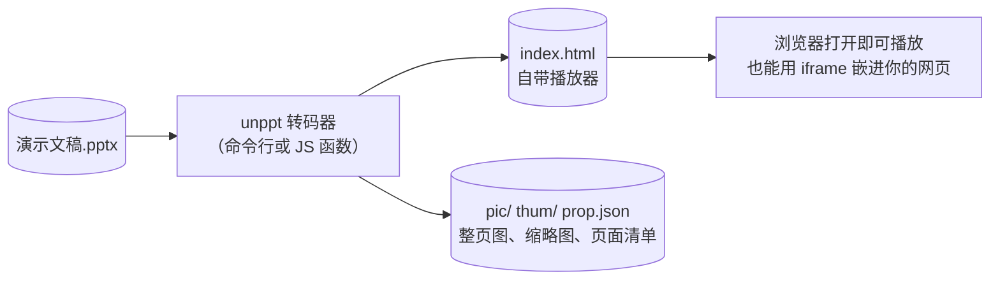
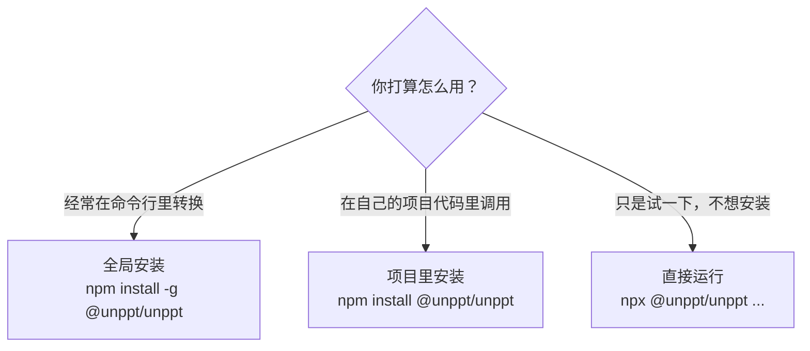
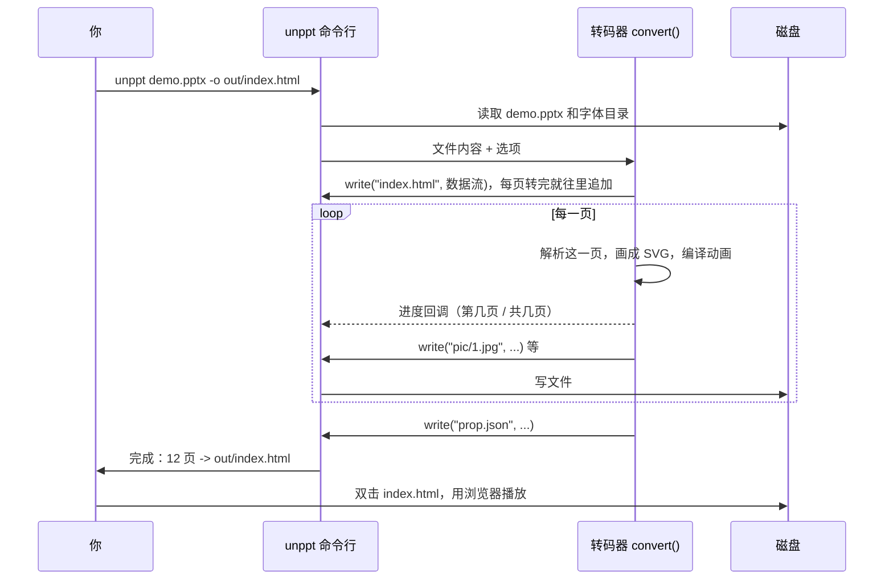
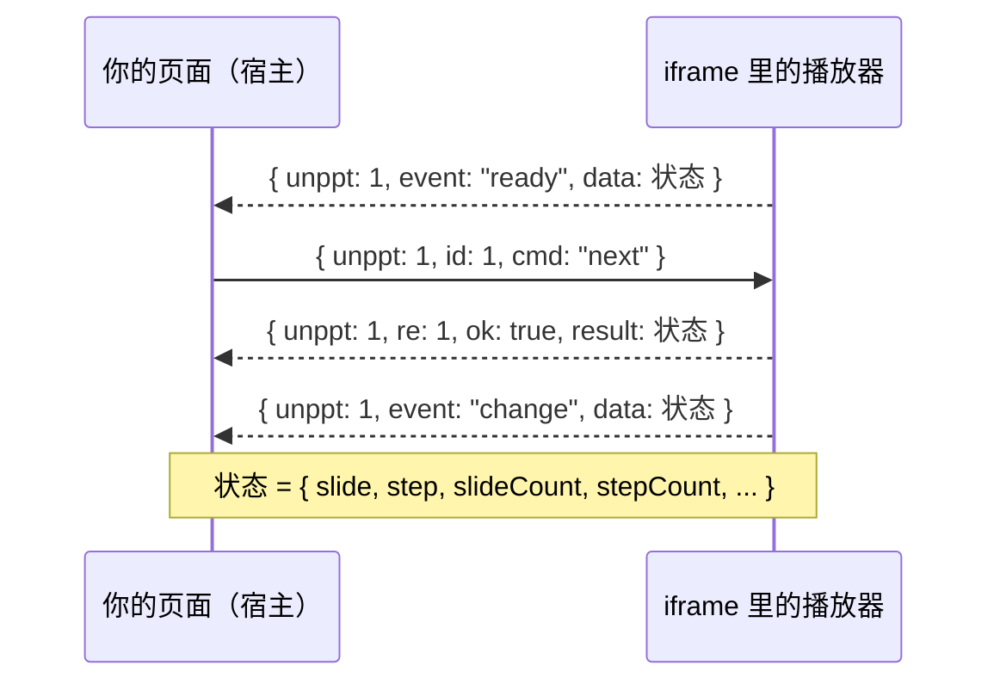
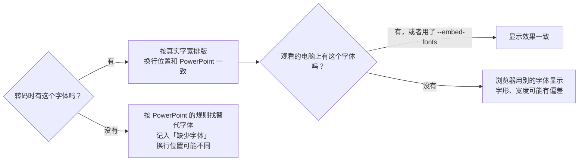

[English](../en/getting-started.md)

# 快速上手

这篇文档带你从零开始：装好 unppt，把第一个 `.pptx` 转成网页，打开播放，看懂输出了哪些文件，再解决最常见的问题。全程只需要会敲几条命令。

> 想看完整的命令行选项和在代码里调用的方法，请读 [使用说明](usage.md)。

---

## 1. unppt 是做什么的

unppt 把 PowerPoint 文件（`.pptx`）变成**网页**。网页里自带一个很小的播放器，能像 PowerPoint 放映一样翻页、播动画、播页面切换效果。



几个名词先解释一下：

| 名词 | 意思 |
|---|---|
| **转码（transcode）** | 把一种格式转换成另一种格式。这里是把 `.pptx` 转成网页。 |
| **SVG** | 一种用文字描述图形的图片格式，浏览器能直接显示，放大不会模糊。unppt 把每一页画成一张 SVG。 |
| **播放器** | 转码时一起写进网页的一段 JavaScript（约 58KB，gzip 后约 21KB），负责翻页、动画、切换效果。它**零依赖**，不需要联网加载任何东西。 |
| **iframe** | 网页里嵌入另一个网页的“窗口”标签 `<iframe>`。你可以用它把转出来的课件嵌进自己的产品页面。 |
| **步（step）** | 一页里每点击一次触发的一组动画叫一步。第 0 步是刚进入这一页、还没点击时的样子。 |


---

## 2. 准备环境

你只需要 **Node.js 20.12 或更高版本**（`package.json` 里写的是 `"node": ">=20.12"`）。不需要安装 PowerPoint，也不需要任何其他程序：转码器是纯 JavaScript + WASM（一种能在 Node 和浏览器里运行的二进制代码），没有要编译的原生插件。

检查 Node 版本：

```bash
node -v
```

输出 `v20.12.0` 或更大的数字就可以。版本太低请到 <https://nodejs.org/> 下载 LTS 版本。

---

## 3. 安装

npm 包名是 **`@unppt/unppt`**，安装后的命令名是 **`unppt`**。三种方式任选一种：



**方式一：全局安装（推荐给命令行用户）**

```bash
npm install -g @unppt/unppt
unppt 演示文稿.pptx -o out/index.html
```

**方式二：装进你的项目**

```bash
npm install @unppt/unppt
npx unppt 演示文稿.pptx -o out/index.html
```

装进项目后，代码里可以 `import { convert } from '@unppt/unppt'`，见 [使用说明](usage.md#3-javascript-api)。

**方式三：不安装，直接运行**

```bash
npx @unppt/unppt 演示文稿.pptx -o out/index.html
```

第一次运行时 npx 会临时下载包，稍等一下即可。

> 不带参数运行 `unppt`，会打印版本号和全部选项。

---

## 4. 转换第一个文件

下面一步一步来。假设你有一个文件 `demo.pptx`。

**第 1 步：新建一个空目录放输出**（转码会在输出文件旁边写出好几个文件和文件夹，放在单独目录里最清楚）

```bash
mkdir out
```

**第 2 步：转码**

```bash
unppt demo.pptx -o out/index.html --system-fonts
```

- `convert`：子命令，目前只有这一个。
- `-o out/index.html`：输出到哪里。不写的话，默认在 `demo.pptx` 旁边生成 `demo.html`（以及 `pic/`、`thum/`、`prop.json` 等，同样写在 `.pptx` 所在目录）。
- `--system-fonts`：用本机安装的字体来排版，效果更准。为什么字体重要见 [第 7 节](#7-字体为什么重要以及怎么给)。

**第 3 步：看命令行输出**

转码过程中会显示进度 `转码中 3/12 页`，结束时类似：

```text
完成：12 页，用时 4.2 秒 -> D:\work\out\index.html
缺少字体：Some Font
提示：……
```

- `缺少字体`：文件里用到但本机找不到的字体（会用替代字体，效果可能有偏差）。
- `提示`：转码时发现的问题（例如某个图片读不出来），不影响其它页面。

**第 4 步：打开播放**

直接双击 `out/index.html`，用 Chrome、Edge 或 Firefox 打开即可。不需要启动 Web 服务器。

整个过程：



---

## 5. 输出目录里都是什么

用 `--output` 选择**产物形式**，一共四种。不管哪种形式，都会额外输出 `prop.json`，默认还会输出整页图 `pic/` 和缩略图 `thum/`。

### 5.1 四种产物形式对比

| 形式 | 命令 | 主文件 | 特点 | 适合 |
|---|---|---|---|---|
| `single`（默认） | `--output single` | 一个 `.html` | 页面、图片、字体、播放器全部写进这一个 HTML；只有大的图片和所有音视频单独放在 `media/` | 发给别人、本地双击、小文件 |
| `paged` | `--output paged` | 目录里的 `index.html` | 入口很小，每页数据是单独文件；打开时只加载正在看的页，并预加载下一页 | 放在网上、页数多、文件大 |
| `pages` | `--output pages` | 目录里的 `index.html` | 和 `paged` 一样，另外每页再出一个只含这一页的 `page-001.html` | 需要单独打开、嵌入某一页 |
| `data` | `--output data` 或 `--data` | `.json` | 只有演示数据，没有播放器 | 开发调试 |

> `--output html` 也能用，它是 `single` 的旧名字。

### 5.2 single（默认）

```bash
unppt demo.pptx -o out/index.html
```

```text
out/
├── index.html        ← 双击就能播放；页面、小图片、字体、播放器都在里面
├── media/            ← 音频、视频，以及超过 --inline-limit（默认 2MB）的图片
│   └── media1.1a2b3c4d.mp4
├── pic/              ← 每页一张整页图（JPEG）
│   ├── 1.jpg
│   └── 2.jpg
├── thum/             ← 每页一张缩略图（JPEG，宽 216 像素）
│   ├── 1.jpg
│   └── 2.jpg
└── prop.json         ← 页面清单：页数、尺寸、图片路径、演讲者备注、是否隐藏
```

`media/` 只有在课件里有音视频或大图片时才会出现。文件名格式是 `media/原名.校验码.扩展名`，校验码保证内容变了文件名也会变（方便浏览器缓存）。

### 5.3 paged（按需加载）

```bash
unppt demo.pptx -o out --output paged
```

注意：`paged` / `pages` 形式下 `-o` 写的是**目录**（入口是目录里的 `index.html`）。不写 `-o` 时，默认是和输入同名的目录（例如 `demo/`）。

```text
out/
├── index.html                 ← 入口：播放器 + 目录（有哪些页、每页数据在哪个文件）
├── pages/                     ← 每页的数据，一页一个脚本文件
│   ├── 1.9f8e7d6c.js
│   └── 2.0a1b2c3d.js
├── fonts/                     ← 嵌入的字体子集（有嵌入字体时才有）
│   └── unppt-f0.5e6f7a8b.js
├── media/                     ← 所有图片、音频、视频（这种形式下图片一律不内联）
├── pic/  thum/  prop.json     ← 同 single
```

每页数据用 `<script>` 标签加载（不是 fetch），所以本地双击打开（`file://`）、放在任何域名下、嵌进 iframe 都能正常工作。文件名里带内容哈希，可以放心设置长期缓存。

### 5.4 pages（按需加载 + 每页一个 HTML）

```bash
unppt demo.pptx -o out --output pages
```

在 `paged` 的基础上多出：

```text
out/
├── page-001.html   ← 只包含第 1 页
├── page-002.html   ← 只包含第 2 页
└── ……
```

单页 HTML 的目录里只有这一页，所以课件里“跳到别的页”的超链接在单页里不起作用。

### 5.5 data（只输出数据）

```bash
unppt demo.pptx --data -o out/deck.json
```

```text
out/
├── deck.json       ← 演示数据（每页的 SVG、动画步骤、切换效果，以及标题、尺寸、报告）
├── fonts/          ← 嵌入的字体子集，.woff 格式（有嵌入字体时才有）
├── media/          ← 所有图片、音视频
├── pic/  thum/  prop.json
```

这种形式没有播放器，主要给开发调试用。

### 5.6 整页图、缩略图和 prop.json

整页图和缩略图是用打包在内的 resvg（一个把 SVG 画成位图的库，WASM 版本）生成的，可以用在课件列表、分享卡片、不支持 JavaScript 的场景。

| 文件 | 尺寸 |
|---|---|
| `pic/{页号}.jpg` | 幻灯片尺寸（磅）取整的像素，例如 16:9 的默认幻灯片是 960×540 |
| `thum/{页号}.jpg` | 宽 216 像素，高按比例 |

页号从 1 开始。不想要图片（可以显著加快转码）就加 `--no-images`，这时 `prop.json` 照常输出。

`prop.json` 的样子（字段都来自 `output/prop.ts`）：

```json
{
 "count": 2,
 "picw": 960,
 "pich": 540,
 "thumw": 216,
 "thumh": 122,
 "slides": [
  { "index": 1, "thum": "thum/1.jpg", "pic": "pic/1.jpg", "note": "演讲者备注文字" },
  { "index": 2, "thum": "thum/2.jpg", "pic": "pic/2.jpg", "hidden": 1 }
 ]
}
```

| 字段 | 含义 |
|---|---|
| `count` | 页数（包括隐藏页） |
| `picw` / `pich` | 幻灯片宽高，单位是磅（pt，1 磅 = 1/72 英寸） |
| `thumw` / `thumh` | 缩略图宽高（像素） |
| `slides[].index` | 页号，从 1 开始 |
| `slides[].pic` / `thum` | 图片路径，相对 `prop.json` 所在目录 |
| `slides[].note` | 演讲者备注（没有备注时不出现） |
| `slides[].hidden` | 隐藏的幻灯片是 `1`（不隐藏时不出现） |

---

## 6. 打开和控制播放器

### 6.1 用鼠标、键盘、触屏

下面这些操作和 PowerPoint 放映时的习惯一致（来自播放器源码 `packages/player/src/ui/input.ts`）：

| 操作 | 效果 |
|---|---|
| 单击画面 | 下一步（有动画先播动画，播完再翻页）；点到超链接则跳转 |
| `→` `↓` `PageDown` `空格` `Enter` | 下一步 |
| `←` `↑` `PageUp` `Backspace` | 上一步 |
| `Home` / `End` | 第一页 / 最后一页 |
| 输入数字再按 `Enter`（如 `5` `Enter`） | 跳到第 5 页（2 秒内没继续输入就作废） |
| `B` 或 `.` | 黑屏；再按任意键或单击回到幻灯片 |
| `W` 或 `,` | 白屏；再按任意键或单击回到幻灯片 |
| 触屏向左滑 / 向右滑 | 下一步 / 上一步 |
| 鼠标移到画面上 | 右下角显示 `‹`、`›` 按钮和页码 `3 / 12` |

顺序翻页时会跳过隐藏的幻灯片，和 PowerPoint 放映一样。

### 6.2 用网址参数

在网址后面加参数，例如 `index.html?slide=2&step=1&ui=0`：

| 参数 | 作用 |
|---|---|
| `slide`、`step` | 打开时直接定位到第几页、第几步（都从 0 开始）。这样打开时默认不按计时自动放映 |
| `ui=0` | 隐藏自带的翻页按钮，完全由你的页面控制 |
| `timings=0` / `timings=1` | 关闭 / 强制开启按“自动换片时间”自动放映 |
| `links=0` | 点击外部链接时不自己打开新窗口，只发 `link` 事件给宿主 |
| `mode=watch` | 观看模式：只能由 JS 接口驱动（例如直播课的学生端） |
| `origin=https://a.com,https://b.com` | 只接受这些来源发来的 postMessage 指令 |

### 6.3 嵌进你的网页并用代码控制

**postMessage** 是浏览器提供的、让两个页面（包括跨域的 iframe）互相发消息的方法。播放器监听这些消息：

```html
<iframe id="ppt" src="out/index.html?ui=0" style="width:960px;height:540px;border:0"></iframe>
<button onclick="send('prev')">上一步</button>
<button onclick="send('next')">下一步</button>
<script>
  const frame = document.getElementById('ppt');
  let id = 0;
  function send(cmd, args) {
    frame.contentWindow.postMessage({ unppt: 1, id: ++id, cmd, args }, '*');
  }
  window.addEventListener('message', (e) => {
    const m = e.data;
    if (!m || m.unppt !== 1) return;
    if (m.event) console.log('事件', m.event, m.data);   // ready / change / end / link
    if (m.re) console.log('回复', m.re, m.ok, m.result);
  });
  // 跳到第 4 页第 0 步：send('goto', { slide: 3, step: 0 })
</script>
```



指令有 `next`、`prev`、`goto`、`sync`、`getState`；事件有 `ready`、`change`、`end`、`link`。同一页面里也可以直接调用 `window.unppt.next()`、`window.unppt.goto({ slide: 2, step: 1 })`。完整的嵌入方式（包括原生 App 的 WebView）见 [嵌入与控制](embedding.md)、[播放器](player.md) 和示例 [examples/iframe-host.html](../../examples/iframe-host.html)。

---

## 7. 字体：为什么重要，以及怎么给

### 7.1 为什么字体重要

PowerPoint 排版时，每个字有多宽、一行能放几个字、在哪里换行，都由字体决定。unppt 要做到和 PowerPoint 一样，**转码时就要知道每个字的真实宽度**，所以需要拿到字体文件（`.ttf`、`.otf`、`.ttc`）。



有两个时刻需要字体：**转码时**（决定排版）和**观看时**（浏览器显示）。

### 7.2 三个字体选项

| 选项 | 作用 | 什么时候用 |
|---|---|---|
| `--fonts <目录>` | 从这个目录（包括子目录）读取 `.ttf` / `.otf` / `.ttc` 字体，按真实字宽排版。可以写多次 | 服务器上没有系统字体，或者你有一套专门的字体 |
| `--system-fonts` | 使用本机系统字体目录。Office 自带的私有字体和云字体（例如 Aptos、Gill Sans MT、Tw Cen MT）也会用上，并且**用到时自动嵌入产物**（因为浏览器用不了这些没装进系统的字体） | 在装了 Office 的电脑上转码，效果最好 |
| `--embed-fonts` | 把用到的字做成字体子集（只包含用到的字）嵌入产物，观看端不需要安装字体 | 观看的人可能没装这些字体。**商业字体注意分发授权** |

`--system-fonts` 会查找的目录：

| 系统 | 系统字体目录 | Office 私有字体 / 云字体 |
|---|---|---|
| Windows | `%WINDIR%\Fonts`、`%LOCALAPPDATA%\Microsoft\Windows\Fonts` | `Program Files\Microsoft Office\root\vfs\Fonts\private`、`%LOCALAPPDATA%\Microsoft\FontCache\4\CloudFonts` |
| macOS | `/System/Library/Fonts`、`/Library/Fonts`、`~/Library/Fonts` | `/Applications/Microsoft PowerPoint.app/Contents/Resources/DFonts` |
| Linux | `/usr/share/fonts`、`/usr/local/share/fonts`、`~/.fonts`、`~/.local/share/fonts` | 无 |

另外，`.pptx` 文件里自己嵌入的字体会被优先使用，并且总是嵌入产物，不需要任何选项。

推荐写法：

```bash
# 在自己电脑上转码，观看的人和你用同样的系统
unppt demo.pptx -o out/index.html --system-fonts

# 观看的人可能没有这些字体（例如手机）
unppt demo.pptx -o out/index.html --system-fonts --embed-fonts

# 在 Linux 服务器上，字体放在 /opt/fonts
unppt demo.pptx -o out/index.html --fonts /opt/fonts --embed-fonts
```

---

## 8. 效果如何

开发时，unppt 用本机 PowerPoint 导出的图片当“标准答案”，逐页自动比对。比对用 **SSIM**（结构相似度，0 到 1 之间，1 表示两张图完全一样），一页 SSIM ≥ 0.95 算通过。

| 测试集 | 规模 | 通过率（SSIM ≥ 0.95） | 平均 SSIM |
|---|---|---|---|
| 合成测试用例 | 228 份 / 504 页 | 92.3% | 0.984 |
| 随机抽取的 100 份真实课件 | 3527 页，0 份转码失败 | 78.8%（约 95% 的页 SSIM ≥ 0.90） | 0.967 |

多数没通过的页只是细节有差别（文字位置差几个像素、某个图表标签）。下面每张图左边是 Microsoft PowerPoint，右边是 unppt：


已知还没做好的地方：图表日期坐标轴的时间刻度（最小/最大值、按月/年间隔）、艺术字竖排（wordArtVert）、可变字体、EMF 图片里的 EMF+ 记录、部分需要重新布局的 SmartArt、旋转 180 度时的三维棱台、45 度分类标签的截断阈值。

---

## 9. 常见问题

| 现象 | 原因和解决 |
|---|---|
| `unppt` 不是内部或外部命令 / command not found | 没有全局安装，或者 npm 全局目录不在 PATH 里。改用 `npx @unppt/unppt ...`，或者重新 `npm install -g @unppt/unppt` |
| 安装或运行时报 Node 版本错误、语法错误 | Node 版本低于 20.12。运行 `node -v` 检查并升级 |
| 运行后只打印了一大段“用法” | 命令写错了：第一个参数必须是 `convert`，后面跟输入文件；选项名写错也会打印用法。看 [使用说明](usage.md#2-命令行参考) |
| 文字换行和 PowerPoint 不一样 | 转码时缺字体。看输出里的 `缺少字体：`，用 `--system-fonts` 或 `--fonts <目录>` 提供这些字体 |
| 在自己电脑上正常，别人电脑上字体不对 | 观看的电脑没装这些字体。加 `--embed-fonts` |
| `.pptx` 旁边多出一堆 `pic/`、`thum/`、`prop.json` | 没写 `-o` 时，输出写在输入文件旁边。用 `-o out/index.html` 指定单独目录 |
| 提示“没有 resvg.wasm，不输出整页图和缩略图” | 程序找不到出图用的 `resvg.wasm`（通常是安装不完整）。重新安装；不需要图片时加 `--no-images` |
| 转码很慢或内存不够 | 出图最耗时。加 `--no-images` 跳过出图，或用 `--jobs 1`、`--jobs 2` 减少同时出图的线程数。用 `--stats` 查看用时和峰值内存 |
| 视频不播放 | 视频在 `media/` 里，复制或上传时要连同 `media/` 一起；另外视频本身的编码要是浏览器能播的（例如 MP4/H.264） |
| 某一页是白的，提示“第 N 页渲染失败” | 那一页转码出错，其它页不受影响。欢迎把能公开的、重新做过的复现文件提给我们 |
| 浏览器显示“无法播放：……” | 产物格式和播放器版本不匹配，或文件被改坏了。用同一版本重新转码 |

遇到效果不对的课件，请在 GitHub 提 issue：<https://github.com/spitmaster/unppt/issues>。注意不要上传含有隐私或客户内容的文件，最好用 PowerPoint 新建一个只包含问题元素的小文件。
