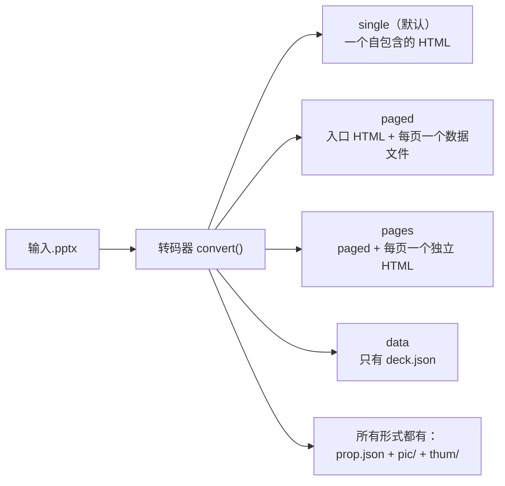
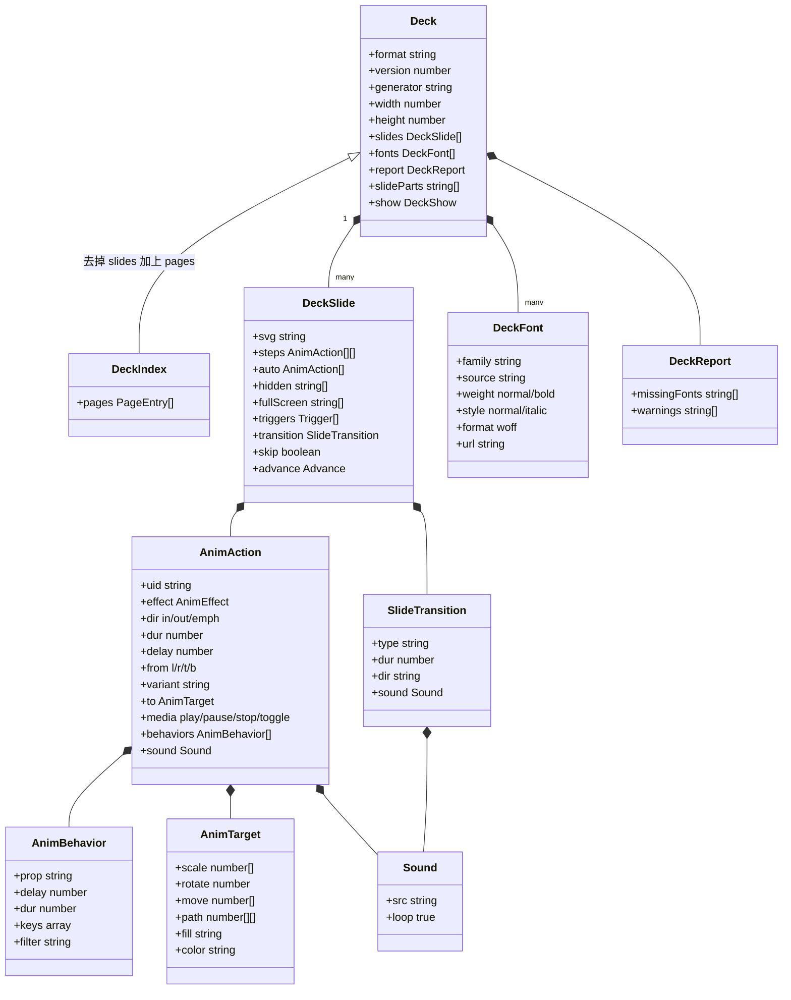

[English](../en/output-format.md)

# 产物格式

这篇文档讲 unppt 转码器**输出了什么**：磁盘上有哪些文件、演示数据（deck）里每个字段是什么意思、动画 / 切换 / 媒体 / 字体 / 链接 / 备注是怎么表示的。

转码器和播放器之间**只通过这份格式交流**。只要格式对得上，两边可以分别部署、分别升级。

> 格式的唯一真相源是 `packages/format/src/index.ts`（TypeScript 类型定义，每个字段都有中文注释）。本文是它的导读。仓库里没有单独的 JSON Schema 文件，TypeScript 类型就是规范。
> 播放器怎么使用这些数据，见 [播放器是怎么工作的](player.md)。

---

## 1. 先认识几个词

| 词 | 意思 |
|---|---|
| **deck（演示数据）** | 一份演示文稿转出来的全部数据：每页的画面、动画、切换，加上字体、尺寸等信息。TypeScript 类型名是 `Deck`。 |
| **SVG** | 用文字描述图形的格式，浏览器可以直接显示。每页幻灯片的静态画面是一段 SVG 字符串。 |
| **EMU** | PowerPoint 文件内部的长度单位，1 英寸 = 914400 EMU。**产物里不出现 EMU**：转码器全部换算成像素（按 96 dpi，1 英寸 = 96 像素）。 |
| **像素 / 磅** | 产物里尺寸用像素；只有 `prop.json` 沿用老约定用磅（1 磅 = 1/72 英寸，所以 像素 × 0.75 = 磅）。16:9 的幻灯片是 1280 × 720 像素 = 960 × 540 磅。 |
| **uid** | 页面里"可能做动画的元素"的编号，写在 SVG 的 `data-uid` 属性上。动画数据通过 uid 找到元素。 |
| **WOFF** | 一种网页字体文件格式。嵌入的字体是只包含用到的字的"子集"。 |
| **产物形式** | 同一份数据可以写成几种文件布局：`single`、`paged`、`pages`、`data`。 |

---

## 2. 版本号

`packages/format/src/index.ts` 里有三个常量：

| 常量 | 值 | 意思 |
|---|---|---|
| `DECK_FORMAT` | `"unppt-deck"` | 写在每份数据的 `format` 字段里，用来认出"这是 unppt 的数据" |
| `DECK_FORMAT_VERSION` | `1` | 数据格式的版本号，写在 `version` 字段里 |
| `UNPPT_VERSION` | `"0.3.0"` | 软件版本，写在 `generator` 字段里（`"unppt 0.3.0"`） |

规则：

- 格式有变化时，`DECK_FORMAT_VERSION` 加一（源码注释里的约定）；
- 播放器遇到 `format` 不对，报错"不是 unppt 演示数据"；遇到比自己认识的更新的 `version`，报错"演示数据版本 N 太新，请升级播放器"；
- 后来加进格式的字段都是**可选的**（类型定义里带 `?`），播放器不会读它不认识的字段；不认识的动画效果名、切换类型按淡入播放。

---

## 3. 磁盘上的文件：四种产物形式

用命令行选择形式：`unppt 输入.pptx --output <形式>`（`--data` 等同 `--output data`）。



| 形式 | 适合 | 主文件 | 播放器 | 小图片 |
|---|---|---|---|---|
| `single` | 发给别人双击就能看；页数不多 | `<名字>.html` | 内嵌在 HTML 里 | 小于 2MB（`--inline-limit`）内联进 HTML |
| `paged` | 放到网站上、页数多、要快速打开 | `<目录>/index.html` | 内嵌在 index.html | 全部写成 `media/` 下的文件 |
| `pages` | 同 paged，并且需要"每页一个网址" | `<目录>/index.html` + `page-001.html`… | 内嵌 | 同 paged |
| `data` | 自己部署播放器、自己加载数据（开发调试用） | `<名字>.json` | 不带 | 全部写成 `media/` 下的文件 |

视频、音频在所有形式下都是 `media/` 下的单独文件。

### 3.1 single

```text
课件.html          ← 页面数据、图片、字体、播放器全在里面
prop.json
pic/1.jpg …        ← 整页图
thum/1.jpg …       ← 缩略图
media/…            ← 视频、音频、超过内联上限的大图片（有才会出现）
```

HTML 内部结构（按出现顺序）：

```html
<div id="unppt"></div>                                              <!-- 播放器挂载点 -->
<script type="application/json" class="unppt-asset" data-id="0">"data:image/png;base64,…"</script>
<script type="application/json" class="unppt-slide">{ 第 1 页的 DeckSlide }</script>
<script type="application/json" class="unppt-slide">{ 第 2 页的 DeckSlide }</script>
…
<script type="application/json" class="unppt-font" data-family="unppt-f0">"WOFF 的 base64"</script>
<script type="application/json" id="unppt-meta">{ 除了 slides 以外的 Deck 字段 }</script>
<script>/* 播放器代码 */</script>
```

- **共享图片**：同一张图片只存一份。页面 SVG 里写 `unppt:asset/编号`，图片数据在对应 `data-id` 的 `unppt-asset` 里，播放器显示前替换；
- 文件是**边转码边写**的（一页处理完就写出去、释放内存），所以元数据 `unppt-meta` 在最后。

### 3.2 paged

```text
课件/
├─ index.html                  ← 播放器 + 目录（<script id="unppt-index">）
├─ pages/1.<哈希>.js            ← __unpptPage(0, { 第 1 页的 DeckSlide });
├─ pages/2.<哈希>.js
├─ fonts/unppt-f0.<哈希>.js     ← __unpptFont("unppt-f0", "WOFF 的 base64");
├─ media/image1.<校验码>.png    ← 图片、视频、音频
├─ prop.json
├─ pic/1.jpg …
└─ thum/1.jpg …
```

- 文件名里带**内容哈希**：内容一样，文件名就一样；内容变了，文件名也变。所以服务器可以让浏览器长期缓存这些文件，重新发布后也不会读到旧版本；
- `media/` 文件名格式是 `media/原名[后缀].校验码.扩展名`，校验码是 ZIP 里记录的 CRC32，作用同上；
- 每页数据是"调用一个函数的脚本"而不是 JSON，是为了能用 `<script>` 标签加载：本地 `file://` 打开、跨域托管都不需要额外配置。

目录（`DeckIndex`）= `Deck` 去掉 `slides`，加上 `pages`：

```json
{
  "format": "unppt-deck", "version": 1, "generator": "unppt 0.3.0",
  "width": 1280, "height": 720, "title": "",
  "fonts": [{ "family": "unppt-f0", "source": "Impact", "weight": "normal", "style": "normal",
              "format": "woff", "url": "fonts/unppt-f0.2e92b8da.js" }],
  "report": { "missingFonts": [], "warnings": [] },
  "slideParts": ["ppt/slides/slide1.xml"],
  "pages": [{ "file": "pages/1.badab6a9.js" }]
}
```

`pages[i].skip` 为 `true` 表示第 i 页是隐藏页——播放器不用下载这一页就知道顺序放映要跳过它。

两个回调函数名也是格式的一部分：`PAGE_CALLBACK = "__unpptPage"`、`FONT_CALLBACK = "__unpptFont"`。

### 3.3 pages

和 paged 完全一样，另外每页多一个 `page-001.html`、`page-002.html`……：它们和 `index.html` 共用 `pages/`、`fonts/`、`media/`，只是目录里只有这一页（所以单页里跳到别的页的链接不起作用）。

### 3.4 data

```text
deck.json          ← 完整的 Deck（含 slides 数组）
fonts/unppt-f0.woff
media/…
prop.json
pic/ thum/
```

`deck.json` 交给你自己部署的播放器（`UnpptPlayer.mount(元素, deck, { baseUrl })`），字体、媒体路径都是相对 `deck.json` 的。

### 3.5 prop.json、整页图和缩略图

所有形式都会在主文件旁边写 `prop.json`。它沿用直播服务的老约定（所以字段名很短、尺寸用磅、页号从 1 开始）：

```json
{
 "count": 3,
 "picw": 960,
 "pich": 540,
 "thumw": 216,
 "thumh": 122,
 "slides": [
  { "index": 1, "thum": "thum/1.jpg", "pic": "pic/1.jpg", "note": "第一段备注\n第二段：A < B & C\n段内换行" },
  { "index": 2, "thum": "thum/2.jpg", "pic": "pic/2.jpg" },
  { "index": 3, "thum": "thum/3.jpg", "pic": "pic/3.jpg", "note": "隐藏页的备注", "hidden": 1 }
 ]
}
```

（上面是合成测试用例 `testcases/speaker-notes.pptx` 的真实输出。）

| 字段 | 意思 |
|---|---|
| `count` | 页数 |
| `picw` / `pich` | 幻灯片尺寸，单位**磅**（可能带小数，保留两位） |
| `thumw` / `thumh` | 缩略图宽高（像素），宽固定 216 |
| `slides[].index` | 页号，**从 1 开始**，和图片文件名一致 |
| `slides[].pic` | 整页图路径（相对 prop.json），像素大小是 `picw × pich` 取整 |
| `slides[].thum` | 缩略图路径 |
| `slides[].note` | 演讲者备注，**纯文本**，段落和换行都是 `\n`；没有备注时没有这个字段 |
| `slides[].hidden` | 隐藏页写 `1`，否则没有这个字段 |

- 图片是 JPG（质量 85），画的是"这一页所有对象都显示"的样子（和 PowerPoint 左侧缩略图一样），视频显示封面帧；
- 图片用 resvg（WASM 版）画，命令行自动使用发布包里的 `dist/resvg.wasm`；
- `--no-images`（API 里 `images: false`）不出图，但 `prop.json` 照样写图片路径；
- **演讲者备注只在 `prop.json` 里**，不在 deck 数据里，播放器不显示备注。

---

## 4. 数据类型总览



（图里只列了主要字段，完整字段见下面各节的表格。）

---

## 5. Deck：顶层字段

| 字段 | 类型 | 必有 | 意思 |
|---|---|---|---|
| `format` | `"unppt-deck"` | 是 | 固定值，认出数据类型 |
| `version` | 数字 | 是 | 格式版本，目前 `1` |
| `generator` | 字符串 | 是 | 生成它的软件，如 `"unppt 0.3.0"` |
| `width` / `height` | 数字 | 是 | 幻灯片宽高，**像素**（96 dpi）。16:9 是 1280 × 720 |
| `title` | 字符串 | 转码器总会写 | 演示文稿标题（来自 pptx 的文档属性，没有时是空字符串）。注意：它不在 TypeScript 的 `Deck` 类型里，但转码器会输出，播放器也会读 |
| `slides` | `DeckSlide[]` | 是 | 每页的数据，见第 6 节（paged 形式里没有这个字段，换成 `pages`） |
| `fonts` | `DeckFont[]` | 是 | 嵌入的字体子集，见第 10 节 |
| `report` | `DeckReport` | 是 | 转码报告：`missingFonts` 缺的字体名、`warnings` 提示信息 |
| `slideParts` | `string[]` | 可选 | 每页对应的 pptx 内部部件路径，例如 `"ppt/slides/slide3.xml"`；用来解析"跳到某页"的链接 |
| `show` | `{ loop?, useTimings? }` | 可选 | 放映设置：`loop: true` 循环放映；`useTimings: false` 不按计时自动换片 |

---

## 6. DeckSlide：一页

| 字段 | 类型 | 必有 | 意思 |
|---|---|---|---|
| `svg` | 字符串 | 是 | 这一页的静态画面（完整的 `<svg>` 元素），见 6.1 |
| `steps` | `AnimAction[][]` | 是 | 每次点击执行的一组动作。`steps.length` 就是这一页要点几下 |
| `auto` | `AnimAction[]` | 是 | 进入页面时（第 0 步之前）自动执行的动作 |
| `hidden` | `string[]` | 是 | 第 0 步时隐藏的元素 uid（有进入动画的元素） |
| `fullScreen` | `string[]` | 可选 | 播放时全屏的视频（元素 uid） |
| `triggers` | `{ uid, steps }[]` | 可选 | 触发器：点击 `uid` 元素时依次播放 `steps` 里的一组（每点一次播一组） |
| `transition` | `SlideTransition` | 可选 | 进入这一页时的切换效果，见第 8 节 |
| `skip` | `boolean` | 可选 | 隐藏的幻灯片：顺序放映跳过，但可以通过链接、`goto` 跳过去 |
| `advance` | `{ after?, click? }` | 可选 | 换片方式：`after` 自动换片时间（毫秒，从进入这页算起）；`click: false` 单击画面不换片 |

### 6.1 页面 SVG 的约定

一页 SVG 长这样（来自 `testcases/anim-basic.pptx`，有删减）：

```xml
<svg xmlns="http://www.w3.org/2000/svg" viewBox="0 0 1280 720" width="1280" height="720">
  <rect width="1280" height="720" fill="#ffffff"/>
  <g data-uid="s2" data-name="矩形 1">
    <g transform="translate(53.33 200)">
      <path d="M0 0L267 0L267 200L0 200Z" fill="#156082" stroke="#042433" stroke-width="2"/>
      <g data-uid="s2p0">
        <text x="99.75 123.75 147.75" y="109" font-family="'等线',sans-serif" font-size="24" fill="#ffffff">动画 </text>
        …
      </g>
    </g>
  </g>
  …
</svg>
```

- `viewBox` 和 `width` / `height` 就是幻灯片的像素大小；
- **文字已经排好版**：每个字的 x 坐标都写死了（`x="99.75 123.75 147.75"`），播放器不需要也不会重新排版；
- SVG 上有几个 unppt 自己的属性：

| 属性 | 写在哪 | 意思 |
|---|---|---|
| `data-uid` | 可能做动画的元素 | 编号。形状是 `s` + 形状 id（如 `s2`），形状里的第 n 段文字是 `s2p0`、`s2p1`…（逐段动画用），图表、SmartArt 的各部分也有自己的编号 |
| `data-name` | 顶层对象 | PowerPoint 里的对象名；平滑切换（morph）靠它配对前后两页的对象 |
| `data-link` | 超链接 | 站内跳转：`next`、`prev`、`first`、`last`、`slide:<部件路径>`、`media`（点击切换媒体播放） |
| `data-href` | 超链接 | 外部网址（只会是 `http(s):`、`mailto:`、`tel:`） |
| `data-media="1"` | `<video>` / `<audio>` | 页面上的媒体 |
| `data-trim-start` / `data-trim-end` | 媒体 | 剪裁：从开头 / 结尾剪掉的秒数 |
| `data-fade-in` / `data-fade-out` | 媒体 | 音量淡入 / 淡出的秒数 |
| `data-bu="1"` | 项目符号 | 标记这是项目符号（不是正文） |

- 图片地址可能是：`data:` URI（内联）、`unppt:asset/编号`（single 形式的共享图片）、`media/…`（单独文件）。

---

## 7. 动画

### 7.1 AnimAction：一个动作

一个动作 = "对哪个元素，做什么效果，什么时候开始，播多久"。

| 字段 | 类型 | 意思 |
|---|---|---|
| `uid` | 字符串 | 目标元素（SVG 上的 `data-uid`） |
| `effect` | 字符串 | 效果名：`appear` `fade` `fly` `wipe` `zoom` `split` `float` `wheel` `random` `shape` `blinds` `growTurn` `swivel` `bounce` `emphasis` `path` `media` |
| `dir` | `in` / `out` / `emph` | 进入 / 退出 / 强调（强调不改变最终是否可见） |
| `dur` | 毫秒 | 持续时间 |
| `delay` | 毫秒 | 从这一组开始算，延迟多久开始 |
| `from` | `l` / `r` / `t` / `b` | 飞入等效果的方向 |
| `variant` | 字符串 | 效果变体，例如 shape 的 `circle-in`、split 的 `vert-out`、wheel 的轮辐数、blinds 的 `horz` |
| `to` | `AnimTarget` | 强调、路径动画结束后的状态（见 7.3） |
| `media` | `play` / `pause` / `stop` / `toggle` | 媒体命令（`effect` 是 `media` 时） |
| `start` | 秒 | 媒体从第几秒开始播 |
| `across` | 数字 | 媒体连续播放的页数（含本页），大于 1 时翻页不停（背景音乐） |
| `loop` | 布尔 | 媒体循环播放直到停止 |
| `iterate` | `{ by, gap }` | 文字逐字（`letter`）/ 逐词（`word`）播放，相邻两个间隔 `gap` 毫秒 |
| `repeat` | 数字 | 重复次数；`-1` 表示一直重复到下一次点击 |
| `autoRev` | 布尔 | 播完再倒着播回去 |
| `behaviors` | `AnimBehavior[]` | PowerPoint 原始的动画行为（有它时播放器按行为播放，不看 `effect` / `from` / `variant`），见 7.2 |
| `accel` / `decel` | 0～1 | 整个效果的加速、减速比例 |
| `sound` | `Sound` | 动画附带的声音，动作开始时播放 |

#### 时间是怎么算的

`steps[k]` 里的所有动作在第 k 次点击时**同时开始计时**，各自等 `delay` 毫秒再开始播 `dur` 毫秒。PowerPoint 里的"与上一动画同时""上一动画之后"在转码时已经换算成 `delay`：

```mermaid
flowchart LR
  click["第 k 次点击（时间 0）"] --> a["动作 A<br/>delay 0, dur 500"]
  click --> b["动作 B（上一动画之后）<br/>delay 500, dur 500"]
  click --> c["动作 C（与上一动画同时）<br/>delay 500, dur 1000"]
```

`auto` 里的动作在进入页面时按同样的规则播放（例如"上一动画之后，延迟 1.5 秒"会变成 `delay: 1500`）。

### 7.2 AnimBehavior：PowerPoint 原始行为

PowerPoint 内部用一组"行为"描述一个效果。转码器把它原样带过来，播放器按元素的真实位置计算，这样效果最接近 PowerPoint。

| 字段 | 意思 |
|---|---|
| `prop` | 改变哪个属性：`x` `y`（元素中心位置）、`w` `h`（宽高），都是**幻灯片宽高的比例**；`sx` `sy` 再乘的缩放倍数；`r` 加上的旋转角度（度）；`o` 不透明度；`reveal` 显现滤镜 |
| `delay` / `dur` | 在这个效果内部的开始时间和时长（毫秒） |
| `keys` | 关键帧 `[时间 0~1, 值, 公式?]`。值可以是数字或 PowerPoint 公式，`#ppt_x` `#ppt_y` `#ppt_w` `#ppt_h` 是元素原来的位置大小 |
| `filter` | `reveal` 的滤镜，例如 `wipe(down)`、`barn(inVertical)`、`circle(in)`、`wheel(4)`、`blinds(horizontal)` |
| `out` | 退出用的显现（被隐去的部分按滤镜长大） |
| `accel` / `decel` / `tmFilter` / `autoRev` / `repeat` | 时间变换：加减速、`[时间, 进度]` 折线、往返、重复 |
| `discrete` | 离散变化：到时间直接跳到下一个关键帧的值 |

例：从下方飞入 = y 从 `1+#ppt_h/2`（幻灯片下边缘再往下半个元素高）变到 `#ppt_y`（原位置）：

```json
{ "prop": "y", "delay": 0, "dur": 500, "keys": [[0, "1+#ppt_h/2"], [1, "#ppt_y"]] }
```

### 7.3 AnimTarget：强调和路径的结果

强调动画（放大、旋转、变色……）和路径动画用 `to` 描述"结束后变成什么样"，**累加在元素当前状态上**：

| 字段 | 意思 |
|---|---|
| `scale` | `[x 倍数, y 倍数]`，相对当前 |
| `rotate` | 旋转角度（度），相对当前 |
| `move` | 移动距离 `[dx, dy]`（像素），相对当前 |
| `path` | 路径经过的点（像素，相对当前位置），最后一个点就是 `move`；沿路径按长度匀速走 |
| `keys` | 过程不匀速的强调（脉冲、跷跷板等）：按时间采样的 `{ o, s, r, a? }` |
| `accel` / `decel` | 平滑开始 / 平滑结束 |
| `fill` / `color` / `opacity` | 新的填充色 / 文字颜色 / 透明度 |
| `dim` | "动画播放后变暗"的颜色 |
| `origin` | 缩放、旋转的原点（相对外框的比例，默认中心） |
| `font` | 一直保留的文字样式：`bold` / `italic` / `underline` |
| `flash` | 只在效果过程中出现的文字样式（加粗闪烁等），`from` / `to` 是效果时长里的位置（0～1） |

### 7.4 一个真实的例子

`testcases/anim-basic.pptx` 是一个合成测试用例：一页上 4 个矩形，依次"出现、淡入、从下方飞入、从下方擦除"，最后第 1 个矩形淡出。用下面的命令看它的数据：

```bash
npx @unppt/unppt testcases/anim-basic.pptx --data -o out/deck.json
```

得到（`svg` 省略）：

```json
{
  "format": "unppt-deck",
  "version": 1,
  "generator": "unppt 0.3.0",
  "width": 1280,
  "height": 720,
  "title": "",
  "fonts": [],
  "report": { "missingFonts": ["等线"], "warnings": [] },
  "slideParts": ["ppt/slides/slide1.xml"],
  "slides": [
    {
      "svg": "<svg …>…</svg>",
      "steps": [
        [{ "uid": "s2", "effect": "appear", "dir": "in", "dur": 0, "delay": 0 }],
        [{ "uid": "s3", "effect": "fade", "dir": "in", "dur": 500, "delay": 0,
           "behaviors": [{ "prop": "o", "delay": 0, "dur": 500, "keys": [[0, 0], [1, 1]] }] }],
        [{ "uid": "s4", "effect": "fly", "dir": "in", "dur": 500, "delay": 0, "from": "b",
           "behaviors": [
             { "prop": "x", "delay": 0, "dur": 500, "keys": [[0, "#ppt_x"], [1, "#ppt_x"]] },
             { "prop": "y", "delay": 0, "dur": 500, "keys": [[0, "1+#ppt_h/2"], [1, "#ppt_y"]] }
           ] }],
        [{ "uid": "s5", "effect": "wipe", "dir": "in", "dur": 500, "delay": 0, "from": "b",
           "behaviors": [{ "prop": "reveal", "delay": 0, "dur": 500, "filter": "wipe(down)" }] }],
        [{ "uid": "s2", "effect": "fade", "dir": "out", "dur": 500, "delay": 0,
           "behaviors": [{ "prop": "o", "delay": 0, "dur": 500, "keys": [[0, 1], [1, 0]] }] }]
      ],
      "auto": [],
      "hidden": ["s2", "s3", "s4", "s5"]
    }
  ]
}
```

怎么读：

- `hidden` 有 4 个矩形 → 刚进入页面时它们都看不见；
- `steps` 有 5 组 → 这一页要点 5 下；
- 第 1 下：`s2` 出现（`dur: 0`，瞬间）；第 2 下：`s3` 用 500 毫秒从透明变不透明；……第 5 下：`s2` 淡出；
- 这份数据是不带任何字体（`--no-default-fonts`）转码得到的：`report.missingFonts` 里的"等线"表示转码时没有这个字体，字宽只能估算，`fonts` 也是空的。默认带字体包时，等线按原字体的度量排版、用思源黑体显示，`fonts` 里会有它的子集，`missingFonts` 是空的。

### 7.5 触发器的例子

`testcases/anim-trigger.pptx`：点击 `s3` 时让 `s4` 淡入，普通点击让 `s5` 淡入：

```json
{
  "steps": [[{ "uid": "s5", "effect": "fade", "dir": "in", "dur": 500, "delay": 0 }]],
  "auto": [],
  "hidden": ["s4", "s5"],
  "triggers": [
    { "uid": "s3", "steps": [[{ "uid": "s4", "effect": "fade", "dir": "in", "dur": 500, "delay": 0 }]] }
  ]
}
```

（实际输出里每个动作还带着和 7.4 一样的 `behaviors`，这里省略。）

---

## 8. 页面切换 SlideTransition

| 字段 | 意思 |
|---|---|
| `type` | 切换类型：`none` `fade` `cut` `flash` `push` `wipe` `cover` `pull` `split` `strips` `circle` `diamond` `plus` `zoom` `wheel` `wedge` `newsflash` `blinds` `checker` `comb` `randomBar` `dissolve` `morph`。播放器不认识的类型按 `fade` 播；`none` 没有效果但可能带声音 |
| `dur` | 时长（毫秒），播放器会限制在 100～3000 |
| `dir` | 运动方向（和 PowerPoint 一致）：`l` 向左（新页从右边进来）、`r`、`u`、`d`；覆盖、揭开、条纹还有斜向 `lu` `ru` `ld` `rd` |
| `orient` | `horz` / `vert`：分割线、百叶窗、棋盘、梳理、随机线条的方向 |
| `inOut` | `in` / `out`：分割、盒状是向内收拢还是向外展开 |
| `thruBlk` | 淡入、切出：穿过黑色 |
| `spokes` / `ccw` | 轮子：轮辐数（默认 4）、逆时针 |
| `sound` | 切换时播放的声音 |
| `stopSound` | "停止前一声音" |

`testcases/transitions.pptx` 的真实输出片段：

```json
{ "type": "fade", "dur": 2000 }
{ "type": "push", "dir": "l", "dur": 2000 }
{ "type": "split", "orient": "horz", "inOut": "in", "dur": 2000 }
{ "type": "randomBar", "orient": "horz", "dur": 2000 }
```

PowerPoint 里的 3D 切换等没有对应类型的，转码器会选一个最接近的类型代替。

---

## 9. 媒体和声音

### 9.1 页面上的视频、音频

视频在 SVG 里是一个 `foreignObject` 包着的 HTML `<video>`（`testcases/media-video.pptx`）：

```xml
<video xmlns="http://www.w3.org/1999/xhtml" data-media="1" src="media/media1.25edbedf.mp4"
       playsinline="" preload="metadata" poster="media/image1.711690cf.png"
       style="width:100%;height:100%;object-fit:fill"></video>
```

音频是隐藏的 `<audio data-media="1" …>`。点击媒体切换播放是靠所在形状上的 `data-link="media"`。

播放命令是动画动作（`effect: "media"`）：

```json
{ "uid": "s3", "effect": "media", "dir": "emph", "dur": 0, "delay": 0, "media": "play", "start": 0 }
```

跨页背景音乐（`testcases/media-background.pptx`，连续播放 3 页并循环）：

```json
{ "uid": "s3", "effect": "media", "dir": "emph", "dur": 0, "delay": 0, "media": "play", "start": 0, "across": 3, "loop": true }
```

### 9.2 Sound

动画声音、切换声音都是 `Sound`：

| 字段 | 意思 |
|---|---|
| `src` | 声音文件路径（`media/` 下） |
| `loop` | `true` 时一直循环到下一个声音 |

---

## 10. 字体 DeckFont

转码时，用到的字体**总是**做成"子集"（只含用到的字）嵌入产物（0.3.0 起）。播放器绝不用观看者电脑上的字体，所以所有观看者看到的一样（SPEC D3）。嵌入的字体来自：

- pptx 里作者自己嵌入的字体；
- 默认字体包 `@unppt/fonts` 里的开源字体（思源黑体、思源宋体、霞鹜文楷、朱雀仿宋、Carlito、Caladea、Liberation，都是 SIL OFL 1.1）：没嵌入的微软雅黑、Calibri 等按原字体的度量排版，显示用这些开源字体；
- 用 `--fonts` / `--system-fonts` 明确指定的字体（商业字体注意分发授权）。

详见 [快速上手第 7 节](getting-started.md#7-字体为什么重要以及现在怎么处理)。

| 字段 | 意思 |
|---|---|
| `family` | 嵌入后使用的唯一别名，如 `unppt-f0`。SVG 里的 `font-family` 会引用它 |
| `source` | 原来的字体名，如 `Impact` |
| `weight` | `normal` / `bold` |
| `style` | `normal` / `italic` |
| `format` | 固定 `woff` |
| `url` | 字体文件路径，随产物形式不同（见下表） |

| 产物形式 | 字体放在哪 | `url` |
|---|---|---|
| single | HTML 里的 `<script class="unppt-font" data-family="别名">`（base64） | 没有 |
| paged / pages | `fonts/<别名>.<哈希>.js`，内容是 `__unpptFont(别名, base64)` | 有 |
| data | `fonts/<别名>.woff` | 有 |

缺的字体不会报错，只列在 `report.missingFonts` 里（更完整的结论在转码结果的 `fontCheck` 里，不写进产物，见 `unppt check`）。所有字体都没有的字（例如 emoji、生僻字）由浏览器用回退字体显示。

---

## 11. 超链接、隐藏页、自动换片、放映设置

| 功能 | 怎么表示 | 例子（合成用例） |
|---|---|---|
| 跳到某页 | SVG 上 `data-link="slide:ppt/slides/slide3.xml"`，配合顶层 `slideParts` 找到页号 | `testcases/links.pptx` |
| 动作按钮 | `data-link="next"` / `"prev"` / `"first"` / `"last"` | `testcases/links.pptx` |
| 外部网址 | `data-href="https://example.com/"` | `testcases/links.pptx` |
| 隐藏页 | `DeckSlide.skip: true`；paged 目录里 `pages[i].skip: true`；prop.json 里 `"hidden": 1` | `testcases/hidden-slides.pptx` |
| 自动换片 | `DeckSlide.advance: { "after": 3000 }` | `testcases/slide-timings.pptx` |
| 单击不换片 | `DeckSlide.advance: { "click": false }` | `testcases/slide-timings.pptx` |
| 循环放映 | 顶层 `show: { "loop": true }` | `testcases/slide-timings.pptx` |
| 演讲者备注 | 只在 `prop.json` 的 `slides[].note` | `testcases/speaker-notes.pptx` |

---

## 12. 播放器状态和 bridge 消息

外部控制用的消息类型也定义在 `@unppt/format` 里：

| 类型 | 方向 | 形状 |
|---|---|---|
| `PlayerState` | — | `{ slide, step, slideCount, stepCount, blank?, triggers?, media? }` |
| `BridgeCommand` | 宿主 → 播放器 | `{ unppt: 1, id?, cmd: 'next' \| 'prev' \| 'goto' \| 'sync' \| 'getState', args? }` |
| `BridgeReply` | 播放器 → 宿主 | `{ unppt: 1, re, ok, result?, error? }` |
| `BridgeEvent` | 播放器 → 宿主 | `{ unppt: 1, event: 'ready' \| 'change' \| 'end' \| 'link', data }`（`link` 的 `data` 多一个 `url`） |

怎么用见 [嵌入与外部控制](embedding.md)。

---

## 13. 自己读取产物：几个小提示

- **想拿到 deck 对象**：最简单是用 `--data` 直接得到 `deck.json`；
- **想从 single HTML 里取数据**：把 `script.unppt-slide` 逐个 `JSON.parse`，`#unppt-meta` 是其它字段；记得把 SVG 里的 `unppt:asset/编号` 换成 `script.unppt-asset[data-id=编号]` 的内容；
- **想做页面列表 / 缩略图墙**：读 `prop.json` 就够了，不需要解析 deck；
- **不要依赖 SVG 内部结构**（除了上面表格里的 `data-*` 属性）：转码器为了更像 PowerPoint，经常调整 SVG 的写法。
