[English](../en/player.md)

# 播放器是怎么工作的

这篇文档讲 unppt 播放器内部的原理：它怎么拿到页面数据、怎么把一页画到屏幕上、动画和页面切换怎么播、键盘鼠标触屏怎么处理、音视频怎么放，以及外部程序怎么控制它。

读完你应该能回答：

- 双击一个转码出来的 HTML，播放器是从哪一行代码开始跑的？
- 按一下空格键，到底发生了什么？
- 为什么 `goto` 跳到第 5 页第 2 步，画面一定和"从头点到那里"一模一样？

> 只想知道怎么在网页里嵌入、怎么用 JS 控制？请直接看 [嵌入与外部控制](embedding.md)。
> 想知道播放器读的数据长什么样？请看 [产物格式](output-format.md)。


---

## 1. 先认识几个词

| 词 | 意思 |
|---|---|
| **SVG** | 一种用文字描述图形的格式（`<rect>`、`<path>`、`<text>`……），浏览器可以直接显示。unppt 把每一页幻灯片转成一段 SVG。 |
| **DOM** | 浏览器里网页的"元素树"。播放器把 SVG 字符串放进一个 `<div>`，浏览器就把它变成 DOM 元素，可以用 JS 找到、修改。 |
| **iframe** | 在一个网页里嵌入另一个网页的"窗口"（`<iframe src="...">`）。播放器通常放在 iframe 里。 |
| **postMessage** | 浏览器提供的、两个窗口（比如父页面和 iframe）之间互相发消息的方法，可以跨域。 |
| **Web Animations API** | 浏览器自带的动画接口：`元素.animate(关键帧, 选项)`，返回一个 `Animation` 对象，可以 `finish()`（直接跳到结束）。播放器的动画和页面切换全靠它。 |
| **关键帧（keyframe）** | 动画在某个时刻的样子，例如"0% 时透明度 0，100% 时透明度 1"。浏览器在关键帧之间自动补中间的画面。 |
| **页（slide）/ 步（step）** | 播放位置用两个数字表示：第几页（从 0 开始）、这一页已经点了几下（从 0 开始）。 |
| **uid** | 转码器给页面里每个"可能做动画的元素"打的编号，写在 SVG 的 `data-uid` 属性上，例如 `s2`（一个形状）、`s2p0`（这个形状里的第 1 段文字）。动画数据通过 uid 找到要动的元素。 |
| **零依赖** | 播放器不引用任何第三方库，打包后就是一个 JS 文件（全局名 `UnpptPlayer`）。 |

---

## 2. 一张图看懂播放器

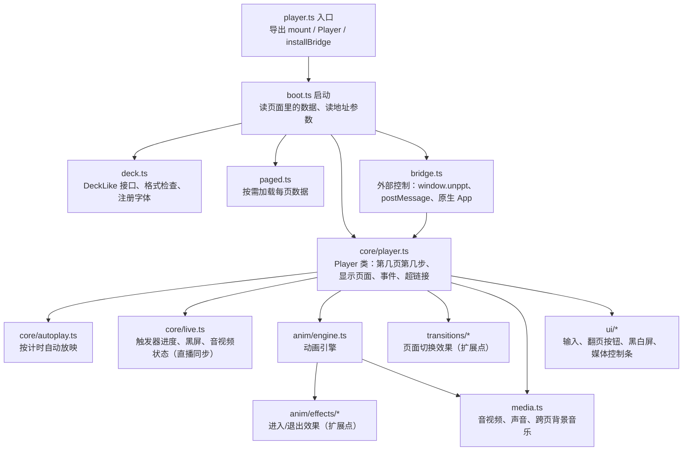

每个文件只做一件事。`core/player.ts` 是"总指挥"，自己不画动画、不处理按键，而是把活分给下面的模块。

| 文件 | 职责 |
|---|---|
| `player.ts` | 入口。页面加载完成后自动调用 `autoBoot()` |
| `boot.ts` | 找到页面里的数据，创建 `Player`，装上 bridge；也提供 `mount()` 给单独部署用 |
| `deck.ts` | 定义播放器眼里的"演示数据"接口 `DeckLike`；`checkFormat` 检查格式和版本；`loadFonts` 注册字体 |
| `paged.ts` | 按需加载形式（paged / pages）：用 `<script>` 标签一页一页加载 |
| `core/player.ts` | `Player` 类：翻页状态、显示页面、发事件、跟随超链接 |
| `core/autoplay.ts` | 按"自动换片时间"自动放映 |
| `core/live.ts` | 直播课同步里"页和步"以外的状态 |
| `core/emitter.ts` | 简单的事件收发（`on` / `off` / `emit`，监听 `'*'` 收到所有事件） |
| `anim/engine.ts` | 动画引擎：播一组动作、瞬间应用一组动作、把正在播的动画跳到结束 |
| `anim/effects/` | 每种进入/退出效果一个文件 |
| `anim/behaviors.ts` `formula.ts` `reveal.ts` | 按 PowerPoint 原始的"动画行为"播放（关键帧、公式、显现滤镜） |
| `anim/target.ts` | 强调动画和路径动画（缩放、旋转、移动、变色……） |
| `anim/text-units.ts` | 文字逐字 / 逐词出现 |
| `transitions/` | 每种页面切换一个文件 |
| `media.ts` | 音视频播放、剪裁、淡入淡出、全屏播放、跨页背景音乐、动画声音 |
| `ui/input.ts` | 点击、键盘、触屏 → 翻页指令 |
| `ui/controls.ts` | 右下角的翻页按钮和页码（鼠标移上去才显示） |
| `ui/blank-screen.ts` | 黑屏 / 白屏 |
| `ui/media-bar.ts` | 音视频控制条 |
| `bridge.ts` | 外部控制协议 |
| `host.ts` | 给**宿主页面**用的小工具类 `UnpptFrame`（不在播放器里运行） |
| `css.ts` | 播放器自己的样式，只注入一次 |

---

## 3. 启动：播放器从哪里拿到数据

播放器有三种启动方式，区别只在"数据从哪里来"：

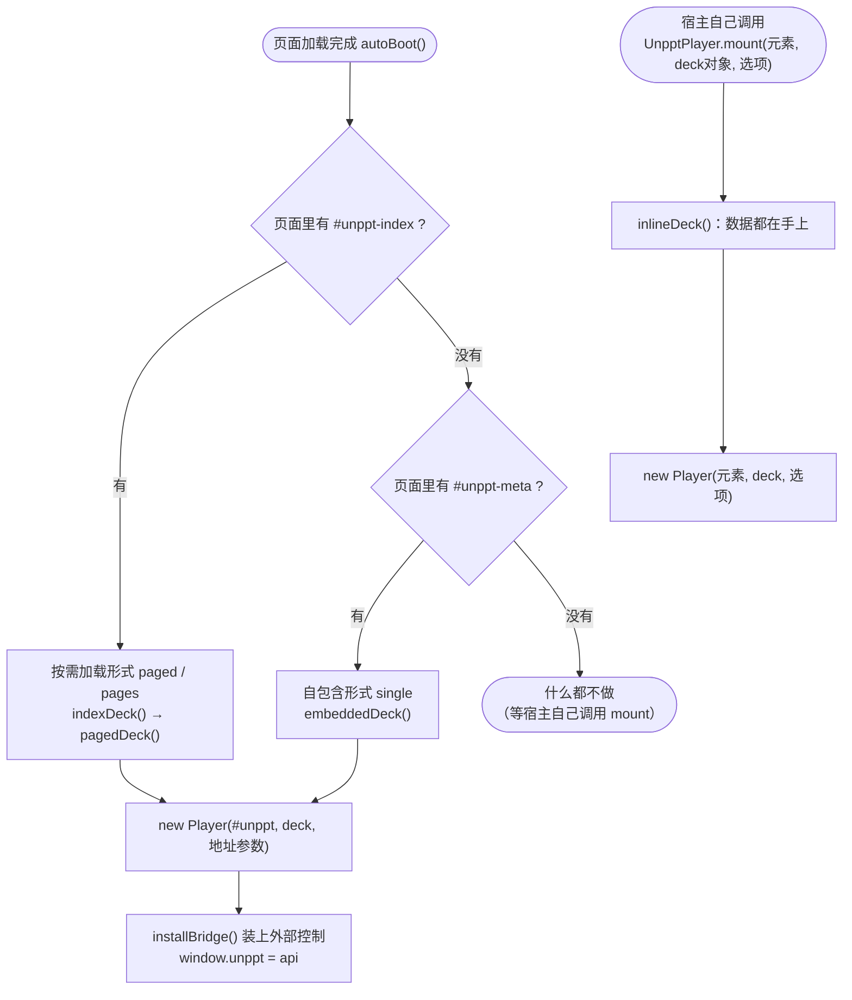

| 方式 | 数据在哪 | 谁来启动 |
|---|---|---|
| **single**（默认产物） | 全部在 HTML 里：`<script id="unppt-meta">` 是演示信息，每页一个 `<script class="unppt-slide">` | 自动 |
| **paged / pages** | HTML 里只有目录 `<script id="unppt-index">`，每页数据在 `pages/*.js` | 自动 |
| **mount** | 宿主自己加载 `deck.json`，把对象传进来 | 宿主写代码调用 |

如果启动出错（例如数据版本太新），挂载点里会显示一句 `无法播放：原因`。

### 3.1 格式检查

`deck.ts` 的 `checkFormat` 做两件事：

1. `format` 必须是 `"unppt-deck"`，否则报错"不是 unppt 演示数据"；
2. `version` 不能比播放器认识的版本（`DECK_FORMAT_VERSION`，目前是 `1`）更新，否则报错"演示数据版本 N 太新，请升级播放器"。

### 3.2 地址参数

自动启动时，播放器会读页面地址里的参数（`boot.ts` 的 `readParams`）：

| 参数 | 作用 | 默认 |
|---|---|---|
| `?slide=3` | 打开时直接到第 4 页（从 0 开始数） | 第一张不隐藏的页 |
| `?step=1` | 打开时直接到这一页的第 1 步之后 | 0 |
| `?ui=0` | 不显示自带的翻页按钮 | 显示 |
| `?mode=watch` | 观看模式：只听 JS 接口的，不响应用户操作 | `present`（演绎模式） |
| `?links=0` | 点外部链接时不自己打开，只发 `link` 事件 | 自己打开 |
| `?timings=1` / `?timings=0` | 强制开启 / 关闭按计时自动放映 | 开启；但带了 `slide` 或 `step` 时默认关闭（方便截图） |
| `?static=1` | 静态显示：所有对象原样显示，不放动画（评测工具对照参考图用） | 关 |
| `?origin=https://a.com,https://b.com` | 只接受这些来源发来的 postMessage 指令 | 接受所有来源 |

用 `mount()` 时，同样的选项写在第三个参数里（`MountOptions`）：`slide`、`step`、`ui`、`openLinks`、`timings`、`static`、`mode`，以及 `clickToNext`（点击画面是否翻页，默认是）、`keyboard`（键盘翻页，默认开）、`baseUrl`（字体等相对路径的前缀）。

---

## 4. 加载页面数据

播放器不直接拿"所有页的数组"，而是通过 `DeckLike` 接口按需要某一页：

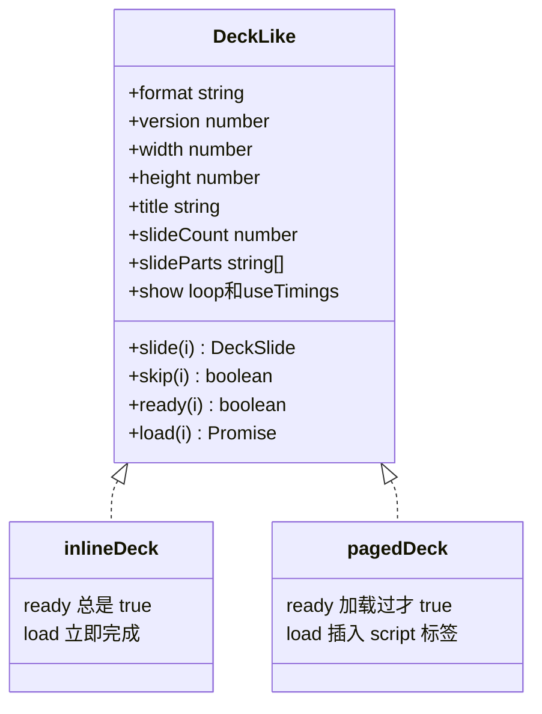

- `slide(i)`：拿第 i 页的数据（`DeckSlide`，见 [产物格式](output-format.md)）；
- `skip(i)`：第 i 页是不是隐藏页——**不用先加载这一页就能知道**（目录里写着）；
- `ready(i)` / `load(i)`：这一页的数据到了没有 / 去加载它。

### 4.1 single 形式：一次下载，按需解析

整个 HTML 一次下载完，但播放器**不会一开始就解析所有页**：

- 第一次要看第 i 页时，才 `JSON.parse` 第 i 个 `<script class="unppt-slide">`；
- 只缓存最近解析的大约 8 页，几百页的大文件也不会占太多内存；
- 同一张图片在文件里只存一份：页面 SVG 里写的是 `unppt:asset/编号`，真正的图片数据放在 `<script class="unppt-asset" data-id="编号">`，显示前替换回来；
- 字体在 `<script class="unppt-font" data-family="别名">` 里（base64 编码的 WOFF），启动时全部注册。

### 4.2 paged / pages 形式：按需加载 + 预加载

入口 HTML 只有目录，每页数据是一个单独的脚本文件 `pages/<页号>.<哈希>.js`，内容是一句函数调用：

```js
__unpptPage(0, { "svg": "<svg ...>", "steps": [...], ... });
```

为什么用 `<script>` 标签而不用 `fetch`？因为 `fetch` 在本地双击打开（`file://`）时会被浏览器拦住，而 `<script>` 不会；跨域托管也不需要配置 CORS。

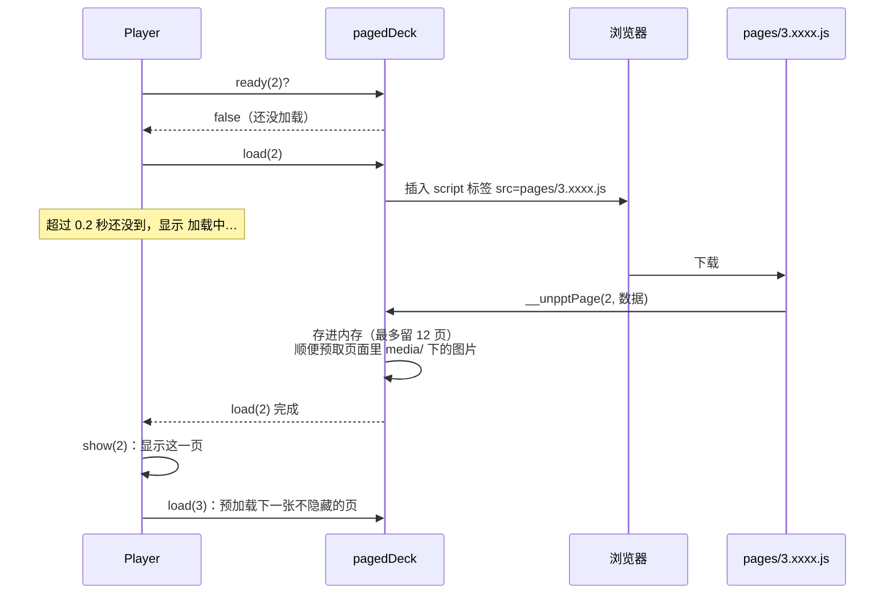

要点：

- 内存里最多留 12 页（`KEEP = 12`），多了就丢掉最早加载的，以后要看再加载一次（浏览器缓存里还有）；
- 每次翻页 `navToken` 加一：如果你快速连按几下，前面几页的数据回来时会被忽略，只显示最后要的那一页；
- 显示完一页后，自动预加载下一张不隐藏的页；
- 页面数据到了以后，顺便用 `new Image()` 预取它引用的 `media/` 图片，翻到这页时图片已经在缓存里；
- 字体：目录里每个字体对应一个 `fonts/<别名>.<哈希>.js`（调用 `__unpptFont(别名, base64)`），启动时全部开始加载，不挡住页面显示，字体到了浏览器会自动重绘；
- 加载失败时，舞台上显示 `第 N 页加载失败：原因`。

---

## 5. 显示一页：渲染和缩放

### 5.1 舞台和缩放

> 舞台的位移会取整到**设备像素**（`位移 × 设备像素比` 是整数）：落在半个像素上时，Chromium 会在幻灯片边缘画出一道灰缝，不同浏览器之间也会整页差 1 个设备像素。设备像素比变了（窗口拖到另一块屏、浏览器缩放）会重新适配。

播放器的 DOM 结构是这样的：

```text
div.unppt-root          ← 占满容器，黑色背景
├─ div.unppt-stage      ← "舞台"：固定为幻灯片的像素大小（例如 1280×720），用 CSS transform 缩放
│   └─ div.unppt-slide  ← 当前页（切换时新旧两页会同时存在一会儿）
│       └─ <svg>…</svg>
├─ div（隐藏）           ← 常驻容器：跨页播放的背景音乐、动画声音放在这里
├─ div.unppt-ui         ← 翻页按钮和页码
├─ div.unppt-mbar       ← 音视频控制条
└─ div.unppt-blank      ← 黑屏 / 白屏遮罩
```

舞台永远是幻灯片的原始像素大小，播放器只用 `transform` 把它整体缩放、居中（`Player.fit()`）：

```text
scale = min(容器宽 / 幻灯片宽, 容器高 / 幻灯片高)
x = (容器宽 - 幻灯片宽 × scale) / 2
y = (容器高 - 幻灯片高 × scale) / 2
stage.style.transform = translate(x, y) scale(scale)
```

所以比例永远不变，多出来的地方是黑边（"留黑边"）。容器大小一变（`ResizeObserver` 和窗口 `resize` 事件），就重新算一次。

文字位置在转码时已经算好，播放器**不做任何排版**，只是把 SVG 放上去。这是 unppt 能和 PowerPoint 对齐的关键之一。

### 5.2 show()：显示一页的步骤

`Player.show(页, 步, 是否播动画)` 是播放器最核心的函数：

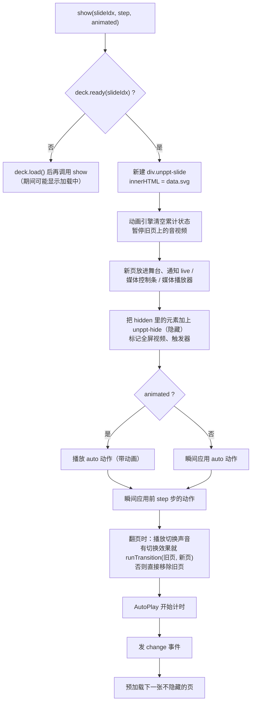

"瞬间应用前 step 步"这一点让 `goto` 有**确定性**：不管之前播过什么，跳到"第 5 页第 2 步"就是重新画第 5 页，然后把第 0、1 步的结果直接摆上去。

---

## 6. 播放状态：第几页、第几步

### 6.1 四个基本操作

| 操作 | 做什么 |
|---|---|
| `next()` | 先把还在播的动画跳到结束；这一页还有步骤 → 播下一步（带动画）；没有了 → 翻到下一张不隐藏的页（带切换效果）；已经是最后一页 → 循环放映时回到第一页，否则发 `end` 事件 |
| `prev()` | 这一页已经点过 → 回到上一步（**不倒放**，直接显示上一步结束的样子）；已经在第 0 步 → 到上一张不隐藏的页的**最后一步** |
| `goto(页, 步)` | 直接显示目标页、目标步的最终状态，不播切换和动画 |
| `sync(状态)` | 观看端跟上演绎端：目标正好是"下一步"或"下一页开头"时照常播动画和切换，和现在一样时什么都不做，其它情况等同 `goto`；再对齐黑屏、触发器、音视频 |

### 6.2 状态图

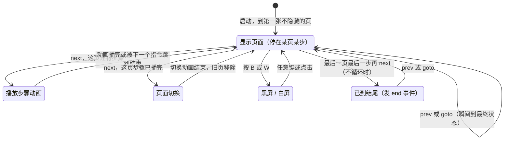

（"已到结尾"不是真的状态，只是发出一个 `end` 事件，画面停在最后一页。）

### 6.3 状态对象 PlayerState

`getState()`、所有事件、所有指令的返回值都是这个对象：

| 字段 | 意思 |
|---|---|
| `slide` | 当前页（从 0 开始） |
| `step` | 这一页已经播了几步（从 0 开始） |
| `slideCount` | 总页数（包含隐藏页） |
| `stepCount` | 这一页主序列的点击次数（不含触发器） |
| `blank` | 黑屏 / 白屏的颜色（`#000` / `#fff`），没黑屏时没有这个字段 |
| `triggers` | 这一页每个触发器已经播到第几组，例如 `{ "s3": 1 }`（点过才有） |
| `media` | 这一页播放过的音视频：`[{ uid, playing, time }]` |

### 6.4 隐藏页

PowerPoint 里"隐藏幻灯片"的页，数据里 `skip: true`：

- `next` / `prev`、Home / End 按顺序翻时跳过它；
- `goto`、页码跳转、超链接、动作按钮仍然可以跳过去；
- `slideCount` 包含它。

---

## 7. 动画引擎

### 7.1 一页的动画数据

每页数据里和动画有关的字段（详细定义见 [产物格式](output-format.md#7-动画)）：

| 字段 | 意思 |
|---|---|
| `steps` | 二维数组：`steps[k]` 是第 k 次点击要执行的一组动作。`steps.length` 就是这一页要点几下 |
| `auto` | 进入页面时就自动执行的动作（PowerPoint 里"与上一动画同时 / 之后"开头的效果） |
| `hidden` | 第 0 步时要隐藏的元素 uid（有进入动画的元素一开始看不见） |
| `triggers` | 触发器：点某个元素时依次播放的动作组，不影响普通的点击顺序 |

每个动作（`AnimAction`）说的是"对哪个元素（`uid`）、做什么效果（`effect`）、进入还是退出还是强调（`dir`）、延迟多久开始（`delay`）、持续多久（`dur`）"，时间单位都是毫秒。

一组动作里的各个动作**同时开始计时**，靠各自的 `delay` 错开先后。例如 PowerPoint 里"单击 → 飞入 A（0.5 秒）→ 之后 淡入 B（0.5 秒）"会变成一组：

```text
时间轴（毫秒）  0        500       1000
A 飞入          |=========|
B 淡入                    |=========|
                A: delay 0, dur 500
                B: delay 500, dur 500
```

### 7.2 播放 vs 瞬间应用

动画引擎（`AnimationEngine`）对外只有三个主要方法：

| 方法 | 什么时候用 | 做什么 |
|---|---|---|
| `play(actions)` | 用户点下一步、进入页面 | 用 Web Animations 真的播放 |
| `applyInstant(actions)` | `goto`、`prev`、深链接 | 不播，直接把结束后的样子摆好（显示/隐藏、强调的最终状态） |
| `finishRunning()` | 任何新指令到达时 | 把还在播的动画全部 `finish()` 跳到结束 |

因为每个新指令都会先 `finishRunning()`，所以连续快速点击时，上一步的动画会立刻跳到结束，不会叠在一起乱掉。

### 7.3 一个动作是怎么播出来的

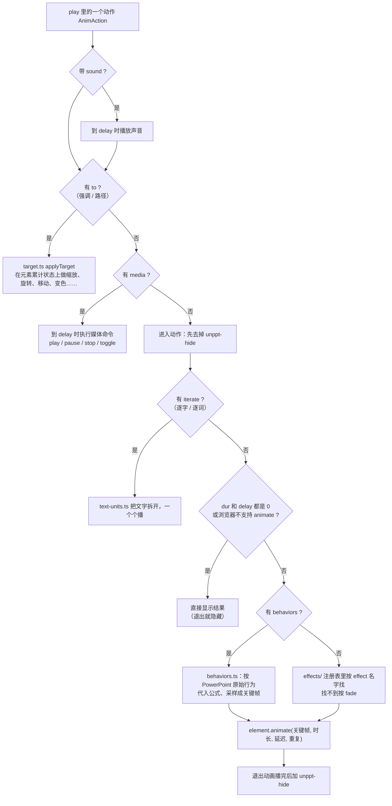

几个细节：

- **隐藏用 `visibility:hidden`**（CSS 类 `unppt-hide`），元素还占着位置，所以显示出来时不会让别的东西跳动；
- **进入动画有延迟时**，延迟期间保持隐藏，到点才露出来；
- **退出动画**用同一组关键帧倒着播（`reversible()`），播完加上 `unppt-hide`；
- **重复和自动翻转**（`repeat`、`autoRev`）换算成 Web Animations 的 `iterations` 和 `direction: 'alternate'`；`repeat: -1` 表示一直重复到下一次点击；
- **强调动画**会累加：同一个元素先放大 1.5 倍再旋转 30 度，引擎记得它当前的状态（`TransformState`：位移、缩放、旋转），下一次在这个基础上继续。换页时清空，跳转时从头重算，保证确定性。

### 7.4 两种画法：按效果名 / 按 PowerPoint 原始行为

**按效果名**：`effect` 是 `fade`、`fly`、`wipe` 这类名字，播放器在 `anim/effects/effects.ts` 的注册表里找到对应的文件，给出关键帧。已注册的效果：

`fade`、`fly`、`wipe`、`split`、`zoom`、`float`、`shape`、`wheel`、`blinds`、`growTurn`、`swivel`、`bounce`、`emphasis`、`path`（没注册的名字，例如 `appear`、`random`，按 `fade` 画）。

**按原始行为**：PowerPoint 内部其实是用一组"行为"描述一个动画的，例如"飞入（从下方）"是：

```json
{ "prop": "y", "keys": [[0, "1+#ppt_h/2"], [1, "#ppt_y"]] }
```

意思是"y 坐标从 `1+#ppt_h/2`（幻灯片底边再往下半个元素高）变到 `#ppt_y`（原来的位置）"。转码器把这些行为原样带过来（`behaviors` 字段），播放器在 `anim/behaviors.ts` 里：

1. 量出元素此刻在幻灯片上的位置和大小，作为 `#ppt_x`、`#ppt_y`、`#ppt_w`、`#ppt_h`（都是幻灯片宽高的比例）；
2. 用 `formula.ts` 计算公式（自己写的小解析器，**不用 `eval`**，支持 `+ - * / ^ %`、`sin`、`cos`、`sqrt` 等函数和 `pi`、`e`；`rand` 总是取中间值，保证每次播放一样）；
3. 按加速/减速（`accel`/`decel`）、`tmFilter`、往返、重复算出每个时刻的位置、大小、旋转、透明度和显现进度；
4. 采样成 6～120 个关键帧（大约每 25 毫秒一个），交给 `element.animate()`。

显现类行为（`prop: "reveal"`，如 `wipe(down)`、`circle(in)`、`wheel(4)`）由 `anim/reveal.ts` 换算成 CSS `clip-path`，让元素一点点露出来。

**有 `behaviors` 时优先用它**，这样效果和 PowerPoint 最接近；没有时才看 `effect` 名字。

### 7.5 触发器

触发器动画（PowerPoint"单击某个形状时播放"）由 `core/live.ts` 管理：

- 进入页面时，触发器元素加上 CSS 类 `unppt-trigger`（鼠标变成手形）；
- 点击时从点到的元素往上找，找到触发器就播它的下一组动作，进度 +1；全部播完后再点什么也不做（也不翻页）；
- 换页时进度清零；
- 进度会写进 `PlayerState.triggers`，直播同步时观看端照着对齐。

---

## 8. 按计时自动放映

PowerPoint 可以给每页设置"自动换片时间"。数据里是 `advance.after`（毫秒）。`core/autoplay.ts` 按实测的 PowerPoint 规律工作：

1. 计时从进入这一页开始；
2. 这一页的点击步骤**自动依次播放**：上一步的动画播完就播下一步；
3. 到了换片时间、**并且**动画都播完，才翻到下一页（取两者较晚的那个时刻）；
4. 用户自己翻页、跳转时重新计时。

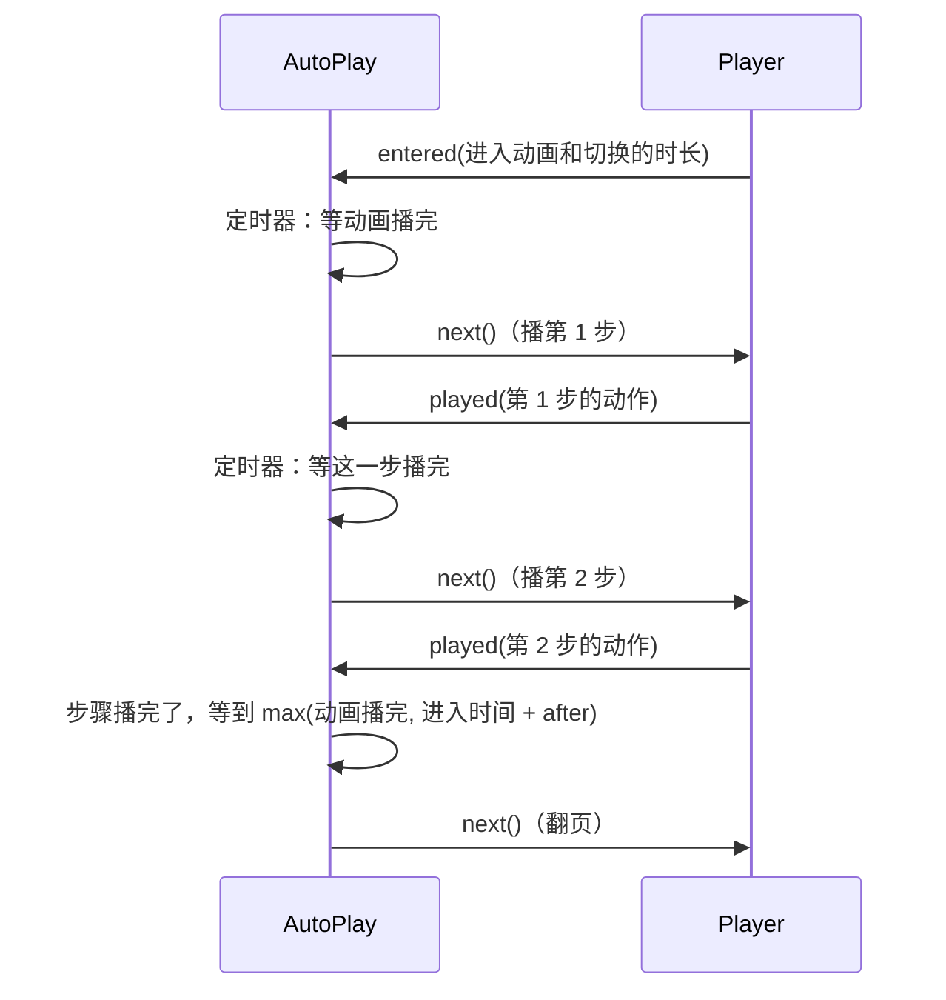

什么时候**不**自动放映：

- 地址参数 `?timings=0` 或 `mount` 传 `timings: false`；
- 用 `?slide=` / `?step=` 打开（截图、预览）且没写 `?timings=1`；
- 放映设置里关掉了"使用计时"（数据里 `show.useTimings` 为 `false`）；
- 观看模式（`mode: 'watch'`）。

另外，`advance.click` 为 `false` 的页（PowerPoint 里取消了"单击鼠标时换片"），单击画面不往下走，但键盘和接口照常。

---

## 9. 页面切换

翻页时（`show(…, animated=true)`），如果新页有 `transition` 且类型不是 `none`，就调用 `transitions/transitions.ts` 的 `runTransition(旧页, 新页, 切换)`：

1. 新页已经放在旧页上面；
2. 时长限制在 100～3000 毫秒之间；
3. 在注册表里按 `type` 找效果，找不到按 `fade`；
4. 效果返回一个 `Animation`，它结束（或被取消）时旧页被移除；
5. 这个 `Animation` 交给动画引擎管理，所以切换中途再按一下，切换会直接跳到结束。

已注册的切换类型：

| 类型 | 中文名 | 类型 | 中文名 |
|---|---|---|---|
| `fade` | 淡入（可穿过黑色） | `zoom` | 盒状 |
| `cut` | 切出 | `wheel` | 轮子 |
| `flash` | 闪光 | `wedge` | 扇形 |
| `push` | 推入 | `newsflash` | 新闻快报 |
| `cover` | 覆盖 | `blinds` | 百叶窗 |
| `pull` | 揭开 | `checker` | 棋盘 |
| `wipe` | 擦除 | `comb` | 梳理 |
| `split` | 分割 | `randomBar` | 随机线条 |
| `strips` | 条纹 | `dissolve` | 溶解 |
| `circle` | 圆形 | `morph` | 平滑切换 |
| `diamond` | 菱形 | `plus` | 加号 |

实现方式大致三类：

- 位移 / 透明度用关键帧（如 `push.ts`、`cover.ts`、`fade.ts`）；
- 软边扫过用 `soft-edge.ts` 逐帧设置遮罩渐变（如 `wipe.ts`、`circle.ts`、`wheel.ts`）；
- 图块用 `tiles.ts` 逐帧设置裁剪多边形（如 `dissolve.ts`、`checker.ts`）。

**平滑切换（morph）**：前后两页里同名（SVG 上 `data-name` 相同）的顶层对象，从旧位置、旧大小平滑变到新位置、新大小，新旧两份交叉淡化；新页其余内容逐个淡入。

速度曲线是用 PowerPoint 放映逐帧截图实测出来的，例如淡入是 `0.5 - 0.5cos(πt)`。

**切换声音**：只在翻页播放时出声，`goto` 和深链接打开不出声。

---

## 10. 用户输入

`ui/input.ts` 把用户操作翻译成指令。观看模式下不绑定任何输入。

### 10.1 键盘

| 按键 | 作用 |
|---|---|
| → ↓ PageDown 空格 Enter | 下一步 |
| ← ↑ PageUp Backspace | 上一步 |
| Home | 第一张不隐藏的页 |
| End | 最后一张不隐藏的页 |
| B 或 `.` | 黑屏 |
| W 或 `,` | 白屏 |
| 数字 + Enter | 跳到第 N 页（从 1 开始数，包含隐藏页；2 秒内不继续输入就作废） |
| 黑屏 / 白屏时按任意键 | 回到幻灯片（不翻页） |

按住 Alt / Ctrl / Cmd 的组合键不处理；焦点在输入框里（例如控制条的进度条）时也不处理。

### 10.2 点击

点击画面时，按下面的优先级决定做什么：

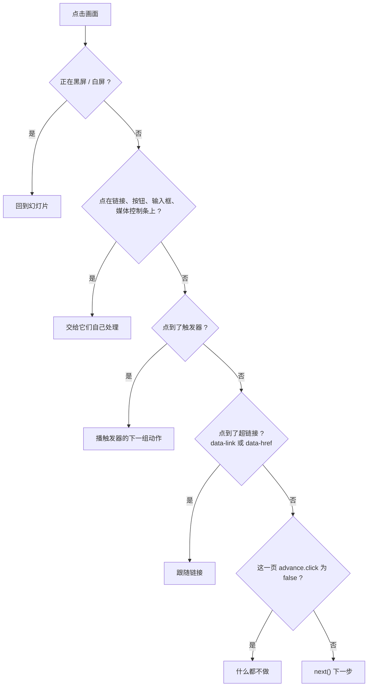

`mount` 时传 `clickToNext: false` 可以关掉点击处理。

### 10.3 触屏

在 600 毫秒内横向滑动超过 40 像素、并且横向距离超过纵向的 1.5 倍：向左滑 = 下一步，向右滑 = 上一步。

### 10.4 自带按钮

`ui/controls.ts` 在右下角放 `‹`、页码 `N / 总数`、`›` 三个控件，鼠标移到播放器上才显示。`?ui=0` 或 `ui: false` 关掉，用你自己的按钮调用 `next` / `prev` / `goto`。

---

## 11. 超链接

转码器把 PowerPoint 的超链接写成 SVG 属性，播放器在 `Player.follow()` 里处理：

| 属性 | 意思 | 播放器怎么做 |
|---|---|---|
| `data-link="next"` / `"prev"` / `"first"` / `"last"` | 动作按钮：下一页、上一页、第一页、最后一页 | 跳到对应的不隐藏页 |
| `data-link="slide:ppt/slides/slide3.xml"` | 跳到某一页（写的是 pptx 里的部件路径） | 在 `slideParts` 里查到页号再 `goto` |
| `data-link="media"` | 点击媒体 | 切换这个媒体的播放 / 暂停 |
| `data-href="https://..."` | 外部网址 | 发 `link` 事件；默认在新标签页打开 |

外部网址只认 `http:`、`https:`、`mailto:`、`tel:`，打开时带 `noopener,noreferrer`，永远是新标签页，不会把播放器所在的页面跳走。`?links=0`（或 `openLinks: false`）时只发事件不打开，由宿主决定（比如先弹个提示）。

---

## 12. 音视频和声音

`media.ts` 负责所有声音和视频。

### 12.1 页面上的音视频

转码器把视频写成 SVG 里的 `<foreignObject><video data-media="1" src="media/..." poster="..."></video></foreignObject>`，音频是隐藏的 `<audio>`。

| 功能 | 怎么实现 |
|---|---|
| 未播放时显示封面 | `<video poster="...">` |
| 点视频切换播放 / 暂停 | 元素上有 `data-link="media"`，点击时 `toggle`，不翻页 |
| 动画里的播放 / 暂停 / 停止 | 动作 `effect: "media"`，`media` 为 `play` / `pause` / `stop` / `toggle`，`start` 是从第几秒开始 |
| 剪裁 | `data-trim-start` / `data-trim-end`（秒）：播到剪裁终点就停，循环时回到剪裁起点 |
| 淡入淡出 | `data-fade-in` / `data-fade-out`（秒）：每帧按播放位置调音量 |
| 全屏播放 | 页面数据 `fullScreen` 里列出的视频，播放时在整页上盖一个黑底、等比放满的副本；播完、停止或翻页时去掉 |
| 跨页播放（背景音乐） | 动作带 `across: N`（N > 1）：把媒体元素移到常驻容器里，翻页不停，超出 N 页的范围才停 |
| 循环 | 动作带 `loop: true` |

`media/` 目录下的外部媒体文件要用支持 HTTP Range 请求的服务器提供（常见 Web 服务器都支持），否则 Chromium 拖不动进度。

### 12.2 控制条

`ui/media-bar.ts`：鼠标移到视频或音频图标上时，在它下方出现控制条（播放/暂停、进度条、`当前时间 / 总时长`）；触屏上点一下出现。点在控制条上不会翻页；剪裁过的媒体只在剪裁范围里拖动。

### 12.3 动画声音和切换声音

动作上的 `sound`、切换上的 `sound`：

- 同一时间只有一个声音，新的声音会停掉正在播的；
- 翻页不停（和 PowerPoint 一样）；
- 切换的 `stopSound` 表示"停止前一声音"；
- 浏览器阻止自动播放时静默忽略。

> 浏览器通常禁止"用户还没点过页面"就自动出声。直播课的观看端需要引导用户先点一下（例如"进入课堂"按钮）。

---

## 13. 两种模式：演绎和观看

| | 演绎模式 `present`（默认） | 观看模式 `watch` |
|---|---|---|
| 谁来翻页 | 观看者自己点击、按键、滑动 | 只听 JS 接口 |
| 自带按钮 | 有（可以用 `ui=0` 关） | 没有 |
| 点击 / 键盘 / 触屏 | 响应 | 不响应（舞台 `pointer-events:none`） |
| 超链接、触发器、控制条 | 能点 | 不能点 |
| 按计时自动放映 | 会 | 不会 |

直播课的用法：老师端用演绎模式，每次 `change` 事件把状态通过你自己的 IM 发出去；学生端用观看模式，收到状态就调用 `sync(状态)`。详见 [嵌入与外部控制](embedding.md)。

---

## 14. 外部控制（bridge）

`bridge.ts` 让外部程序控制播放器，三种宿主共用同一套指令格式：

| 宿主 | 发指令 | 收结果和事件 |
|---|---|---|
| 同一个页面的 JS | `window.unppt.goto({ slide: 3, step: 0 })`（返回 Promise） | `window.unppt.on('change', fn)` |
| iframe 的父页面（可跨域） | `iframe.contentWindow.postMessage({ unppt: 1, id: 7, cmd: 'goto', args: { slide: 3 } }, '*')` | 回复 `{ unppt: 1, re: 7, ok: true, result }`，事件 `{ unppt: 1, event: 'change', data }` |
| 原生 App 的 WebView | `window.unppt.handle('<JSON 字符串>')` | 播放器调用 `window.webkit.messageHandlers.unppt`（iOS）、`window.UnpptNative.postMessage`（Android）、`window.ReactNativeWebView.postMessage`（React Native） |

指令：`next`、`prev`、`goto`、`sync`、`getState`。事件：`ready`、`change`、`end`、`link`。

一次 iframe 控制的完整过程：

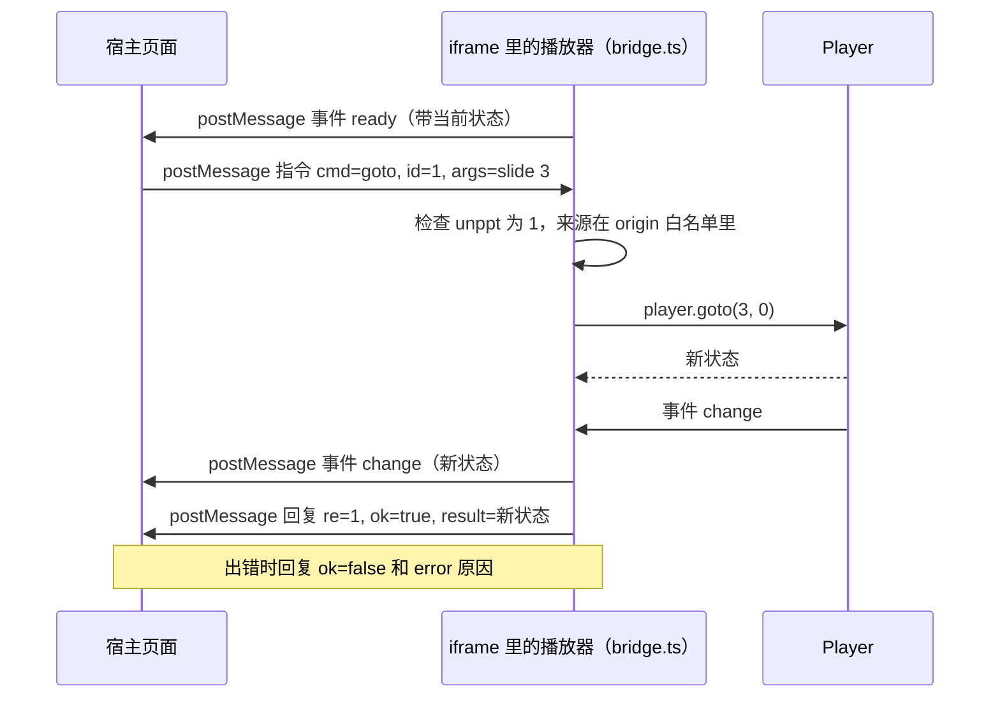

宿主页面可以用 `packages/player/dist/host.js` 里的 `UnpptFrame` 类省去手写 postMessage：

```js
import { UnpptFrame } from './host.js';
const deck = new UnpptFrame(document.querySelector('iframe'));
await deck.ready;
await deck.goto(3, 0);
deck.on('change', (s) => console.log(s.slide, s.step));
```

`UnpptFrame` 会给每条指令编号、等对应的回复（10 秒没回复算失败），并在 iframe 加载完时主动问一次状态，防止错过 `ready` 事件。

完整用法、安全建议（`?origin=` 白名单）、直播同步示例请看 [嵌入与外部控制](embedding.md)；可运行的例子在仓库的 `examples/iframe-host.html` 和 `examples/live-class.html`。

---

## 15. 怎么给播放器加新效果（扩展点）

播放器遵循"加新能力 = 新文件 + 注册表一行"：

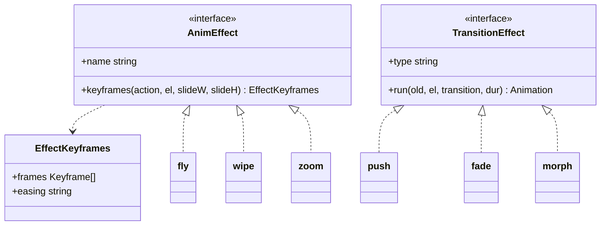

| 想加什么 | 怎么加 |
|---|---|
| 进入 / 退出效果 | 新建 `anim/effects/xxx.ts` 导出一个 `AnimEffect`（给出进入时的关键帧，退出自动倒放），在 `anim/effects/effects.ts` 的 `EFFECTS` 里加一行 |
| 页面切换 | 新建 `transitions/xxx.ts` 导出一个 `TransitionEffect`，在 `transitions/transitions.ts` 的 `TRANSITIONS` 里加一行 |
| 显现滤镜 | 在 `anim/reveal.ts` 的 `FILTERS` 里加一项 `名字(进度, 参数, 元素) => clip-path` |

没注册的效果都有兜底（按淡入画），所以新版本转码器产出的新效果名，老播放器也能播，只是样子简单一点。

更多架构说明见 [docs/architecture.md](../architecture.md)。

---

## 16. 兼容性小结

- 动画和切换依赖浏览器的 Web Animations API（`element.animate`）。老版本 Android WebView 没有它时，播放器直接显示动画结果、直接换页，不会报错；
- 字体用 `FontFace` 接口注册，不支持时退回 `@font-face` 样式；字体加载失败用回退字体显示；
- 打包目标是 ES2019。
