[English](../en/transcoding.md)

# 转码原理：一个 .pptx 是怎么变成网页的

这篇文档顺着代码讲一遍：从你在命令行敲下 `unppt convert 课件.pptx` 开始，到磁盘上出现 `课件.html`、`prop.json`、`pic/`、`thum/` 为止，中间每一步做了什么、代码在哪个文件里。

读完你应该能回答：

- .pptx 文件里面到底装了什么？
- 转码器从哪里进来，先做什么、后做什么？
- 一页幻灯片是怎么一层一层画成 SVG 的？
- 文字为什么能和 PowerPoint 在同一个地方换行？
- 动画、字体、整页图、产物文件分别是怎么生成的？

> 本文所有函数名、文件名、选项名都来自 `packages/transcoder/src/` 里的代码。路径都相对这个目录写，例如 `render/render.ts` 指 `packages/transcoder/src/render/render.ts`。

---

## 目录

1. [先认识几个词](#1-先认识几个词)
2. [.pptx 文件里装了什么](#2-pptx-文件里装了什么)
3. [一次转码的全过程（总览）](#3-一次转码的全过程总览)
4. [第 1 步：命令行 cli.ts](#4-第-1-步命令行-clits)
5. [第 2 步：按需读取 zip 和 XML](#5-第-2-步按需读取-zip-和-xml)
6. [第 3 步：演示文稿模型 Presentation](#6-第-3-步演示文稿模型-presentation)
7. [第 4 步：逐页渲染成 SVG](#7-第-4-步逐页渲染成-svg)
8. [文字排版引擎](#8-文字排版引擎)
9. [图表](#9-图表)
10. [动画和页面切换](#10-动画和页面切换)
11. [字体：查找、替代、嵌入和子集化](#11-字体查找替代嵌入和子集化)
12. [图片、音视频](#12-图片音视频)
13. [整页图和缩略图（pic/ 和 thum/）](#13-整页图和缩略图pic-和-thum)
14. [写出产物：四种产物形式](#14-写出产物四种产物形式)
15. [出错了会怎样](#15-出错了会怎样)
16. [PowerPoint 概念和源码文件对照表](#16-powerpoint-概念和源码文件对照表)
17. [还没做好的地方](#17-还没做好的地方)

---

## 1. 先认识几个词

| 词 | 意思 |
|---|---|
| **转码器（transcoder）** | 把 .pptx 变成网页文件的程序，代码在 `packages/transcoder/`。它是一个"纯函数"：给它字节，它通过你提供的 `write` 回调交还文件，自己不读写磁盘、不联网 |
| **播放器（player）** | 在浏览器里播放产物的 JS 程序（`packages/player/`），本文不细讲 |
| **产物** | 转码的输出：HTML 文件、`prop.json`、`media/`、`pic/`、`thum/` 等 |
| **SVG** | 一种用文字描述图形的格式（矢量图），浏览器原生支持，放大不会糊。unppt 把每一页画成一个 SVG |
| **XML** | 一种用尖括号标签描述数据的文本格式，例如 `<a:off x="0" y="0"/>`。.pptx 里几乎所有内容都是 XML |
| **zip** | 压缩包格式。.pptx 其实就是一个改了扩展名的 zip |
| **EMU** | English Metric Unit，PowerPoint 内部的长度单位。1 英寸 = 914400 EMU，1 像素（96 DPI）= **9525** EMU（代码里的常量 `EMU_PER_PX`） |
| **部件（part）** | zip 里的一个文件，例如 `ppt/slides/slide1.xml` |
| **关系（relationship，rels）** | 部件之间"谁引用谁"的表，存在 `_rels/xxx.rels` 文件里。例如幻灯片通过关系找到它用的版式和图片 |
| **母版 / 版式 / 主题** | PowerPoint 的模板体系，见第 2 节 |
| **占位符（placeholder）** | 版式里预留的"标题框""正文框"，幻灯片上的标题会继承它的位置和样式 |
| **data-uid** | 写在 SVG 元素上的编号属性，例如 `data-uid="s5"`。动画数据用它指出"让哪个元素动" |
| **WASM** | WebAssembly，浏览器和 Node 都能运行的二进制程序格式。unppt 用它运行 resvg（画图）、HarfBuzz（字体子集化）、libjpeg-turbo（编码 JPEG） |

---

## 2. .pptx 文件里装了什么

把任意一个 .pptx 的扩展名改成 .zip 再解压，你会看到类似下面的结构：

```text
[Content_Types].xml          每个部件是什么类型
_rels/.rels                  入口：主部件在哪
docProps/core.xml            标题、作者等（unppt 读 dc:title 当网页标题）
ppt/presentation.xml         页面尺寸、幻灯片列表、嵌入字体列表
ppt/_rels/presentation.xml.rels
ppt/presProps.xml            放映设置（循环放映、是否按计时）
ppt/slides/slide1.xml        第 1 页的内容
ppt/slides/_rels/slide1.xml.rels   第 1 页引用了哪个版式、哪些图片
ppt/slideLayouts/slideLayout1.xml  版式
ppt/slideMasters/slideMaster1.xml  母版
ppt/theme/theme1.xml         主题：配色、字体、效果样式
ppt/media/image1.png         图片、音视频
ppt/charts/chart1.xml        图表（数据缓存也在里面）
ppt/diagrams/drawing1.xml    SmartArt 的绘图缓存
ppt/fonts/font1.fntdata      嵌入的字体
ppt/notesSlides/...          演讲者备注
```

### 2.1 部件和关系

部件之间不是靠文件名互相找的，而是靠 **关系表**。每个部件旁边的 `_rels/<部件名>.rels` 记录了它引用的其它部件，每条关系有一个编号（如 `rId2`）、一个类型（如 `slideLayout`、`image`）和一个目标路径。

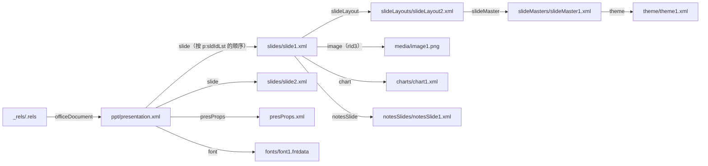

### 2.2 继承链：主题 → 母版 → 版式 → 幻灯片

PowerPoint 的设计是"层层继承"：

- **主题（theme）**：一套配色（`accent1`…`accent6`、`dk1`、`lt1`…）、一套字体（标题字体 major、正文字体 minor）、一套填充/线条/效果样式。
- **母版（slide master）**：用某个主题，规定默认的标题样式、正文样式、背景，以及所有页都有的东西（例如 logo）。
- **版式（slide layout）**：基于母版，规定"标题+内容""两栏"等排布，可以覆盖母版的配色映射。
- **幻灯片（slide）**：基于某个版式，放真正的内容。

一个属性（比如标题的字号）在幻灯片上没写，就去版式上的对应占位符找；版式也没写，就去母版找；母版的文字样式里也没有，就用演示文稿默认样式。

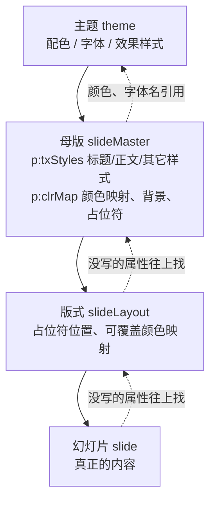

### 2.3 EMU：PowerPoint 的长度单位

XML 里的位置和大小都是 EMU 整数，例如：

```xml
<a:xfrm>
  <a:off x="914400" y="457200"/>     <!-- 左上角：x = 1 英寸，y = 0.5 英寸 -->
  <a:ext cx="4572000" cy="914400"/>  <!-- 宽 5 英寸，高 1 英寸 -->
</a:xfrm>
```

unppt 统一换算成 96 DPI 的像素：`像素 = EMU ÷ 9525`。所以上面这个框是 x=96、y=48、宽 480、高 96 像素。标准 16:9 幻灯片宽 12192000 EMU = **1280 像素**。

其它常见单位：

| 写法 | 含义 | 例子 |
|---|---|---|
| EMU | 长度，9525 EMU = 1 像素 | `x="914400"` |
| 1/100 磅 | 字号 | `sz="1800"` = 18 磅 = 24 像素 |
| 1/60000 度 | 角度 | `rot="5400000"` = 90 度 |
| 1/1000 百分比 | 比例、透明度 | `alpha="50000"` = 50% |

---

## 3. 一次转码的全过程（总览）

先看全景图，后面每节再展开。

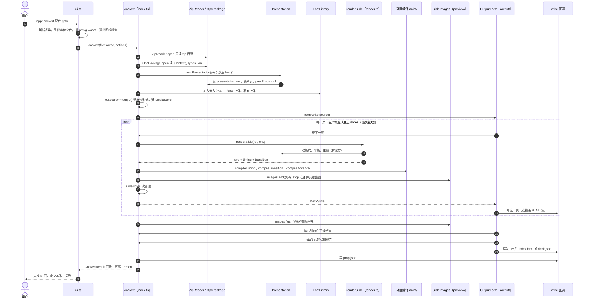

关键点：

- **流式处理**：页面是一页一页"拉"出来的（`slides()` 是一个异步生成器 `AsyncGenerator`），处理完一页就交给产物形式写出、释放内存。所以几百页的大文件也不会把内存撑爆。
- **转码器不碰磁盘**：所有文件都通过 `options.write(相对路径, 数据)` 交出去。命令行的 `write` 写到磁盘；你在云函数里可以写到对象存储。
- **单页出错不影响整份**：某一页渲染抛异常，就输出一页白色空页，并在报告里记一条警告。

---

## 4. 第 1 步：命令行 cli.ts

命令行只做"和文件系统打交道"的事，转码本身交给 `convert`。

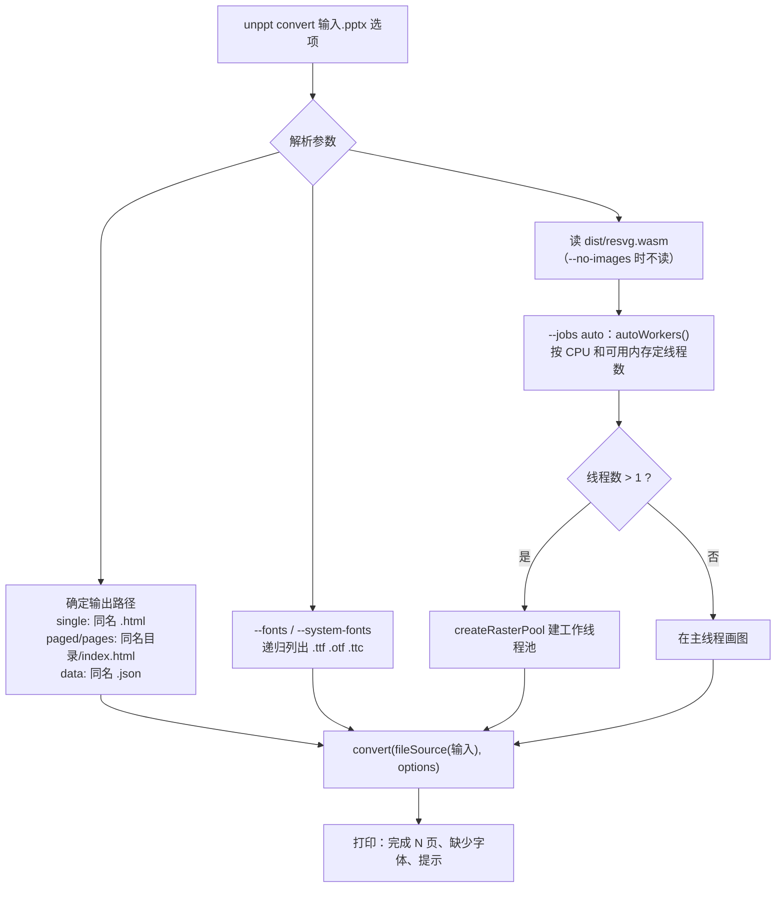

几个值得知道的细节（都在 `cli.ts`）：

- **`fileSource`**：输入文件不是一次性读进内存，而是包装成"按位置读取"的对象 `{ size, read(offset, length) }`，转码器要哪一段就读哪一段。字体文件也一样。
- **`--system-fonts`**：把本机系统字体目录加进字体库，另外把 Office 自带的私有字体和云字体目录（例如 Windows 上的 `Microsoft Office\root\vfs\Fonts\private`）作为 `privateFonts` 传入。私有字体浏览器用不了，所以用到时总是嵌入产物。
- **`autoWorkers()`**（`node-pool.ts`）：线程数 = min(CPU 数, 可用内存 ÷ 400MB)，在 Linux 容器里还会读 cgroup 的 CPU 配额。
- **线程池建不起来**（比如 resvg.wasm 坏了）时退回主线程，转码照常进行，只是报告里多一条"resvg 加载失败"。

命令行选项和 `ConvertOptions` 的对应关系：

| 命令行 | `ConvertOptions` 字段 | 说明 |
|---|---|---|
| `-o, --out` | （命令行自己处理）| 输出文件或目录 |
| `--output single\|paged\|pages\|data` | `output` | 产物形式，默认 `single` |
| `--data` | `output: 'data'` | 同 `--output data` |
| `--fonts <目录>` | `fonts` | 可写多次 |
| `--system-fonts` | `fonts` + `privateFonts` | 系统字体 + Office 私有字体 |
| `--embed-fonts` | `embedFonts: true` | 把用到的字做成子集嵌入 |
| `--no-images` | `images: false` | 不出 `pic/`、`thum/` |
| `--jobs <n\|auto>` | `rasterPool` | 出图线程数 |
| `--inline-limit <字节>` | `inlineLimit` | 小于它的图片内联，默认 2097152（2MB） |
| `-q, --quiet` | 不传 `onProgress` | 不显示进度 |
| `--stats` | — | 显示用时和峰值内存 |

如果你不用命令行，而是在自己的 Node 程序里调用，大致是这样（只用代码里真实存在的导出）：

```js
import { readFile, writeFile, mkdir } from 'node:fs/promises';
import { dirname, join } from 'node:path';
import { convert } from '@unppt/unppt';

const pptx = await readFile('课件.pptx');
const outDir = 'out';
const result = await convert(new Uint8Array(pptx), {
  output: 'single',
  images: false,                     // 不出整页图，就不需要 resvg.wasm
  write: async (path, data) => {
    const target = join(outDir, path);
    await mkdir(dirname(target), { recursive: true });
    if (typeof data === 'string' || data instanceof Uint8Array) {
      await writeFile(target, data);
    } else {                         // AsyncIterable<Uint8Array>：边生成边写
      const chunks = [];
      for await (const c of data) chunks.push(c);
      await writeFile(target, Buffer.concat(chunks));
    }
  },
});
console.log(result.slides, result.report.missingFonts, result.report.warnings);
```

`write` 收到的数据有三种：字符串、`Uint8Array`、或者 `AsyncIterable<Uint8Array>`（大文件分块流过来）。

`ConvertOptions` 和 `ConvertResult` 的结构：

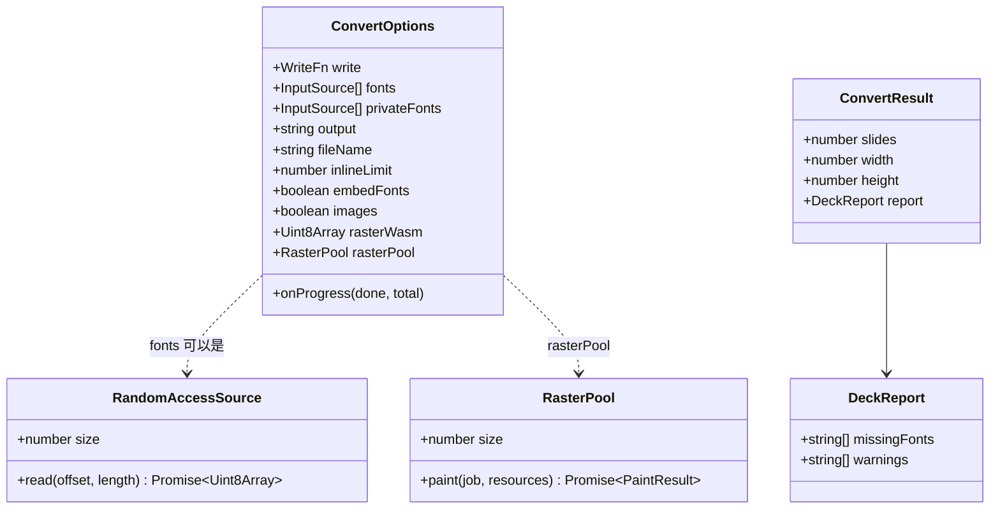

除 `write` 以外都是可选的。`InputSource` 可以是 `Uint8Array`、`ArrayBuffer` 或 `RandomAccessSource`。

---

## 5. 第 2 步：按需读取 zip 和 XML

`convert` 的前三行就是读取层（`io/`）：

```ts
const zip = await ZipReader.open(toSource(input));
const pkg = await OpcPackage.open(zip);
const pres = new Presentation(pkg);
```

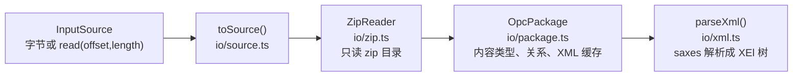

| 层 | 文件 | 做什么 |
|---|---|---|
| 数据源 | `io/source.ts` | `toSource` 把字节数组也包装成 `RandomAccessSource`，后面统一"按位置读" |
| zip | `io/zip.ts` | 用 zip.js 只解析 **目录**（每个文件在哪、多大），不解压内容；`read(name)` 用到时才解压某一个文件；`stream(entry)` 以数据流方式读大文件（视频），内存占用恒定。老格式 .ppt 或加密文件会报错"这是老格式的 .ppt 文件……" |
| OPC 包 | `io/package.ts` | `xml(part, cache)` 读并解析 XML；`rels(part)` 读关系表并把相对路径换成包内绝对路径；`relByType` 按类型找关系 |
| XML | `io/xml.ts` | 用 saxes 把 XML 解析成简单的树 `XEl { name, attrs, children, text }`。**命名空间被换成固定前缀**（`p:`、`a:`、`c:` 等），不管文件里实际写的是什么前缀，后面的代码都能直接按 `"p:sp"` 查找。格式不规范时不报错，保留已经解析出的部分 |

**为什么要"按需"？** 有的课件有 1GB（里面塞了视频）。如果一开始就把整个文件读进内存再全部解压，内存会爆。现在的做法是：

- 只读 zip 目录；
- 母版、版式、主题数量少，解析后缓存；
- 幻灯片 XML 用 `pkg.xml(ref.part, false)` 读，**不缓存**，渲染完就丢；
- 视频音频用数据流从 zip 直接流到输出文件。

`io/xml.ts` 里还有一个重要函数 `expandAlternate`：PowerPoint 新功能常写成 `mc:AlternateContent`（"新版本用 Choice，老版本用 Fallback"）。unppt 选自己支持的 Choice；Choice 里是画不了的内容（Office 数学公式、墨迹）时，改用 Fallback 里 PowerPoint 存好的图片。

---

## 6. 第 3 步：演示文稿模型 Presentation

`model/model.ts` 里的 `Presentation` 类是"整份文稿"的内存模型。`load()` 做这些事：

1. 从根关系 `_rels/.rels` 找到主部件（通常是 `ppt/presentation.xml`）；
2. 读页面尺寸 `p:sldSz`，换算成像素 `width`、`height`（超出 PowerPoint 允许的 1~56 英寸范围时按 PowerPoint 的修复规则改成默认值）；
3. 按 `p:sldIdLst` 的顺序列出所有幻灯片 → `slides: SlideRef[]`（只记部件路径和序号，不读内容）；
4. 读 `presProps.xml` 的放映设置（循环放映、是否按计时）→ `show`；
5. 读 `p:embeddedFontLst` 的嵌入字体列表 → `embeddedFonts`；
6. 预扫描每页用到的字体字符集（`model/font-charsets.ts`），缺字体时选替代字体要用。

母版、版式、主题是 **用到才读、读了缓存** 的：`pres.layout(part)`、`pres.master(part)`、`pres.theme(part)`。

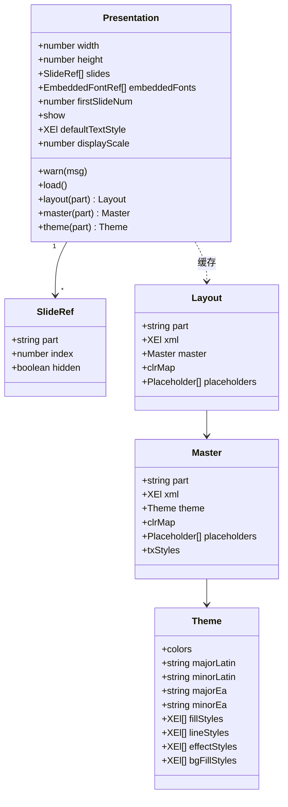

`warn(msg)` 很常用：各模块遇到不支持的东西就调用它，相同的消息只计数，最后进 `report.warnings`（例如"未支持的图形：xxx（3 处）"）。

**颜色映射（clrMap）**：幻灯片里的颜色经常写成 `<a:schemeClr val="tx1"/>`（"文字颜色 1"）。`tx1` 先经母版的 `p:clrMap` 映射成 `dk1`，再到主题配色里查到真正的 RGB。版式、幻灯片可以覆盖这个映射（`p:clrMapOvr`）。

---

## 7. 第 4 步：逐页渲染成 SVG

入口是 `render/render.ts` 的 `renderSlide(ref, env)`。`env`（`render/env.ts` 的 `RenderEnv`）带着整份文稿共用的东西：`pres`、字体库 `fonts`、缺失字体集合 `missingFonts`、媒体仓库 `media`、字体嵌入记录器 `embed`。

### 7.1 一页的绘制顺序

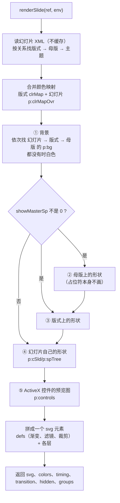

注意：

- 母版、版式上的元素 **不参与动画**（`ownSlide: false`），也不带 `data-uid`；
- 母版、版式上的 **占位符本身不画**，它们只给幻灯片提供继承属性；
- 选择窗格里被隐藏的对象（`hidden="1"`）不画；
- 渲染结果里的 `timing`（`p:timing`）和 `transition`（`p:transition`）还是原始 XML，后面交给动画编译。

### 7.2 每个元素按类型分派

`SlideRenderer.element()` 看元素的标签名，交给不同的函数：

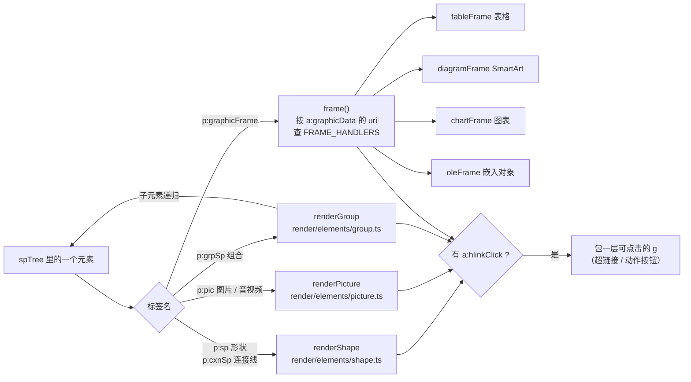

### 7.3 占位符继承

幻灯片上的标题通常只写了文字，位置、字号、颜色都是继承来的。`SlideRenderer.inherited()` 负责找"上一级"：

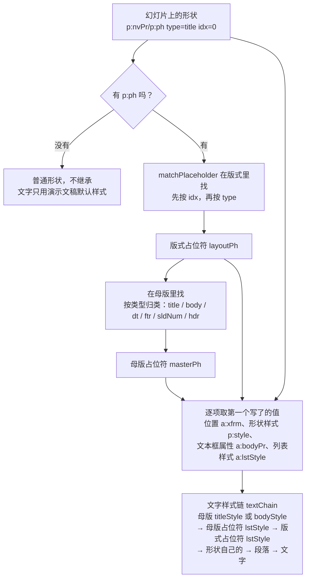

例如在 `renderShape` 里，位置是这样取的：

```ts
const box = readXfrm(child(spPr, 'a:xfrm')) ?? readXfrm(child(lSpPr, 'a:xfrm')) ?? readXfrm(child(mSpPr, 'a:xfrm'));
```

意思是：幻灯片写了就用幻灯片的，否则用版式的，再否则用母版的。

代码里还记录了一些实测得到的特殊规则，比如：编号是 `4294967295` 的占位符（老 .ppt 转换来的"没有编号"）不继承版式，只按类型继承母版；日期、页脚、页码占位符的基础样式是演示文稿默认样式，不是母版的 otherStyle。

### 7.4 形状：几何 + 填充 + 线条 + 效果 + 文字

一个 `p:sp` 形状是这样画出来的（`render/elements/shape.ts`）：

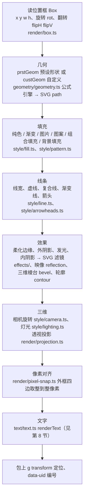

**几何（geometry）**：PowerPoint 有 187 种预设形状（矩形、圆角矩形、箭头、星形……），每种都用一套公式定义（来自 ECMA-376 标准附带的 `presetShapeDefinitions.xml`，转成了 `geometry/presets-data.ts`）。公式里有调整值（比如圆角矩形的圆角大小 `adj`）、内置变量（`w` 宽、`h` 高、`ss` 短边……），算完得到路径。自定义形状 `custGeom` 用同一个公式引擎。另有 40 种艺术字文字变形（`warps-data.ts`）。

**样式引用**：形状常写 `<p:style><a:fillRef idx="1"><a:schemeClr val="accent1"/></a:fillRef>…`，意思是"用主题第 1 种填充样式，颜色用 accent1"。`style/fill.ts` 的 `styleRef` 负责把它解析成具体填充。

**像素对齐**：PowerPoint 画形状时会把外框四边取整到整像素，所以矩形边缘不发虚。unppt 实测后照做（`render/pixel-snap.ts`），这是做到"逐像素接近"的关键之一。

### 7.5 图片和音视频

`render/elements/picture.ts` 处理 `p:pic`：

- 裁剪（`a:srcRect`）、外形（图片可以裁成圆形等形状）、边框、效果；
- 图片调整（亮度、对比度、重新着色、设置透明色……）在 `style/blip.ts`；
- 图片地址由 `MediaStore` 给出（见第 12 节）；
- 音频 / 视频输出成 `<foreignObject>` 里的 `<video>` / `<audio>` 标签（带 `data-media="1"`），视频封面帧作为 `poster`。播放、暂停由播放器根据动画数据控制。

### 7.6 组合

`render/elements/group.ts`：组合有自己的外框（`a:off`/`a:ext`）和子坐标系（`a:chOff`/`a:chExt`）。子元素的坐标在子坐标系里，需要换算（`render/group-map.ts`）。子元素写了 `a:grpFill`（"组合填充"）时，用组合的填充，并且按组合的外框铺（每个子元素只露出自己那一块）。

### 7.7 graphicFrame：表格、图表、SmartArt、OLE

`p:graphicFrame` 是"装着别的东西的框"。里面装什么由 `a:graphicData` 的 `uri` 决定。这是一个 **扩展点**：

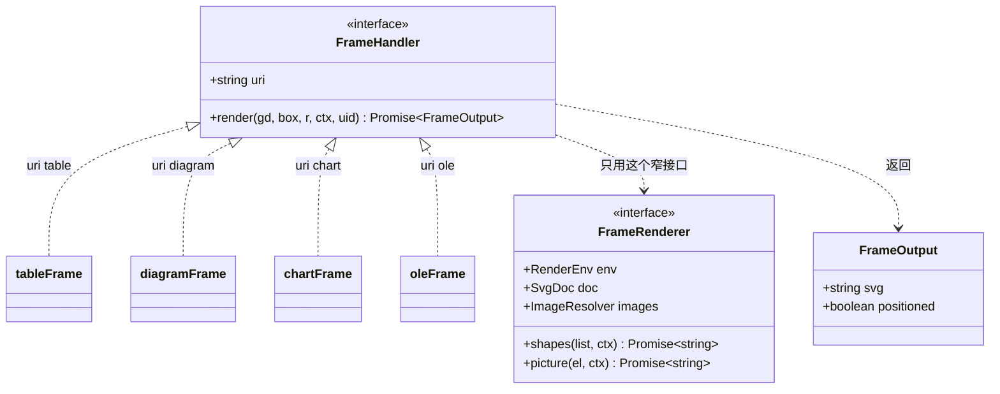

注册表在 `render/frames/frames.ts`：

```ts
export const FRAME_HANDLERS: readonly FrameHandler[] = [tableFrame, diagramFrame, chartFrame, oleFrame];
```

不认识的 uri 会记警告"未支持的图形：xxx"。

| 内容 | 文件 | 做法 |
|---|---|---|
| 表格 | `render/frames/table-frame.ts`、`render/table.ts`、`render/table-style.ts`、`render/builtin-table-styles.ts` | 列宽来自 `a:tblGrid`；行高取"设定行高"和"文字实际高度"较大的；先叠表格样式（首行、镶边行……），再用单元格自己的填充和边框覆盖 |
| 图表 | `render/frames/chart-frame.ts` → `chart/` | 见第 9 节 |
| SmartArt | `render/frames/diagram-frame.ts` | **不自己排版**，而是画 PowerPoint 存在文件里的"绘图缓存"（`dsp:drawing`，一组现成的形状）。每个形状单独包一层 `data-uid`，"逐个"动画才能找到它。缓存缺失或为空时记警告 |
| OLE 嵌入对象 | `render/frames/ole-frame.ts` | 显示 PowerPoint 存的预览图（当成一张图片画） |

### 7.8 一页渲染的结果

`renderSlide` 返回 `RenderedSlide`：

| 字段 | 含义 |
|---|---|
| `svg` | 整页的 SVG 字符串，`viewBox` 是幻灯片像素，可动画的元素带 `data-uid` |
| `colors` | 这一页的配色（动画里颜色类效果要用） |
| `timing` | 原始的 `p:timing` XML |
| `transition` | 原始的 `p:transition` XML |
| `hidden` | 是否是隐藏幻灯片（`show="0"`） |
| `groups` | 组合的动画编号集合 |

---

## 8. 文字排版引擎

这是 unppt 和"把文字直接丢给浏览器"的方案最大的区别：**在转码时就用字体文件的真实字宽把每一行排好**，每个字的 x 坐标直接写进 SVG 的 `<text x="…">`。这样换行位置是固定的，不依赖观看者的浏览器和字体。

入口是 `text/text.ts` 的 `renderText`。

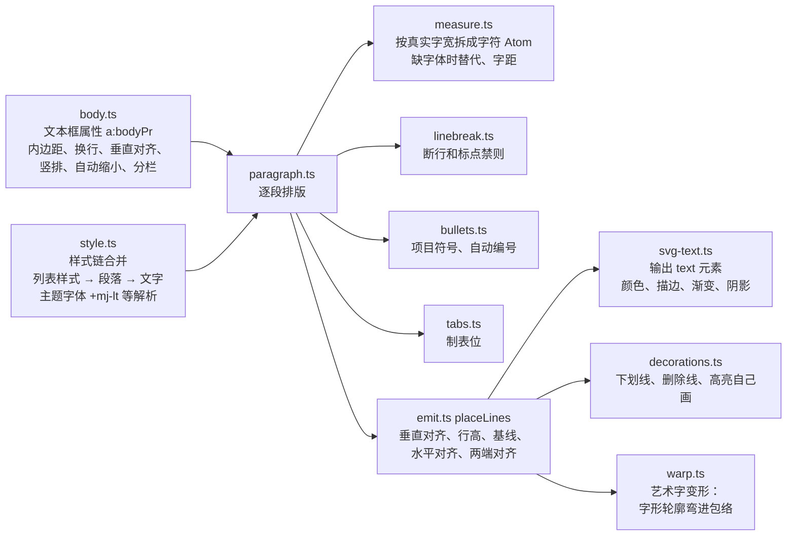

### 8.1 测量（measure.ts）

- 字体文件由 `font/font.ts` 解析，读字宽（`hmtx`）、行高（`OS/2`、`hhea`）、字距（`GPOS`/`kern`）。
- PowerPoint 排版的最小单位是 1/8 磅（= 1/6 像素），每个字的宽度先四舍五入到这个单位（常量 `LAYOUT_UNIT`），这是实测得到的。
- **缺字体时的替代**（也都是实测规则）：
  - 西文缺字体 → `Calibri`、`Arial`、`Liberation Sans`、`Helvetica` 中第一个有的；
  - 标了中文字符集的缺字体 → `Microsoft YaHei`（微软雅黑）等；
  - 标了日文字符集的 → `Yu Gothic`；
  - 一些老名字有别名：`Helvetica` → `Arial`，`Times` → `Times New Roman`，`Courier` → `Courier New`。
- 缺的字体名记入 `missingFonts`，最后出现在 `report.missingFonts`。

### 8.2 断行（linebreak.ts）

- 空格、制表符后可以断；中日韩文字之间可以断；
- **标点禁则**：句号、逗号、右括号等不能放在行首；左括号、左引号等不能放在行尾（`NO_START`、`NO_END` 两个集合）；
- 放不下的长单词在字中间断。

### 8.3 项目符号和编号（bullets.ts）

支持字符符号（`a:buChar`）、图片符号（`a:buBlip`）、自动编号（`a:buAutoNum`：阿拉伯数字、罗马数字、字母等），编号在同一文本框里按级别连续计数（`BulletNumbering`）。

### 8.4 对齐和行距（emit.ts）

- 垂直对齐：上 / 中 / 下（`anchor`）；
- 水平对齐：左 / 中 / 右 / 两端对齐 / 分散对齐；
- 行距、段前段后间距；
- **基线对齐整像素**：字号不超过 20 磅时，基线 y 取整到整像素（`SNAP_MAX_SIZE`），和 PowerPoint 的显示一致。

### 8.5 自动调整（autofit）

文本框属性里的 `a:normAutofit` 记着 PowerPoint 算好的"缩小比例"：`fontScale`（字号缩放）和 `lnSpcReduction`（行距减少）。unppt 直接读这两个数（`text/body.ts`）应用到排版上，而不是自己重新算——因为 PowerPoint 存下来的值就是它显示时用的值。

### 8.6 文字的输出

每一行（同一行里每段相同样式的文字）输出一个 SVG `<text>`，带 `font-family`、`font-size`、`fill` 和每个字的 x 坐标。下划线、删除线、高亮都 **自己画成矩形/线条**，不用浏览器的 `text-decoration`（各浏览器画出来的位置和粗细不一样）。段落有动画时，段落会带自己的子编号，供"按段落"动画使用。

---

## 9. 图表

PowerPoint 图表的数据在 Excel 里，但 chart XML 里同时存了一份 **数据缓存**（`c:numCache`、`c:strCache`）。unppt 直接用缓存画，不需要 Excel。

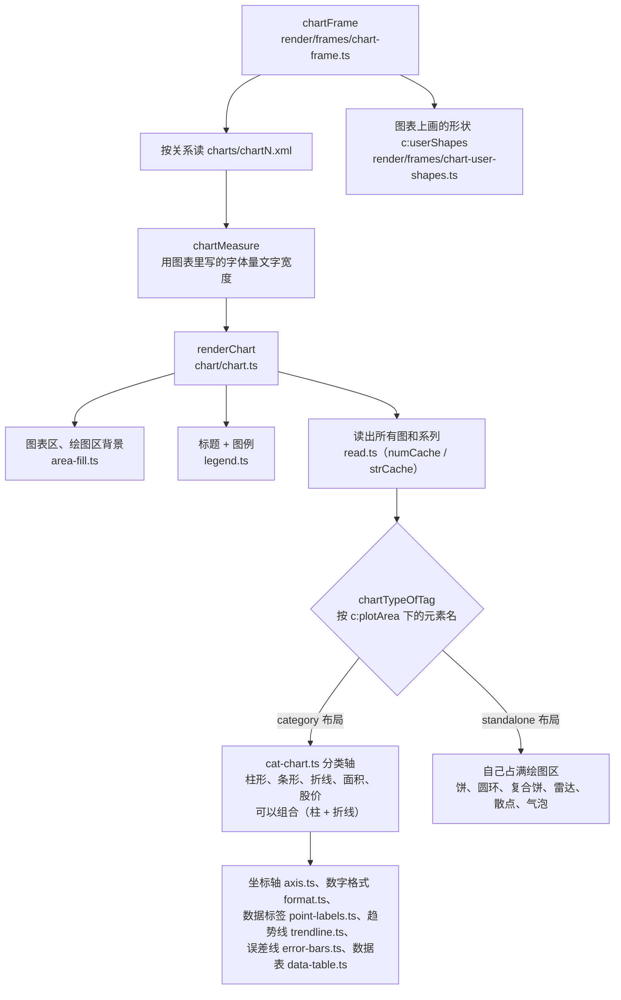

图表类型是一个扩展点（`chart/chart-type.ts`，`layout` 取 `standalone` 或 `category`），注册表在 `chart/chart-types.ts`：

```ts
export const CHART_TYPES: readonly ChartType[] = [barType, lineType, areaType, pieType, doughnutType, scatterType, radarType, bubbleType, ofPieType, stockType];
```

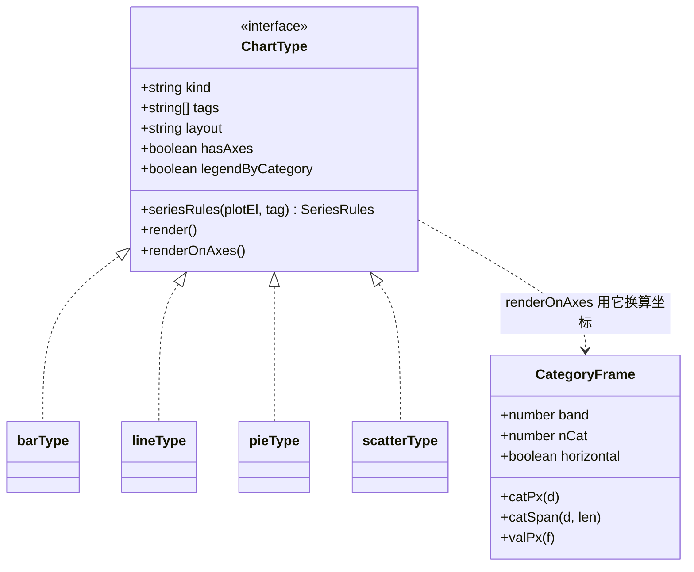

图表的每一部分（数据点、整条线、数据标签）都有自己的编号（`common/uid.ts` 的 `chartUid`），所以"按系列""按类别"的图表动画也能播放。

布局（标题离上边多远、图例占多宽……）按 PowerPoint 默认自动布局实测的规律近似实现，常数在 `chart/layout.ts` 等文件里，注释写着"实测"。


---

## 10. 动画和页面切换

PowerPoint 的动画存在每页的 `p:timing` 里，是一棵很深的时间节点树。播放器不想理解这么复杂的结构，所以 **转码时就把它编译成简单的"每次点击做哪些动作"**。

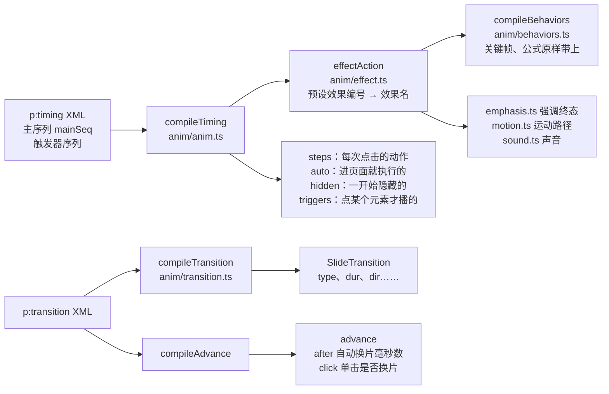

编译时用 SVG 里的 `data-uid` 集合核对目标：动画指向的元素不存在时（比如段落是空的），退回到整个形状；还是找不到就丢掉。

一个动作 `AnimAction` 的主要字段（定义在 `packages/format/src/index.ts`）：

| 字段 | 含义 | 例子 |
|---|---|---|
| `uid` | 目标元素编号 | `"s5"` |
| `effect` | 效果名 | `'fade'`、`'fly'`、`'wipe'`、`'zoom'`、`'emphasis'`、`'path'`、`'media'` … |
| `dir` | `in` 进入、`out` 退出、`emph` 强调 | `'in'` |
| `dur` / `delay` | 时长 / 延迟（毫秒） | `500` / `0` |
| `from` | 飞入方向 | `'l'` |
| `behaviors` | PowerPoint 原始行为的关键帧（有它时播放器按它播） | — |
| `media` | 媒体命令 | `'play'` |
| `iterate` | 逐字 / 逐词 | `{ by: 'letter', gap: 50 }` |

页面切换 `SlideTransition.type` 支持：`none`、`fade`、`cut`、`flash`、`push`、`wipe`、`cover`、`pull`、`split`、`strips`、`circle`、`diamond`、`plus`、`zoom`、`wheel`、`wedge`、`newsflash`、`blinds`、`checker`、`comb`、`randomBar`、`dissolve`、`morph`。PowerPoint 的切换名到这些类型的对应表在 `anim/transition.ts`；播放器不认识的按 `fade` 播。

动画和切换用到的声音，在 `index.ts` 里通过 `soundRids` 找出关系编号，再由 `media.media(...)` 写成媒体文件。

---

## 11. 字体：查找、替代、嵌入和子集化

字体在 unppt 里有两个用途：

1. **排版**：量字宽，决定在哪换行（第 8 节）；
2. **显示**：观看者的电脑上不一定有这个字体，可以把用到的字"嵌入"产物。

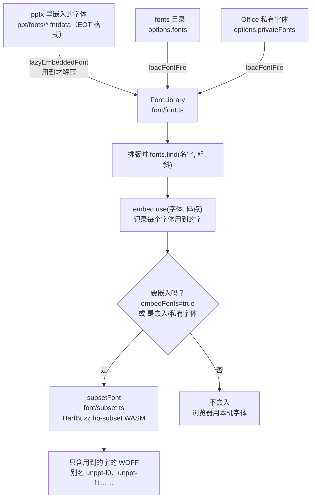

要点：

- **字体解析是自研的**（`font/font.ts`）：只读排版需要的表（`name`、`cmap`、`hmtx`/`hhea`、`head`、`OS/2`、`GPOS`/`kern`），而且懒加载——建索引时只读表目录和 `name` 表，真正用到才读字宽。
- **嵌入字体还原**：PowerPoint 嵌入的字体是 EOT 外壳，里面一般经过 MicroType Express 压缩。`font/eot.ts` → `font/lzcomp.ts` → `font/ctf.ts` 把它还原成普通 TTF。
- **什么时候嵌入**：`options.embedFonts === true` 时所有用到的字体都嵌入；否则只嵌入 pptx 自带的嵌入字体和 `privateFonts`（因为观看端多半没有这些字体）。商业字体的分发需要授权，所以默认关闭。
- **子集化**：`font/subset.ts` 用 HarfBuzz 的 `hb-subset`（WASM，构建时直接打进 JS）只保留用到的字，打包成 WOFF。每个字体一个唯一别名 `unppt-f{n}`，SVG 里的 `font-family` 先写别名、再写原名。
- 所有页处理完之后，产物形式调用 `fontFiles()` 才真正做子集化，这时已经知道全部用到的字了。

---

## 12. 图片、音视频

`media/media.ts` 的 `MediaStore` 管理所有媒体：

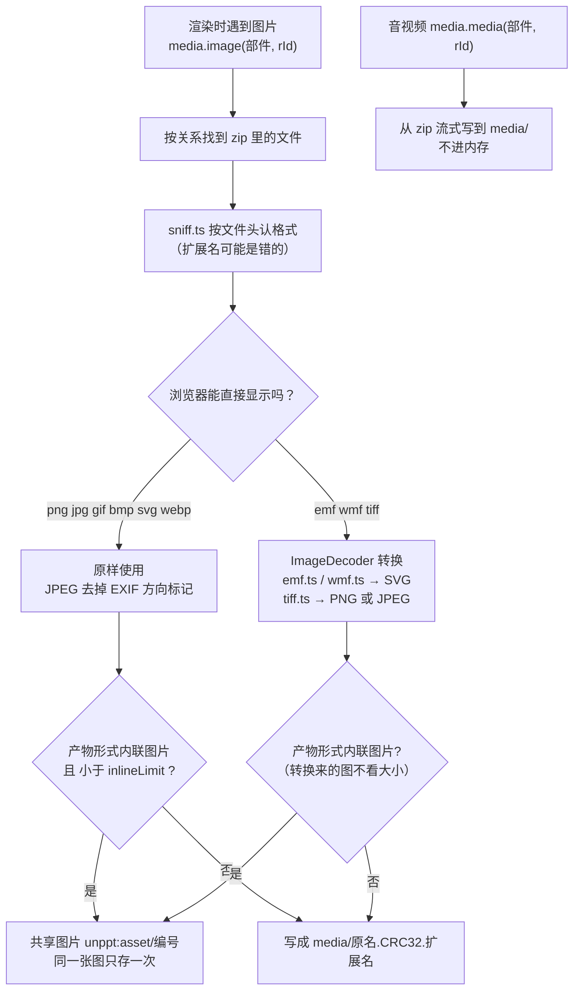

- **文件名带校验码**：`media/image1.1a2b3c4d.png` 里的 8 位十六进制是 zip 目录里记录的 CRC32。重新发布时浏览器、CDN 的旧缓存不会串版本。
- **共享图片**：同一张图在多页出现时只存一次，页面里写 `unppt:asset/编号`，播放器显示前替换成真正的数据。
- **图片格式扩展点**：`ImageDecoder`（`media/image-decoder.ts`），注册表 `media/decoders.ts`：`[emfDecoder, wmfDecoder, tiffDecoder]`。EMF/WMF 是 Windows 矢量图元文件，unppt 自己解析 GDI 记录转成 SVG。
- **设置透明色**：PowerPoint 的"设置透明色"在原图上抠色（`media/color-key.ts`），自研 JPEG 解码 + PNG 编码。
- PowerPoint 插入的 SVG 图片会同时存 PNG 备用图和原始 SVG（`asvg:svgBlip`），unppt 用 SVG，放大不糊。

---

## 13. 整页图和缩略图（pic/ 和 thum/）

除了网页，产物里默认还有每页一张整页图 `pic/{n}.jpg` 和缩略图 `thum/{n}.jpg`，以及描述它们的 `prop.json`。用途：列表页预览、不支持 JS 的地方显示等。

- 整页图尺寸：幻灯片像素 × 0.75 取整（也就是"磅"数），例如 1280×720 的幻灯片 → 960×540；
- 缩略图宽固定 216（`THUMB_WIDTH`），高按比例；
- 画的是"这一页所有对象都显示"的样子，音视频去掉（视频封面帧照常显示）。

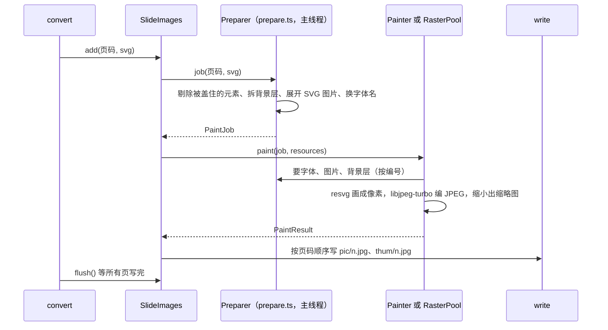

- **resvg** 是一个把 SVG 画成位图的库（Rust 写的，编译成 WASM），unppt 只把它用在缩略图这类周边功能上，正式播放的渲染是自研的。
- **准备和绘制分开**：准备（`preview/prepare.ts`）要用字体库和媒体，只能在主线程；绘制（`preview/paint.ts`）和环境无关，可以放到工作线程。命令行通过 `node-pool.ts` 的 `createRasterPool` 建线程池，多页同时画；**结果和单线程画的逐字节一致**，写出仍按页码顺序。
- 转码器本身（`index.ts`）不创建线程：线程池由调用方通过 `options.rasterPool` 传入（在 Node 里可以从 `@unppt/unppt/node` 导入）。
- 没有 resvg.wasm 或加载失败：不出图，记一条警告，`prop.json` 照常输出。

`prop.json` 的样子（字段名来自 `output/prop.ts`）：

```json
{
 "count": 2,
 "picw": 960,
 "pich": 540,
 "thumw": 216,
 "thumh": 122,
 "slides": [
  { "index": 1, "thum": "thum/1.jpg", "pic": "pic/1.jpg", "note": "第一页的备注" },
  { "index": 2, "thum": "thum/2.jpg", "pic": "pic/2.jpg", "hidden": 1 }
 ]
}
```

---

## 14. 写出产物：四种产物形式

`convert` 自己不决定文件长什么样，而是把一个 `OutputSource`（"数据源"）交给选中的 `OutputForm`（"产物形式"），由它决定怎么写。这也是一个扩展点（`output/output.ts`，注册表 `output/forms.ts`）。

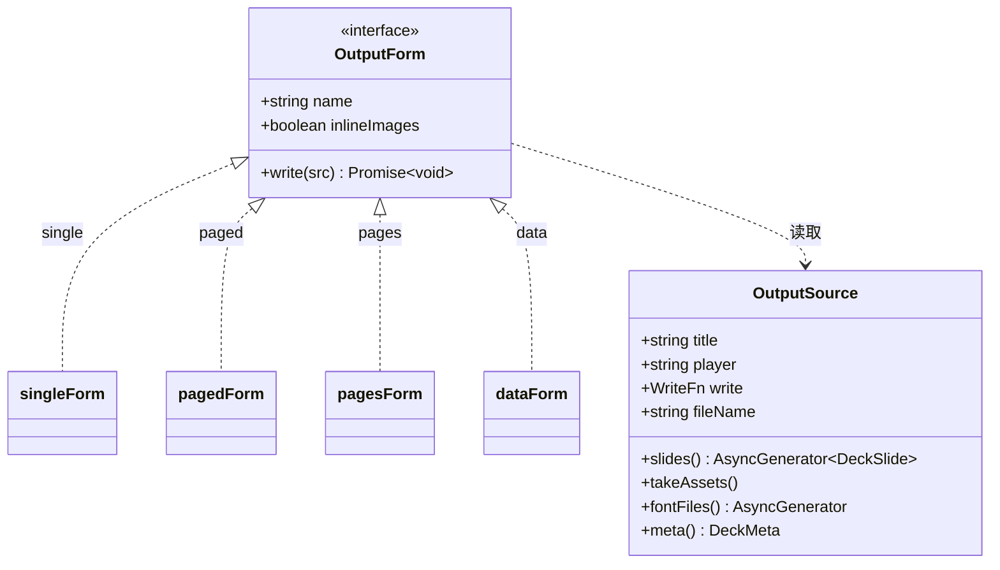

调用顺序是固定的：先 `slides()` 逐页拿，**所有页之后**才 `fontFiles()`（这时才知道用到了哪些字），最后 `meta()`（这时报告才完整）。

| 形式 | 内联小图片 | 输出文件 | 适合 |
|---|---|---|---|
| `single`（默认，旧名 `html`） | 是 | 一个自包含的 `index.html`（页面、图片、字体、播放器都在里面），大媒体在 `media/` | 发给别人、本地双击打开 |
| `paged` | 否 | `index.html`（播放器 + 目录）+ `pages/<页号>.<哈希>.js` + `fonts/<别名>.<哈希>.js` + `media/` | 网站托管，按需加载，看当前页时预加载下一页 |
| `pages` | 否 | 同 `paged`，再加每页一个独立的 `page-001.html`… | 需要单页链接 |
| `data` | 否 | 只有 `deck.json` + `fonts/*.woff` + `media/` | 开发调试 |

另外，**所有形式** 都会在入口文件旁边写 `prop.json`，出图时还有 `pic/`、`thum/`。

### 14.1 single 形式的 HTML 长什么样

`output/single.ts` 一边转码一边往 HTML 里写，顺序如下：

```mermaid
flowchart TD
  h["htmlHead<br/>doctype、meta、title、div id=unppt"] --> loop
  loop["每一页"] --> a["这一页新用到的共享图片<br/>script type=application/json class=unppt-asset"]
  a --> s["这一页的 DeckSlide<br/>script type=application/json class=unppt-slide"]
  s --> loop
  loop -->|所有页之后| f["字体子集（base64）<br/>script class=unppt-font"]
  f --> m["元数据<br/>script id=unppt-meta"]
  m --> p["播放器脚本<br/>script"]
```

播放器启动时读 `#unppt-meta`（数据都在页面里）；paged 形式则读 `#unppt-index`（目录），每页数据用 `<script>` 标签按需加载，回调名是 `__unpptPage` 和 `__unpptFont`（`PAGE_CALLBACK`、`FONT_CALLBACK`）。用 `<script>` 而不是 `fetch` 加载，所以本地 `file://` 打开也能用。

### 14.2 每页数据 DeckSlide

产物形式拿到的每一页是一个 `DeckSlide`（`packages/format/src/index.ts`），这是转码器和播放器之间的约定：

```mermaid
classDiagram
  class Deck {
    +string format
    +number version
    +string generator
    +number width
    +number height
    +DeckSlide[] slides
    +DeckFont[] fonts
    +DeckReport report
    +string[] slideParts
    +show
  }
  class DeckSlide {
    +string svg
    +AnimAction[][] steps
    +AnimAction[] auto
    +string[] hidden
    +string[] fullScreen
    +triggers
    +SlideTransition transition
    +boolean skip
    +advance
  }
  class DeckFont {
    +string family
    +string source
    +string weight
    +string style
    +string format
    +string url
  }
  Deck "1" --> "*" DeckSlide
  Deck "1" --> "*" DeckFont
  DeckSlide --> AnimAction
  DeckSlide --> SlideTransition
```

`Deck.format` 固定是 `"unppt-deck"`，`version` 是格式版本号（当前 `DECK_FORMAT_VERSION = 1`）。`steps.length` 就是这一页需要点击的次数。

---

## 15. 出错了会怎样

unppt 的原则是"尽量出结果"：

| 情况 | 结果 |
|---|---|
| 不是 zip、找不到 zip 目录 | 抛错"不是有效的 pptx 文件（找不到 zip 目录）" |
| 老格式 .ppt、加密的 pptx | 抛错，提示用 PowerPoint 另存为 .pptx |
| 某一页渲染失败 | 这一页输出白色空页，警告"第 N 页渲染失败：…" |
| 某个元素渲染失败 | 跳过这个元素，警告"元素渲染失败：…" |
| 不支持的 graphicFrame | 跳过，警告"未支持的图形：…" |
| SmartArt 没有绘图缓存 | 跳过，警告"SmartArt 缺少绘图缓存" |
| 缺字体 | 用替代字体排版，字体名进 `report.missingFonts` |
| 字体子集化失败 | 不嵌入这个字体，警告 |
| 没有 resvg.wasm | 不出 `pic/`、`thum/`，警告，`prop.json` 照常 |
| 整页图画不出来 | 这一页不出图，警告 |

所有警告去重计数后放进 `ConvertResult.report.warnings`，命令行会以"提示：…"打印出来，产物元数据里也有一份。

---

## 16. PowerPoint 概念和源码文件对照表

| PowerPoint 里的概念 | XML 里长什么样 | 源码文件 |
|---|---|---|
| .pptx 文件本身 | zip | `io/zip.ts` |
| 部件、关系、内容类型 | `_rels/*.rels`、`[Content_Types].xml` | `io/package.ts` |
| XML 解析、新旧版本兼容 | `mc:AlternateContent` | `io/xml.ts` |
| 演示文稿、页面尺寸、页列表 | `ppt/presentation.xml` | `model/model.ts`（`Presentation`） |
| 主题、母版、版式 | `theme/`、`slideMasters/`、`slideLayouts/` | `model/model.ts` |
| 颜色（主题色、亮度调整……） | `a:schemeClr`、`a:srgbClr`、`a:lumMod` | `model/color.ts` |
| 演讲者备注 | `notesSlides/` | `model/notes.ts` |
| 一页的绘制、占位符继承、背景 | `p:sld`、`p:bg`、`p:ph` | `render/render.ts` |
| 形状、连接线 | `p:sp`、`p:cxnSp` | `render/elements/shape.ts` |
| 位置、旋转、翻转 | `a:xfrm` | `render/box.ts` |
| 预设形状、自定义形状 | `a:prstGeom`、`a:custGeom` | `geometry/geometry.ts`、`geometry/presets-data.ts` |
| 填充 | `a:solidFill`、`a:gradFill`、`a:blipFill`、`a:pattFill` | `style/fill.ts`、`style/pattern.ts`、`style/gradient-stops.ts` |
| 线条、箭头 | `a:ln`、`a:headEnd` | `style/line.ts`、`style/arrowheads.ts` |
| 阴影、发光、柔化边缘 | `a:effectLst` | `effects/`（`outer-shadow.ts`、`glow.ts`、`soft-edge.ts`、`inner-shadow.ts`） |
| 映像 | `a:reflection` | `effects/reflection.ts` |
| 三维旋转、棱台、灯光 | `a:scene3d`、`a:sp3d` | `style/camera.ts`、`style/lighting.ts`、`effects/bevel.ts`、`effects/contour.ts` |
| 图片、图片调整 | `p:pic`、`a:blip` | `render/elements/picture.ts`、`style/blip.ts` |
| 视频、音频 | `a:videoFile`、`a:audioFile` | `render/elements/picture.ts`、`media/media.ts` |
| 组合 | `p:grpSp` | `render/elements/group.ts`、`render/group-map.ts` |
| 表格 | `a:tbl` | `render/frames/table-frame.ts`、`render/table.ts`、`render/table-style.ts` |
| 图表 | `c:chartSpace` | `render/frames/chart-frame.ts`、`chart/` |
| SmartArt | `dgm:relIds`、`dsp:drawing` | `render/frames/diagram-frame.ts` |
| 嵌入对象 OLE | `p:oleObj` | `render/frames/ole-frame.ts` |
| ActiveX 控件 | `p:controls` | `render/controls.ts` |
| 文本框属性、自动调整 | `a:bodyPr`、`a:normAutofit` | `text/body.ts` |
| 段落、文字样式 | `a:p`、`a:pPr`、`a:rPr`、`a:lstStyle` | `text/style.ts`、`text/paragraph.ts` |
| 项目符号、编号 | `a:buChar`、`a:buAutoNum` | `text/bullets.ts` |
| 换行 | — | `text/linebreak.ts` |
| 艺术字变形 | `a:prstTxWarp` | `text/warp.ts` |
| 超链接、动作按钮 | `a:hlinkClick` | `common/links.ts` |
| 动画 | `p:timing` | `anim/anim.ts`、`anim/effect.ts`、`anim/behaviors.ts` |
| 页面切换、换片方式 | `p:transition` | `anim/transition.ts` |
| 嵌入字体 | `p:embeddedFontLst`、`fonts/*.fntdata` | `font/eot.ts`、`font/lzcomp.ts`、`font/ctf.ts` |
| 字体解析、子集化 | — | `font/font.ts`、`font/subset.ts` |
| EMF / WMF / TIFF 图片 | — | `media/emf.ts`、`media/wmf.ts`、`media/tiff.ts` |
| 整页图、缩略图 | — | `preview/`、`node-pool.ts`、`raster-worker.ts` |
| 产物文件 | — | `output/`（`single.ts`、`paged.ts`、`data.ts`、`prop.ts`） |

---

## 17. 还没做好的地方

当前版本 0.1.0。合成测试用例 228 份 / 504 页，92.3% 的页通过（SSIM ≥ 0.95，平均 0.984）；随机抽 100 份真实课件 / 3527 页，0 份转换失败，78.8% 的页通过（约 95% 的页 SSIM ≥ 0.90，平均 0.967）。SSIM（结构相似度）是一个 0~1 的数，衡量两张图看起来有多像，1 是完全一样。没通过的页大多只是细节差异（文字位置差几个像素、某个图表标签）。

已知的差距：

- 图表日期坐标轴的时间刻度（最小值、最大值、按月/年的间隔）；
- `wordArtVert` 竖排文字；
- 可变字体（variable fonts）；
- EMF 图片里的 EMF+ 记录（目前只画 GDI 部分）；
- 部分需要重新排版的 SmartArt（unppt 只画绘图缓存，没有 SmartArt 排版引擎）；
- 旋转 180 度时的三维棱台；
- 分类标签转 45 度时的截断阈值。

下面是几张对照图（左边 PowerPoint，右边 unppt，都是合成测试用例）：


想了解整体架构和扩展点，请看 [architecture.md](../architecture.md)。
