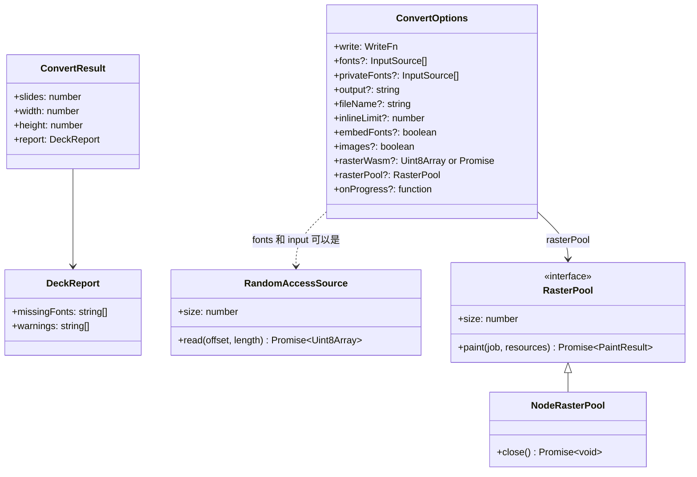
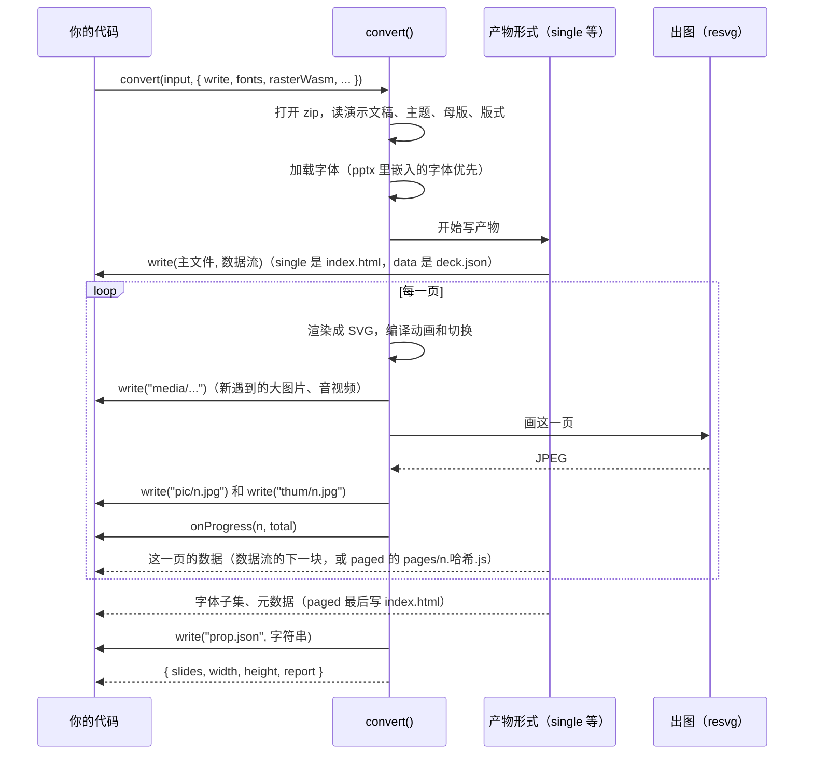
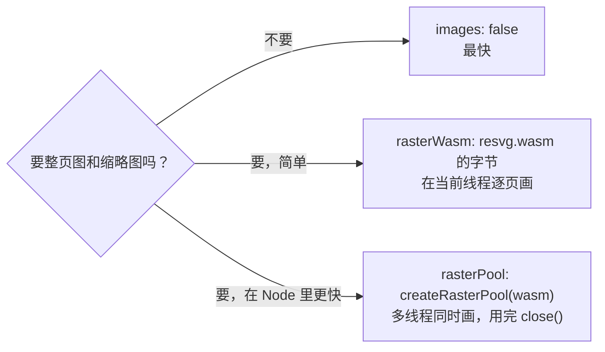
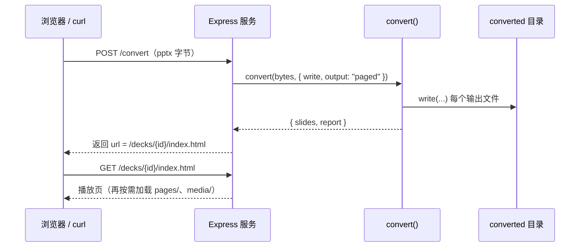

[English](../en/usage.md)

# 使用说明

这篇是参考手册：第 2 节列出命令行的**全部**选项，第 3 节讲在 JavaScript 代码里怎么调用 `convert()`，第 4 节给出 Node 脚本、HTTP 服务、云函数三个可以直接改着用的例子。

还没装过 unppt？先看 [快速上手](getting-started.md)。

---

## 1. 先选产物形式

unppt 能输出四种形式（`--output` / `output` 选项）。不知道选哪个，按这张图走：


| 形式 | 图片 | 字体子集 | 音视频 | 主文件 |
|---|---|---|---|---|
| `single` | 小于 `inlineLimit`（默认 2MB）的内联进 HTML，其余写到 `media/` | 内联进 HTML | `media/` | `index.html`（或 `-o` 指定的名字） |
| `paged` | 全部写到 `media/` | `fonts/<别名>.<哈希>.js` | `media/` | `index.html` + `pages/<页号>.<哈希>.js` |
| `pages` | 同 `paged` | 同 `paged` | `media/` | 同 `paged`，另加 `page-001.html`… |
| `data` | 全部写到 `media/` | `fonts/<别名>.woff` | `media/` | `deck.json` |

所有形式都会再写 `prop.json`，默认还有 `pic/{n}.jpg`、`thum/{n}.jpg`。每个文件的说明见 [快速上手第 5 节](getting-started.md#5-输出目录里都是什么)。

---

## 2. 命令行参考

### 2.1 语法

```bash
unppt <输入.pptx> [-o 输出] [选项]
```

- 第一个参数就是输入文件；什么选项都不加时，在 pptx 旁边新建一个和它同名的文件夹，产物都放进去（打开里面的 `index.html` 播放）。其它功能都用选项加。
- 0.1.0 及以前的写法 `unppt convert <输入.pptx>` 仍然可用（从 0.2.0 起 `convert` 可以省略）。
- `unppt -v` 显示版本号，`unppt -h` 显示用法。
- 不带参数、参数不对、或者写了不认识的选项时，会打印版本号和用法，然后以退出码 1 结束。
- 转码出错（例如文件不是有效的 pptx）时打印错误信息，退出码 1。成功时退出码 0。

### 2.2 全部选项

以下内容逐条来自 `packages/transcoder/src/cli.ts`：

| 选项 | 取值 | 默认值 | 说明 |
|---|---|---|---|
| `-o`, `--out <路径>` | 文件或目录 | 见 2.3 | `single` / `data` 时是输出文件；`paged` / `pages` 时是输出**目录**（入口是目录里的 `index.html`） |
| `--output <形式>` | `single`、`paged`、`pages`、`data`（`html` 是 `single` 的旧名） | `single` | 产物形式。写了不认识的形式会报错 |
| `--data` | 无 | 关 | 等同于 `--output data` |
| `--fonts <目录>` | 目录 | 无 | 字体目录，递归读取里面的 `.ttf` / `.otf` / `.ttc`，按真实字宽排版。可以写多次 |
| `--system-fonts` | 无 | 开 | **默认开启**（0.2.3 起）：使用本机系统字体，按真实字宽排版，换行才和 PowerPoint 一致；Office 自带的私有字体、云字体用到时嵌入产物。加 `--no-system-fonts` 关闭（关闭后字宽只能估算，换行可能和 PowerPoint 不同） |
| `--embed-fonts` | 无 | 关 | 把用到的字做成字体子集嵌入，观看端不需要安装字体（商业字体注意授权） |
| `--no-images` | 无 | 出图 | 不输出整页图 `pic/` 和缩略图 `thum/`（`prop.json` 照常输出） |
| `--jobs <n\|auto>` | 正整数或 `auto` | `auto` | 出图用几个线程同时画。`auto` 按 CPU 数（容器里按 CPU 配额）和可用内存（每个线程按 400MB 估算）取较小值；`1` 表示在主线程画 |
| `--inline-limit <字节>` | 数字 | `2097152`（2MB） | 小于这个大小的图片内联进 HTML（只对 `single` 有效） |
| `--stats` | 无 | 关 | 结束时打印页数、用时和峰值内存 |
| `-q`, `--quiet` | 无 | 关 | 不显示进度和结果（包括缺少字体、提示） |
| `-v`, `--version` | 无 | — | 只显示版本号 |
| `-h`, `--help` | 无 | — | 显示用法（退出码 0） |

### 2.3 不写 `-o` 时输出到哪里

在输入文件旁边**新建一个和它同名的文件夹**，产物都放进去（0.2.2 起；以前是直接放在输入文件旁边）：

| 形式 | `unppt D:\work\demo.pptx` 的输出 |
|---|---|
| `single` | `D:\work\demo\index.html` |
| `paged` / `pages` | `D:\work\demo\index.html` |
| `data` | `D:\work\demo\deck.json` |

`media/`、`pic/`、`thum/`、`fonts/`、`prop.json` 都写在主文件**所在的目录**里，所以不写 `-o` 时它们都在那个同名文件夹里，不会和 `.pptx` 混在一起。写了 `-o` 时按你给的位置，例如 `-o 新目录/index.html`。

### 2.4 命令行的输出

```text
转码中 12/12 页                                   ← 进度（写到 stderr）
统计：12 页，用时 4.2 秒，峰值内存 310 MB         ← 加了 --stats 时（在“完成”之前打印）
完成：12 页，用时 4.2 秒 -> D:\work\out\index.html
缺少字体：Font A、Font B                          ← 有缺失字体时
提示：……                                          ← 每条警告一行
```

### 2.5 常用组合

```bash
# 最常用：自包含 HTML，用本机字体
unppt demo.pptx -o out/index.html --system-fonts

# 放到网站上：按需加载，嵌入字体，观看端不用装字体
unppt demo.pptx -o site/demo --output paged --system-fonts --embed-fonts

# 每页一个 HTML
unppt demo.pptx -o site/demo --output pages

# 服务器上：指定字体目录，不要图片，安静模式
unppt demo.pptx -o out/index.html --fonts /opt/fonts --no-images -q

# 内存紧张的机器：只用 1 个线程出图，看峰值内存
unppt demo.pptx -o out/index.html --jobs 1 --stats

# 只看数据
unppt demo.pptx --data -o out/deck.json
```

---

## 3. JavaScript API

### 3.1 包里有什么

| 导入路径 | 内容 | 运行环境 |
|---|---|---|
| `@unppt/unppt` | `convert()`、`createPainter()`、`UNPPT_VERSION`，以及类型 `ConvertOptions`、`ConvertResult`、`InputSource`、`RandomAccessSource`、`WriteData`、`WriteFn`、`RasterPool` 等 | 任何环境（Node、浏览器、云函数），不读写磁盘、不联网 |
| `@unppt/unppt/node` | `createRasterPool()`、`autoWorkers()`、类型 `NodeRasterPool` | 只在 Node（用 `worker_threads` 多线程出图） |
| `@unppt/unppt/resvg.wasm` | 出图用的 resvg WASM 文件 | 作为文件读取，传给 `rasterWasm` 或 `createRasterPool` |

包是 ES Module（`"type": "module"`），用 `import` 导入。

**纯函数**的意思：`convert()` 自己不碰文件系统、不联网。你把 pptx 的**字节**交给它，它通过你提供的 `write` 回调把输出文件**交还给你**，写到哪里（磁盘、内存、对象存储）由你决定。

### 3.2 `convert(input, options)`

```ts
function convert(input: InputSource, options: ConvertOptions): Promise<ConvertResult>
```



#### 输入 `input: InputSource`

```ts
type InputSource = Uint8Array | ArrayBuffer | RandomAccessSource;

interface RandomAccessSource {
  size: number;                                           // 文件总字节数
  read(offset: number, length: number): Promise<Uint8Array>; // 读从 offset 开始的 length 个字节
}
```

小文件直接传 `Uint8Array`（Node 的 `Buffer` 就是 `Uint8Array`）。大文件传 `RandomAccessSource`，转码器只读需要的部分，见 [3.5](#35-大文件按位置读取)。

#### 选项 `options: ConvertOptions`

| 选项 | 类型 | 默认值 | 说明 |
|---|---|---|---|
| `write` | `(path, data) => Promise<void>` | **必填** | 输出文件的写入函数，见 [3.3](#33-write-回调) |
| `fonts` | `InputSource[]` | `[]` | 字体文件（ttf / otf / ttc），每项是一个文件的内容 |
| `privateFonts` | `InputSource[]` | `[]` | 观看端没有的字体（如 Office 私有字体、云字体）：用于排版，用到的字**总是**嵌入产物，不受 `embedFonts` 影响 |
| `output` | `'single' \| 'paged' \| 'pages' \| 'data'` | `'single'` | 产物形式（`'html'` 是 `'single'` 的旧名）；不认识的名字会抛错 |
| `fileName` | `string` | `'index.html'`（`data` 时 `'deck.json'`） | 主文件名 |
| `inlineLimit` | `number`（字节） | `2097152` | 小于这个大小的图片内联进 HTML；只对 `single` 有效。视频音频总是单独输出 |
| `embedFonts` | `boolean` | `false` | 把用到的字做成字体子集嵌入产物 |
| `images` | `boolean` | `true` | 是否输出 `pic/{n}.jpg`、`thum/{n}.jpg`。`prop.json` 总是输出 |
| `rasterWasm` | `Uint8Array \| Promise<Uint8Array \| undefined>` | 无 | resvg WASM 的字节。**`images` 为 `true` 时必须给它或 `rasterPool`**，否则不出图并记一条警告 |
| `rasterPool` | `RasterPool` | 无 | 并行出图执行器（如 `createRasterPool()` 的返回值）。给了它就不需要 `rasterWasm`，结果和单线程画的逐字节一致 |
| `onProgress` | `(done: number, total: number) => void` | 无 | 每处理完一页调用一次 |

#### 结果 `ConvertResult`

| 字段 | 说明 |
|---|---|
| `slides` | 输出的页数 |
| `width` / `height` | 幻灯片尺寸（像素，按 96 DPI；`prop.json` 里的 `picw`/`pich` 是它乘 0.75 得到的磅数） |
| `report.missingFonts` | 文档用到、但没有提供字体文件的字体名（已排序） |
| `report.warnings` | 转码时的提示，例如“第 3 页渲染失败：……”。同一条出现多次时会写成“……（N 处）” |

#### 出错时

- 文件不是有效的 pptx、`output` 写错等，`convert()` 返回的 Promise 会 reject（抛错）。
- **单页**出错不会让整个转码失败：那一页输出成白页，并在 `report.warnings` 里记一条“第 N 页渲染失败”。
- `write` 回调抛出的错误会让 `convert()` 失败。

### 3.3 `write` 回调

```ts
type WriteData = Uint8Array | string | AsyncIterable<Uint8Array>;
type WriteFn = (path: string, data: WriteData) => Promise<void>;
```

- `path` 是相对路径，用 `/` 分隔，例如 `index.html`、`media/media1.1a2b3c4d.mp4`、`pic/3.jpg`、`pages/2.9f8e7d6c.js`、`prop.json`。
- `data` 有三种：字符串、字节，或者**数据流**（`AsyncIterable<Uint8Array>`，可以用 `for await` 一块一块读）。主文件和大视频是以数据流给出的，这样不需要把整个文件放在内存里。
- 回调要把文件**完全写完**再让 Promise 结束。

> **注意：不要让写入排队互相等待。** `single` 和 `data` 形式会**先**调用 `write(主文件名, 数据流)`（`single` 是 `index.html`，`data` 是 `deck.json`），转码器在你读这个数据流的过程中逐页工作，期间还会调用 `write('media/…')`、`write('pic/…')` 写别的文件。如果你的 `write` 实现成“上一个写完才开始下一个”，就会互相等死。每次调用独立处理即可。

在 Node 里最简单的写法：`fs.promises.writeFile` 本身就接受字符串、`Uint8Array` 和 `AsyncIterable`：

```js
import { mkdir, writeFile } from 'node:fs/promises';
import { dirname, join } from 'node:path';

const outDir = 'out';
const write = async (path, data) => {
  const target = join(outDir, path);
  await mkdir(dirname(target), { recursive: true });
  await writeFile(target, data);
};
```

把任意 `WriteData` 收集成一个 `Buffer`（适合放进内存、上传到对象存储）：

```js
async function toBuffer(data) {
  if (typeof data === 'string') return Buffer.from(data);
  if (data instanceof Uint8Array) return Buffer.from(data);
  const chunks = [];
  for await (const chunk of data) chunks.push(chunk);
  return Buffer.concat(chunks);
}
```

### 3.4 一次 `convert` 调用里发生了什么



转码器“边转边写”：处理完一页就交出这一页的数据并释放内存，所以几百页的文件也不会占用很多内存。

### 3.5 大文件：按位置读取

不要把 1GB 的文件整个读进内存，传一个 `RandomAccessSource`，转码器只读需要的部分（例如目录和每页的 XML，视频按块流式写出）：

```js
import { open, stat } from 'node:fs/promises';
import { convert } from '@unppt/unppt';

async function fileSource(path) {
  const { size } = await stat(path);
  const fh = await open(path, 'r');
  return {
    size,
    fh, // 自己留着，用完关闭
    async read(offset, length) {
      const buf = new Uint8Array(Math.max(0, Math.min(length, size - offset)));
      const { bytesRead } = await fh.read(buf, 0, buf.length, offset);
      return buf.subarray(0, bytesRead);
    },
  };
}

const source = await fileSource('big.pptx');
try {
  await convert(source, { write, images: false });
} finally {
  await source.fh.close();
}
```

字体也可以这样传（`fonts: [await fileSource('C:/Windows/Fonts/msyh.ttc')]`），读取大的 `.ttc` 字体集时同样省内存。在浏览器里可以用 `Blob.slice(offset, offset + length).arrayBuffer()` 实现 `read`。

### 3.6 整页图和缩略图

`images` 默认是 `true`，但 `convert()` 本身不会去找 `resvg.wasm`，需要你提供。三种做法：



**单线程：**

```js
import { readFile } from 'node:fs/promises';
import { convert } from '@unppt/unppt';

const wasm = new Uint8Array(await readFile(new URL(import.meta.resolve('@unppt/unppt/resvg.wasm'))));
const result = await convert(pptxBytes, { write, rasterWasm: wasm });
```

**多线程（只在 Node）：**

```js
import { readFile } from 'node:fs/promises';
import { convert } from '@unppt/unppt';
import { createRasterPool, autoWorkers } from '@unppt/unppt/node';

const wasm = new Uint8Array(await readFile(new URL(import.meta.resolve('@unppt/unppt/resvg.wasm'))));
const pool = await createRasterPool(wasm, autoWorkers()); // 第二个参数可省略，默认就是 autoWorkers()
try {
  await convert(pptxBytes, { write, rasterPool: pool });
} finally {
  await pool.close(); // 结束工作线程
}
```

- `autoWorkers()`：CPU 数（Linux 容器里按 cgroup 的 CPU 配额）和“可用内存 ÷ 400MB”取较小值，至少 1。
- 一个线程池可以给多次 `convert()` 共用。命令行的 `--jobs` 就是用这两个函数实现的。

### 3.7 进度、警告、缺失字体

```js
const result = await convert(pptxBytes, {
  write,
  images: false,
  onProgress: (done, total) => console.log(`进度 ${done}/${total}`),
});
console.log('页数', result.slides);
if (result.report.missingFonts.length) console.warn('缺少字体：', result.report.missingFonts.join('、'));
for (const w of result.report.warnings) console.warn('提示：', w);
```

---

## 4. 示例

以下示例都是 ES Module（文件扩展名 `.mjs`，或者 `package.json` 里写 `"type": "module"`）。

### 4.1 Node 脚本：批量转换一个目录

```js
// batch.mjs   用法：node batch.mjs 输入目录 输出目录
import { mkdir, readdir, readFile, writeFile } from 'node:fs/promises';
import { basename, dirname, extname, join } from 'node:path';
import { convert } from '@unppt/unppt';
import { createRasterPool } from '@unppt/unppt/node';

const [inDir, outRoot] = process.argv.slice(2);
const wasm = new Uint8Array(await readFile(new URL(import.meta.resolve('@unppt/unppt/resvg.wasm'))));
const pool = await createRasterPool(wasm);

try {
  for (const name of await readdir(inDir)) {
    if (extname(name).toLowerCase() !== '.pptx') continue;
    const outDir = join(outRoot, basename(name, extname(name)));
    const write = async (path, data) => {
      const target = join(outDir, path);
      await mkdir(dirname(target), { recursive: true });
      await writeFile(target, data);
    };
    try {
      const bytes = await readFile(join(inDir, name));
      const r = await convert(bytes, { write, output: 'paged', rasterPool: pool });
      console.log(`${name}：${r.slides} 页，缺少字体 ${r.report.missingFonts.length} 个，提示 ${r.report.warnings.length} 条`);
    } catch (e) {
      console.error(`${name} 转换失败：${e.message}`);
    }
  }
} finally {
  await pool.close();
}
```

### 4.2 HTTP 服务（Express）：上传 pptx，返回播放地址

需要先 `npm install express`。上传用请求体直接发文件字节（`Content-Type: application/octet-stream`）。

```js
// server.mjs
import express from 'express';
import { randomUUID } from 'node:crypto';
import { mkdir, readFile, writeFile } from 'node:fs/promises';
import { dirname, join } from 'node:path';
import { convert } from '@unppt/unppt';

const app = express();
const OUT = join(process.cwd(), 'converted');
const wasm = new Uint8Array(await readFile(new URL(import.meta.resolve('@unppt/unppt/resvg.wasm'))));

// 转出来的文件当作静态文件提供
app.use('/decks', express.static(OUT));

app.post('/convert', express.raw({ type: 'application/octet-stream', limit: '500mb' }), async (req, res) => {
  const id = randomUUID();
  const dir = join(OUT, id);
  const write = async (path, data) => {
    const target = join(dir, path);
    await mkdir(dirname(target), { recursive: true });
    await writeFile(target, data);
  };
  try {
    const result = await convert(new Uint8Array(req.body), { write, output: 'paged', rasterWasm: wasm });
    res.json({
      url: `/decks/${id}/index.html`,
      prop: `/decks/${id}/prop.json`,
      slides: result.slides,
      missingFonts: result.report.missingFonts,
      warnings: result.report.warnings,
    });
  } catch (e) {
    res.status(400).json({ error: e.message });
  }
});

app.listen(3000, () => console.log('http://localhost:3000'));
```

试一下：

```bash
curl -X POST --data-binary @demo.pptx -H "Content-Type: application/octet-stream" http://localhost:3000/convert
```

返回的 `url` 可以直接放进 `<iframe src="...">`。



### 4.3 云函数：从对象存储读、转码、写回对象存储

云函数通常没有可写的持久磁盘，内存也有限。`convert()` 不碰磁盘，正好合适。下面的 `getObject` / `putObject` 是**占位函数**，请换成你所用云厂商 SDK 的对应方法：

```js
// handler.mjs
import { convert } from '@unppt/unppt';

// —— 换成你的对象存储 SDK ——
async function getObject(key) { /* 返回 Uint8Array */ }
async function putObject(key, body) { /* body 是 Buffer */ }
// ——————————————————————————

async function toBuffer(data) {
  if (typeof data === 'string') return Buffer.from(data);
  if (data instanceof Uint8Array) return Buffer.from(data);
  const chunks = [];
  for await (const chunk of data) chunks.push(chunk);
  return Buffer.concat(chunks);
}

export async function handler(event) {
  const { inputKey, outputPrefix } = event;   // 例如 "uploads/a.pptx"、"decks/a/"
  const bytes = await getObject(inputKey);
  const result = await convert(bytes, {
    output: 'paged',
    images: false,                            // 需要图片时传 rasterWasm（把 resvg.wasm 一起打包部署）
    write: async (path, data) => putObject(outputPrefix + path, await toBuffer(data)),
  });
  return {
    entry: outputPrefix + 'index.html',
    slides: result.slides,
    missingFonts: result.report.missingFonts,
    warnings: result.report.warnings,
  };
}
```

要点：

- 文件很大时，`toBuffer` 会把一个视频完整放进内存。如果你的 SDK 支持流式上传，直接把 `data`（`AsyncIterable`）交给它更省内存；输入也可以用 [3.5](#35-大文件按位置读取) 的方式按范围读取（很多对象存储支持 Range 请求）。
- 云函数里一般没有中文字体，用 `fonts: [...]` 传入字体文件的字节，并考虑 `embedFonts: true`。
- 把 `index.html`、`pages/`、`media/` 放在同一个前缀下，通过 CDN 提供访问即可，不需要服务器端程序。

### 4.4 在浏览器里转码

`@unppt/unppt` 的主入口不依赖 Node，打包工具（如 Vite、webpack）可以直接打进前端。用户选的文件可以按位置读取：

```js
import { convert } from '@unppt/unppt';

const file = input.files[0];              // <input type="file">
const source = {
  size: file.size,
  read: async (offset, length) => new Uint8Array(await file.slice(offset, offset + length).arrayBuffer()),
};
const files = new Map();
const result = await convert(source, {
  images: false,
  write: async (path, data) => {
    if (typeof data === 'string' || data instanceof Uint8Array) { files.set(path, data); return; }
    const parts = [];
    for await (const c of data) parts.push(c);
    files.set(path, new Blob(parts));
  },
});
// files 里就是 index.html、media/... 等输出
```
